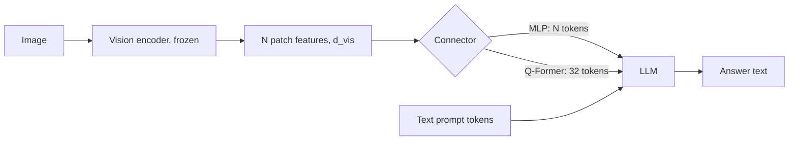

## Où cela s'inscrit

Un LLM purement textuel ([[trf.04]]) ne peut pas regarder une capture d'écran, un graphique ou une photo. Pourtant, la plupart de ce que les gens veulent demander à un assistant implique une image : « qu'est-ce qui cloche dans ce graphique ? », « lis ce ticket de caisse ». La façon la moins coûteuse de donner des yeux à un LLM n'est pas d'entraîner un nouveau modèle de zéro mais de **greffer un encodeur de vision pré-entraîné sur un LLM existant** et d'apprendre à la paire à se parler. Cette leçon porte sur cette greffe : quelles sont les pièces, combien peu il faut entraîner, et surtout combien de **tokens** une image consomme, car ces tokens sont prélevés sur la même fenêtre de contexte et le même budget d'attention ([[trf.01]]) que ton texte. La leçon suivante (adv.02) étend le comptage à des résolutions arbitraires et à la vidéo.

## L'idée en mots simples

Imagine un interprète placé entre un peintre et un romancier. Le peintre (l'**encodeur de vision**) regarde un tableau et dit, dans un vocabulaire privé : « quelque chose de rouge, de rond, en haut à gauche, un objet comme une tasse ». Le romancier (le **LLM**) ne comprend que les mots. L'interprète (le **connecteur**) apprend à traduire le vocabulaire privé du peintre dans celui du romancier, de sorte que le romancier reçoive des « mots » qui représentent le tableau et puisse continuer à écrire.

Deux questions de conception en découlent.

1. **Combien de mots l'interprète doit-il transmettre ?** Une traduction fidèle de chaque petite région du tableau représente des centaines de « mots » par image. Un interprète qui résume pourrait n'en transmettre que trente-deux. Plus de mots signifie plus de détails mais une page plus longue à lire pour le romancier, et le coût de lecture croît plus vite que linéairement.
2. **Combien faut-il réentraîner ?** Le peintre et le romancier sont déjà des experts. La recette économique n'entraîne d'abord que l'interprète (pour que les deux puissent se comprendre), et seulement ensuite laisse le romancier s'adapter à ce nouveau type d'entrée.

## Tokens visuels : l'arithmétique

Un transformer de vision découpe une image $H\times W$ en patchs carrés non chevauchants de côté $p$ pixels (14 ou 16 sont courants). Chaque patch devient un vecteur, donc l'encodeur produit

$$
N_{\text{vis}} = \left\lfloor \frac{H}{p}\right\rfloor \left\lfloor \frac{W}{p}\right\rfloor
$$

embeddings de patchs de dimension $d_{\text{vis}}$ (pour un ViT-L, $d_{\text{vis}}=1024$). Exemples que l'exercice reproduit :

| Réglage de l'encodeur | Patchs |
|---|---|
| patch 14, 224x224 | 16 x 16 = 256 |
| patch 16, 224x224 | 14 x 14 = 196 |
| patch 14, 336x336 | 24 x 24 = 576 |
| patch 14, 1024x768 | 73 x 54 = 3942 (pixels restants abandonnés) |
| patch 32, 1024x768 | 32 x 24 = 768 |

Diviser par deux le côté du patch **quadruple** les tokens, car les deux dimensions de la grille doublent. Doubler le côté de l'image fait de même. C'est pourquoi la résolution est le principal bouton de coût dans un VLM.

Pourquoi ces tokens comptent-ils tant ? Chacun est une position dans le contexte du LLM. Si un prompt textuel a $T$ tokens et que l'image en ajoute $N$, l'auto-attention coûte de l'ordre de $(T+N)^2$ par couche, et le cache KV (leçon [[sys.01]]) croît linéairement en $T+N$ pour chaque couche. Une image de 336 pixels à 576 tokens est une erreur d'arrondi dans une fenêtre de 32k, mais c'est 28 % d'une fenêtre de 2048 tokens, et un lot d'images la multiplie.

## Le connecteur

Entre l'encodeur (dimension de sortie $d_{\text{vis}}$) et le LLM (dimension d'embedding $d_{\text{llm}}$, par exemple 4096) se trouve le connecteur. Deux conceptions dominent.

**Projecteur MLP (LLaVA).** Appliquer le même petit réseau à chaque embedding de patch indépendamment :

$$
Z = \operatorname{GELU}(F W_1 + b_1)\,W_2 + b_2,\qquad F\in\mathbb{R}^{N\times d_{\text{vis}}},\; Z\in\mathbb{R}^{N\times d_{\text{llm}}}.
$$

Il conserve un token par patch (aucun goulot d'étranglement d'information, mais les $N$ tokens entrent tous dans le LLM). Pour $1024\to4096\to4096$, il a $1024\cdot4096+4096+4096\cdot4096+4096 = 20{,}979{,}712$ paramètres, environ 21 M, contre des milliards pour le LLM.

**Q-Former (BLIP-2).** Introduire $n_q$ (par exemple 32) **vecteurs de requête apprenables** $Q_0\in\mathbb{R}^{n_q\times d}$. Ce sont des paramètres ordinaires, identiques pour toute image. On les laisse faire de l'attention croisée sur les caractéristiques des patchs, exactement l'attention de [[trf.01]] mais avec des requêtes issues de l'ensemble appris et des clés et valeurs issues de l'image :

$$
A=\operatorname{softmax}\!\Big(\tfrac{(Q_0W_Q)(FW_K)^\top}{\sqrt{d_k}}\Big)\in\mathbb{R}^{n_q\times N},\qquad \text{out}=A\,(FW_V)\in\mathbb{R}^{n_q\times d_v}.
$$

Chaque ligne de $A$ est une distribution de probabilité sur les patchs, donc chacun des $n_q$ tokens de sortie est une moyenne pondérée de valeurs de patchs : un **résumé** appris. La longueur de sortie est $n_q$ **quel que soit $N$**, et c'est tout l'intérêt. (Le vrai Q-Former empile environ 12 couches de transformer avec auto-attention entre les requêtes et attention croisée vers l'image, environ 188 M de paramètres dans BLIP-2, et laisse aussi le texte interagir avec les requêtes pendant l'étape 1.)

Comme le Q-Former n'a pas d'entrée positionnelle propre, permuter les patchs laisse sa sortie inchangée sauf si les positions étaient déjà intégrées aux caractéristiques des patchs. L'exercice teste cela.



## Recette d'entraînement (style LLaVA)

Le prompt est construit en écrivant un emplacement réservé à l'endroit où va l'image, puis en remplaçant cet emplacement par les tokens projetés : embeddings de texte avant, les $N$ tokens d'image, embeddings de texte après. La longueur de séquence devient $T+N$ et le modèle est entraîné avec la perte ordinaire du token suivant sur la réponse seulement.

1. **Étape 1, alignement.** Geler à la fois l'encodeur et le LLM ; n'entraîner que le projecteur sur des paires image-légende (environ 558 k dans LLaVA). C'est peu coûteux : le projecteur apprend à traduire les caractéristiques visuelles en quelque chose que le LLM gelé traite comme une entrée sensée.
2. **Étape 2, réglage par instructions visuelles.** Garder le projecteur entraînable et aussi fine-tuner le LLM (entièrement ou avec des adaptateurs de bas rang) sur des conversations d'images de style instruction. LLaVA a obtenu environ 158 k tels échanges sans qu'un humain regarde les images : un GPT-4 purement textuel recevait les légendes et les boîtes d'objets de chaque image et devait écrire des conversations, des descriptions et des questions de raisonnement. Ces données sont bruitées (le générateur n'a jamais vu les pixels) mais suffisantes pour débloquer le dialogue.

BLIP-2 entraîne au contraire son Q-Former en deux étapes avec un LLM gelé : l'étape 1 utilise des pertes contrastive, d'appariement et de génération de légendes sans aucun LLM ; l'étape 2 branche les requêtes via une couche linéaire dans un LLM gelé et entraîne avec la perte du modèle de langage. Total entraîné : environ 188 M sur environ 8 Md de paramètres.

Pourquoi la communauté a-t-elle surtout copié la recette plus simple de LLaVA ? Aucune perte intermédiaire spéciale, le LLM peut être remplacé en ne réentraînant que le projecteur, et avec assez de contexte il n'y a pas besoin de compresser. Le véritable avantage du Q-Former est le **nombre de tokens fixe et petit** quand les images sont grandes.

## Dérivation : coût du budget de tokens

Soit un LLM à $L$ couches, de largeur $d$, traitant un prompt de $T$ tokens de texte plus $N$ tokens visuels. Par couche, le calcul des scores d'attention coûte environ $(T+N)^2 d$ multiplications-additions et le bloc feed-forward environ $(T+N)\cdot 8d^2$ (pour une expansion de 4x). Donc

$$
\frac{\text{cost with } N=576}{\text{cost with } N=32}\;\;\xrightarrow{\;T\ll N\;}\;\; \Big(\tfrac{576}{32}\Big)^2 = 324\ \text{for attention},\qquad \tfrac{576}{32}=18\ \text{for the FFN}.
$$

La compression rapporte le plus quand le contexte est le goulot d'étranglement. Quand $T$ est grand, le rapport se réduit, et les ablations dans la littérature (MM1, Idefics2, Prismatic) ont trouvé qu'à **nombre de tokens fixe** le type de connecteur importe à peine (à environ un point près), tandis que l'encodeur de vision, les données et la résolution comptent davantage.

## Exemple détaillé

Image 672x672, patch ViT 14, taille de tuile 336, AnyRes de LLaVA-NeXT avec une grille 2x2 plus une miniature globale.

- Une tuile de 336 : $24\times24=576$ tokens.
- Tuiles : $2\cdot2=4$, plus une miniature : 5 encodages.
- Tokens visuels : $5\cdot576=2880$.
- Ajoute une question de 40 tokens : 2920 tokens dans le contexte. Dans une fenêtre de 4096 tokens, 71 % est de l'image.
- Avec un Q-Former de 32 requêtes par encodage à la place : $5\cdot32=160$ tokens.

Une grille 4x4 sur une image 1344x1344 donne $17\cdot576=9792$ tokens, ce qui remplit l'essentiel d'une fenêtre de 8k. `anyres_tokens` dans l'exercice reproduit ces valeurs.

## Implémentation

```python
import numpy as np

def n_patches(h, w, p):
    return (h // p) * (w // p)

def mlp_projector(F, W1, b1, W2, b2):
    return gelu(F @ W1 + b1) @ W2 + b2          # (N, d_vis) -> (N, d_llm)

def qformer_cross_attention(queries, F, Wq, Wk, Wv):
    Q, K, V = queries @ Wq, F @ Wk, F @ Wv
    s = Q @ K.T / np.sqrt(K.shape[1])            # (n_q, N)
    a = np.exp(s - s.max(1, keepdims=True)); a /= a.sum(1, keepdims=True)
    return a @ V, a                              # (n_q, d_v), (n_q, N)
```

En pratique, tu chargerais une tour de vision CLIP ou SigLIP et un projecteur avec `transformers` de Hugging Face (par exemple les classes LLaVA) et laisserais le processeur insérer le bon nombre de tokens réservés ; la bibliothèque fait exactement ce collage.

## Formes

| Tenseur | Forme |
|---|---|
| image | (3, H, W) |
| caractéristiques de patchs $F$ | (N, d_vis) avec N = floor(H/p) floor(W/p) |
| sortie du projecteur | (N, d_llm) |
| requêtes apprenables | (n_q, d) |
| attention $A$ | (n_q, N), les lignes somment à 1 |
| sortie du Q-Former | (n_q, d_v), puis une application linéaire vers d_llm |
| entrée du LLM | (T + N_vis, d_llm) |

## Évaluation

Comment savoir si un VLM est bon ? Familles typiques : question-réponse visuelle et suites académiques (VQA, OK-VQA, MMMU pour le raisonnement multimodal de niveau universitaire), tâches d'OCR et de documents (DocVQA, graphiques), ancrage (le modèle sait-il désigner une boîte), et sondes d'hallucination (décrit-il des objets qui n'y sont pas). Trois précautions : un score de benchmark mélange le raisonnement textuel du LLM et sa vision (la taille du LLM fixe un plafond), le mélange de données peut compter plus que l'architecture, et les données d'entraînement générées par un LLM peuvent faire fuiter les biais du générateur à la fois dans l'entraînement et dans l'évaluateur. Compare toujours à nombre de tokens visuels et taille de LLM égaux.

## Idées reçues

- **« Le Q-Former voit la question. »** Seule la variante sensible aux instructions (InstructBLIP) injecte l'instruction dans les requêtes ; le résumé du Q-Former simple est indépendant de la question.
- **« Plus de tokens aide toujours. »** Les rendements diminuent ; 64 tokens est trop peu pour du texte dans les images, mais 2000+ aide surtout pour les documents et les graphiques.
- **« C'est le connecteur qui apporte la qualité. »** Les ablations rapportées désignent d'abord l'encodeur, les données et la résolution.
- **« Les tokens visuels sont gratuits parce que l'encodeur est gelé. »** L'encodeur est bon marché ; le LLM doit prêter attention à chaque token visuel à chaque couche, à chaque pas de génération via le cache KV.
- **« LLM gelé signifie pas d'oubli. »** À l'étape 2, le LLM est généralement mis à jour, donc les compétences textuelles peuvent se dégrader sans données textuelles mélangées.

## Points clés à retenir

- Tokens visuels $=\lfloor H/p\rfloor\lfloor W/p\rfloor$ par image encodée ; la taille de patch et la résolution sont des boutons de coût quadratiques.
- Un connecteur transforme les caractéristiques de l'encodeur en tokens de la taille des embeddings du LLM : MLP (un par patch) ou Q-Former (un nombre fixe de résumés appris via l'attention croisée).
- La recette est : aligner d'abord le projecteur, puis faire le réglage par instructions.
- Évalue à budgets de tokens égaux ; le LLM, l'encodeur et les données comptent généralement plus que le connecteur.

## Explique-le toi-même

1. Un collègue dit « nous avons réduit les tokens d'image de 576 à 32, donc l'attention est 18 fois moins chère ». Corrige l'affirmation et dis quand s'applique chaque facteur.
2. Pourquoi un Q-Former peut-il produire le même nombre de tokens pour une image de 224 et une de 1024, et à quoi renonce-t-il ?

## Pour aller plus loin

- BLIP-2 (Li et al., 2023) et LLaVA (Liu et al., 2023), tels que résumés dans les leçons sources ; ablations de MM1 et Idefics2.
- Leçon [[adv.02]] pour les images à résolution arbitraire et la vidéo, [[sys.01]] pour la mémoire du cache KV.

## Critères de maîtrise

Tu sais calculer le nombre de tokens visuels pour toute taille de patch, résolution et disposition AnyRes ; implémenter un projecteur MLP et une attention croisée à requêtes apprenables ; décrire les deux étapes d'entraînement de LLaVA et ce qui est gelé dans chacune ; et argumenter sur le moment où un Q-Former l'emporte sur un projecteur MLP.
