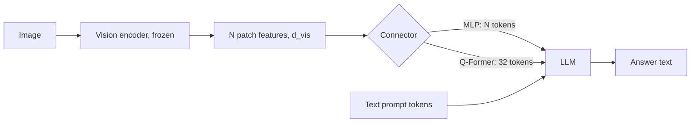

## Where this fits

A text-only LLM ([[trf.04]]) cannot look at a screenshot, a chart or a photo. Yet most of what people want to ask an assistant involves an image: "what is wrong with this plot?", "read this receipt". The cheapest way to give an LLM eyes is not to train a new model from zero but to **bolt a pretrained vision encoder onto an existing LLM** and teach the pair to talk. This lesson is about that bolt: what the pieces are, how little needs to be trained, and above all how many **tokens** an image consumes, because those tokens come out of the same context window and attention budget ([[trf.01]]) as your text. The next lesson (adv.02) extends the counting to arbitrary resolutions and video.

## The idea in plain words

Imagine an interpreter standing between a painter and a novelist. The painter (the **vision encoder**) looks at a picture and says, in a private vocabulary, "something red, round, top left, a thing like a cup". The novelist (the **LLM**) only understands words. The interpreter (the **connector**) learns to translate the painter's private vocabulary into the novelist's vocabulary, so that the novelist receives "words" that stand for the picture and can then continue writing.

Two design questions follow.

1. **How many words should the interpreter hand over?** A faithful translation of every small region of the picture means hundreds of "words" per image. A summarising interpreter might hand over just thirty-two. More words means more detail but a longer page for the novelist to read, and reading cost grows faster than linearly.
2. **How much should be retrained?** Painter and novelist are already experts. The cheap recipe trains only the interpreter first (so the two can understand each other), and only then lets the novelist adapt to the new kind of input.

## Visual tokens: the arithmetic

A vision transformer cuts an $H\times W$ image into non-overlapping square patches of side $p$ pixels (14 or 16 are common). Each patch becomes one vector, so the encoder outputs

$$
N_{\text{vis}} = \left\lfloor \frac{H}{p}\right\rfloor \left\lfloor \frac{W}{p}\right\rfloor
$$

patch embeddings of dimension $d_{\text{vis}}$ (for a ViT-L, $d_{\text{vis}}=1024$). Examples that the exercise reproduces:

| Encoder setting | Patches |
|---|---|
| patch 14, 224x224 | 16 x 16 = 256 |
| patch 16, 224x224 | 14 x 14 = 196 |
| patch 14, 336x336 | 24 x 24 = 576 |
| patch 14, 1024x768 | 73 x 54 = 3942 (remainder pixels dropped) |
| patch 32, 1024x768 | 32 x 24 = 768 |

Halving the patch side **quadruples** the tokens, because both grid dimensions double. Doubling the image side does the same. This is why resolution is the dominant cost knob in a VLM.

Why do these tokens matter so much? Each one is a position in the LLM's context. If a text prompt has $T$ tokens and the image adds $N$, self-attention costs on the order of $(T+N)^2$ per layer, and the KV cache (lesson [[sys.01]]) grows linearly in $T+N$ for every layer. One 336-pixel image at 576 tokens is a rounding error in a 32k window, but it is 28% of a 2048-token window and a batch of images multiplies it.

## The connector

Between the encoder (output dimension $d_{\text{vis}}$) and the LLM (embedding dimension $d_{\text{llm}}$, for example 4096) sits the connector. Two designs dominate.

**MLP projector (LLaVA).** Apply the same small network to every patch embedding independently:

$$
Z = \operatorname{GELU}(F W_1 + b_1)\,W_2 + b_2,\qquad F\in\mathbb{R}^{N\times d_{\text{vis}}},\; Z\in\mathbb{R}^{N\times d_{\text{llm}}}.
$$

It keeps one token per patch (no information bottleneck, but all $N$ tokens enter the LLM). For $1024\to4096\to4096$ it has $1024\cdot4096+4096+4096\cdot4096+4096 = 20{,}979{,}712$ parameters, about 21 M, versus billions for the LLM.

**Q-Former (BLIP-2).** Introduce $n_q$ (for example 32) **learnable query vectors** $Q_0\in\mathbb{R}^{n_q\times d}$. They are ordinary parameters, identical for every image. Let them cross-attend to the patch features, exactly the attention of [[trf.01]] but with queries from the learned set and keys and values from the image:

$$
A=\operatorname{softmax}\!\Big(\tfrac{(Q_0W_Q)(FW_K)^\top}{\sqrt{d_k}}\Big)\in\mathbb{R}^{n_q\times N},\qquad \text{out}=A\,(FW_V)\in\mathbb{R}^{n_q\times d_v}.
$$

Each row of $A$ is a probability distribution over patches, so each of the $n_q$ output tokens is a weighted average of patch values: a learned **summary**. The output length is $n_q$ **whatever $N$ is**, which is the point. (The real Q-Former stacks about 12 transformer layers with self-attention among queries and cross-attention to the image, about 188 M parameters in BLIP-2, and also lets text interact with queries during stage 1.)

Because the Q-Former has no positional input of its own, permuting the patches leaves its output unchanged unless positions were already baked into the patch features. The exercise tests this.



## Training recipe (LLaVA style)

The prompt is built by writing a placeholder where the image goes, then replacing the placeholder by the projected tokens: text embeddings before, the $N$ image tokens, text embeddings after. The sequence length becomes $T+N$ and the model is trained with the ordinary next-token loss on the answer only.

1. **Stage 1, alignment.** Freeze both the encoder and the LLM; train only the projector on image-caption pairs (about 558 k in LLaVA). It is cheap: the projector learns to translate vision features into something the frozen LLM treats as sensible input.
2. **Stage 2, visual instruction tuning.** Keep the projector trainable and also fine-tune the LLM (fully or with low-rank adapters) on instruction-style image conversations. LLaVA obtained about 158 k such turns without a human looking at images: a text-only GPT-4 was given each image's captions and object boxes and asked to write conversations, descriptions and reasoning questions. That data is noisy (the generator never saw the pixels) but sufficient to unlock dialogue.

BLIP-2 instead trains its Q-Former in two stages with a frozen LLM: stage 1 uses contrastive, matching and caption-generation losses without any LLM; stage 2 plugs the queries through a linear layer into a frozen LLM and trains with the language-model loss. Total trained: about 188 M of roughly 8 B parameters.

Why did the community mostly copy LLaVA's simpler recipe? No special intermediate losses, the LLM can be swapped by retraining only the projector, and with enough context there is no need to compress. The Q-Former's genuine advantage is the **fixed, small token count** when images are large.

## Derivation: cost of the token budget

Let the LLM have $L$ layers, width $d$, and process a prompt of $T$ text tokens plus $N$ visual tokens. Per layer, the attention score computation costs about $(T+N)^2 d$ multiply-adds and the feed-forward block about $(T+N)\cdot 8d^2$ (for a 4x expansion). So

$$
\frac{\text{cost with } N=576}{\text{cost with } N=32}\;\;\xrightarrow{\;T\ll N\;}\;\; \Big(\tfrac{576}{32}\Big)^2 = 324\ \text{for attention},\qquad \tfrac{576}{32}=18\ \text{for the FFN}.
$$

Compression pays off most when context is the bottleneck. When $T$ is large the ratio shrinks, and ablations in the literature (MM1, Idefics2, Prismatic) found that at a **fixed token count** the connector type barely matters (within about one point), while the vision encoder, the data and the resolution matter more.

## Worked example

Image 672x672, ViT patch 14, tile size 336, LLaVA-NeXT AnyRes with a 2x2 grid plus a global thumbnail.

- One 336 tile: $24\times24=576$ tokens.
- Tiles: $2\cdot2=4$, plus one thumbnail: 5 encodings.
- Visual tokens: $5\cdot576=2880$.
- Add a 40-token question: 2920 tokens in the context. In a 4096-token window, 71% is image.
- With a Q-Former of 32 queries per encoding instead: $5\cdot32=160$ tokens.

A 4x4 grid on a 1344x1344 image gives $17\cdot576=9792$ tokens, which fills most of an 8k window. `anyres_tokens` in the exercise reproduces these.

## Implementation

```python
import numpy as np

def n_patches(h, w, p):
    return (h // p) * (w // p)

def mlp_projector(F, W1, b1, W2, b2):
    return gelu(F @ W1 + b1) @ W2 + b2          # (N, d_vis) -> (N, d_llm)

def qformer_cross_attention(queries, F, Wq, Wk, Wv):
    Q, K, V = queries @ Wq, F @ Wk, F @ Wv
    s = Q @ K.T / np.sqrt(K.shape[1])            # (n_q, N)
    a = np.exp(s - s.max(1, keepdims=True)); a /= a.sum(1, keepdims=True)
    return a @ V, a                              # (n_q, d_v), (n_q, N)
```

In practice you would load a CLIP or SigLIP vision tower and a projector with Hugging Face `transformers` (for example the LLaVA classes) and let the processor insert the right number of placeholder tokens; the library is doing exactly this splice.

## Shapes

| Tensor | Shape |
|---|---|
| image | (3, H, W) |
| patch features $F$ | (N, d_vis) with N = floor(H/p) floor(W/p) |
| projector output | (N, d_llm) |
| learnable queries | (n_q, d) |
| attention $A$ | (n_q, N), rows sum to 1 |
| Q-Former output | (n_q, d_v), then a linear map to d_llm |
| LLM input | (T + N_vis, d_llm) |

## Evaluation

How do you know a VLM is any good? Typical families: visual question answering and academic suites (VQA, OK-VQA, MMMU for college-level multimodal reasoning), OCR and document tasks (DocVQA, charts), grounding (can the model point to a box), and hallucination probes (does it describe objects that are not there). Three cautions: a benchmark score mixes the LLM's text reasoning with its vision (the LLM size sets a ceiling), the data mix can matter more than the architecture, and LLM-generated training data can leak the generator's biases into both training and the evaluator. Always compare at matched visual-token counts and matched LLM size.

## Common misconceptions

- **"The Q-Former sees the question."** Only the instruction-aware variant (InstructBLIP) feeds the instruction into the queries; the plain Q-Former summary is question-independent.
- **"More tokens always helps."** Returns diminish; 64 tokens is too few for text in images, but 2000+ mostly helps documents and charts.
- **"The connector is where the quality comes from."** Reported ablations point to encoder, data and resolution first.
- **"Visual tokens are free because the encoder is frozen."** The encoder is cheap; the LLM must attend to every visual token on every layer, at every generation step through the KV cache.
- **"Frozen LLM means no forgetting."** In stage 2 the LLM is usually updated, so text skills can degrade without mixed-in text data.

## Key takeaways

- Visual tokens $=\lfloor H/p\rfloor\lfloor W/p\rfloor$ per encoded image; patch size and resolution are quadratic cost knobs.
- A connector turns encoder features into LLM-embedding-sized tokens: MLP (one per patch) or Q-Former (a fixed number of learned summaries via cross-attention).
- The recipe is align the projector first, then instruction-tune.
- Evaluate at matched token budgets; the LLM, encoder and data usually matter more than the connector.

## Explain it yourself

1. A colleague says "we cut the image tokens from 576 to 32, so attention is 18x cheaper". Correct the claim and say when each factor applies.
2. Why can a Q-Former produce the same number of tokens for a 224 and a 1024 image, and what does it give up?

## Further reading

- BLIP-2 (Li et al., 2023) and LLaVA (Liu et al., 2023), as summarised in the source lessons; MM1 and Idefics2 ablations.
- Lesson [[adv.02]] for any-resolution images and video, [[sys.01]] for KV cache memory.

## Mastery criteria

You can compute the visual token count for any patch size, resolution and AnyRes layout; implement an MLP projector and a learnable-query cross-attention; describe the two LLaVA training stages and what is frozen in each; and argue when a Q-Former beats an MLP projector.
