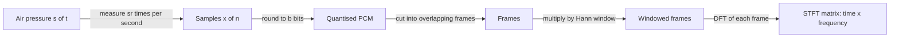

## Où cela s'inscrit

Tout système de reconnaissance vocale, d'étiquetage musical, d'assistant vocal ou de synthèse vocale part de la même matière première : une longue liste de nombres mesurés par un microphone. Avant de pouvoir utiliser le moindre réseau de neurones, tu dois répondre à trois questions pratiques. Combien de nombres par seconde conserve-t-on ? Avec quelle précision stocke-t-on chacun d'eux ? Et comment fait-on apparaître *quelles hauteurs sont présentes, et quand*, car c'est cela, et non la forme brute de l'onde, qui porte le sens. Cette leçon y répond. Elle est le socle de tout le cours d'audio : [[aud.02]] construit les caractéristiques mel sur la STFT que tu implémentes ici, [[aud.03]] classifie des sons avec elles, [[aud.04]] reconnaît la parole à partir d'elles et [[aud.05]] les reconvertit en son.

La transformée de Fourier est traitée en profondeur dans [[mx.02]]. Tu n'en as **pas** besoin pour suivre cette leçon : tout ce que nous utilisons de la transformée de Fourier discrète (DFT) est défini et vérifié ici à partir de zéro.

## L'idée en termes simples

Le son est une pression d'air qui varie dans le temps. Un microphone convertit cette pression en tension ; un convertisseur mesure la tension à des instants régulièrement espacés et note chaque mesure sous la forme d'un nombre entier. C'est tout ce qu'est un enregistrement numérique : **une liste de mesures**. Deux réglages déterminent sa qualité. La fréquence à laquelle tu mesures (la **fréquence d'échantillonnage**) décide des hauteurs que tu peux capturer : mesure trop lentement et les vibrations rapides se font passer pour des lentes, comme les roues de chariot qui semblent tourner à l'envers dans les films. La finesse avec laquelle tu écris chaque mesure (la **profondeur de bits**) décide de l'intensité du souffle inévitable dû à l'arrondi.

Une liste de pressions est une mauvaise description pour une machine, car le même mot prononcé deux fois donne des listes complètement différentes. Ce que perçoit un auditeur, c'est *quelles hauteurs sonnent en ce moment*. Un accord est un mélange de quelques hauteurs stables ; une voyelle parlée est un mélange d'une hauteur et de ses harmoniques. Pour lire les hauteurs dans un signal, nous faisons glisser une courte fenêtre le long de celui-ci et, pour chaque position, nous demandons « quelle quantité de chaque hauteur y a-t-il dans cet extrait ? ». La réponse pour un extrait est un **spectre** ; l'empilement des spectres, un par position de fenêtre, est une image avec le temps sur un axe et la hauteur sur l'autre. Cette image, la **transformée de Fourier à court terme**, est ce que presque tous les modèles audio consomment réellement.

Deux subtilités pratiques complètent le tableau. Découper un extrait brutalement laisse des bords abrupts qui étalent l'énergie sur toutes les hauteurs ; on fait donc entrer et sortir l'extrait en fondu avec une **fenêtre** lisse. Et il existe un compromis inévitable : un extrait court précise *quand* mais brouille *quelle hauteur* ; un extrait long fait l'inverse.



## Échantillonnage

Un signal physique est une fonction du temps continu, $s(t)$. Le mesurer toutes les $T_s = 1/f_s$ secondes donne la suite

$$
x[n] = s\!\left(\frac{n}{f_s}\right),\qquad n = 0,1,2,\dots
$$

où $f_s$ (écrit `sr` dans le code) est la fréquence d'échantillonnage en hertz. Un extrait de $D$ secondes devient un tableau de longueur $D\,f_s$ ; un extrait de 10 secondes à 16 kHz contient 160 000 nombres. Pour reconvertir un indice en temps, utilise $t = n/f_s$. Fréquences typiques : 8 kHz pour le téléphone, 16 kHz pour la reconnaissance vocale, 24 kHz pour la synthèse vocale moderne, 44,1 kHz pour l'audio des CD et la musique, 48 kHz pour le cinéma et l'audio professionnel (leçon 06/01 du dépôt et cours en français, qui donne le format CD comme du PCM 16 bits à 44,1 kHz).

### Repliement spectral : pourquoi il existe une fréquence minimale

Prends un cosinus pur de fréquence $f$ et échantillonne-le :

$$
x[n] = \cos\!\left(2\pi f \frac{n}{f_s}\right).
$$

Ajoute maintenant un multiple entier de la fréquence d'échantillonnage à la fréquence, $f' = f + m f_s$ avec $m$ entier :

$$
\cos\!\left(2\pi (f + m f_s)\frac{n}{f_s}\right)
= \cos\!\left(2\pi f \frac{n}{f_s} + 2\pi m n\right)
= \cos\!\left(2\pi f \frac{n}{f_s}\right),
$$

car $2\pi m n$ est un nombre entier de tours complets. **Les échantillons des deux cosinus sont identiques**, donc après échantillonnage personne ne peut distinguer $f$ de $f + m f_s$. Le cosinus est aussi pair, $\cos(\theta)=\cos(-\theta)$, donc $f$ et $-f$ sont également indiscernables. En combinant les deux faits, un son à $f$ apparaît à

$$
f_{\text{alias}} = \min\big(f \bmod f_s,\; f_s - (f \bmod f_s)\big)\in[0, f_s/2].
$$

Chaque fréquence est repliée dans l'intervalle $[0, f_s/2]$. Cette limite supérieure, $f_s/2$, est la **fréquence de Nyquist**. Le théorème d'échantillonnage (Nyquist-Shannon) énonce la réciproque : un signal dont toutes les fréquences sont inférieures à $f_s/2$ peut être reconstruit exactement à partir de ses échantillons. Le cours en français énonce le théorème dans sa forme à bande limitée, $f_s \ge 2(f_{\max}-f_{\min})$, qui est le même énoncé pour un signal confiné à une bande ; la règle simple pour nous est $f_s > 2 f_{\max}$. En pratique, un filtre passe-bas analogique supprime tout ce qui dépasse Nyquist *avant* l'échantillonnage, et tout rééchantillonneur numérique doit filtrer avant de supprimer des échantillons ; sinon les hautes fréquences se replient sur celles qui t'intéressent.

**Vérification détaillée.** Échantillonner un son de 7 kHz à 10 kHz (Nyquist 5 kHz) : $7000 \bmod 10000 = 7000$, $\min(7000, 3000) = 3000$. Le son apparaît à 3 kHz. De même, `alias_freq(9000, 16000)` vaut 7000.

## Quantification et profondeur de bits

L'échantillonnage discrétise le temps ; la **quantification** discrétise l'amplitude. Avec $b$ bits, il y a $2^b$ niveaux couvrant l'intervalle $[-1,1)$, donc le pas vaut

$$
\Delta = \frac{2}{2^{b}} .
$$

Chaque échantillon est arrondi au centre de son niveau (le schéma *PCM* : échantillonner, quantifier, coder en binaire). L'erreur d'arrondi $e = x - \hat x$ appartient à $[-\Delta/2,\Delta/2]$. Lorsque le signal est assez riche pour que l'erreur se répartisse uniformément sur cet intervalle, sa variance est celle d'une variable uniforme de largeur $\Delta$ :

$$
\sigma_e^2 = \frac{\Delta^2}{12}.
$$

Une sinusoïde d'amplitude $A\le 1$ a une puissance $A^2/2$. Le rapport signal sur bruit de quantification est donc

$$
\mathrm{SNR}=10\log_{10}\frac{A^2/2}{\Delta^2/12}
=10\log_{10}\!\big(1.5\,A^2\,4^{b}\big)
= 6.02\,b + 1.76 + 20\log_{10}A \ \text{dB}.
$$

L'étape utilise $\Delta^2 = 4^{1-b}$, d'où $\frac{A^2/2}{4^{1-b}/12}=6A^2\,4^{b-1}=1.5A^2 4^b$, et $10\log_{10}4 = 6.02$. **Chaque bit supplémentaire rapporte environ 6 dB.** L'audio en 16 bits a donc un SNR d'environ 96 dB pour une sinusoïde pleine échelle, ce qui explique pourquoi c'est le format d'échange universel ; le code des réseaux de neurones travaille sur des flottants 32 bits dans $[-1,1]$, qui sont simplement l'entier divisé par 32768.

## Exemple détaillé 1 : échantillonnage et quantification

Tous les nombres ci-dessous sont reproduits par le code de l'exercice (`quantize`, `alias_freq`, `stft`).

| Grandeur | Valeur |
|---|---|
| 10 s à 16 kHz | 160 000 échantillons |
| trame 400, saut 160 sur 10 s | $1+\lfloor(160000-400)/160\rfloor = 998$ trames |
| son de 7 kHz échantillonné à 10 kHz | apparaît à 3000 Hz |
| `quantize(0.3, 3 bits)` | pas $2/8=0.25$, donc $0.375$ |
| SNR d'une sinusoïde d'amplitude $0.8$ à 1234,5 Hz, 8 bits | $48.02$ dB mesurés, formule $6.02\cdot8+1.76+20\log_{10}0.8=47.98$ dB |
| idem, 16 bits | $96.11$ dB mesurés, formule $96.14$ dB |

Attention : la formule exige que l'erreur ressemble à du hasard. Un son exactement à 1000 Hz échantillonné à 16 kHz se répète toutes les 16 échantillons, donc son erreur de quantification se répète aussi et le SNR mesuré s'écarte de plus d'un décibel de la formule. Nous avons utilisé 1234,5 Hz ci-dessus pour éviter cela.

## La transformée de Fourier discrète, à partir de zéro

Prends $N$ échantillons consécutifs $x[0],\dots,x[N-1]$. La DFT est la liste de $N$ nombres complexes

$$
X[k]=\sum_{n=0}^{N-1} x[n]\,e^{-i\,2\pi k n/N},\qquad k=0,\dots,N-1 .
$$

Lis-la comme une question : *dans quelle mesure le signal ressemble-t-il à une sinusoïde complexe qui effectue exactement $k$ tours sur les $N$ échantillons ?* La somme multiplie le signal par cette sinusoïde, échantillon par échantillon, et additionne. Si le signal contient une telle sinusoïde, les produits s'alignent et la somme est grande ; sinon, les contributions positives et négatives s'annulent.

**Quelle fréquence est le bin $k$ ?** La sinusoïde de référence effectue $k$ tours en $N/f_s$ secondes, donc sa fréquence est

$$
f_k = k\,\frac{f_s}{N}\ \text{Hz},
$$

et l'espacement entre bins voisins, la **résolution fréquentielle**, est $f_s/N$. Avec $N=512$ à 16 kHz, cela fait $31.25$ Hz ; avec $N=400$, $40$ Hz. Des extraits plus longs donnent une résolution plus fine.

**Module et phase.** $|X[k]|$ indique quelle quantité de la fréquence $f_k$ est présente ; $\arg X[k]$ indique à quel endroit de son cycle la sinusoïde démarre. Les modules sont ce qu'utilisent les modèles à base de spectrogrammes. La phase compte pour retransformer un spectrogramme en son ([[aud.05]]).

**Les signaux réels ont une moitié redondante.** Pour $x$ réel, $X[N-k]=\overline{X[k]}$ (conjugué complexe), donc la moitié supérieure du spectre n'apporte aucune information nouvelle. Les bibliothèques ne conservent que les bins $0,\dots,N/2$, soit $N/2+1$ nombres ; NumPy appelle cela `np.fft.rfft`. Le bin $N/2$ se situe à la fréquence de Nyquist.

**Vérification sur un bin exact.** Un son $A\sin(2\pi f t)$ avec $f=1000$ Hz, échantillonné à 16 kHz, $N=512$, tombe exactement sur le bin $k=1000\cdot512/16000=32$. Le module au pic vaut $A N/2 = 0.8\cdot256=204.8$ (la moitié de l'amplitude va dans le bin miroir $N-32$). La FFT calcule les mêmes $N$ nombres que la double somme en $O(N\log N)$ opérations au lieu de $O(N^2)$ ; l'exercice confirme qu'une version matricielle naïve $N\times N$ donne des valeurs identiques.

## Trames et fenêtres

Un extrait entier est un seul énorme morceau ; une unique DFT de celui-ci te dit quelles hauteurs apparaissent *quelque part* mais pas *quand*. La parole change toutes les dix millisecondes environ, donc nous découpons l'extrait en **trames** de $N$ échantillons, en avançant d'un **saut** de $H$ échantillons entre deux trames. Pour un signal de longueur $L$, le nombre de trames complètes est

$$
T = 1 + \left\lfloor \frac{L-N}{H} \right\rfloor .
$$

Choix courant pour la parole : trame de 25 ms et saut de 10 ms ; à 16 kHz, cela donne $N=400$, $H=160$.

### Pourquoi une fenêtre

Découper une trame revient à multiplier le signal par un rectangle valant 1 dans la trame et 0 en dehors. La DFT suppose que la trame se répète indéfiniment ; à moins que le son n'effectue un nombre entier de tours, le saut à l'endroit où la fin rejoint le début est un bord abrupt, et un bord abrupt contient toutes les fréquences. Le résultat est la **fuite spectrale** : l'énergie d'un son pur se répand dans des bins éloignés.

Le remède consiste à atténuer la trame jusqu'à zéro aux deux extrémités avec une **fenêtre** lisse $w[n]$. La fenêtre de Hann est

$$
w[n]=\tfrac12-\tfrac12\cos\!\left(\frac{2\pi n}{N}\right),\qquad n=0,\dots,N-1 .
$$

(C'est la forme *périodique* utilisée pour la STFT. La forme *symétrique* divise par $N-1$ au lieu de $N$ ; `np.hanning` de NumPy est symétrique, alors que `torch.hann_window` et `scipy.signal.get_window` sont périodiques par défaut. Utiliser la mauvaise est une source modeste mais réelle de divergences quand tu compares tes caractéristiques à celles d'une bibliothèque.)

**Exemple détaillé 2 : la fuite.** Prends une sinusoïde unitaire à 1010 Hz (entre les bins 32 et 33 : $1010\cdot512/16000=32.3$), $N=512$, $f_s=16$ kHz. Compare le module à quatre bins du pic, relativement au pic, avec et sans fenêtre :

| fenêtre | pic (bin 32) | bin 28 | bin 28 / pic |
|---|---|---|---|
| rectangle | 215.06 | 16.02 | $7.4\%$ (environ $-22.6$ dB) |
| Hann | 119.77 | 0.45 | $0.38\%$ (environ $-48.5$ dB) |

La fenêtre de Hann fuit environ 20 fois moins. Le prix : son lobe principal est plus large (le son s'étale sur environ quatre bins au lieu de deux), et elle jette l'énergie aux bords des trames. C'est acceptable car les trames se chevauchent : avec un saut $H=N/2$ ou $N/4$, les fenêtres de Hann décalées s'additionnent exactement à 1, une propriété appelée **recouvrement-addition constant (COLA)**. Vérifie pour $N=8$, $H=4$ : $w[n]+w[n+4]=1$ pour tout $n$. COLA est ce qui permet à [[aud.05]] de reconstruire une forme d'onde à partir de trames qui se chevauchent.

## La transformée de Fourier à court terme

Assemblons le tout. Pour l'indice de trame $t=0,\dots,T-1$ et le bin $k=0,\dots,N/2$ :

$$
X[t,k]=\sum_{n=0}^{N-1} w[n]\,x[tH+n]\,e^{-i\,2\pi k n/N}.
$$

Son module $|X[t,k]|$, vu comme une image avec $t$ sur l'axe horizontal et $f_k$ sur l'axe vertical, est le spectrogramme (le cours en français l'appelle *sonagramme* ; il note qu'un simple spectre cache l'information temporelle et que faire glisser la fenêtre la restitue). Tailles courantes : un `n_fft` de 512 à 16 kHz donne 257 bins de fréquence de 0 à 8 kHz.

**Compromis temps-fréquence.** Une trame dure $N/f_s$ secondes et résout des fréquences distantes de $f_s/N$ : le produit des deux vaut exactement 1. Doubler la fenêtre divise par deux l'espacement en fréquence mais divise par deux la précision temporelle. La parole utilise ~25 ms parce que c'est assez court pour figer un phonème et assez long (résolution de 40 Hz) pour séparer les harmoniques d'une voix dont la hauteur est d'environ 100-250 Hz. L'analyse musicale utilise souvent des fenêtres plus longues, la détection de coups de batterie des fenêtres plus courtes. Compléter une trame par des zéros jusqu'à un `n_fft` plus grand interpole le spectre mais n'ajoute aucune résolution réelle.

## Implémentation

```python
import numpy as np

def hann(N):
    n = np.arange(N)
    return 0.5 - 0.5 * np.cos(2 * np.pi * n / N)           # periodic Hann

def frame_signal(x, frame_len, hop):
    n = 1 + (len(x) - frame_len) // hop                     # number of full frames
    idx = np.arange(frame_len)[None, :] + hop * np.arange(n)[:, None]
    return x[idx]                                            # (n, frame_len)

def stft(x, n_fft, hop):
    frames = frame_signal(x, n_fft, hop) * hann(n_fft)       # broadcast window
    return np.fft.rfft(frames, axis=1)                       # (n, n_fft//2 + 1), complex

def quantize(x, bits):
    L = 2 ** bits
    step = 2.0 / L
    q = np.clip(np.floor(x / step), -L // 2, L // 2 - 1)
    return (q + 0.5) * step

def alias_freq(f, sr):
    r = f % sr
    return min(r, sr - r)
```

L'astuce d'indexation dans `frame_signal` construit une matrice d'entiers $(T, N)$ de positions, de sorte que tout le découpage en trames se fait en une seule opération d'indexation avancée, sans boucle Python.

### Formes

| Objet | Forme |
|---|---|
| forme d'onde `x` | `(L,)` |
| trames | `(T, N)` avec $T = 1+\lfloor (L-N)/H\rfloor$ |
| fenêtre | `(N,)`, diffusée sur les lignes |
| STFT (complexe) | `(T, N//2 + 1)` |
| module du spectrogramme | `(T, N//2 + 1)` réel, positif ou nul |

1 s à 16 kHz avec `n_fft=512, hop=160` donne `(97, 257)` ; avec une trame de 400, `(98, 201)` bins à `n_fft=400`.

## Ce que font les bibliothèques de production

`librosa.stft` et `torch.stft` effectuent le même calcul avec des FFT, complètent éventuellement le signal d'une demi-fenêtre aux deux extrémités (`center=True`) pour que la trame $t$ soit centrée sur l'échantillon $tH$, et gèrent les lots et les GPU. `torchaudio` fournit un rééchantillonnage avec un vrai filtre anti-repliement et `soundfile` lit les fichiers dans des tableaux float32 dans $[-1,1]$. La règle qui compte en pratique : *vérifie d'abord la fréquence d'échantillonnage*. Un modèle entraîné sur de l'audio à 16 kHz alimenté avec de l'audio à 44,1 kHz ne lève aucune erreur, il renvoie simplement n'importe quoi.

## Idées reçues courantes

- **« Plus de bits ou une fréquence plus élevée, c'est toujours mieux. »** Les deux coûtent de la mémoire et du calcul ; la reconnaissance vocale utilise 16 kHz parce que la parole ne contient presque rien au-dessus de 8 kHz pour cette tâche.
- **« Sous-échantillonner, c'est juste prendre un échantillon sur trois. »** Sans filtre passe-bas préalable, tout ce qui est au-dessus de la nouvelle fréquence de Nyquist se replie dans la bande. Utilise toujours un vrai rééchantillonneur.
- **« La FFT exige une puissance de deux. »** Des algorithmes rapides existent pour toute longueur ; les puissances de deux sont simplement les plus rapides.
- **« Le spectrogramme de module contient toute l'information du signal. »** Il écarte la phase, donc la forme d'onde exacte ne peut pas en être récupérée sans estimer la phase ([[aud.05]]).
- **« La fenêtre de Hann est sans perte. »** Elle atténue les bords des trames ; c'est pourquoi des trames qui se chevauchent sont nécessaires.
- **« Le bin de fréquence $k$ vaut $k$ Hz. »** Il vaut $k\,f_s/N$ Hz.

## Points clés à retenir

- Un enregistrement est $x[n]=s(n/f_s)$ ; les fréquences au-dessus de $f_s/2$ se replient à $f \bmod f_s$ ramené dans $[0,f_s/2]$.
- La quantification sur $b$ bits ajoute un bruit de variance $\Delta^2/12$ et donne environ $6.02\,b + 1.76$ dB de SNR.
- Le bin $k$ de la DFT est la fréquence $k f_s/N$ ; les signaux réels n'ont besoin que de $N/2+1$ bins ; la résolution est $f_s/N$.
- Des trames de $N$ échantillons avec un saut $H$ sont au nombre de $1+\lfloor (L-N)/H\rfloor$ ; une fenêtre de Hann réduit la fuite d'environ un ordre de grandeur et satisfait COLA pour un saut de $N/2$ ou $N/4$.
- La STFT est une matrice complexe `(trames, bins)` ; les résolutions temporelle et fréquentielle se font concurrence.

## Explique-le toi-même

1. Un ami dit : « mon modèle 16 kHz sonne faux sur un enregistrement fait à 44,1 kHz alors que je n'ai rien changé au code. » Explique, avec l'argument du repliement, pourquoi prendre simplement un échantillon sur 3 serait aussi une erreur.
2. Explique avec tes propres mots pourquoi multiplier une trame par une fenêtre de Hann réduit la fuite mais élargit le pic.

## Pour aller plus loin

- Leçons du dépôt : `ai-engineering-from-scratch` phase 06, leçons 01 et 02 (choix de bibliothèques et pièges de fréquence d'échantillonnage).
- Smith, *The Scientist and Engineer's Guide to Digital Signal Processing* (libre en ligne), chapitres sur l'échantillonnage et la DFT, si tu veux le point de vue du traitement du signal.
- La leçon sur Fourier [[mx.02]] pour la transformée continue et toute la théorie derrière la DFT.

## Critères de maîtrise

Tu sais (a) prédire l'alias de n'importe quel son pour une fréquence d'échantillonnage donnée, (b) démontrer la règle des 6 dB par bit, (c) calculer le nombre de trames, de bins et la fréquence d'un bin pour des $L, N, H, f_s$ donnés, (d) expliquer la fuite et pourquoi la fenêtre de Hann aide, et (e) écrire `frame_signal`, `hann` et `stft` en NumPy et les vérifier face à une DFT naïve.
