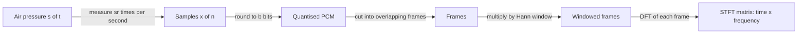

## Where this fits

Every speech recogniser, music tagger, voice assistant and text-to-speech system starts from the same raw material: a long list of numbers measured by a microphone. Before any neural network can be used you must answer three practical questions. How many numbers per second do I keep? How precisely do I store each one? And how do I expose *which pitches are present, and when*, because that, not the raw wiggle, is what carries meaning. This lesson answers them. It is the foundation of the whole audio course: [[aud.02]] builds mel features on top of the STFT you implement here, [[aud.03]] classifies sounds with them, [[aud.04]] recognises speech from them and [[aud.05]] inverts them back to sound.

The Fourier transform is treated in depth in [[mx.02]]. You do **not** need it to follow this lesson: everything about the discrete Fourier transform (DFT) that we use is defined and checked here from scratch.

## The idea in plain words

Sound is air pressure changing over time. A microphone turns that pressure into a voltage; a converter measures the voltage at evenly spaced instants and writes each measurement down as a whole number. That is all a digital recording is: **a list of measurements**. Two knobs set its quality. How often you measure (the **sampling rate**) decides which pitches you can capture: measure too slowly and fast vibrations masquerade as slow ones, like the wagon wheels that seem to turn backwards in films. How finely you write each measurement (the **bit depth**) decides how loud the unavoidable rounding hiss is.

A list of pressures is a poor description for a machine, because the same word spoken twice gives completely different lists. What a listener perceives is *which pitches are sounding right now*. A chord is a mixture of a few steady pitches; a spoken vowel is a mixture of a pitch and its overtones. To read pitches off a signal we slide a short window along it, and for each position ask "how much of each pitch is in this snippet?" The answer for one snippet is a **spectrum**; the stack of spectra, one per window position, is a picture with time on one axis and pitch on the other. That picture, the **short-time Fourier transform**, is what almost every audio model really consumes.

Two practical subtleties complete the picture. Cutting a snippet out abruptly leaves sharp edges that smear energy across all pitches, so we fade the snippet in and out with a smooth **window**. And there is an unavoidable trade: a short snippet pins down *when* but blurs *which pitch*; a long snippet does the opposite.



## Sampling

A physical signal is a function of continuous time, $s(t)$. Measuring it every $T_s = 1/f_s$ seconds gives the sequence

$$
x[n] = s\!\left(\frac{n}{f_s}\right),\qquad n = 0,1,2,\dots
$$

where $f_s$ (written `sr` in code) is the sampling rate in hertz. A clip of $D$ seconds becomes an array of length $D\,f_s$; a 10-second clip at 16 kHz has 160 000 numbers. To convert an index back to time use $t = n/f_s$. Typical rates: 8 kHz telephone, 16 kHz speech recognition, 24 kHz modern text-to-speech, 44.1 kHz CD audio and music, 48 kHz film and professional audio (repo lesson 06/01 and the French course, which gives the CD format as 16-bit PCM at 44.1 kHz).

### Aliasing: why a minimum rate exists

Take a pure cosine of frequency $f$ and sample it:

$$
x[n] = \cos\!\left(2\pi f \frac{n}{f_s}\right).
$$

Now add a whole multiple of the sampling rate to the frequency, $f' = f + m f_s$ with $m$ an integer:

$$
\cos\!\left(2\pi (f + m f_s)\frac{n}{f_s}\right)
= \cos\!\left(2\pi f \frac{n}{f_s} + 2\pi m n\right)
= \cos\!\left(2\pi f \frac{n}{f_s}\right),
$$

because $2\pi m n$ is a whole number of full turns. **The samples of the two cosines are identical**, so after sampling nobody can tell $f$ from $f + m f_s$. Cosine is also even, $\cos(\theta)=\cos(-\theta)$, so $f$ and $-f$ are indistinguishable too. Putting both facts together, a tone at $f$ shows up at

$$
f_{\text{alias}} = \min\big(f \bmod f_s,\; f_s - (f \bmod f_s)\big)\in[0, f_s/2].
$$

Every frequency is folded into the interval $[0, f_s/2]$. That upper limit, $f_s/2$, is the **Nyquist frequency**. The sampling theorem (Nyquist-Shannon) states the converse: a signal whose frequencies all lie below $f_s/2$ can be reconstructed exactly from its samples. The French course states the theorem in its band-limited form, $f_s \ge 2(f_{\max}-f_{\min})$, which is the same statement for a signal confined to a band; the simple rule for us is $f_s > 2 f_{\max}$. In practice an analogue low-pass filter removes everything above Nyquist *before* sampling, and any digital resampler must filter before it drops samples; otherwise high frequencies fold down on top of the ones you care about.

**Worked check.** Sampling a 7 kHz tone at 10 kHz (Nyquist 5 kHz): $7000 \bmod 10000 = 7000$, $\min(7000, 3000) = 3000$. The tone appears at 3 kHz. Likewise `alias_freq(9000, 16000)` is 7000.

## Quantisation and bit depth

Sampling discretises time; **quantisation** discretises amplitude. With $b$ bits there are $2^b$ levels covering the range $[-1,1)$, so the step is

$$
\Delta = \frac{2}{2^{b}} .
$$

Each sample is rounded to the centre of its level (the *PCM* scheme: sample, quantise, code in binary). The rounding error $e = x - \hat x$ lies in $[-\Delta/2,\Delta/2]$. When the signal is busy enough that the error is spread evenly over that interval, its variance is the variance of a uniform variable of width $\Delta$:

$$
\sigma_e^2 = \frac{\Delta^2}{12}.
$$

A sine of amplitude $A\le 1$ has power $A^2/2$. The signal-to-quantisation-noise ratio is therefore

$$
\mathrm{SNR}=10\log_{10}\frac{A^2/2}{\Delta^2/12}
=10\log_{10}\!\big(1.5\,A^2\,4^{b}\big)
= 6.02\,b + 1.76 + 20\log_{10}A \ \text{dB}.
$$

The step uses $\Delta^2 = 4^{1-b}$, hence $\frac{A^2/2}{4^{1-b}/12}=6A^2\,4^{b-1}=1.5A^2 4^b$, and $10\log_{10}4 = 6.02$. **Every extra bit buys about 6 dB.** 16-bit audio therefore has an SNR of roughly 96 dB for a full-scale sine, which is why it is the universal exchange format; neural network code works on 32-bit floats in $[-1,1]$, which is just the integer divided by 32768.

## Worked example 1: sampling and quantisation

All numbers below are reproduced by the exercise code (`quantize`, `alias_freq`, `stft`).

| Quantity | Value |
|---|---|
| 10 s at 16 kHz | 160 000 samples |
| frame 400, hop 160 over 10 s | $1+\lfloor(160000-400)/160\rfloor = 998$ frames |
| 7 kHz tone sampled at 10 kHz | appears at 3000 Hz |
| `quantize(0.3, 3 bits)` | step $2/8=0.25$, so $0.375$ |
| SNR of a $0.8$-amplitude, 1234.5 Hz sine, 8 bits | measured $48.02$ dB, formula $6.02\cdot8+1.76+20\log_{10}0.8=47.98$ dB |
| same, 16 bits | measured $96.11$ dB, formula $96.14$ dB |

Careful: the formula needs the error to look random. A tone exactly at 1000 Hz sampled at 16 kHz repeats every 16 samples, so its quantisation error repeats too and the measured SNR deviates by more than a decibel from the formula. We used 1234.5 Hz above to avoid that.

## The discrete Fourier transform, from scratch

Take $N$ consecutive samples $x[0],\dots,x[N-1]$. The DFT is the list of $N$ complex numbers

$$
X[k]=\sum_{n=0}^{N-1} x[n]\,e^{-i\,2\pi k n/N},\qquad k=0,\dots,N-1 .
$$

Read it as a question: *how well does the signal match a complex sinusoid that completes exactly $k$ turns over the $N$ samples?* The sum multiplies the signal by that sinusoid, sample by sample, and adds up. If the signal contains such a sinusoid the products line up and the sum is large; if not, positive and negative contributions cancel.

**Which frequency is bin $k$?** The reference sinusoid completes $k$ turns in $N/f_s$ seconds, so its frequency is

$$
f_k = k\,\frac{f_s}{N}\ \text{Hz},
$$

and the spacing between neighbouring bins, the **frequency resolution**, is $f_s/N$. With $N=512$ at 16 kHz that is $31.25$ Hz; with $N=400$ it is $40$ Hz. Longer snippets mean finer resolution.

**Magnitude and phase.** $|X[k]|$ says how much of frequency $f_k$ is present; $\arg X[k]$ says where in its cycle the sinusoid starts. Magnitudes are what spectrogram-based models use. The phase matters for turning a spectrogram back into sound ([[aud.05]]).

**Real signals have a redundant half.** For real $x$, $X[N-k]=\overline{X[k]}$ (complex conjugate), so the upper half of the spectrum carries no new information. Libraries keep only bins $0,\dots,N/2$, that is $N/2+1$ numbers; NumPy calls this `np.fft.rfft`. Bin $N/2$ sits at the Nyquist frequency.

**Exact-bin check.** A tone $A\sin(2\pi f t)$ with $f=1000$ Hz, sampled at 16 kHz, $N=512$ falls exactly on bin $k=1000\cdot512/16000=32$. The peak magnitude there is $A N/2 = 0.8\cdot256=204.8$ (half the amplitude goes to the mirror bin $N-32$). The FFT computes the same $N$ numbers as the double sum in $O(N\log N)$ instead of $O(N^2)$ operations; the exercise confirms that a naive $N\times N$ matrix version gives identical values.

## Frames and windows

An entire clip is one huge snippet; a single DFT of it tells you which pitches occur *somewhere* but not *when*. Speech changes every ten milliseconds or so, so we cut the clip into **frames** of $N$ samples, advancing by a **hop** of $H$ samples between frames. For a signal of length $L$ the number of complete frames is

$$
T = 1 + \left\lfloor \frac{L-N}{H} \right\rfloor .
$$

Common choice for speech: frame 25 ms and hop 10 ms; at 16 kHz that is $N=400$, $H=160$.

### Why a window

Cutting a frame out is the same as multiplying the signal by a rectangle that is 1 inside the frame and 0 outside. The DFT assumes the frame repeats forever; unless the tone completes a whole number of turns, the jump where the end meets the start is a sharp edge, and a sharp edge contains every frequency. The result is **spectral leakage**: energy of a pure tone spills into distant bins.

The remedy is to taper the frame to zero at both ends with a smooth **window** $w[n]$. The Hann window is

$$
w[n]=\tfrac12-\tfrac12\cos\!\left(\frac{2\pi n}{N}\right),\qquad n=0,\dots,N-1 .
$$

(This is the *periodic* form used for the STFT. The *symmetric* form divides by $N-1$ instead of $N$; NumPy's `np.hanning` is symmetric, while `torch.hann_window` and `scipy.signal.get_window` are periodic by default. Using the wrong one is a small but real source of mismatches when you compare your features to a library.)

**Worked example 2: leakage.** Take a unit sine at 1010 Hz (between bins 32 and 33: $1010\cdot512/16000=32.3$), $N=512$, $f_s=16$ kHz. Compare the magnitude four bins away from the peak, relative to the peak, with and without the window:

| window | peak (bin 32) | bin 28 | bin 28 / peak |
|---|---|---|---|
| rectangle | 215.06 | 16.02 | $7.4\%$ (about $-22.6$ dB) |
| Hann | 119.77 | 0.45 | $0.38\%$ (about $-48.5$ dB) |

The Hann window leaks about 20 times less. The price: its main lobe is wider (the tone smears over about four bins instead of two), and it throws away the energy at the frame edges. That is acceptable because frames overlap: with hop $H=N/2$ or $N/4$, the shifted Hann windows add up to exactly 1, a property called **constant overlap-add (COLA)**. Check for $N=8$, $H=4$: $w[n]+w[n+4]=1$ for every $n$. COLA is what lets [[aud.05]] rebuild a waveform from overlapping frames.

## The short-time Fourier transform

Put it together. For frame index $t=0,\dots,T-1$ and bin $k=0,\dots,N/2$:

$$
X[t,k]=\sum_{n=0}^{N-1} w[n]\,x[tH+n]\,e^{-i\,2\pi k n/N}.
$$

Its magnitude $|X[t,k]|$ as an image with $t$ along the horizontal axis and $f_k$ on the vertical is the spectrogram (the French course calls it the *sonagramme*; it notes that a plain spectrum hides the temporal information and that sliding the window recovers it). Common sizes: an `n_fft` of 512 at 16 kHz gives 257 frequency bins from 0 to 8 kHz.

**Time-frequency trade-off.** A frame lasts $N/f_s$ seconds and resolves frequencies $f_s/N$ apart: the product of the two is exactly 1. Doubling the window halves the frequency spacing but halves the time precision. Speech uses ~25 ms because that is short enough to freeze one phoneme and long enough (40 Hz resolution) to separate the harmonics of a voice pitched around 100-250 Hz. Music analysis often uses longer windows, detecting drum hits shorter ones. Zero-padding a frame to a larger `n_fft` interpolates the spectrum but adds no real resolution.

## Implementation

```python
import numpy as np

def hann(N):
    n = np.arange(N)
    return 0.5 - 0.5 * np.cos(2 * np.pi * n / N)           # periodic Hann

def frame_signal(x, frame_len, hop):
    n = 1 + (len(x) - frame_len) // hop                     # number of full frames
    idx = np.arange(frame_len)[None, :] + hop * np.arange(n)[:, None]
    return x[idx]                                            # (n, frame_len)

def stft(x, n_fft, hop):
    frames = frame_signal(x, n_fft, hop) * hann(n_fft)       # broadcast window
    return np.fft.rfft(frames, axis=1)                       # (n, n_fft//2 + 1), complex

def quantize(x, bits):
    L = 2 ** bits
    step = 2.0 / L
    q = np.clip(np.floor(x / step), -L // 2, L // 2 - 1)
    return (q + 0.5) * step

def alias_freq(f, sr):
    r = f % sr
    return min(r, sr - r)
```

The index trick in `frame_signal` builds a $(T, N)$ integer matrix of positions, so the whole framing is one fancy-indexing operation with no Python loop.

### Shapes

| Object | Shape |
|---|---|
| waveform `x` | `(L,)` |
| frames | `(T, N)` with $T = 1+\lfloor (L-N)/H\rfloor$ |
| window | `(N,)`, broadcast over rows |
| STFT (complex) | `(T, N//2 + 1)` |
| spectrogram magnitude | `(T, N//2 + 1)` real, non-negative |

1 s at 16 kHz with `n_fft=512, hop=160` gives `(97, 257)`; with frame 400, `(98, 201)` bins at `n_fft=400`.

## What the production libraries do

`librosa.stft` and `torch.stft` do the same computation with FFTs, optionally pad the signal by half a window at both ends (`center=True`) so that frame $t$ is centred on sample $tH$, and handle batches and GPUs. `torchaudio` provides resampling with a proper anti-aliasing filter and `soundfile` reads files into float32 arrays in $[-1,1]$. The rule that matters in practice: *check the sample rate first*. A model trained on 16 kHz audio fed 44.1 kHz audio does not raise an error, it just returns garbage.

## Common misconceptions

- **"More bits or a higher rate is always better."** Both cost memory and compute; speech recognition uses 16 kHz because speech carries almost nothing above 8 kHz for the task.
- **"Downsampling is just taking every third sample."** Without a low-pass filter first, everything above the new Nyquist frequency folds into the band. Always use a proper resampler.
- **"The FFT needs a power of two."** Fast algorithms exist for any length; powers of two are merely fastest.
- **"The magnitude spectrogram contains all information in the signal."** It discards phase, so the exact waveform cannot be recovered from it without estimating the phase ([[aud.05]]).
- **"The Hann window is lossless."** It attenuates the frame edges; that is why overlapping frames are needed.
- **"Frequency bin $k$ is $k$ Hz."** It is $k\,f_s/N$ Hz.

## Key takeaways

- A recording is $x[n]=s(n/f_s)$; frequencies above $f_s/2$ alias to $f \bmod f_s$ folded into $[0,f_s/2]$.
- Quantisation to $b$ bits adds noise of variance $\Delta^2/12$ and gives about $6.02\,b + 1.76$ dB of SNR.
- The DFT bin $k$ is the frequency $k f_s/N$; real signals need only $N/2+1$ bins; resolution is $f_s/N$.
- Frames of $N$ samples with hop $H$ number $1+\lfloor (L-N)/H\rfloor$; a Hann window cuts leakage by roughly an order of magnitude and satisfies COLA at hop $N/2$ or $N/4$.
- The STFT is a `(frames, bins)` complex matrix; time and frequency resolution trade against each other.

## Explain it yourself

1. A friend says "my 16 kHz model sounds wrong on a recording made at 44.1 kHz even though I did not change any code." Explain, with the aliasing argument, why simply taking every 3rd sample would also be wrong.
2. Explain in your own words why multiplying a frame by a Hann window reduces leakage but widens the peak.

## Further reading

- Repo lessons: `ai-engineering-from-scratch` phase 06, lessons 01 and 02 (library choices and sample-rate pitfalls).
- Smith, *The Scientist and Engineer's Guide to Digital Signal Processing* (free online), chapters on sampling and the DFT, if you want the signal-processing view.
- The Fourier lesson [[mx.02]] for the continuous transform and the full theory behind the DFT.

## Mastery criteria

You can (a) predict the alias of any tone for a given sample rate, (b) derive the 6 dB-per-bit rule, (c) compute the number of frames, bins and the frequency of a bin for given $L, N, H, f_s$, (d) explain leakage and why the Hann window helps, and (e) write `frame_signal`, `hann` and `stft` in NumPy and verify them against a naive DFT.
