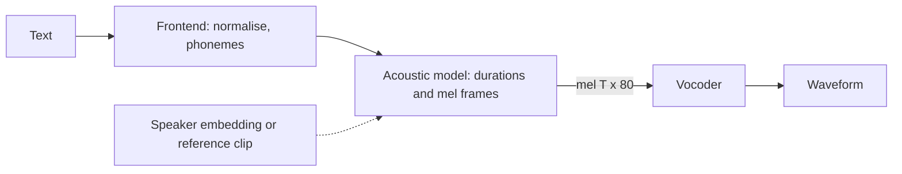

## Où cela s'inscrit

La reconnaissance ([[aud.04]]) transforme le son en texte ; la synthèse va dans l'autre sens. Un assistant vocal, un livre audio, un lecteur d'écran, un film doublé et, malheureusement, un appel téléphonique frauduleux ont tous besoin que du texte devienne une forme d'onde convaincante. Le pipeline de synthèse réutilise tout ce qui figure dans ce cours : le spectrogramme mel de [[aud.02]] en est la représentation centrale, la STFT de [[aud.01]] est ce qu'un vocodeur doit inverser, les encodeurs et décodeurs transformer des leçons sur les séquences construisent le modèle acoustique, et le taux d'erreur sur les mots de [[aud.04]] est la façon de vérifier l'intelligibilité. La leçon se termine par la partie qui n'est pas que de l'ingénierie : cloner la voix de quelqu'un à partir de quelques secondes d'audio, et les garde-fous dont les systèmes responsables ont besoin.

## L'idée en termes simples

Lire à voix haute, ce sont trois métiers. D'abord tu détermines **quoi dire** : développer « Dr. Smith, 2026 » en mots et en sons. Ensuite tu décides **comment cela doit sonner** : quelle syllabe est accentuée, où vont les pauses, combien de temps dure chaque son, la mélodie de la phrase. Enfin ta gorge et ta bouche produisent les **vibrations** réelles. Les systèmes de synthèse vocale répartissent le travail de la même façon : un *front-end textuel* normalise et phonémise le texte ; un *modèle acoustique* prédit une description compacte du son (un spectrogramme mel, la même image qu'en [[aud.02]]) ; un *vocodeur* transforme cette image en forme d'onde.

La dernière étape est plus difficile qu'il n'y paraît. Un spectrogramme mel a perdu deux choses : le détail fin en fréquence (les filtres mel mélangent les bins voisins) et la **phase**, le calage exact des ondes à l'intérieur de chaque trame. De nombreuses formes d'onde différentes partagent la même image de module. Un vocodeur doit inventer une phase et un détail plausibles. La méthode classique est une alternance patiente, **Griffin-Lim** : deviner la phase, construire une forme d'onde, regarder son spectrogramme, garder la nouvelle phase mais restaurer les modules cibles, et recommencer. Les vocodeurs neuronaux modernes apprennent directement cette invention à partir des données et sonnent bien mieux, mais Griffin-Lim montre exactement quel est le problème.



## Le pipeline en détail

**Front-end.** Normalise le texte (« 2026 », « 6 pm », « Dr. ») en mots, puis associe les mots à des phonèmes (unités sonores abstraites) à l'aide d'un dictionnaire de prononciation et d'un modèle graphème-vers-phonème de secours pour les noms inconnus. La leçon du dépôt liste les défaillances typiques : pas de normaliseur, noms propres hors vocabulaire.

**Modèle acoustique.** Il associe une séquence de phonèmes de longueur $U$ à un spectrogramme mel de $T$ trames, $T\gg U$ (environ 10 à 12 trames par phonème). Deux façons de combler l'écart de longueur :

- Les *modèles autorégressifs à attention* (Tacotron 2) : un encodeur lit les caractères, un décodeur émet les trames mel une à une pendant que l'attention apprend où il se trouve dans le texte. Haute qualité mais lent, et sujet à sauter ou répéter des mots sur un long texte.
- Les *modèles à durées* (FastSpeech 2) : un **prédicteur de durées** produit un nombre entier de trames $d_u$ pour chaque phonème, et un **régulateur de longueur** copie le vecteur caché $h_u$ de chaque phonème exactement $d_u$ fois. Si $H\in\mathbb R^{U\times d}$ et $d\in\mathbb N^U$, la séquence étendue est $\tilde H\in\mathbb R^{T\times d}$ avec $T=\sum_ud_u$, produite en une passe par `np.repeat(H, d, axis=0)` ; le décodeur transforme ensuite $\tilde H$ en trames mel en parallèle. Il n'y a pas d'alignement à apprendre et aucun risque de mots sautés. Exemple : quatre phonèmes de durées $(2,3,1,2)$ s'étendent en $T=8$ trames.

Les systèmes plus récents (VITS, F5-TTS, Kokoro) sont de bout en bout ou utilisent le flow matching et la diffusion, et le spectrogramme mel devient une représentation interne. La perte d'un modèle qui prédit des mels est simplement une distance entre mels prédits et vrais, par ex. l'erreur absolue moyenne $\frac1{TM}\sum_{t,m}|\hat S_{tm}-S_{tm}|$ pour $S\in\mathbb R^{T\times M}$.

**Conditionnement par locuteur et par style.** Un modèle multi-locuteurs reçoit un *embedding de locuteur* (un vecteur résumant une voix) en plus du texte ; changer l'embedding change la voix. C'est le point d'accroche qu'utilise le clonage de voix, discuté plus bas.

**Vocodeur.** Associe des trames mel `(T, 80)` à des échantillons `(T·hop,)`. Le cours en français présente la synthèse de forme d'onde comme un modèle autorégressif $p(x)=\prod_tp(x_t\mid x_{<t},h)$ conditionné par des caractéristiques linguistiques ou acoustiques $h$, et WaveNet comme un CNN à convolutions dilatées causales qui le réalise. Les modèles de type WaveNet sont très lents car l'audio à 24 kHz exige 24 000 pas séquentiels par seconde. Les vocodeurs GAN (HiFi-GAN) génèrent tous les échantillons en parallèle en empilant des convolutions transposées dont les facteurs de suréchantillonnage ont pour produit la longueur du saut : l'esquisse du dépôt utilise $8\cdot8\cdot2\cdot2=256$. Ils sont entraînés de façon adversariale contre des discriminateurs sur de courtes fenêtres, plus une perte de reconstruction du mel et une perte d'appariement de caractéristiques. Vérification : avec un saut de 256 à 24 kHz, une trame mel dure $256/24000=10.7$ ms.

**Codecs neuronaux.** Les systèmes qui traitent l'audio comme un langage le compressent d'abord en jetons discrets avec un *codec neuronal* utilisant la **quantification vectorielle résiduelle** (RVQ) : le livre de codes 1 quantifie la sortie de l'encodeur, le livre de codes 2 quantifie le résidu laissé par le livre 1, et ainsi de suite. Avec $Q$ livres de codes de $K$ entrées à $f$ trames par seconde, le débit est $f\,Q\log_2K$ bits par seconde. Pour un réglage de type EnCodec (75 Hz, 8 livres de 1024 entrées), cela donne $75\cdot8\cdot10=6000$ bit/s, ce qui correspond aux 6 kbps du tableau du dépôt. Pour le réglage Mimi cité là-bas (12,5 Hz, 8 livres), la même formule donne $12.5\cdot8\cdot10=1000$ bit/s, **et non les 4,4 kbps qu'indique le tableau du dépôt**, donc cette entrée du tableau est incohérente avec ses propres paramètres (notre décompte suppose des livres de 1024 entrées). Le premier livre de Mimi est distillé à partir d'un modèle de parole pour qu'il porte le *contenu* ; les autres portent le timbre et le détail. Un modèle de langage autorégressif sur de tels jetons prédit d'abord le contenu puis le détail acoustique, ce qui explique qu'il puisse parler avec une voix donnée par un court extrait de référence.

## Récupération de phase : l'algorithme de Griffin-Lim

### La STFT inverse

Cadre : $x\in\mathbb R^L$, longueur de trame $N$, saut $H$, fenêtre de Hann périodique $w$ (voir [[aud.01]]). La trame $t$ de la STFT est $X_t=\mathrm{DFT}(w\odot x_{tH:tH+N})$. Pour revenir d'une matrice complexe $Y\in\mathbb C^{T\times(N/2+1)}$ (éventuellement modifiée), nous voulons le signal dont la STFT est la *plus proche* de $Y$. Comme la DFT conserve l'énergie (à un facteur constant par trame près), il suffit de comparer dans le temps. Soit $y_t=\mathrm{IDFT}(Y_t)\in\mathbb R^N$. Minimise

$$
J(x)=\sum_t\sum_{n=0}^{N-1}\big(w[n]\,x[tH+n]-y_t[n]\big)^2 .
$$

Dérive par rapport à $x[m]$ ; seules les trames couvrant l'échantillon $m$ contribuent, avec $n=m-tH$ :

$$
\frac{\partial J}{\partial x[m]}=2\sum_t w[m-tH]\big(w[m-tH]\,x[m]-y_t[m-tH]\big)=0
\ \Longrightarrow\
x[m]=\frac{\sum_t w[m-tH]\;y_t[m-tH]}{\sum_t w[m-tH]^2}.
$$

C'est le **recouvrement-addition pondéré** : fenêtre à nouveau chaque trame transformée inversement, additionne-les à leurs positions, et divise par la somme des fenêtres au carré. Si $Y$ est une véritable STFT, $y_t=w\odot x_{tH:tH+N}$ et la formule redonne exactement $x$ partout où $\sum_tw^2>0$. Pour que les bords du signal restent couverts, nous complétons le signal de $N/2$ des deux côtés (par réflexion) avant la STFT et nous rognons après l'inverse (la convention `center=True`).

### Les projections alternées

On ne nous donne que des modules $A\in\mathbb R_{\ge0}^{T\times(N/2+1)}$ (par exemple le spectrogramme mel ramené aux fréquences linéaires). Nous cherchons un signal avec $|\mathrm{STFT}(x)|\approx A$. Deux ensembles de matrices complexes comptent :

- $\mathcal C$ = les spectrogrammes **cohérents**, ceux égaux à $\mathrm{STFT}(x)$ pour un certain $x$ réel. Une matrice complexe aléatoire n'est pas cohérente : les trames voisines se recouvrent, donc leurs contenus sont liés. $\mathcal C$ est un sous-espace linéaire.
- $\mathcal M$ = les spectrogrammes de **module prescrit** $|Y|=A$ (phase quelconque).

Nous voulons un point dans les deux. Les projections sont faciles : sur $\mathcal M$, garde la phase, remplace le module, $\mathcal P_{\mathcal M}(Y)=A\,Y/|Y|$ ; sur $\mathcal C$, applique la STFT inverse ci-dessus puis transforme à nouveau, $\mathcal P_{\mathcal C}(Y)=\mathrm{STFT}(\mathrm{ISTFT}(Y))$ (l'étape des moindres carrés est exactement la projection). Griffin-Lim itère

$$
X_{k+1}=\mathcal P_{\mathcal C}\big(S_k\big),\qquad S_{k+1}=\mathcal P_{\mathcal M}\big(X_{k+1}\big),\qquad S_0=A\,e^{i\varphi_0}\ (\text{random phase }\varphi_0),
$$

et produit $\mathrm{ISTFT}(S_k)$. Dans le code, chaque itération est : `x = istft(S); T = stft(x); S = A * exp(1j * angle(T))`.

**Pourquoi l'erreur n'augmente jamais.** Soit $d_k=\|X_k-S_k\|$. Comme $S_{k+1}$ est le point de $\mathcal M$ le plus proche de $X_{k+1}$, $\|X_{k+1}-S_{k+1}\|\le\|X_{k+1}-S_k\|$ (car $S_k\in\mathcal M$ aussi). Comme $X_{k+1}$ est le point de $\mathcal C$ le plus proche de $S_k$, $\|X_{k+1}-S_k\|\le\|X_k-S_k\|$ (car $X_k\in\mathcal C$). Donc $d_{k+1}\le d_k$ : la distance entre les deux ensembles ne peut que diminuer. Mais $\mathcal M$ n'est pas convexe, donc la limite est un optimum local, et non la garantie de retrouver le signal original. (Dans cet argument, les distances sont la norme du spectre complet bilatéral ; la métrique usuelle unilatérale de « convergence spectrale » pondère les bins légèrement différemment mais s'est comportée de façon monotone dans nos essais.)

Nous mesurons le progrès par la **convergence spectrale**

$$
\mathrm{SC}(x)=\frac{\big\|\,|\mathrm{STFT}(x)|-A\,\big\|_F}{\|A\|_F}.
$$

### Exemple détaillé 1 : aller-retour et Griffin-Lim

Signal de test : 1 s à 8 kHz, un mélange modulé en amplitude de sons à 300 Hz et 900 Hz plus un chirp plus faible, normalisé à un pic de 1 ; `n_fft=256`, `hop=64` (donc 75 % de recouvrement), donnant une STFT de forme $(126,129)$ (126 trames après un remplissage de $N/2$, 129 = $N/2+1$ bins).

- **Aller-retour avec la vraie phase :** `istft(stft(x))` reproduit $x$ avec une erreur absolue maximale de $4.4\times10^{-16}$ (virgule flottante). L'inverse est exact ; la difficulté n'est que la phase manquante.
- **Griffin-Lim à partir d'une phase aléatoire** (phase initiale uniforme sur $[0,2\pi)$, graine 0) : convergence spectrale du signal reconstruit par rapport au module cible

| itérations | 0 (phase aléatoire) | 1 | 5 | 20 | 100 | 300 |
|---|---|---|---|---|---|---|
| SC | 0.641 | 0.388 | 0.287 | 0.191 | 0.107 | 0.057 |

L'écart diminue de façon monotone mais lentement. Pendant ce temps, la **forme d'onde** n'est pas retrouvée : la différence RMS entre la reconstruction et l'original reste entre 0,44 et 0,53 pour tous les nombres d'itérations du tableau (elle ne diminue pas). C'est attendu : le changement de signe $x\to-x$ donne les mêmes modules, et pour cette tâche seuls les modules étaient requis. Compare les spectres, pas les échantillons, pour tester un vocodeur.

### Exemple détaillé 2 : pourquoi l'inversion du mel est plus difficile

À partir du même signal, construis un banc de 40 filtres mel $\mathbf H\in\mathbb R^{40\times129}$ ([[aud.02]]). Le spectrogramme mel $\mathbf P\mathbf H^\top$ garde 40 nombres par trame au lieu de 129. Une estimation par moindres carrés du spectrogramme de puissance linéaire est $\hat{\mathbf P}=\max(0,\,\mathbf M\,(\mathbf H^{+})^\top)$ avec $\mathbf H^{+}$ la pseudo-inverse (le banc de filtres est de rang 40, donc 89 dimensions par trame sont perdues). L'erreur relative du module récupéré $\sqrt{\hat P}$ par rapport au vrai est déjà de **0.444** avant tout problème de phase. Faire tourner 100 itérations de Griffin-Lim sur ce module flouté atteint *sa* cible de près (SC 0.228) mais reste à 0.466 du vrai module. Les vocodeurs neuronaux font mieux parce qu'ils apprennent à quoi ressemble la parole typique entre les bandes mel.

## Évaluation

- **MOS (mean opinion score).** Des auditeurs notent le naturel de 1 à 5. Étalon-or mais lent : le dépôt suggère 20+ auditeurs et 100+ échantillons par système. Rapporte un intervalle de confiance : pour $n$ notes de moyenne $\bar r$ et d'écart type d'échantillon $s$, l'intervalle à 95 % par approximation normale est $\bar r\pm1.96\,s/\sqrt n$. *Exemple :* 20 notes de moyenne 4,0 et $s=0.649$ donnent une erreur standard de $0.145$ et l'intervalle $[3.72,\,4.28]$ (un multiplicateur $t$ de 2,09 pour 19 degrés de liberté l'élargirait à environ $[3.70,\,4.30]$). Des différences plus petites que l'intervalle ne sont pas une preuve.
- **CMOS.** Les auditeurs comparent A à B directement ; plus serré que le MOS absolu.
- **UTMOS et autres prédicteurs appris.** Un réseau entraîné à prédire le MOS sans référence ; peu coûteux, utilisé pour les classements, bien corrélé sur les benchmarks standard d'après le dépôt, mais peut être contourné par des systèmes réglés pour lui.
- **WER/CER aller-retour.** Synthétise, transcris avec un modèle d'ASR, et calcule le taux d'erreur par rapport au texte d'entrée ([[aud.04]]). Détecte les mauvaises prononciations et les mots sautés, pas le naturel.
- **SECS** (similarité cosinus d'embeddings de locuteur) entre une référence et un clone : $\cos(e_{\text{ref}},e_{\text{clone}})$ pour des embeddings issus d'un modèle de vérification de locuteur. Le dépôt est incohérent sur les seuils (0,75 pour « reconnaissable » dans une leçon, 0,70 pour « indiscernable » dans une autre), donc traite tout seuil comme une convention à calibrer sur tes propres auditeurs.
- **Latence :** délai avant le premier son et facteur temps réel ; un assistant en flux continu se soucie des 100 à 300 premières ms.

## Clonage de voix et conversion de voix

**De quoi il s'agit.** Le *clonage* produit de la parole nouvelle à partir de texte dans une voix cible ; la *conversion* réécrit une parole existante de la voix A vers la voix B en conservant les mots. Les deux décomposent un énoncé en contenu, identité du locuteur et prosodie, et les recombinent. Le clonage *zero-shot* fait passer quelques secondes d'audio de référence dans un encodeur de locuteur, sans entraînement sur cette personne ; l'ajustement *few-shot* adapte le modèle sur quelques minutes d'audio pour une fidélité supérieure. La conversion par reconnaissance-synthèse extrait le contenu avec un modèle de type ASR et le re-synthétise avec une autre voix ; les systèmes à jetons utilisent les jetons de codec ci-dessus.

**Pourquoi c'est important.** La leçon du dépôt rapporte que quelques secondes d'audio suffisent pour des clones convaincants. Les usages légitimes sont réels (accessibilité, restauration d'une voix perdue avec consentement, doublage, assistants) ; les préjudices aussi : usurpation d'identité dans des appels frauduleux, faux audios politiques, vol de la voix d'un artiste, harcèlement, et contournement de l'authentification vocale.

**Contrôles, et leurs limites.**

- *Consentement.* Ne clone pas une voix sans l'autorisation éclairée et vérifiable du locuteur. Un système peut exiger un enregistrement de consentement signé, limité dans le temps et lié au locuteur (le dépôt esquisse une barrière qui refuse l'inférence autrement). Le consentement ne prouve l'intention que si l'enregistrement ne peut pas être falsifié, donc il doit être authentifié et journalisé.
- *Tatouage numérique (watermarking).* Intégrer un identifiant inaudible dans l'audio généré pour que la provenance puisse être vérifiée plus tard. Le dépôt décrit des schémas open source portant environ 16 à 32 bits qui survivent au réencodage. Limites : un attaquant déterminé peut tenter de le supprimer ou de réenregistrer l'audio, et l'absence de tatouage ne prouve rien, puisque des outils sans tatouage existent.
- *Détection.* Les modèles anti-usurpation classifient la parole réelle contre la parole synthétique. Le dépôt rapporte des taux d'égale erreur de 0,8 à 2,3 % sur un défi de 2025 ; de tels chiffres sont propres aux générateurs et conditions testés et tendent à se dégrader sur de nouveaux générateurs, donc les détecteurs sont une couche, pas une solution.
- *Politique et droit.* Le dépôt affirme que l'AI Act européen et une loi californienne (AB 2905) imposent des obligations de tatouage et de divulgation pour les médias synthétiques à partir de 2025-2026. Nous n'avons pas pu vérifier ces affirmations juridiques à partir des sources lues ici : vérifie le texte en vigueur et ta juridiction avant de t'y fier.
- *Défense pour les utilisateurs.* Ne considère pas une voix familière au téléphone comme preuve d'identité ; utilise une confirmation hors bande pour les demandes sensibles, et n'utilise jamais la voix seule comme facteur d'authentification.

**Pièges pratiques issus du dépôt :** une transcription de référence qui ne correspond pas à l'audio de référence casse l'alignement ; les références réverbérantes abîment le clone ; le ton émotionnel de la référence contamine chaque sortie ; les accents se propagent d'une langue à l'autre.

## Implémentation

```python
import numpy as np

def hann(N):
    return 0.5 - 0.5 * np.cos(2 * np.pi * np.arange(N) / N)

def stft(x, n_fft=256, hop=64):
    xp = np.pad(x, (n_fft // 2, n_fft // 2), mode="reflect")        # centre frames
    n = 1 + (len(xp) - n_fft) // hop
    idx = np.arange(n_fft)[None, :] + hop * np.arange(n)[:, None]
    return np.fft.rfft(xp[idx] * hann(n_fft), axis=1)               # (n, n_fft//2 + 1)

def istft(S, n_fft=256, hop=64, length=None):
    n = S.shape[0]
    fr = np.fft.irfft(S, n=n_fft, axis=1) * hann(n_fft)             # window again
    L = n_fft + hop * (n - 1)
    y, wsum, w2 = np.zeros(L), np.zeros(L), hann(n_fft) ** 2
    for i in range(n):
        y[i * hop:i * hop + n_fft] += fr[i]
        wsum[i * hop:i * hop + n_fft] += w2
    y = y / np.maximum(wsum, 1e-8)                                   # divide by sum of w^2
    y = y[n_fft // 2:L - n_fft // 2]
    return y if length is None else y[:length]

def spectral_convergence(S_hat, mag):
    return np.linalg.norm(np.abs(S_hat) - mag) / np.linalg.norm(mag)

def griffin_lim(mag, n_fft=256, hop=64, n_iter=100, seed=0, length=None):
    rng = np.random.default_rng(seed)
    S = mag * np.exp(2j * np.pi * rng.random(mag.shape))            # random initial phase
    for _ in range(n_iter):
        x = istft(S, n_fft, hop, length)
        S = mag * np.exp(1j * np.angle(stft(x, n_fft, hop)))        # keep phase, restore magnitude
    return istft(S, n_fft, hop, length)
```

### Formes

| Objet | Forme |
|---|---|
| états cachés des phonèmes $H$ | `(U, d)` |
| durées | `(U,)` entiers ; étendu `(sum(d), d)` |
| spectrogramme mel | `(T, 80)` |
| sortie du vocodeur | `(T * hop,)` |
| STFT / module `A` | `(trames, n_fft//2 + 1)` |
| embedding de locuteur | `(e,)`, SECS est le cosinus de deux d'entre eux |

**Bibliothèques.** `librosa.griffinlim` et `torchaudio.transforms.GriffinLim` implémentent cet algorithme (souvent avec de l'élan pour une convergence plus rapide) ; des boîtes à outils TTS comme Coqui TTS, ESPnet et NeMo fournissent des modèles acoustiques et des vocodeurs pré-entraînés (HiFi-GAN, BigVGAN) ; `soundfile`/`torchaudio` gèrent les entrées/sorties. La leçon du dépôt nomme Kokoro pour une synthèse anglaise légère exécutable sur CPU et F5-TTS pour le clonage zero-shot ; les classements de modèles changent vite, donc traite tout classement comme un instantané.

## Idées reçues courantes

- **« Un spectrogramme mel contient le son. »** Il en contient une enveloppe ; la phase et le détail fin ont disparu et doivent être générés.
- **« Griffin-Lim devrait redonner la forme d'onde originale. »** Il redonne *une* forme d'onde dont le spectrogramme de module est similaire ; l'originale n'est pas unique (le seul signe est ambigu).
- **« Plus d'itérations de Griffin-Lim sonnent toujours mieux. »** L'erreur diminue de façon monotone, mais elle converge vers un optimum local avec un caractère « phasé » caractéristique ; les vocodeurs neuronaux le remplacent pour la qualité.
- **« Un MOS élevé signifie sûr. »** Un clone fidèle peut obtenir un MOS élevé et être exactement le préjudice ; les métriques de qualité ne disent rien du consentement.
- **« Un tatouage ou un détecteur résout les deepfakes. »** Ils augmentent le coût du détournement ; ils ne le suppriment pas.
- **« Un SECS au-dessus d'un seuil signifie le même locuteur. »** Cela signifie similaire à la notion de voix du modèle d'embedding ; les seuils dépendent du modèle et des données.

## Points clés à retenir

- TTS = front-end, modèle acoustique (texte/phonèmes vers mel, les durées comblant l'écart de longueur), vocodeur (mel vers forme d'onde) ; un régulateur de longueur répète chaque phonème $d_u$ fois.
- La STFT inverse est un recouvrement-addition pondéré, $x[m]=\sum_tw\,y_t/\sum_tw^2$, la solution des moindres carrés ; elle est exacte pour une vraie STFT.
- Griffin-Lim alterne des projections sur les spectrogrammes « cohérents » et « de bon module » ; l'écart entre les ensembles n'augmente jamais, mais la limite n'est qu'un optimum local et la forme d'onde n'est pas unique.
- Évalue avec le MOS plus un intervalle de confiance, le WER aller-retour, le SECS et la latence ; chaque métrique répond à une question différente.
- Le clonage de voix exige consentement, provenance (tatouage), détection et politique ; aucun n'est suffisant seul, et les affirmations juridiques doivent être vérifiées, pas supposées.

## Explique-le toi-même

1. Explique pourquoi deux formes d'onde différentes peuvent avoir le même spectrogramme de module, et pourquoi cela rend le vocodage mal posé avant même la compression mel.
2. Une entreprise veut proposer « tape du texte, parle avec n'importe quelle voix que tu téléverses ». Liste trois garde-fous techniques et trois garde-fous procéduraux, et dis contre quoi chacun ne protège pas.

## Pour aller plus loin

- Dépôt, phase 06, leçons 07, 08, 13 et 17 (choix de modèles, garde-fous, codecs et métriques).
- Griffin et Lim, « Signal estimation from modified short-time Fourier transform » (1984) ont introduit l'algorithme ; nous avons dérivé l'itération nous-mêmes et n'avons pas lu l'article.
- Les articles de modèles cités (Tacotron 2, FastSpeech 2, VITS, HiFi-GAN, F5-TTS, VALL-E) sont nommés dans les leçons du dépôt ; aucun n'a été lu directement.

## Critères de maîtrise

Tu sais décrire les trois étapes du TTS et le rôle des durées ; dériver la STFT inverse par recouvrement-addition pondéré à partir d'un objectif des moindres carrés ; implémenter la STFT, l'ISTFT et Griffin-Lim en NumPy et vérifier l'aller-retour à la précision de la virgule flottante ; argumenter pourquoi l'erreur est non croissante ; calculer un intervalle de confiance de MOS ; et concevoir un flux de clonage avec consentement, tatouage et détection, en énonçant ses limites.
