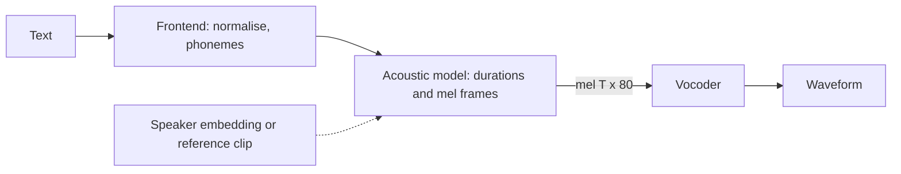

## Where this fits

Recognition ([[aud.04]]) turns sound into text; synthesis goes the other way. A voice assistant, an audiobook, a screen reader, a dubbed film and, unfortunately, a scam phone call all need text to become a convincing waveform. The synthesis pipeline reuses everything in this course: the mel spectrogram of [[aud.02]] is its central representation, the STFT of [[aud.01]] is what a vocoder must invert, the transformer encoders and decoders of the sequence lessons build the acoustic model, and the word error rate of [[aud.04]] is how we check intelligibility. The lesson ends with the part that is not only engineering: cloning someone's voice from seconds of audio, and the safeguards that responsible systems need.

## The idea in plain words

Reading aloud is three jobs. First you work out **what to say**: expand "Dr. Smith, 2026" into words and sounds. Then you decide **how it should sound**: which syllable is stressed, where the pauses go, how long each sound lasts, the melody of the sentence. Finally your throat and mouth produce the actual **vibrations**. Text-to-speech systems split the work the same way: a *text frontend* normalises and phonemises the text; an *acoustic model* predicts a compact description of the sound (a mel spectrogram, the same picture as in [[aud.02]]); a *vocoder* turns that picture into a waveform.

The last step is harder than it looks. A mel spectrogram has thrown away two things: fine frequency detail (the mel filters blend neighbouring bins) and **phase**, the exact timing of the waves inside each frame. Many different waveforms share the same magnitude picture. A vocoder must invent plausible phase and detail. The classical way is a patient alternation, **Griffin-Lim**: guess the phase, build a waveform, look at its spectrogram, keep the new phase but restore the target magnitudes, and repeat. Modern neural vocoders learn the invention directly from data and sound far better, but Griffin-Lim shows exactly what the problem is.



## The pipeline in detail

**Frontend.** Normalise the text ("2026", "6 pm", "Dr.") into words, then map words to phonemes (abstract sound units) with a pronunciation dictionary plus a fallback grapheme-to-phoneme model for unknown names. The repo lesson lists the typical failures: no normaliser, out-of-vocabulary proper nouns.

**Acoustic model.** It maps a phoneme sequence of length $U$ to a mel spectrogram of $T$ frames, $T\gg U$ (about 10-12 frames per phoneme). Two ways to bridge the length gap:

- *Autoregressive attention models* (Tacotron 2): an encoder reads the characters, a decoder emits mel frames one at a time while attention learns where in the text it is. High quality but slow, and prone to skipping or repeating words on long text.
- *Duration-based models* (FastSpeech 2): a **duration predictor** outputs an integer number of frames $d_u$ for each phoneme, and a **length regulator** copies each phoneme's hidden vector $h_u$ exactly $d_u$ times. If $H\in\mathbb R^{U\times d}$ and $d\in\mathbb N^U$, the expanded sequence is $\tilde H\in\mathbb R^{T\times d}$ with $T=\sum_ud_u$, produced in one pass by `np.repeat(H, d, axis=0)`; the decoder then maps $\tilde H$ to mel frames in parallel. There is no alignment to learn and no risk of skipping words. Example: four phonemes with durations $(2,3,1,2)$ expand to $T=8$ frames.

More recent systems (VITS, F5-TTS, Kokoro) are end-to-end or use flow matching and diffusion, and the mel spectrogram becomes an internal representation. The loss for a mel-predicting model is simply a distance between predicted and true mels, e.g. the mean absolute error $\frac1{TM}\sum_{t,m}|\hat S_{tm}-S_{tm}|$ for $S\in\mathbb R^{T\times M}$.

**Speaker and style conditioning.** A multi-speaker model receives a *speaker embedding* (a vector summarising a voice) alongside the text; changing the embedding changes the voice. This is the hook that voice cloning uses, discussed below.

**Vocoder.** Maps mel frames `(T, 80)` to samples `(T·hop,)`. The French course frames waveform synthesis as an autoregressive model $p(x)=\prod_tp(x_t\mid x_{<t},h)$ conditioned on linguistic or acoustic features $h$, and WaveNet as a CNN with causal dilated convolutions realising it. WaveNet-style models are very slow because audio at 24 kHz needs 24 000 sequential steps per second. GAN vocoders (HiFi-GAN) generate all samples in parallel by stacking transposed convolutions whose upsampling factors multiply to the hop length: the repo sketch uses $8\cdot8\cdot2\cdot2=256$. They are trained adversarially against discriminators on short windows, plus a mel-reconstruction loss and a feature-matching loss. Check: with hop 256 at 24 kHz one mel frame lasts $256/24000=10.7$ ms.

**Neural codecs.** Systems that treat audio like language first compress it into discrete tokens with a *neural codec* using **residual vector quantisation** (RVQ): codebook 1 quantises the encoder output, codebook 2 quantises the residual left by codebook 1, and so on. With $Q$ codebooks of $K$ entries at $f$ frames per second the bitrate is $f\,Q\log_2K$ bits per second. For an EnCodec-like setting (75 Hz, 8 codebooks of 1024 entries) that is $75\cdot8\cdot10=6000$ bit/s, matching the 6 kbps in the repo table. For the Mimi setting quoted there (12.5 Hz, 8 codebooks) the same formula gives $12.5\cdot8\cdot10=1000$ bit/s, **not the 4.4 kbps the repo table states**, so that table entry is inconsistent with its own parameters (our count assumes 1024-entry codebooks). The first codebook of Mimi is distilled from a speech model so that it carries the *content*; the remaining ones carry timbre and detail. An autoregressive language model over such tokens predicts content first and acoustic detail second, which is why it can speak in a voice given by a short reference clip.

## Phase retrieval: the Griffin-Lim algorithm

### The inverse STFT

Setting: $x\in\mathbb R^L$, frame length $N$, hop $H$, periodic Hann window $w$ (see [[aud.01]]). Frame $t$ of the STFT is $X_t=\mathrm{DFT}(w\odot x_{tH:tH+N})$. To go back from a (possibly modified) complex matrix $Y\in\mathbb C^{T\times(N/2+1)}$, we want the signal whose STFT is *closest* to $Y$. Because the DFT preserves energy (up to a constant factor per frame) it suffices to compare in time. Let $y_t=\mathrm{IDFT}(Y_t)\in\mathbb R^N$. Minimise

$$
J(x)=\sum_t\sum_{n=0}^{N-1}\big(w[n]\,x[tH+n]-y_t[n]\big)^2 .
$$

Differentiate with respect to $x[m]$; only frames covering sample $m$ contribute, with $n=m-tH$:

$$
\frac{\partial J}{\partial x[m]}=2\sum_t w[m-tH]\big(w[m-tH]\,x[m]-y_t[m-tH]\big)=0
\ \Longrightarrow\
x[m]=\frac{\sum_t w[m-tH]\;y_t[m-tH]}{\sum_t w[m-tH]^2}.
$$

This is **weighted overlap-add**: window each inverse-transformed frame again, add them at their positions, and divide by the summed squared windows. If $Y$ is a genuine STFT, $y_t=w\odot x_{tH:tH+N}$ and the formula returns $x$ exactly wherever $\sum_tw^2>0$. To keep the signal edges covered we pad the signal by $N/2$ on both sides (reflecting) before the STFT and trim after the inverse (the `center=True` convention).

### The alternating projections

We are given only magnitudes $A\in\mathbb R_{\ge0}^{T\times(N/2+1)}$ (for example, the mel spectrogram mapped back to linear frequencies). We look for a signal with $|\mathrm{STFT}(x)|\approx A$. Two sets of complex matrices matter:

- $\mathcal C$ = the **consistent** spectrograms, those equal to $\mathrm{STFT}(x)$ for some real $x$. A random complex matrix is not consistent: neighbouring frames overlap, so their contents are tied together. $\mathcal C$ is a linear subspace.
- $\mathcal M$ = spectrograms with the **prescribed magnitude** $|Y|=A$ (any phase).

We want a point in both. The projections are easy: onto $\mathcal M$ keep the phase, replace the magnitude, $\mathcal P_{\mathcal M}(Y)=A\,Y/|Y|$; onto $\mathcal C$ apply the inverse STFT above and transform again, $\mathcal P_{\mathcal C}(Y)=\mathrm{STFT}(\mathrm{ISTFT}(Y))$ (the least-squares step is exactly the projection). Griffin-Lim iterates

$$
X_{k+1}=\mathcal P_{\mathcal C}\big(S_k\big),\qquad S_{k+1}=\mathcal P_{\mathcal M}\big(X_{k+1}\big),\qquad S_0=A\,e^{i\varphi_0}\ (\text{random phase }\varphi_0),
$$

and outputs $\mathrm{ISTFT}(S_k)$. In code each iteration is: `x = istft(S); T = stft(x); S = A * exp(1j * angle(T))`.

**Why the error never increases.** Let $d_k=\|X_k-S_k\|$. Since $S_{k+1}$ is the point of $\mathcal M$ nearest to $X_{k+1}$, $\|X_{k+1}-S_{k+1}\|\le\|X_{k+1}-S_k\|$ (because $S_k\in\mathcal M$ too). Since $X_{k+1}$ is the point of $\mathcal C$ nearest to $S_k$, $\|X_{k+1}-S_k\|\le\|X_k-S_k\|$ (because $X_k\in\mathcal C$). Hence $d_{k+1}\le d_k$: the distance between the two sets can only shrink. But $\mathcal M$ is not convex, so the limit is a local optimum, not a guarantee of finding the original signal. (In this argument distances are the full two-sided spectrum norm; the common one-sided "spectral convergence" metric weights the bins slightly differently but behaved monotonically in our runs.)

We measure progress by the **spectral convergence**

$$
\mathrm{SC}(x)=\frac{\big\|\,|\mathrm{STFT}(x)|-A\,\big\|_F}{\|A\|_F}.
$$

### Worked example 1: round trip and Griffin-Lim

Test signal: 1 s at 8 kHz, an amplitude-modulated mix of 300 Hz and 900 Hz tones plus a quieter chirp, normalised to peak 1; `n_fft=256`, `hop=64` (so 75% overlap), giving an STFT of shape $(126,129)$ (126 frames after padding by $N/2$, 129 = $N/2+1$ bins).

- **Round trip with the true phase:** `istft(stft(x))` reproduces $x$ with maximum absolute error $4.4\times10^{-16}$ (floating point). The inverse is exact; the difficulty is only the missing phase.
- **Griffin-Lim from random phase** (initial phase uniform on $[0,2\pi)$, seed 0): spectral convergence of the reconstructed signal against the target magnitude

| iterations | 0 (random phase) | 1 | 5 | 20 | 100 | 300 |
|---|---|---|---|---|---|---|
| SC | 0.641 | 0.388 | 0.287 | 0.191 | 0.107 | 0.057 |

The mismatch falls monotonically but slowly. Meanwhile the **waveform** is not recovered: the RMS difference between the reconstruction and the original stays between 0.44 and 0.53 for all iteration counts in the table (not shrinking). That is expected: the sign $x\to-x$ gives the same magnitudes, and for this task only the magnitudes were required. Compare spectra, not samples, when testing a vocoder.

### Worked example 2: why mel inversion is harder

From the same signal build a 40-band mel filterbank $\mathbf H\in\mathbb R^{40\times129}$ ([[aud.02]]). The mel spectrogram $\mathbf P\mathbf H^\top$ keeps 40 numbers per frame instead of 129. A least-squares guess of the linear power spectrogram is $\hat{\mathbf P}=\max(0,\,\mathbf M\,(\mathbf H^{+})^\top)$ with $\mathbf H^{+}$ the pseudo-inverse (the filterbank has rank 40, so 89 dimensions per frame are lost). The relative error of the recovered magnitude $\sqrt{\hat P}$ against the true one is already **0.444** before any phase problem. Running 100 Griffin-Lim iterations on this blurred magnitude matches *its* target closely (SC 0.228) but is 0.466 away from the true magnitude. Neural vocoders do better because they learn what typical speech looks like between the mel bands.

## Evaluation

- **MOS (mean opinion score).** Listeners rate naturalness from 1 to 5. Gold standard but slow: the repo suggests 20+ listeners and 100+ samples per system. Report a confidence interval: for $n$ ratings with mean $\bar r$ and sample standard deviation $s$, the normal-approximation 95% interval is $\bar r\pm1.96\,s/\sqrt n$. *Example:* 20 ratings with mean 4.0 and $s=0.649$ give a standard error of $0.145$ and the interval $[3.72,\,4.28]$ (a $t$ multiplier of 2.09 for 19 degrees of freedom would widen it to about $[3.70,\,4.30]$). Differences smaller than the interval are not evidence.
- **CMOS.** Listeners compare A against B directly; tighter than absolute MOS.
- **UTMOS and other learned predictors.** A network trained to predict MOS without reference; cheap, used for leaderboards, correlates well on standard benchmarks according to the repo, but can be gamed by systems tuned for it.
- **Round-trip WER/CER.** Synthesise, transcribe with an ASR model, and compute the error rate against the input text ([[aud.04]]). Detects mispronunciations and skipped words, not naturalness.
- **SECS** (speaker-embedding cosine similarity) between a reference and a clone: $\cos(e_{\text{ref}},e_{\text{clone}})$ for embeddings from a speaker-verification model. The repo is inconsistent about thresholds (0.75 for "recognisable" in one lesson, 0.70 for "indistinguishable" in another), so treat any threshold as a convention to calibrate on your own listeners.
- **Latency:** time to first audio and real-time factor; a streaming assistant cares about the first 100-300 ms.

## Voice cloning and voice conversion

**What it is.** *Cloning* produces new speech from text in a target voice; *conversion* rewrites existing speech from voice A into voice B while keeping the words. Both factor an utterance into content, speaker identity and prosody and recombine them. *Zero-shot* cloning feeds a few seconds of reference audio through a speaker encoder, with no training on that person; *few-shot* fine-tuning adapts the model on minutes of audio for higher fidelity. Recognition-synthesis conversion extracts content with an ASR-like model and re-synthesises it with another voice; token-based systems use the codec tokens above.

**Why it matters.** The repo lesson reports that seconds of audio are enough for convincing clones. Legitimate uses are real (accessibility, restoring a lost voice with consent, dubbing, assistants); so are harms: impersonation in scam calls, fabricated political audio, theft of a performer's voice, harassment, and defeating voice-based authentication.

**Controls, and their limits.**

- *Consent.* Do not clone a voice without the speaker's informed, verifiable permission. A system can require a signed, time-limited consent record tied to the speaker (the repo sketches a gate that refuses inference otherwise). Consent proves intent only if the record cannot be forged, so it must be authenticated and logged.
- *Watermarking.* Embed an inaudible identifier in generated audio so that provenance can be checked later. The repo describes open-source schemes carrying about 16-32 bits that survive re-encoding. Limits: a determined attacker can try to remove or re-record the audio, and a missing watermark proves nothing, since non-watermarking tools exist.
- *Detection.* Anti-spoofing models classify real versus synthetic speech. The repo reports equal error rates of 0.8-2.3% on a 2025 challenge; such numbers are specific to the generators and conditions tested and tend to degrade on new generators, so detectors are one layer, not a solution.
- *Policy and law.* The repo states that the EU AI Act and a California statute (AB 2905) impose watermarking and disclosure duties on synthetic media from 2025-2026. We could not verify these legal claims from the sources read here: check the current text and your jurisdiction before relying on them.
- *Defence for users.* Do not treat a familiar voice on the phone as proof of identity; use out-of-band confirmation for sensitive requests, and never use voice alone as an authentication factor.

**Practical pitfalls from the repo:** a reference transcript that does not match the reference audio breaks alignment; reverberant references damage the clone; emotional tone of the reference leaks into every output; accents leak across languages.

## Implementation

```python
import numpy as np

def hann(N):
    return 0.5 - 0.5 * np.cos(2 * np.pi * np.arange(N) / N)

def stft(x, n_fft=256, hop=64):
    xp = np.pad(x, (n_fft // 2, n_fft // 2), mode="reflect")        # centre frames
    n = 1 + (len(xp) - n_fft) // hop
    idx = np.arange(n_fft)[None, :] + hop * np.arange(n)[:, None]
    return np.fft.rfft(xp[idx] * hann(n_fft), axis=1)               # (n, n_fft//2 + 1)

def istft(S, n_fft=256, hop=64, length=None):
    n = S.shape[0]
    fr = np.fft.irfft(S, n=n_fft, axis=1) * hann(n_fft)             # window again
    L = n_fft + hop * (n - 1)
    y, wsum, w2 = np.zeros(L), np.zeros(L), hann(n_fft) ** 2
    for i in range(n):
        y[i * hop:i * hop + n_fft] += fr[i]
        wsum[i * hop:i * hop + n_fft] += w2
    y = y / np.maximum(wsum, 1e-8)                                   # divide by sum of w^2
    y = y[n_fft // 2:L - n_fft // 2]
    return y if length is None else y[:length]

def spectral_convergence(S_hat, mag):
    return np.linalg.norm(np.abs(S_hat) - mag) / np.linalg.norm(mag)

def griffin_lim(mag, n_fft=256, hop=64, n_iter=100, seed=0, length=None):
    rng = np.random.default_rng(seed)
    S = mag * np.exp(2j * np.pi * rng.random(mag.shape))            # random initial phase
    for _ in range(n_iter):
        x = istft(S, n_fft, hop, length)
        S = mag * np.exp(1j * np.angle(stft(x, n_fft, hop)))        # keep phase, restore magnitude
    return istft(S, n_fft, hop, length)
```

### Shapes

| Object | Shape |
|---|---|
| phoneme hidden states $H$ | `(U, d)` |
| durations | `(U,)` integers; expanded `(sum(d), d)` |
| mel spectrogram | `(T, 80)` |
| vocoder output | `(T * hop,)` |
| STFT / magnitude `A` | `(frames, n_fft//2 + 1)` |
| speaker embedding | `(e,)`, SECS is the cosine of two of them |

**Libraries.** `librosa.griffinlim` and `torchaudio.transforms.GriffinLim` implement this algorithm (often with momentum for faster convergence); TTS toolkits such as Coqui TTS, ESPnet and NeMo provide acoustic models and pretrained vocoders (HiFi-GAN, BigVGAN); `soundfile`/`torchaudio` handle I/O. The repo lesson names Kokoro for small CPU-runnable English synthesis and F5-TTS for zero-shot cloning; model rankings change quickly, so treat any leaderboard as a snapshot.

## Common misconceptions

- **"A mel spectrogram contains the sound."** It contains an envelope of it; phase and fine detail are gone and must be generated.
- **"Griffin-Lim should return the original waveform."** It returns *a* waveform with a similar magnitude spectrogram; the original is not unique (the sign alone is ambiguous).
- **"More Griffin-Lim iterations always sound better."** The error decreases monotonically, but it converges to a local optimum with a characteristic phasiness; neural vocoders replace it for quality.
- **"A high MOS means safe."** A faithful clone may score a high MOS and be exactly the harm; quality metrics say nothing about consent.
- **"A watermark or detector solves deepfakes."** They raise the cost of misuse; they do not remove it.
- **"SECS above a threshold means same speaker."** It means similar to the embedding model's notion of voice; thresholds depend on the model and data.

## Key takeaways

- TTS = frontend, acoustic model (text/phonemes to mel, with durations bridging the length gap), vocoder (mel to waveform); a length regulator repeats each phoneme $d_u$ times.
- Inverse STFT is weighted overlap-add, $x[m]=\sum_tw\,y_t/\sum_tw^2$, the least-squares solution; it is exact for a true STFT.
- Griffin-Lim alternates projections onto "consistent" and "correct magnitude" spectrograms; the gap between the sets never increases, but the limit is only a local optimum and the waveform is not unique.
- Evaluate with MOS plus confidence interval, round-trip WER, SECS and latency; each metric answers a different question.
- Voice cloning demands consent, provenance (watermarking), detection and policy; none is sufficient alone, and legal claims must be checked, not assumed.

## Explain it yourself

1. Explain why two different waveforms can have the same magnitude spectrogram, and why this makes vocoding an ill-posed problem even before the mel compression.
2. A company wants to offer "type text, speak in any voice you upload". List three technical and three procedural safeguards, and say what each does not protect against.

## Further reading

- Repo phase 06, lessons 07, 08, 13 and 17 (model choices, safeguards, codecs and metrics).
- Griffin and Lim, "Signal estimation from modified short-time Fourier transform" (1984) introduced the algorithm; we derived the iteration ourselves and did not read the paper.
- The cited model papers (Tacotron 2, FastSpeech 2, VITS, HiFi-GAN, F5-TTS, VALL-E) are named in the repo lessons; none was read directly.

## Mastery criteria

You can describe the three stages of TTS and the role of durations; derive the weighted overlap-add inverse STFT from a least-squares objective; implement STFT, ISTFT and Griffin-Lim in NumPy and verify the round trip to floating-point precision; argue why the error is non-increasing; compute a MOS confidence interval; and design a cloning workflow with consent, watermarking and detection, stating its limits.
