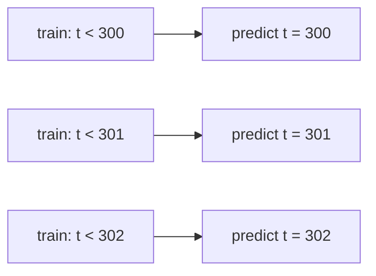

## Où cela s'inscrit

Ventes par jour, charge d'un serveur à la minute, température de midi : dès que tes lignes sont accompagnées d'une **horloge**, l'ordre des lignes est une information. Tout ce que tu as fait jusqu'ici (régression linéaire, validation croisée dans [[cml.03]]) supposait tacitement que les lignes sont **indépendantes et identiquement distribuées (i.i.d.)** : les mélanger ne change rien. Pour une série temporelle, cette hypothèse est fausse, et les dégâts ne sont pas subtils. Un modèle validé avec un découpage aléatoire peut sembler excellent, puis échouer en production, parce que le découpage aléatoire lui a permis de s'entraîner sur les jours *postérieurs* à ceux sur lesquels il était testé.

Cette leçon te donne la boîte à outils minimale pour prévoir honnêtement : décrire une série, mesurer combien de temps elle se souvient (autocorrélation), construire un prédicteur qui n'est qu'une régression linéaire sur le passé (autorégression), et l'évaluer par **validation walk-forward**. Elle se prolonge vers la leçon sur les fuites de données ([[cml.11]]), où « utiliser le futur » est le péché central, et vers les modèles de séquences en apprentissage profond, qui sont des modèles autorégressifs avec une très grosse fonction à l'intérieur.

## L'idée en mots simples

Imagine que tu prédis la température de demain. Le meilleur indice isolé est **la température d'aujourd'hui** ; le deuxième est « quelle saison sommes-nous » ; et ce qui reste est une vraie surprise. Une série temporelle est construite ainsi :

- une lente dérive vers le haut ou vers le bas (la **tendance**),
- un motif qui se répète selon le calendrier (la **saisonnalité** : jours de la semaine, mois),
- et du **bruit**, la part que personne ne peut prédire.

La mémoire est l'idée clé. Certaines séries oublient vite (proches du bruit pur), d'autres se souviennent longtemps (le niveau d'une rivière). La **fonction d'autocorrélation** répond à « à quel point la série ressemble-t-elle à elle-même décalée de k pas ? » pour chaque k. Un modèle **autorégressif** dit : demain est un mélange pondéré des derniers jours, plus une constante, plus du bruit. Ajuster ces poids n'est qu'une régression dont les entrées sont des *copies décalées de la série elle-même*.

Enfin, l'honnêteté. Quand tu testes un prédicteur, tu dois te comporter comme un prédicteur : te placer à une date, n'utiliser que ce qui était connu à ce moment, prédire le pas suivant, puis avancer la date. C'est la validation walk-forward. Un mélange aléatoire laisse le modèle regarder demain pendant qu'il « prédit » hier.

## Composantes et stationnarité

Une **décomposition additive** écrit $y_t = T_t + S_t + R_t$ (tendance, saisonnalité, résidu). Une décomposition **multiplicative** écrit $y_t = T_t\cdot S_t\cdot R_t$, adaptée quand les variations saisonnières grandissent avec le niveau (prendre des logarithmes la rend additive).

Une série est **(faiblement) stationnaire** si sa moyenne et sa variance ne dépendent pas de $t$ et si la covariance entre $y_t$ et $y_{t+k}$ ne dépend que du décalage $k$. Pourquoi cela nous importe : un modèle qui apprend des relations dans le passé ne peut les réutiliser dans le futur que si ces relations ne dérivent pas. Une série avec tendance ou variance changeante n'est pas stationnaire ; les remèdes habituels sont la **différenciation** ($y_t - y_{t-1}$, qui supprime une tendance), la différenciation saisonnière ($y_t - y_{t-m}$) et une transformation logarithmique (qui stabilise une variance croissante). Une marche aléatoire $y_t = y_{t-1}+\varepsilon_t$ est la série non stationnaire classique, et la différencier redonne le bruit stationnaire $\varepsilon_t$.

## Autocorrélation

Soit $\bar y$ la moyenne des $n$ observations et $d_t = y_t-\bar y$. L'**autocorrélation empirique** au décalage $k$ est

$$
r_k=\frac{\sum_{t=k}^{n-1} d_t\,d_{t-k}}{\sum_{t=0}^{n-1} d_t^{2}},\qquad r_0=1 .
$$

Même dénominateur pour tous les décalages (la variance de toute la série), numérateur égal à une covariance décalée. Comment la lire : $r_1$ proche de 1 signifie « demain ressemble à aujourd'hui » ; un pic à $k=7$ dans des données quotidiennes signifie un rythme hebdomadaire ; un $r_k$ qui décroît très lentement suggère une non-stationnarité (une tendance). Pour un bruit blanc, tous les $r_k$ ($k\ge1$) sont proches de 0, avec une taille typique d'environ $1/\sqrt n$, ce qui donne une bande approximative pour « indiscernable de zéro ».

## Modèles autorégressifs

Un modèle **AR($p$)** prédit la valeur suivante à partir des $p$ dernières :

$$
y_t=c+\phi_1y_{t-1}+\dots+\phi_py_{t-p}+\varepsilon_t,\qquad \varepsilon_t\sim\mathcal N(0,\sigma^2)\ \text{independent}.
$$

Pour AR(1), prendre l'espérance dans une série stationnaire donne la moyenne $\mu=c/(1-\phi_1)$, et itérer l'équation montre que l'autocorrélation vaut $\rho_k=\phi_1^{\,k}$ : elle décroît géométriquement, et la série n'est stationnaire que si $|\phi_1|<1$. (Pour $\phi_1=1$ et $c=0$ on obtient la marche aléatoire vue plus haut.)

## Dérivation : ajustement par moindres carrés

Avec $n$ observations, on peut former une équation pour chaque cible $y_t$, $t=p,\dots,n-1$, donc il y a $m=n-p$ équations. Empile-les dans une matrice de conception $X\in\mathbb R^{m\times(p+1)}$ dont la ligne pour l'instant $t$ est $[1,\;y_{t-1},\;\dots,\;y_{t-p}]$, un vecteur cible $\mathbf t=(y_p,\dots,y_{n-1})^\top\in\mathbb R^m$ et des paramètres $\mathbf w=(c,\phi_1,\dots,\phi_p)^\top\in\mathbb R^{p+1}$. Comme le bruit est gaussien, maximiser la vraisemblance revient à minimiser la somme des carrés $\|\mathbf t-X\mathbf w\|^2$ (comme dans [[cml.01]]). Annuler le gradient $-2X^\top(\mathbf t-X\mathbf w)$ donne les **équations normales**

$$
X^\top X\,\mathbf w=X^\top\mathbf t\;\Longrightarrow\;\mathbf w=(X^\top X)^{-1}X^\top\mathbf t .
$$

Un modèle AR *est* donc une régression linéaire ; la seule nouveauté est que les variables explicatives sont des copies décalées de la cible. Les lignes ne sont pas indépendantes (des lignes voisines partagent des valeurs), donc les barres d'erreur i.i.d. ne sont qu'approximatives, mais l'estimation ponctuelle est la standard.

**Prévision.** À un pas : injecte les $p$ dernières valeurs observées. À $h$ pas : prévois un pas, traite cette prévision comme si elle était observée, et recommence (prévision récursive). Les erreurs s'accumulent, et une prévision AR stationnaire décroît vers la moyenne $\mu$, si bien que les prévisions à long horizon deviennent floues.

## Validation walk-forward et références de base



Pour chaque instant de test $t$ : réajuste le modèle en n'utilisant que $y_0,\dots,y_{t-1}$, prédis $y_t$, enregistre l'erreur, passe au suivant. La fenêtre d'entraînement peut **s'étendre** (tout ce qu'on a jusque-là) ou **glisser** (un nombre fixe de points récents, mieux quand le comportement dérive). Ne mélange jamais ; ne laisse jamais un transformateur (mise à l'échelle, statistiques de différenciation) voir des données postérieures à $t$.

Compare toujours avec des **références de base** (baselines), car il est facile de « prédire » trivialement une série temporelle :

- **Naïve** : demain égale aujourd'hui, $\hat y_t=y_{t-1}$. Très difficile à battre pour des données proches d'une marche aléatoire.
- **Naïve saisonnière** : $\hat y_t=y_{t-m}$ pour une longueur de saison $m$ (même jour de la semaine, la semaine dernière).
- **Moyenne** : la moyenne d'entraînement ; le bon étalon pour des séries stationnaires bruitées.

Si un modèle sophistiqué ne bat pas celles-ci en validation walk-forward, il n'a rien appris d'utile.

## Exemple détaillé

Prenons la série de 8 points $y=(2,4,3,5,4,6,5,7)$. Sa moyenne est $4.5$, les valeurs centrées sont $(-2.5,-0.5,-1.5,0.5,-0.5,1.5,0.5,2.5)$ et $\sum d_t^2=18$.

- Décalage 1 : $\sum_{t=1}^{7}d_td_{t-1}=1.25+0.75-0.75-0.25-0.75+0.75+1.25=2.25$, donc $r_1=2.25/18=0.125$.
- De même $r_2=0.4722$ et $r_3=-0.2361$. La valeur positive au décalage 2 reflète le rythme en dents de scie superposé à la tendance.

Ajustement AR(1) : entrées $x=(2,4,3,5,4,6,5)$, cibles $(4,3,5,4,6,5,7)$. Résoudre les équations normales donne $\phi_1=0.2895$ et $c=3.6579$. La prévision à un pas est $3.6579+0.2895\cdot7=5.6842$.

Sur une série AR(2) simulée avec les vrais coefficients $(0.5,0.3)$ et $n=400$ (graine 0), les moindres carrés retrouvent environ $(0.49,0.29)$, et le walk-forward à partir de $t=300$ donne une erreur absolue moyenne d'environ $0.73$ contre $0.83$ pour la prévision naïve. L'exercice reproduit ces valeurs.

## Implémentation

```python
import numpy as np

def acf(y, max_lag):
    d = np.asarray(y, float) - np.mean(y)
    return np.array([d[k:] @ d[:len(d) - k] / (d @ d) for k in range(max_lag + 1)])

def fit_ar(y, p):
    y = np.asarray(y, float); n = len(y)
    X = np.column_stack([np.ones(n - p)] + [y[p - j:n - j] for j in range(1, p + 1)])
    w = np.linalg.lstsq(X, y[p:], rcond=None)[0]
    return w[0], w[1:]
```

En production, `statsmodels` fournit ARIMA/SARIMAX et `sklearn.model_selection.TimeSeriesSplit` fournit des découpages walk-forward ; les modèles à gradient boosting sur des variables de décalage sont une alternative solide (voir [[cml.07]]).

## Dimensions

`y: (n,)`. Pour AR($p$) : `X: (n-p, p+1)`, `t: (n-p,)`, `w: (p+1,)`. `acf` renvoie `(max_lag+1,)`. Le walk-forward à partir de `start` renvoie `(n-start,)` prédictions.

## Idées reçues

- **« Le k-fold aléatoire convient, je ferai attention. »** Il entraîne sur le futur des points de test ; les scores sont optimistes, parfois énormément.
- **« Une grande précision par rapport à la valeur d'hier signifie un bon modèle. »** La persistance est une référence solide ; bats-la avant de te réjouir.
- **« L'ACF m'indique la causalité. »** Elle ne mesure que l'auto-similarité linéaire à un décalage ; une tendance seule produit une grande autocorrélation à tous les décalages.
- **« Différencier ne coûte rien. »** Cela supprime l'information sur le niveau et amplifie le bruit ; utilise le minimum nécessaire.
- **« Un bon ajustement sur l'échantillon garantit une bonne prévision. »** Les résidus d'un ajustement AR sur l'échantillon sont plus petits que les vraies erreurs de prévision.

## Points clés

- L'ordre temporel est une information ; la validation i.i.d. est invalide. Utilise des découpages walk-forward et rapporte toujours les scores des références de base.
- $r_k$ mesure la ressemblance au décalage $k$ ; une décroissance lente évoque une tendance, des pics aux décalages saisonniers.
- AR($p$) est une régression linéaire sur des valeurs décalées : équations normales $X^\top X\mathbf w=X^\top\mathbf t$.
- Les prévisions à plusieurs pas accumulent l'erreur ; les modèles stationnaires reviennent vers la moyenne.

## Explique-le toi-même

1. Pourquoi un découpage aléatoire entraînement/test gonfle-t-il le score d'un prédicteur, et que fait exactement le walk-forward de différent ?
2. Pourquoi la matrice de conception d'un AR($p$) a-t-elle $n-p$ lignes plutôt que $n$, et qu'advient-il des $p$ premières observations ?

## Pour aller plus loin

- La leçon source `phases/02-ml-fundamentals/15-time-series` pour les variables de décalage, l'intuition d'ARIMA et les statistiques glissantes.
- La documentation de Statsmodels pour ARIMA et SARIMAX.

## Critères de maîtrise

Tu sais implémenter l'ACF et un ajustement AR($p$) à partir de zéro, expliquer la stationnarité et quand la différenciation est nécessaire, produire une évaluation walk-forward sans fuite, et juger un prédicteur par rapport aux références naïve et naïve saisonnière.
