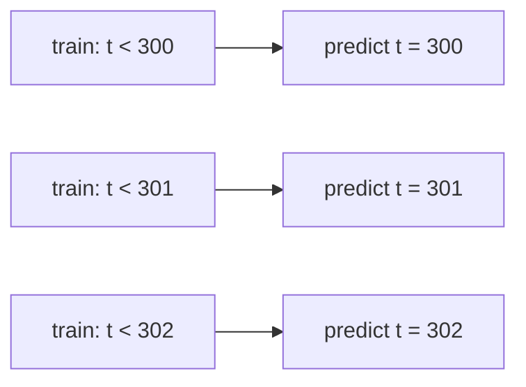

## Where this fits

Sales per day, server load per minute, the temperature at noon: whenever your rows come with a **clock**, the order of the rows is information. Everything you did before (linear regression, cross-validation in [[cml.03]]) quietly assumed that rows are **independent and identically distributed (i.i.d.)**: shuffling them changes nothing. For a time series that assumption is false, and the damage is not subtle. A model validated with a random split can look excellent and then fail in production, because the random split let it train on the days *after* the ones it was tested on.

This lesson gives you the minimum toolkit to forecast honestly: describe a series, measure how long it remembers (autocorrelation), build a forecaster that is just linear regression on the past (autoregression), and evaluate it by **walk-forward validation**. It connects forward to the leakage lesson ([[cml.11]]), where "using the future" is the central sin, and to sequence models in deep learning, which are autoregressive models with a very large function inside.

## The idea in plain words

Imagine predicting tomorrow's temperature. The best single clue is **today's temperature**; the second best is "what season is it"; and what is left is genuine surprise. A time series is built like that:

- a slow drift upward or downward (the **trend**),
- a pattern that repeats on a calendar (the **seasonality**: weekdays, months),
- and **noise**, the part nobody can predict.

Memory is the key idea. Some series forget quickly (close to pure noise), some remember for a long time (a river level). The **autocorrelation function** answers "how similar is the series to itself shifted by k steps?" for every k. An **autoregressive** model says: tomorrow is a weighted blend of the last few days plus a constant plus noise. Fitting those weights is just a regression whose inputs are *lagged copies of the series itself*.

Finally, honesty. When you test a forecaster you must behave like a forecaster: stand at a date, use only what was known by then, predict the next step, then move the date forward. That is walk-forward validation. A random shuffle lets the model look at tomorrow while "predicting" yesterday.

## Components and stationarity

An **additive decomposition** writes $y_t = T_t + S_t + R_t$ (trend, seasonal, residual). A **multiplicative** one writes $y_t = T_t\cdot S_t\cdot R_t$, appropriate when seasonal swings grow with the level (taking logs turns it additive).

A series is **(weakly) stationary** if its mean and variance do not depend on $t$ and the covariance between $y_t$ and $y_{t+k}$ depends only on the lag $k$. Why we care: a model that learns relationships from the past can only reuse them in the future if those relationships do not drift. A series with trend or changing variance is not stationary; the usual repairs are **differencing** ($y_t - y_{t-1}$, removes a trend), seasonal differencing ($y_t - y_{t-m}$) and a log transform (stabilises growing variance). A random walk $y_t = y_{t-1}+\varepsilon_t$ is the classic non-stationary series, and differencing it returns the stationary noise $\varepsilon_t$.

## Autocorrelation

Let $\bar y$ be the mean of the $n$ observations and $d_t = y_t-\bar y$. The **sample autocorrelation** at lag $k$ is

$$
r_k=\frac{\sum_{t=k}^{n-1} d_t\,d_{t-k}}{\sum_{t=0}^{n-1} d_t^{2}},\qquad r_0=1 .
$$

Same denominator for every lag (the variance of the whole series), numerator a lagged covariance. Reading it: $r_1$ near 1 means "tomorrow looks like today"; a spike at $k=7$ in daily data means a weekly rhythm; $r_k$ decaying very slowly suggests non-stationarity (a trend). For white noise all $r_k$ ($k\ge1$) are near 0, with typical size about $1/\sqrt n$, which gives a rough band for "indistinguishable from zero".

## Autoregressive models

An **AR($p$)** model predicts the next value from the last $p$:

$$
y_t=c+\phi_1y_{t-1}+\dots+\phi_py_{t-p}+\varepsilon_t,\qquad \varepsilon_t\sim\mathcal N(0,\sigma^2)\ \text{independent}.
$$

For AR(1), taking expectations in a stationary series gives the mean $\mu=c/(1-\phi_1)$, and iterating the equation shows the autocorrelation is $\rho_k=\phi_1^{\,k}$: it decays geometrically, and the series is stationary only if $|\phi_1|<1$. (For $\phi_1=1$ and $c=0$ you get the random walk above.)

## Derivation: fitting by least squares

With $n$ observations we can form one equation for each target $y_t$, $t=p,\dots,n-1$, so there are $m=n-p$ equations. Stack them into a design matrix $X\in\mathbb R^{m\times(p+1)}$ whose row for time $t$ is $[1,\;y_{t-1},\;\dots,\;y_{t-p}]$, a target vector $\mathbf t=(y_p,\dots,y_{n-1})^\top\in\mathbb R^m$ and parameters $\mathbf w=(c,\phi_1,\dots,\phi_p)^\top\in\mathbb R^{p+1}$. Because the noise is Gaussian, maximising the likelihood is the same as minimising the sum of squares $\|\mathbf t-X\mathbf w\|^2$ (as in [[cml.01]]). Setting the gradient $-2X^\top(\mathbf t-X\mathbf w)$ to zero gives the **normal equations**

$$
X^\top X\,\mathbf w=X^\top\mathbf t\;\Longrightarrow\;\mathbf w=(X^\top X)^{-1}X^\top\mathbf t .
$$

So an AR model *is* linear regression; the only novelty is that the features are shifted copies of the target. The rows are not independent (neighbouring rows share values), so i.i.d. error bars are only approximate, but the point estimate is the standard one.

**Forecasting.** One step ahead: plug in the last $p$ observed values. $h$ steps ahead: forecast one step, treat that forecast as if it were observed, and repeat (recursive forecasting). Errors compound, and a stationary AR forecast decays toward the mean $\mu$, so long-horizon forecasts get blurry.

## Walk-forward validation and baselines



For each test time $t$: refit using only $y_0,\dots,y_{t-1}$, predict $y_t$, record the error, move on. The training window can **expand** (use everything so far) or **slide** (a fixed number of recent points, better when behaviour drifts). Never shuffle; never let a transformer (scaling, differencing statistics) see data after $t$.

Always compare with **baselines**, because time series are easy to "predict" trivially:

- **Naive**: tomorrow equals today, $\hat y_t=y_{t-1}$. Very hard to beat for random-walk-like data.
- **Seasonal naive**: $\hat y_t=y_{t-m}$ for season length $m$ (same weekday last week).
- **Mean**: the training mean; the right yardstick for noisy stationary series.

If a fancy model cannot beat these under walk-forward validation, it has learned nothing useful.

## Worked example

Take the 8-point series $y=(2,4,3,5,4,6,5,7)$. Its mean is $4.5$, the centred values are $(-2.5,-0.5,-1.5,0.5,-0.5,1.5,0.5,2.5)$ and $\sum d_t^2=18$.

- Lag 1: $\sum_{t=1}^{7}d_td_{t-1}=1.25+0.75-0.75-0.25-0.75+0.75+1.25=2.25$, so $r_1=2.25/18=0.125$.
- Likewise $r_2=0.4722$ and $r_3=-0.2361$. The positive value at lag 2 reflects the up-and-down rhythm on top of the trend.

AR(1) fit: inputs $x=(2,4,3,5,4,6,5)$, targets $(4,3,5,4,6,5,7)$. Solving the normal equations gives $\phi_1=0.2895$ and $c=3.6579$. The one-step forecast is $3.6579+0.2895\cdot7=5.6842$.

On a simulated AR(2) series with true coefficients $(0.5,0.3)$ and $n=400$ (seed 0), least squares recovers about $(0.49,0.29)$, and walk-forward from $t=300$ gives a mean absolute error of about $0.73$ against $0.83$ for the naive forecast. The exercise reproduces these.

## Implementation

```python
import numpy as np

def acf(y, max_lag):
    d = np.asarray(y, float) - np.mean(y)
    return np.array([d[k:] @ d[:len(d) - k] / (d @ d) for k in range(max_lag + 1)])

def fit_ar(y, p):
    y = np.asarray(y, float); n = len(y)
    X = np.column_stack([np.ones(n - p)] + [y[p - j:n - j] for j in range(1, p + 1)])
    w = np.linalg.lstsq(X, y[p:], rcond=None)[0]
    return w[0], w[1:]
```

In production, `statsmodels` provides ARIMA/SARIMAX and `sklearn.model_selection.TimeSeriesSplit` provides walk-forward splits; gradient-boosted models on lag features are a strong alternative (see [[cml.07]]).

## Shapes

`y: (n,)`. For AR($p$): `X: (n-p, p+1)`, `t: (n-p,)`, `w: (p+1,)`. `acf` returns `(max_lag+1,)`. Walk-forward from `start` returns `(n-start,)` predictions.

## Common misconceptions

- **"Random k-fold is fine, I'll just be careful."** It trains on the future of the test points; scores are optimistic, sometimes wildly.
- **"High accuracy against yesterday's value means a good model."** Persistence is a strong baseline; beat it before celebrating.
- **"ACF tells me causation."** It only measures linear self-similarity at a lag; a trend alone produces large autocorrelation at every lag.
- **"Differencing is free."** It removes information about the level and amplifies noise; use the minimum needed.
- **"A good in-sample fit means a good forecast."** In-sample residuals of an AR fit are smaller than genuine forecast errors.

## Key takeaways

- Time order is information; i.i.d. validation is invalid. Use walk-forward splits and always report baseline scores.
- $r_k$ measures lag-$k$ similarity; slow decay hints at trend, spikes at seasonal lags.
- AR($p$) is linear regression on lagged values: normal equations $X^\top X\mathbf w=X^\top\mathbf t$.
- Multi-step forecasts compound error; stationary models revert to the mean.

## Explain it yourself

1. Why does a random train/test split inflate the score of a forecaster, and what exactly does walk-forward do differently?
2. Why does the AR($p$) design matrix have $n-p$ rows rather than $n$, and what happens to the first $p$ observations?

## Further reading

- The source lesson `phases/02-ml-fundamentals/15-time-series` for lag features, ARIMA intuition and rolling statistics.
- Statsmodels documentation for ARIMA and SARIMAX.

## Mastery criteria

You can implement the ACF and an AR($p$) fit from scratch, explain stationarity and when differencing is needed, produce a leakage-free walk-forward evaluation and judge a forecaster against naive and seasonal-naive baselines.
