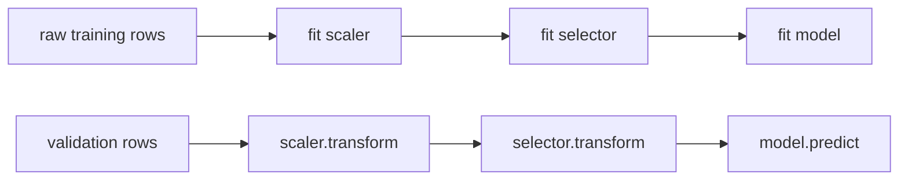

## Où cela s'inscrit

Un modèle possède deux sortes de nombres. Les **paramètres** (poids, seuils de coupure) sont appris à partir des données par l'algorithme d'entraînement. Les **hyper-paramètres** (la force de ridge $\lambda$ de [[cml.01]], le taux d'apprentissage et la profondeur d'arbre de [[cml.07]], le $k$ de [[cml.09]]) sont choisis *avant* l'entraînement et contrôlent la façon dont l'apprentissage se déroule. Bien les choisir peut compter plus que choisir l'algorithme ; les choisir négligemment est la manière la plus courante de se tromper soi-même, car chaque essai est un coup d'œil supplémentaire sur les données de validation ([[cml.03]]).

Deux thèmes dans cette leçon. D'abord, **comment chercher** : recherche par grille, recherche aléatoire, successive halving, et optimisation bayésienne, où un modèle statistique bon marché du score guide l'essai suivant. Ensuite, **comment évaluer honnêtement** : toute la chaîne d'étapes de prétraitement doit être réajustée à l'intérieur de chaque pli de validation croisée, ce que garantit exactement un objet **Pipeline**. C'est le remède pratique à la fuite de [[cml.11]].

## L'idée en mots simples

Tu règles une radio avec deux boutons, mais un seul change réellement le son. Essayer toutes les combinaisons sur une grille 3 par 3 de réglages ne teste que **trois** positions distinctes du bouton qui compte. Choisir neuf réglages au hasard teste **neuf** positions différentes de ce bouton, donc tu as bien plus de chances de tomber près du bon réglage. C'est tout l'argument de la recherche aléatoire : quand le score dépend surtout de quelques hyper-paramètres, une grille gaspille l'essentiel de son budget à répéter les mêmes valeurs des paramètres importants.

Plus malin encore : ne traite pas chaque essai comme indépendant. Si tu as essayé trois réglages et que celui du milieu sonnait le mieux, l'essai suivant devrait être près de lui, mais aussi parfois dans une région inexplorée. L'**optimisation bayésienne** maintient une estimation courante du score sous forme de courbe avec barres d'erreur, et essaie le point qui paraît le plus prometteur quand on compte à la fois une estimation haute et une large barre d'erreur.

Et le **successive halving** est l'idée du tournoi : donne à de nombreux candidats un budget minuscule (quelques époques), garde le meilleur tiers, donne-lui trois fois plus de budget, recommence. Les mauvaises configurations sont éliminées à bas coût.

Les pipelines répondent à un danger différent : préparer les données (mise à l'échelle, remplissage des valeurs manquantes, sélection de variables) en utilisant *toutes* les lignes avant de découper. La préparation a alors secrètement vu les lignes de test. Un pipeline ajuste chaque étape de préparation uniquement sur la partie d'entraînement de chaque pli.

## Stratégies de recherche

**Recherche par grille.** Choisis une liste de valeurs par hyper-paramètre et essaie toutes les combinaisons : $m^d$ exécutions pour $m$ valeurs en dimension $d$. Exponentiel en $d$ ; et chaque axe n'utilise que $m$ valeurs distinctes.

**Recherche aléatoire.** Tire $n$ configurations indépendamment dans des intervalles (utilise une échelle logarithmique pour les paramètres d'échelle comme les taux d'apprentissage). Chaque exécution explore une nouvelle valeur sur chaque axe, donc avec $n$ exécutions tu vois $n$ valeurs distinctes du paramètre important, quel qu'il soit. Le coût, c'est toi qui le choisis, et on peut ajouter des exécutions à tout moment.

**Successive halving.** Commence avec $n$ configurations au budget $b_0$ (époques, arbres, fraction des données). À chaque palier, évalue tous les survivants, garde la meilleure fraction $1/\eta$, multiplie le budget par $\eta$. Avec $n=27$, $\eta=3$, $b_0=1$, les paliers sont $(27,1),(9,3),(3,9),(1,27)$ et le coût total est $27+27+27+27=108$ unités de budget, contre $27\cdot27=729$ pour tout mener jusqu'au bout. Son risque : une configuration lente au démarrage (un petit taux d'apprentissage) peut être éliminée trop tôt. Hyperband exécute plusieurs calendriers de halving avec des compromis différents pour se couvrir contre cela.

## Optimisation bayésienne et processus gaussiens

On veut maximiser un score coûteux et bruité $f(x)$ avec peu d'évaluations. Ajuste un **modèle de substitution** (surrogate) aux évaluations vues jusqu'ici, choisis le $x$ suivant par une **fonction d'acquisition**, évalue, mets à jour, recommence.

### Le modèle de substitution par processus gaussien

Un processus gaussien (GP) place un a priori directement sur des *fonctions* : pour tout ensemble fini d'entrées $x_1,\dots,x_N$, les valeurs de la fonction $\mathbf y=(f(x_1),\dots,f(x_N))$ sont conjointement gaussiennes, de moyenne nulle et de covariance $K_{ij}=k(x_i,x_j)$. Nous utilisons le **noyau RBF**

$$
k(x,x')=\sigma^2\exp\!\Big(-\frac{(x-x')^2}{2\ell^2}\Big),
$$

avec une échelle de signal $\sigma$ et une échelle de longueur $\ell$ : des entrées proches obtiennent des valeurs fortement corrélées, des entrées distantes de plus de quelques $\ell$ sont presque indépendantes. Les observations sont $t_n=f(x_n)+\epsilon_n$ avec $\epsilon_n\sim\mathcal N(0,\beta^{-1})$, donc le vecteur des cibles a pour covariance $C=K+\beta^{-1}I$.

**Dérivation de la loi a posteriori.** Ajoute une entrée de test $x_*$. Les cibles et la valeur inconnue $f_*$ sont conjointement gaussiennes :

$$
\begin{pmatrix}\mathbf t\\ f_*\end{pmatrix}\sim\mathcal N\!\left(\mathbf 0,\begin{pmatrix}C&\mathbf k_*\\ \mathbf k_*^\top&k(x_*,x_*)\end{pmatrix}\right),\qquad (\mathbf k_*)_n=k(x_n,x_*).
$$

Conditionner une gaussienne conjointe sur un bloc donne une gaussienne de

$$
\mu(x_*)=\mathbf k_*^\top C^{-1}\mathbf t,\qquad
s^2(x_*)=k(x_*,x_*)-\mathbf k_*^\top C^{-1}\mathbf k_* .
$$

(Ce sont la moyenne et la variance prédictives de Bishop pour la régression par processus gaussien, Sec. 6.4.) La moyenne est une somme pondérée de valeurs du noyau aux points d'entraînement ; la variance part de la variance a priori $k(x_*,x_*)=\sigma^2$ et diminue d'une quantité importante quand $x_*$ est proche des entrées d'entraînement. Numériquement, n'inverse pas $C$ : factorise $C=LL^\top$ (Cholesky), résous $L L^\top\boldsymbol\alpha=\mathbf t$ pour $\boldsymbol\alpha$, puis $\mu=\mathbf k_*^\top\boldsymbol\alpha$, et avec $\mathbf v=L^{-1}\mathbf k_*$ la variance vaut $\sigma^2-\|\mathbf v\|^2$. Le coût est $O(N^3)$ pour la factorisation, correct pour des centaines d'évaluations (le régime habituel du réglage d'hyper-paramètres) et prohibitif pour de très grands $N$.

### Acquisition : amélioration espérée

Soit $f^+$ la meilleure valeur jusqu'ici. L'amélioration en $x$ est $\max(f(x)-f^+,0)$. Sous le GP, $f(x)\sim\mathcal N(\mu,s^2)$, et son espérance a une forme close. Avec $z=(\mu-f^+)/s$, $\Phi$ la fonction de répartition de la loi normale standard et $\varphi$ sa densité,

$$
\mathrm{EI}(x)=(\mu-f^+)\,\Phi(z)+s\,\varphi(z).
$$

Le premier terme récompense une moyenne prédite élevée (exploitation) ; le second récompense l'incertitude (exploration). Quand $s=0$, EI se réduit à $\max(\mu-f^+,0)$. Les alternatives sont la borne supérieure de confiance $\mu+\kappa s$ et la probabilité d'amélioration.

## Des pipelines qui ne peuvent pas fuir

Un **pipeline** est une liste ordonnée d'étapes ; toutes sauf la dernière sont des *transformateurs* avec `fit` et `transform`, la dernière est un *modèle* avec `fit` et `predict`. Appeler `fit(X, y)` sur le pipeline ajuste chaque transformateur sur les données qu'il reçoit de l'étape précédente et transmet les données transformées ; `predict` n'appelle que `transform`, jamais `fit`. Utilisé dans la validation croisée, un pipeline neuf est construit et ajusté pour chaque pli sur les seuls indices d'entraînement, si bien qu'aucune statistique (moyenne, écart-type, colonnes sélectionnées, médianes d'imputation, vocabulaire, encodage de cible) n'est jamais calculée à partir de lignes de validation.



Le réglage appartient lui aussi à l'extérieur des plis du pipeline. Si tu essaies 200 configurations et rapportes le meilleur score de validation croisée, ce score est optimiste (tu as sélectionné le maximum de nombres bruités). Garde un **jeu de test** final intact, ou utilise la **validation croisée imbriquée** : une boucle externe pour l'estimation, une boucle interne pour le réglage.

## Exemple détaillé

**Recherche.** Le score jouet est $f(a,b)=e^{-(a-0.37)^2/(2\cdot0.08^2)}+0.05\,e^{-(b-0.6)^2/(2\cdot0.3^2)}$ : il dépend surtout de $a$. Une grille 3 par 3 avec les valeurs $\{0,0.5,1\}$ sur chaque axe trouve son meilleur en $(0.5,0.5)$ avec la valeur $0.314$. Neuf points aléatoires (graine variable sur 300 exécutions) atteignent un meilleur moyen de $0.816$ et battent les $0.314$ de la grille dans environ $93\%$ des exécutions. L'optimum est $1.05$.

**Halving.** 27 configurations, évaluations bruitées dont le bruit décroît comme $0.5/\sqrt{\text{budget}}$ : le calendrier est $(27,1),(9,3),(3,9),(1,27)$ pour un coût total de $108$.

**GP.** Points d'entraînement $x=(0.1,0.5,0.9)$ de valeurs $(0,1,0)$, $\ell=0.15$, $\sigma=1$, bruit $10^{-4}$ : la moyenne a posteriori en $0.3$ est $0.400$ avec un écart-type de $0.82$ (on est loin des données, relativement à $\ell$, donc le modèle est incertain) ; aux points de données l'écart-type est d'environ $0.01$ ; en $1.5$ il vaut $1.0$, la valeur a priori.

**Optimisation bayésienne.** Avec 3 départs aléatoires et 7 évaluations choisies par EI (10 au total) sur la tranche 1D $f(a,0.6)$, la meilleure valeur moyennée sur 10 graines est $1.050$, contre $0.861$ pour 10 tirages aléatoires (le minimum sur les graines : $1.048$ contre $0.506$).

**Fuite.** Bruit pur : $X\in\mathbb R^{40\times200}$, $y$ indépendant de $X$. Sélectionner les 5 colonnes les plus corrélées à $y$ en utilisant *toutes* les lignes puis lancer une régression ridge en 5 plis donne un $R^2$ de validation croisée de $+0.39$ : l'étape de sélection a jeté un œil aux étiquettes mises de côté. La même sélection dans un Pipeline, réajustée à chaque pli, donne $R^2=-0.85$, correctement pire que prédire la moyenne. Les deux nombres proviennent de l'exercice 2.

## Implémentation

```python
class Pipeline:
    def __init__(self, steps): self.steps = steps          # [(name, obj), ..., (name, model)]
    def fit(self, X, y):
        for _, step in self.steps[:-1]:
            step.fit(X, y); X = step.transform(X)
        self.steps[-1][1].fit(X, y); return self
    def predict(self, X):
        for _, step in self.steps[:-1]: X = step.transform(X)
        return self.steps[-1][1].predict(X)

def gp_posterior(Xtr, ytr, Xte, length, sigma, noise):
    K = rbf(Xtr, Xtr, length, sigma) + noise * np.eye(len(Xtr))
    L = np.linalg.cholesky(K); Ks = rbf(Xtr, Xte, length, sigma)
    alpha = np.linalg.solve(L.T, np.linalg.solve(L, ytr))
    v = np.linalg.solve(L, Ks)
    return Ks.T @ alpha, np.sqrt(np.maximum(sigma**2 - (v**2).sum(0), 0))
```

Outils de production : `sklearn.pipeline.Pipeline` et `ColumnTransformer`, `GridSearchCV`, `RandomizedSearchCV`, `HalvingRandomSearchCV` ; Optuna et bibliothèques similaires pour une recherche de style bayésien avec élagage (arrêt précoce des mauvaises exécutions). Les estimateurs de Parzen structurés en arbre et les substituts par forêts aléatoires remplacent le GP quand l'espace de recherche est de grande dimension ou conditionnel.

## Dimensions

`K: (N, N)`, `Ks: (N, M)` pour $M$ entrées de test, `alpha: (N,)`, moyenne et écart-type a posteriori `(M,)`. Pipeline : `X: (n, d)` ; un sélecteur change la largeur en `(n, k)`.

## Idées reçues

- **« Plus de points de grille signifie une meilleure recherche. »** Le coût explose, et les axes sans importance gaspillent la plupart des exécutions.
- **« L'optimisation bayésienne gagne toujours. »** Elle a un surcoût, exige un noyau raisonnable, et avec une poignée d'essais indépendants bon marché la recherche aléatoire est difficile à battre. Son avantage grandit quand chaque évaluation est coûteuse.
- **« Le meilleur score de validation croisée est ma performance attendue. »** Il est biaisé vers le haut par la sélection ; confirme sur des données intactes ou avec une validation croisée imbriquée.
- **« Mettre à l'échelle tout le jeu de données d'abord est inoffensif. »** Cela fait fuir des statistiques de test ; avec la sélection de variables ou l'encodage de cible, la fuite peut être énorme (le $+0.39$ ci-dessus sur du bruit pur).
- **« Les hyper-paramètres ne font jamais de surapprentissage. »** Avec assez d'essais, tu surapprends le jeu de validation lui-même.

## Points clés

- L'aléatoire bat la grille quand seuls quelques hyper-paramètres comptent ; utilise des échelles logarithmiques pour les paramètres d'échelle.
- Le successive halving échange largeur contre profondeur : 108 au lieu de 729 unités dans l'exemple.
- Un GP donne une moyenne et une incertitude : $\mu=\mathbf k_*^\top C^{-1}\mathbf t$, $s^2=k_{**}-\mathbf k_*^\top C^{-1}\mathbf k_*$ ; l'EI équilibre exploitation et exploration.
- Mets chaque étape de prétraitement ajustée dans un Pipeline et valide le pipeline par validation croisée, jamais le tableau prétraité.

## Explique-le toi-même

1. Pourquoi la recherche aléatoire trouve-t-elle plus souvent une bonne valeur de l'hyper-paramètre important qu'une grille avec le même nombre d'exécutions ?
2. Explique avec tes propres mots pourquoi sélectionner des variables avant la validation croisée peut produire un score élevé sur du bruit pur, et comment un Pipeline supprime cet effet.

## Pour aller plus loin

- Bishop, *PRML*, Sec. 6.4 (processus gaussiens), et le chapitre 6 pour les noyaux en général.
- Les leçons sources `phases/02-ml-fundamentals/12-hyperparameter-tuning` et `13-ml-pipelines` pour Optuna, ColumnTransformer et le suivi d'expériences.

## Critères de maîtrise

Tu sais implémenter les recherches par grille, aléatoire et par halving, dériver la moyenne et la variance a posteriori d'un GP et calculer l'amélioration espérée, expliquer pourquoi la validation imbriquée est nécessaire, et construire un Pipeline dont le score de validation croisée ne fuit pas.
