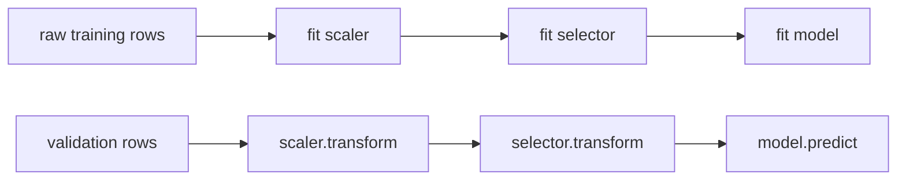

## Where this fits

A model has two kinds of numbers. **Parameters** (weights, split thresholds) are learned from data by the training algorithm. **Hyper-parameters** (the ridge strength $\lambda$ of [[cml.01]], the learning rate and tree depth of [[cml.07]], the $k$ of [[cml.09]]) are chosen *before* training and control how learning happens. Choosing them well can matter more than choosing the algorithm; choosing them carelessly is the most common way to fool yourself, because every try is another peek at the validation data ([[cml.03]]).

Two themes in this lesson. First, **how to search**: grid search, random search, successive halving, and Bayesian optimisation, where a cheap statistical model of the score guides the next trial. Second, **how to evaluate honestly**: the whole chain of preprocessing steps must be refitted inside every cross-validation fold, which is exactly what a **Pipeline** object guarantees. It is the practical cure for the leakage of [[cml.11]].

## The idea in plain words

You are tuning a radio with two knobs, but only one of them really changes the sound. Trying every combination on a 3 by 3 board of knob settings tests only **three** distinct positions of the knob that matters. Picking nine random settings tests **nine** different positions of it, so you are far more likely to land near the sweet spot. That is the whole argument for random search: when the score depends mostly on a few of the hyper-parameters, a grid wastes most of its budget repeating the same values of the important ones.

Smarter still: do not treat each trial as independent. If you tried three settings and the middle one sounded best, the next trial should be near it, but also sometimes in an unexplored region. **Bayesian optimisation** keeps a running guess of the score as a curve with error bars, and tries the point that looks most promising when you count both a high guess and a wide error bar.

And **successive halving** is the tournament idea: give many candidates a tiny budget (a few epochs), keep the best third, give them three times more budget, repeat. Bad configurations are discarded cheaply.

Pipelines address a different danger: preparing the data (scaling, filling missing values, selecting features) using *all* rows before splitting. The preparation then secretly saw the test rows. A pipeline fits each preparation step on the training part of each fold only.

## Search strategies

**Grid search.** Choose a list of values per hyper-parameter and try every combination: $m^d$ runs for $m$ values in $d$ dimensions. Exponential in $d$; and every axis uses only $m$ distinct values.

**Random search.** Draw $n$ configurations independently from ranges (use a log scale for scale-like parameters such as learning rates). Every run explores a new value on every axis, so with $n$ runs you see $n$ distinct values of the important parameter, whichever one that is. The cost is chosen by you, and runs can be added at any time.

**Successive halving.** Start with $n$ configurations at budget $b_0$ (epochs, trees, data fraction). In each rung evaluate all survivors, keep the best $1/\eta$ fraction, multiply the budget by $\eta$. With $n=27$, $\eta=3$, $b_0=1$ the rungs are $(27,1),(9,3),(3,9),(1,27)$ and the total cost is $27+27+27+27=108$ budget units, versus $27\cdot27=729$ to run everything to the end. Its risk: a configuration that is slow to start (a small learning rate) can be eliminated early. Hyperband runs several halving schedules with different trade-offs to hedge this.

## Bayesian optimisation and Gaussian processes

We want to maximise an expensive, noisy score $f(x)$ with few evaluations. Fit a **surrogate** to the evaluations seen so far, choose the next $x$ by an **acquisition function**, evaluate, update, repeat.

### The Gaussian-process surrogate

A Gaussian process (GP) puts a prior directly on *functions*: for any finite set of inputs $x_1,\dots,x_N$ the function values $\mathbf y=(f(x_1),\dots,f(x_N))$ are jointly Gaussian with mean zero and covariance $K_{ij}=k(x_i,x_j)$. We use the **RBF kernel**

$$
k(x,x')=\sigma^2\exp\!\Big(-\frac{(x-x')^2}{2\ell^2}\Big),
$$

with signal scale $\sigma$ and length scale $\ell$: nearby inputs get highly correlated values, inputs more than a few $\ell$ apart are nearly independent. Observations are $t_n=f(x_n)+\epsilon_n$ with $\epsilon_n\sim\mathcal N(0,\beta^{-1})$, so the vector of targets has covariance $C=K+\beta^{-1}I$.

**Derivation of the posterior.** Add one test input $x_*$. The targets and the unknown value $f_*$ are jointly Gaussian:

$$
\begin{pmatrix}\mathbf t\\ f_*\end{pmatrix}\sim\mathcal N\!\left(\mathbf 0,\begin{pmatrix}C&\mathbf k_*\\ \mathbf k_*^\top&k(x_*,x_*)\end{pmatrix}\right),\qquad (\mathbf k_*)_n=k(x_n,x_*).
$$

Conditioning a joint Gaussian on one block gives a Gaussian with

$$
\mu(x_*)=\mathbf k_*^\top C^{-1}\mathbf t,\qquad
s^2(x_*)=k(x_*,x_*)-\mathbf k_*^\top C^{-1}\mathbf k_* .
$$

(This is Bishop's predictive mean and variance for Gaussian-process regression, Sec. 6.4.) The mean is a weighted sum of kernel values at the training points; the variance starts at the prior variance $k(x_*,x_*)=\sigma^2$ and shrinks by an amount that is large when $x_*$ is close to training inputs. Numerically, do not invert $C$: factor $C=LL^\top$ (Cholesky), solve $L L^\top\boldsymbol\alpha=\mathbf t$ for $\boldsymbol\alpha$, then $\mu=\mathbf k_*^\top\boldsymbol\alpha$, and with $\mathbf v=L^{-1}\mathbf k_*$ the variance is $\sigma^2-\|\mathbf v\|^2$. The cost is $O(N^3)$ for the factorisation, fine for hundreds of evaluations (the usual regime of hyper-parameter tuning) and prohibitive for very large $N$.

### Acquisition: expected improvement

Let $f^+$ be the best value so far. The improvement at $x$ is $\max(f(x)-f^+,0)$. Under the GP, $f(x)\sim\mathcal N(\mu,s^2)$, and its expectation has a closed form. With $z=(\mu-f^+)/s$, $\Phi$ the standard normal CDF and $\varphi$ its density,

$$
\mathrm{EI}(x)=(\mu-f^+)\,\Phi(z)+s\,\varphi(z).
$$

The first term rewards a high predicted mean (exploitation); the second rewards uncertainty (exploration). When $s=0$ EI reduces to $\max(\mu-f^+,0)$. Alternatives are the upper confidence bound $\mu+\kappa s$ and the probability of improvement.

## Pipelines that cannot leak

A **pipeline** is an ordered list of steps; all but the last are *transformers* with `fit` and `transform`, the last is a *model* with `fit` and `predict`. Calling `fit(X, y)` on the pipeline fits each transformer on the data it receives from the previous step and passes the transformed data on; `predict` only calls `transform`, never `fit`. Used inside cross-validation, a fresh pipeline is built and fitted for each fold on the training indices only, so no statistic (mean, standard deviation, selected columns, imputed medians, a vocabulary, a target encoding) is ever computed from validation rows.



Tuning belongs outside the pipeline's folds too. If you try 200 configurations and report the best cross-validation score, that score is optimistic (you selected the maximum of noisy numbers). Keep a final **test set** untouched, or use **nested cross-validation**: an outer loop for the estimate, an inner loop for tuning.

## Worked example

**Search.** The toy score is $f(a,b)=e^{-(a-0.37)^2/(2\cdot0.08^2)}+0.05\,e^{-(b-0.6)^2/(2\cdot0.3^2)}$: it depends mostly on $a$. A 3 by 3 grid with values $\{0,0.5,1\}$ on each axis finds its best at $(0.5,0.5)$ with value $0.314$. Nine random points (seed varies over 300 runs) reach a mean best of $0.816$ and beat the grid's $0.314$ in about $93\%$ of the runs. The optimum is $1.05$.

**Halving.** 27 configurations, noisy evaluations whose noise shrinks as $0.5/\sqrt{\text{budget}}$: the schedule is $(27,1),(9,3),(3,9),(1,27)$ with total cost $108$.

**GP.** Training points $x=(0.1,0.5,0.9)$ with values $(0,1,0)$, $\ell=0.15$, $\sigma=1$, noise $10^{-4}$: the posterior mean at $0.3$ is $0.400$ with standard deviation $0.82$ (it is far from the data, relative to $\ell$, so the model is unsure); at the data points the standard deviation is about $0.01$; at $1.5$ it is $1.0$, the prior value.

**Bayesian optimisation.** With 3 random starts and 7 EI-chosen evaluations (10 total) on the 1-D slice $f(a,0.6)$, the best value averaged over 10 seeds is $1.050$, against $0.861$ for 10 random draws (the minimum over seeds: $1.048$ against $0.506$).

**Leakage.** Pure noise: $X\in\mathbb R^{40\times200}$, $y$ independent of $X$. Selecting the 5 columns most correlated with $y$ using *all* rows and then running 5-fold ridge regression yields a cross-validated $R^2$ of $+0.39$: the selection step peeked at the held-out labels. The same selection inside a Pipeline, refitted per fold, gives $R^2=-0.85$, correctly worse than predicting the mean. Both numbers come from exercise 2.

## Implementation

```python
class Pipeline:
    def __init__(self, steps): self.steps = steps          # [(name, obj), ..., (name, model)]
    def fit(self, X, y):
        for _, step in self.steps[:-1]:
            step.fit(X, y); X = step.transform(X)
        self.steps[-1][1].fit(X, y); return self
    def predict(self, X):
        for _, step in self.steps[:-1]: X = step.transform(X)
        return self.steps[-1][1].predict(X)

def gp_posterior(Xtr, ytr, Xte, length, sigma, noise):
    K = rbf(Xtr, Xtr, length, sigma) + noise * np.eye(len(Xtr))
    L = np.linalg.cholesky(K); Ks = rbf(Xtr, Xte, length, sigma)
    alpha = np.linalg.solve(L.T, np.linalg.solve(L, ytr))
    v = np.linalg.solve(L, Ks)
    return Ks.T @ alpha, np.sqrt(np.maximum(sigma**2 - (v**2).sum(0), 0))
```

Production tools: `sklearn.pipeline.Pipeline` and `ColumnTransformer`, `GridSearchCV`, `RandomizedSearchCV`, `HalvingRandomSearchCV`; Optuna and similar libraries for Bayesian-style search with pruning (early stopping of bad runs). Tree-structured Parzen estimators and random-forest surrogates replace the GP when the search space is high-dimensional or conditional.

## Shapes

`K: (N, N)`, `Ks: (N, M)` for $M$ test inputs, `alpha: (N,)`, posterior mean and std `(M,)`. Pipeline: `X: (n, d)`; a selector changes the width to `(n, k)`.

## Common misconceptions

- **"More grid points means a better search."** Cost explodes, and unimportant axes waste most runs.
- **"Bayesian optimisation always wins."** It has overhead, needs a sensible kernel, and with a handful of independent cheap trials random search is hard to beat. Its advantage grows when each evaluation is expensive.
- **"The best CV score is my expected performance."** It is biased upwards by selection; confirm on untouched data or with nested CV.
- **"Scaling the full dataset first is harmless."** It leaks test statistics; with feature selection or target encoding the leak can be enormous (the $+0.39$ above on pure noise).
- **"Hyper-parameters never overfit."** With enough trials you overfit the validation set itself.

## Key takeaways

- Random beats grid when only a few hyper-parameters matter; use log scales for scale-like parameters.
- Successive halving trades breadth for depth: 108 instead of 729 units in the example.
- A GP gives a mean and an uncertainty: $\mu=\mathbf k_*^\top C^{-1}\mathbf t$, $s^2=k_{**}-\mathbf k_*^\top C^{-1}\mathbf k_*$; EI balances exploitation and exploration.
- Put every fitted preprocessing step into a Pipeline and cross-validate the pipeline, never the pre-processed array.

## Explain it yourself

1. Why does random search find a good value of the important hyper-parameter more often than a grid with the same number of runs?
2. Explain in your own words why selecting features before cross-validation can produce a high score on pure noise, and how a Pipeline removes the effect.

## Further reading

- Bishop, *PRML*, Sec. 6.4 (Gaussian processes), and Ch. 6 for kernels in general.
- The source lessons `phases/02-ml-fundamentals/12-hyperparameter-tuning` and `13-ml-pipelines` for Optuna, ColumnTransformer and experiment tracking.

## Mastery criteria

You can implement grid, random and halving search, derive the GP posterior mean and variance and compute expected improvement, explain why nested validation is needed, and build a Pipeline whose cross-validated score does not leak.
