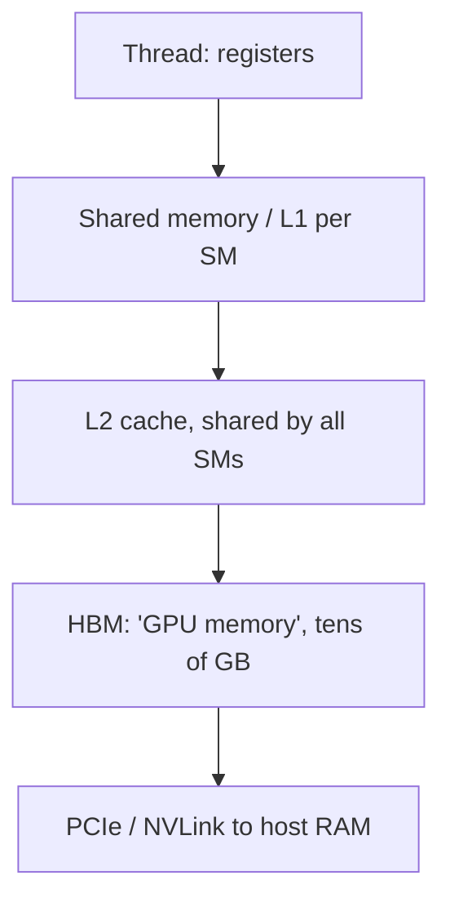

## Où cela s'inscrit

Chaque grand modèle que tu rencontreras dans cette académie est entraîné et servi sur des GPU, et presque toutes les questions « pourquoi est-ce si lent ? » à leur sujet ont la même forme : **l'arithmétique est bon marché, amener les nombres jusqu'aux unités arithmétiques est coûteux**. [[dl.04]] t'a montré `tensor.to("cuda")` et une boucle d'entraînement qui devenait soudain rapide ; [[sys.01]] a montré que le cache KV est un problème de *mémoire*, pas de calcul. Cette leçon ouvre la boîte en dessous : ce qui se passe vraiment quand tu lances du travail sur un GPU, pourquoi certains motifs de code sont plusieurs fois plus rapides que d'autres qui calculent exactement la même chose, et comment estimer le coût d'un noyau avec un crayon.

Ensuite, [[gpu.02]] transforme cela en outil quantitatif (le modèle roofline) et [[gpu.03]] l'applique à l'entraînement en précision mixte. Ni l'un ni l'autre n'exige un GPU, et cette leçon non plus : chaque exercice est un *simulateur* NumPy d'une règle matérielle. Le code CUDA qui apparaît plus bas est **montré et expliqué mais jamais exécuté ici**.

Une remarque d'honnêteté sur les nombres. Les sources que j'ai lues donnent quelques chiffres matériels (bandes passantes du H100, SRAM par SM, tailles mémoire) ; ils sont marqués « source ». Tout le reste sur les puces concrètes (taille de warp 32, nombre de registres, latences) est une connaissance générale des GPU NVIDIA, citée comme ordres de grandeur, et change d'une génération à l'autre. Consulte la fiche technique du fabricant avant de te fier à un chiffre isolé.

## L'idée en mots simples

Imagine un CPU comme une petite équipe de spécialistes brillants : une poignée de cœurs, chacun très rapide pour exécuter une tâche compliquée avec des branchements. Un GPU est un **immense atelier de travailleurs simples**, des milliers d'entre eux, qui suivent tous la même feuille d'instructions en même temps sur des données différentes. Si ton travail est « faire la même chose à un million de nombres » (et la multiplication matricielle est exactement cela), l'atelier gagne largement.

L'atelier est organisé d'une façon particulière :

- Les travailleurs sont regroupés en **escouades de 32 qui doivent avancer au pas** : à chaque tic, les 32 font la même instruction (sur leurs propres données). L'escouade s'appelle un **warp**.
- Les escouades sont regroupées en **équipes (blocs)** qui partagent un petit **tableau blanc** très rapide (mémoire partagée) et peuvent s'attendre mutuellement à une barrière.
- Chaque **atelier (multiprocesseur de flux, SM)** accueille plusieurs équipes à la fois. Quand une escouade attend une livraison de l'entrepôt, l'atelier passe simplement à une autre escouade prête. C'est ainsi que les GPU cachent le temps d'attente : pas par une prédiction astucieuse comme un CPU, mais avec tant d'escouades en vol que quelqu'un est toujours prêt.
- L'**entrepôt** (HBM, la « mémoire GPU » de `nvidia-smi`) est vaste mais lointain. Une **étagère plus proche** (cache L2) est partagée par tous les ateliers. Chaque travailleur a quelques **poches** (registres).

Trois choses rendent un atelier lent même si les travailleurs sont rapides :

1. **Le pas cadencé est un gaspillage quand les travailleurs ne sont pas d'accord.** Si la moitié d'une escouade veut faire la tâche A et l'autre moitié la tâche B, l'escouade fait A pendant que les gens de B restent inactifs, puis B pendant que les gens de A restent inactifs. Coût : les deux.
2. **Les livraisons sont plus rapides en grandes caisses contiguës.** Si 32 travailleurs demandent 32 articles voisins, un camion apporte une caisse. S'ils demandent 32 articles dispersés, 32 camions roulent.
3. **Pas assez d'escouades en vol.** Si les poches de chaque travailleur ou le tableau blanc de chaque équipe sont si grands que peu d'équipes tiennent dans un atelier, l'atelier manque d'escouades prêtes et reste inactif en attendant l'entrepôt.

Tout dans cette leçon est une version précise de ces trois phrases.

## Le modèle d'exécution

### Threads, blocs, grilles

Tu écris une fonction, un **noyau** (kernel), et tu la lances sur une **grille** de **blocs** de **threads**. Chaque thread exécute le même code ; il se distingue des autres par des indices intégrés. En CUDA (le modèle de programmation de NVIDIA), ce sont `threadIdx` (position dans le bloc), `blockIdx` (position du bloc dans la grille), `blockDim` et `gridDim` (les tailles). Un thread calcule typiquement sa propre position globale

$$
i=\text{blockIdx.x}\cdot\text{blockDim.x}+\text{threadIdx.x}
$$

et travaille sur l'élément `i`. Les blocs et les grilles peuvent être à 1, 2 ou 3 dimensions ; pour les matrices on utilise le 2-D.

Règles empiriques de lancement (connaissances générales, vraies pour les GPU NVIDIA de la dernière décennie) : un bloc contient au plus 1024 threads ; tous les threads d'un bloc s'exécutent sur le **même SM** ; des blocs différents sont indépendants et peuvent s'exécuter dans n'importe quel ordre, sur n'importe quel SM, donc les blocs ne peuvent pas s'attendre les uns les autres au sein d'un même lancement.

### SIMT et warps

Le SM exécute les threads par groupes de **32 threads consécutifs (selon l'indice de thread aplati) appelés un warp**. Le modèle s'appelle **SIMT** (single instruction, multiple threads) : une instruction est récupérée et émise pour tout le warp, et chacune des 32 voies l'applique à ses propres registres. Un bloc de 256 threads fait 8 warps. La taille de warp de 32 est un fait du matériel NVIDIA (AMD utilise 32 ou 64 selon la génération).

### Divergence de warp

Prends un noyau avec `if (cond) A else B`. Si **toutes** les 32 voies d'un warp sont d'accord, le warp n'exécute qu'un côté. Si elles divergent, le matériel exécute le côté A avec les voies qui ont pris B désactivées (« masquées »), puis le côté B avec les voies de A masquées : **deux passes**. L'exercice 1 compte les passes. Trois conditions sur 128 threads (4 warps) :

| condition | ce que fait chaque warp | passes totales |
|---|---|---|
| `tid % 2 == 0` | chaque warp a des voies paires et impaires | 8 (efficacité 0.5) |
| `(tid // 32) % 2 == 0` | chaque warp est uniforme | 4 (efficacité 1.0) |
| `tid < 48` | le warp 1 (threads 32-63) se scinde à 48 | 5 (efficacité 0.8) |

La leçon : branche sur quelque chose qui est **constant au sein d'un warp** (comme l'indice du warp ou un paramètre valable pour tout le bloc), pas sur quelque chose qui varie voie par voie. La divergence coûte du temps mais jamais de la justesse. Note que la divergence n'est un problème que lorsque les deux côtés font un vrai travail ; un petit test de bornes `if (i < n)` en fin de tableau ne coûte rien de notable.

### Multiprocesseurs de flux

Un SM contient les unités arithmétiques, un grand **fichier de registres**, un petit bloc de **mémoire partagée / cache L1**, et des ordonnanceurs de warps. Un GPU moderne de centre de données a de l'ordre de 100 SM (par exemple 108 sur un A100, 132 sur un H100 SXM ; connaissances générales). Chaque SM garde de nombreux warps *résidents* (jusqu'à 64 warps, 2048 threads, sur les puces NVIDIA récentes ; connaissances générales) et à chaque cycle chaque ordonnanceur choisit un warp résident dont les opérandes sont prêts. Passer d'un warp à l'autre est gratuit car chaque warp résident a ses propres registres alloués en permanence : rien n'est à sauvegarder ni à restaurer.

## La hiérarchie mémoire



Ordres de grandeur (la bande passante de la première ligne et les chiffres HBM et SRAM marqués *source* viennent de la leçon sur le cache KV/FlashAttention que j'ai lue, écrite pour un H100 ; le reste est une connaissance générale des puces NVIDIA récentes, citée de façon approximative) :

| niveau | portée | taille (ordre) | latence (ordre) | bande passante (ordre) |
|---|---|---|---|---|
| registres | un thread | jusqu'à 255 par thread ; 64K de 32 bits par SM | environ 1 cycle | la plus élevée |
| mémoire partagée / L1 | un SM (un bloc) | environ 100-250 Ko par SM (source : environ 256 Ko sur H100) | dizaines de cycles | source : environ 30 To/s cumulés de « SRAM » |
| cache L2 | toute la puce | dizaines de Mo | quelques centaines de cycles | plusieurs To/s |
| HBM (mémoire globale) | toute la puce | source : 80 Go sur H100 | plusieurs centaines de cycles | source : environ 3 To/s |
| RAM hôte via PCIe | de l'autre côté du lien | centaines de Go | microsecondes | dizaines de Go/s |

Lis le tableau verticalement et tu obtiens le fait central de la programmation GPU : **chaque palier vers le bas coûte environ 10x en bande passante et 10x ou plus en latence**. La source cite la SRAM à environ 10x la bande passante de la HBM ; je ne lirais pas plus de précision dans une cellule que « ordre de grandeur ». Un noyau est rapide quand la plupart de ses données sont réutilisées depuis les registres et la mémoire partagée plutôt que récupérées à nouveau depuis la HBM.

Deux termes que tu entendras : la **mémoire globale** est le nom CUDA de la partie de la HBM que ton noyau peut adresser ; la **VRAM** est la même chose du point de vue de `nvidia-smi`. Les Tensor Cores (nommés dans la leçon d'installation que j'ai lue) sont des unités dédiées à la multiplication matricielle à l'intérieur de chaque SM ; nous les rencontrons dans [[gpu.03]].

### Coalescence

Quand les 32 voies d'un warp exécutent un chargement, le matériel regarde les 32 adresses et les fusionne en le moins possible de **transactions mémoire**. L'unité est un segment contigu aligné (couramment 32-128 octets ; j'utilise des lignes de 128 octets dans le simulateur). Si la voie `j` lit l'élément `base + j` d'un tableau float32, le warp touche 128 octets contigus : **1 transaction**. C'est un accès **coalescé**.

Si la voie `j` lit `base + stride*j`, le warp couvre `128*stride` octets : le nombre de lignes croît avec le pas jusqu'à saturer à 32. L'accident classique est de descendre une *colonne* d'une matrice rangée par lignes : les éléments d'une colonne sont espacés de `N` flottants, donc chaque voie tombe dans une ligne différente (32 transactions, avec 31/32 de chaque ligne récupérés pour rien).

Dans le simulateur (`coalesced_transactions`), pour 64 threads (2 warps) lisant des float32 :

| motif d'accès | transactions par warp | total pour 2 warps |
|---|---|---|
| `index = tid` | 1 | 2 |
| `index = 2*tid` | 2 | 4 |
| `index = tid + 1` (non aligné) | 2 | 4 |
| `index = 32*tid` (colonne d'une matrice) | 32 | 64 |

Règle : **fais en sorte que des threads consécutifs touchent des adresses consécutives**, c'est-à-dire laisse `threadIdx.x` indexer la dimension qui varie le plus vite en mémoire.

### Bancs de mémoire partagée

La mémoire partagée est découpée en **32 bancs**, un mot de 4 octets par banc et par cycle, avec des mots consécutifs dans des bancs consécutifs : le mot `w` vit dans le banc `w mod 32`. Si les 32 voies accèdent à 32 mots dans 32 bancs différents, tout est servi en un cycle. Si plusieurs voies veulent **des mots différents dans le même banc**, les accès sont **sérialisés** (un conflit de banc à `m` voies prend `m` cycles). Si plusieurs voies veulent **le même mot**, c'est une diffusion (broadcast) et c'est gratuit.

| accès (indice de mot par voie) | degré |
|---|---|
| `lane` | 1 (sans conflit) |
| `2*lane` | 2 |
| `32*lane` | 32 (chaque voie dans le banc 0) |
| `33*lane` | 1 |

La dernière ligne est l'astuce standard du remplissage (padding) : une tuile stockée comme `float tile[32][33]` (une colonne inutilisée en plus) donne à un accès par colonne un pas de 33 mots et l'étale sur tous les bancs. C'est toute l'histoire du `+1` d'apparence étrange que tu vois dans les noyaux de transposition.

### Occupation

L'**occupation** est le rapport entre les warps résidents sur un SM et le maximum qu'il supporte. Le nombre de blocs résidents est limité par la ressource qui s'épuise en premier :

$$
\text{blocks per SM}=\min\!\Big(B_{\max},\ \Big\lfloor \tfrac{T_{\max}}{t}\Big\rfloor,\ \Big\lfloor \tfrac{R}{r\cdot 32\cdot w}\Big\rfloor,\ \Big\lfloor \tfrac{S}{s}\Big\rfloor\Big)
$$

où $t$ est le nombre de threads par bloc, $w=\lceil t/32\rceil$ le nombre de warps par bloc, $r$ les registres par thread, $s$ les octets partagés par bloc, et $B_{\max}$, $T_{\max}$, $R$, $S$ sont les limites du SM en blocs, threads, registres et octets partagés. Ensuite

$$
\text{occupancy}=\frac{\text{blocks per SM}\cdot w}{W_{\max}}.
$$

Exemple avec des limites de SM illustratives (2048 threads, 32 blocs, 64 warps, 65 536 registres, 96 Ko partagés ; ce sont des nombres plausibles de classe Ampere, pas une fiche technique précise) :

| bloc | registres/thread | partagée | blocs par SM | occupation | limitée par |
|---|---|---|---|---|---|
| 256 threads | 32 | 0 | 8 | 100% | threads |
| 256 threads | 64 | 0 | 4 | 50% | registres |
| 256 threads | 128 | 0 | 2 | 25% | registres |
| 256 threads | 32 | 32 Ko | 3 | 37.5% | mémoire partagée |

Une occupation plus élevée donne à l'ordonnanceur plus de warps vers lesquels basculer pendant que d'autres attendent la mémoire, donc une faible occupation *peut* exposer la latence. Mais l'occupation est un moyen, pas un but : un noyau qui utilise plus de registres par thread pour garder les valeurs sur la puce (comme les accumulateurs de la multiplication matricielle par tuiles) tourne souvent plus vite à 50 % d'occupation qu'un noyau à court de registres à 100 %. Mesure avant d'optimiser.

## Lire un noyau : addition de vecteurs CUDA

> **Non exécuté ici.** Ceci est du CUDA C++ montré pour l'explication ; les exercices de cette académie ne le compilent jamais.

```cuda
__global__ void vec_add(const float* a, const float* b, float* c, int n) {
    int i = blockIdx.x * blockDim.x + threadIdx.x;
    if (i < n) {
        c[i] = a[i] + b[i];
    }
}

// host side
int threads = 256;
int blocks  = (n + threads - 1) / threads;   // ceiling division
vec_add<<<blocks, threads>>>(d_a, d_b, d_c, n);
```

Ligne par ligne :

1. `__global__` marque une fonction qui s'exécute sur le GPU et est lancée depuis l'hôte.
2. `const float* a, ...` : des pointeurs vers la **mémoire globale** (HBM), déjà copiés là (`d_a` est la copie sur le dispositif du tableau hôte `a`).
3. `int i = blockIdx.x * blockDim.x + threadIdx.x` : l'indice global de ce thread. Le bloc 3 de blocs de 256 threads, thread 5, obtient $3\cdot256+5=773$.
4. `if (i < n)` : la grille est arrondie à des blocs entiers, donc le dernier bloc peut avoir des threads en trop. Le branchement ne diverge que dans ce seul warp.
5. `c[i] = a[i] + b[i]` : deux chargements, une addition, un stockage. Des threads consécutifs touchent des `i` consécutifs, donc chaque chargement et le stockage sont **coalescés** : une transaction par warp et par tableau.
6. Hôte : `blocks = ceil(n / 256)` ; `<<<blocks, threads>>>` est la syntaxe de lancement (taille de grille, taille de bloc).

Ce noyau fait 1 FLOP pour 12 octets déplacés (deux chargements de 4 octets et un stockage de 4 octets par addition). Sa vitesse est entièrement fixée par la bande passante de la HBM. Nous transformerons cette observation en nombre dans [[gpu.02]].

## Lire un noyau : multiplication matricielle par tuiles

Produit matriciel $C=AB$ avec $A\in\mathbb{R}^{M\times K}$, $B\in\mathbb{R}^{K\times N}$, $C\in\mathbb{R}^{M\times N}$, chaque élément $C_{ij}=\sum_k A_{ik}B_{kj}$.

**Noyau naïf.** Un thread par élément de sortie. Chaque thread boucle sur $k$ et lit une ligne de $A$ et une colonne de $B$ en mémoire globale : $2K$ chargements pour $2K$ FLOPs. Sur toute la sortie, cela fait $2MNK$ chargements. La même ligne de $A$ est relue par les $N$ threads qui en ont besoin. Presque tout le trafic est redondant.

**Noyau par tuiles.** Un bloc de $T\times T$ threads calcule une tuile $T\times T$ de $C$. On avance le long de $k$ par morceaux de $T$ : le bloc charge en coopération une tuile $T\times T$ de $A$ et une de $B$ en **mémoire partagée**, attend à une barrière, puis chaque thread fait $T$ multiplications-additions depuis la mémoire partagée.

> **Non exécuté ici.** CUDA C++ pour l'explication seulement. Suppose que `M`, `N`, `K` sont des multiples de `TILE`.

```cuda
#define TILE 16
__global__ void matmul_tiled(const float* A, const float* B, float* C,
                             int M, int N, int K) {
    __shared__ float As[TILE][TILE];
    __shared__ float Bs[TILE][TILE];

    int row = blockIdx.y * TILE + threadIdx.y;
    int col = blockIdx.x * TILE + threadIdx.x;
    float acc = 0.0f;

    for (int t = 0; t < K / TILE; ++t) {
        As[threadIdx.y][threadIdx.x] = A[row * K + t * TILE + threadIdx.x];
        Bs[threadIdx.y][threadIdx.x] = B[(t * TILE + threadIdx.y) * N + col];
        __syncthreads();
        for (int k = 0; k < TILE; ++k)
            acc += As[threadIdx.y][k] * Bs[k][threadIdx.x];
        __syncthreads();
    }
    C[row * N + col] = acc;
}
```

Ligne par ligne :

1. `TILE 16` : un bloc fait $16\times16=256$ threads (8 warps). Le lancement est `dim3 block(16,16); dim3 grid(N/16, M/16);`.
2. `__shared__ float As, Bs` : deux tableaux de flottants $16\times16$ (2 Ko au total) qui vivent dans la mémoire partagée du SM, une copie par bloc, visible par les 256 threads.
3. `row`, `col` : l'élément de sortie dont ce thread est responsable. `y` indexe les lignes, `x` les colonnes.
4. `acc` : vit dans un **registre** ; il accumule le produit scalaire sur toutes les tuiles.
5. Boucle sur `t` : numéro de tuile le long de la dimension partagée $K$.
6. Premier chargement : le thread $(y,x)$ copie un élément de la tuile courante de $A$. `A[row*K + t*TILE + x]` : des `x` consécutifs lisent des adresses consécutives, donc le chargement du warp est **coalescé**.
7. Second chargement : le thread $(y,x)$ copie un élément de la tuile de $B$. `B[(t*TILE+y)*N + col]` : des `x` consécutifs correspondent à des colonnes consécutives : également coalescé.
8. `__syncthreads()` (1) : une barrière. Sans elle, un warp rapide pourrait commencer à calculer avant que les warps plus lents aient fini d'écrire la tuile. C'est la raison pour laquelle tous les threads d'un bloc doivent être sur le même SM.
9. Boucle interne sur `k` : 16 multiplications-additions par thread et par tuile, lisant `As[y][k]` (toutes les voies de même `y` lisent le même mot : une diffusion, gratuite) et `Bs[k][x]` (des `x` consécutifs : des bancs consécutifs, pas de conflit).
10. `__syncthreads()` (2) : n'écrase pas les tuiles à l'itération suivante tant que tout le monde n'a pas fini de les lire.
11. Écriture `C[row*N+col] = acc` : stockage coalescé.

**Modèle de trafic.** Chaque élément de $A$ est nécessaire aux $N$ sorties de sa ligne. Sans tuiles, il est chargé $N$ fois ; avec des tuiles $T\times T$, il est chargé une fois par colonne de tuiles de $C$, soit $N/T$ fois. De même chaque élément de $B$ est chargé $M/T$ fois. Donc

$$
\text{loads}_{\text{tiled}}=MK\cdot\frac{N}{T}+KN\cdot\frac{M}{T}=\frac{2MNK}{T},\qquad
\text{loads}_{\text{naive}}=2MNK,
$$

plus $MN$ stockages dans les deux cas. La réduction vaut exactement la largeur de tuile $T$. Avec le nombre de FLOPs $2MNK$, l'intensité arithmétique (FLOPs par octet déplacé) augmente d'environ $T$.

## Exemple détaillé

Tous les nombres ci-dessous sont produits par le code solution des deux exercices (float32, donc 4 octets par élément).

**1. Trafic.** $M=N=K=1024$ :

| noyau | trafic global | FLOPs par octet |
|---|---|---|
| naïf | 8 594 128 896 o (environ 8,6 Go) | 0.2499 |
| par tuiles, $T=16$ | 541 065 216 o (environ 541 Mo) | 3.97 |
| par tuiles, $T=32$ | 272 629 760 o (environ 273 Mo) | 7.88 |

Le noyau $T=32$ déplace 31,5 fois moins d'octets que le naïf (le rapport est légèrement inférieur à 32 à cause des $MN$ stockages). Sur un petit cas, tu peux vérifier à la main : $M=N=K=64$, le naïf donne $4\,(2\cdot64^3+64^2)=2{,}113{,}536$ octets ; avec $T=16$ cela donne $4\,(2\cdot64^3/16+64^2)=147{,}456$ octets.

**2. La divergence et la coalescence** sont dans les tableaux ci-dessus ; ce sont les cas de test de l'exercice 1.

**3. L'occupation** est le tableau de la section Occupation ; ce sont les cas de test de l'exercice 2.

## Implémentation

Les simulateurs tiennent en quelques lignes de NumPy. Les warps ne sont qu'un reshape :

```python
import numpy as np

def divergence_passes(cond, warp=32):
    c = np.asarray(cond, dtype=bool).reshape(-1, warp)   # (n_warps, 32)
    return int(c.any(axis=1).sum() + (~c).any(axis=1).sum())

def coalesced_transactions(index, elem_bytes=4, line=128, warp=32):
    idx = np.asarray(index, dtype=np.int64).reshape(-1, warp)
    return sum(len(set((row * elem_bytes // line).tolist())) for row in idx)
```

Ce que fait la production à la place : tu ne comptes jamais les transactions à la main. `ncu` (Nsight Compute) rapporte l'« efficacité des chargements globaux », les conflits de banc et l'occupation atteinte pour un vrai noyau, et `cudaOccupancyMaxActiveBlocksPerMultiprocessor` calcule la formule d'occupation ci-dessus. Le code d'apprentissage profond écrit rarement ces noyaux : cuBLAS et cuDNN fournissent des multiplications matricielles optimisées, FlashAttention fournit l'attention, et Triton te laisse écrire des noyaux par tuiles en Python. Pour confirmer qu'un GPU est présent et mesurer une multiplication matricielle, tu lancerais ce qui suit ; cela **demande un GPU** et n'est pas exécuté ici.

```python
# needs a GPU (not executed in this academy)
import time, torch
x = torch.randn(4096, 4096, device="cuda")
torch.cuda.synchronize()
t0 = time.time()
y = x @ x
torch.cuda.synchronize()   # kernels are asynchronous: wait before reading the clock
print(f"{time.time() - t0:.4f} s")
```

Les appels à `synchronize` comptent : un lancement CUDA retourne immédiatement, donc sans eux tu ne chronométrerais que le lancement.

## Formes

| grandeur | forme / valeur |
|---|---|
| `A`, `B`, `C` | `(M, K)`, `(K, N)`, `(M, N)`, rangées par lignes (l'élément `(i, j)` est à `i*cols + j`) |
| bloc (matmul) | `(16, 16)` threads = 256 = 8 warps |
| grille (matmul) | `(N/16, M/16)` blocs |
| warp | 32 threads consécutifs dans l'ordre aplati du bloc (`threadIdx.x` varie le plus vite) |
| tuiles partagées `As`, `Bs` | `(16, 16)` flottants chacune |
| entrée du simulateur `cond`, `index` | 1-D, longueur multiple de 32 |

## Idées reçues

- **« Un thread GPU est comme un thread CPU. »** Un thread GPU est une voie d'un warp ; il n'a pas de pointeur d'instruction indépendant dans l'image de performance du modèle de programmation, et en créer un million est normal.
- **« Plus de threads par bloc est toujours mieux. »** La taille de bloc s'arbitre avec les registres par thread et la mémoire partagée par bloc ; elle ne compte que via l'occupation et l'efficacité au niveau du warp, et 128-256 est une valeur par défaut raisonnable courante.
- **« La divergence rend le résultat faux. »** Elle le rend seulement plus lent ; les voies masquées conservent leurs valeurs.
- **« 100 % d'occupation est le but. »** C'est un outil pour masquer la latence. Les noyaux avec beaucoup de travail indépendant par thread peuvent saturer le matériel à 25-50 %.
- **« La mémoire partagée n'est qu'une mémoire globale plus rapide. »** Elle est gérée explicitement par toi, par bloc, de taille limitée, et a son propre mode de défaillance (conflits de banc).
- **« Les noyaux GPU s'exécutent dans l'ordre du programme. »** Les lancements sont asynchrones par rapport à l'hôte ; utilise `torch.cuda.synchronize()` (ou des événements CUDA) avant de chronométrer.
- **« Le GPU est plus rapide pour tout. »** Pour un travail petit ou plein de branchements, ou quand les données doivent traverser le PCIe, le CPU peut gagner. La leçon d'installation que j'ai lue fait le même constat : les petites tâches n'ont pas besoin d'un GPU.

## Points clés

- Un GPU exécute une grille de blocs de threads ; les threads s'exécutent au pas dans des warps de 32 sur des SM, et le SM cache la latence mémoire en basculant entre de nombreux warps résidents.
- La divergence de warp coûte une passe par chemin distinct dans le warp ; branche sur des conditions uniformes au warp.
- La mémoire est une hiérarchie ; chaque niveau est environ un ordre de grandeur plus petit, plus proche et plus rapide. Garde les données réutilisées dans les registres et la mémoire partagée.
- Coalesce : des voies consécutives doivent toucher des adresses consécutives (1 transaction par warp au lieu de jusqu'à 32). Évite les conflits de banc (remplis jusqu'à un pas de 33).
- L'occupation est un minimum sur quatre limites de ressources ; elle aide à masquer la latence mais n'est pas un objectif.
- Le découpage en tuiles $T\times T$ divise par $T$ le trafic en mémoire globale de la multiplication matricielle.

## Explique-le toi-même

1. Explique, à quelqu'un qui ne connaît que Python, pourquoi un GPU peut être plusieurs fois plus lent sur une « somme de colonne » que sur une « somme de ligne » de la même matrice rangée par lignes, sans mentionner le nombre de cœurs.
2. Le noyau d'un collègue contient `if (threadIdx.x % 2 == 0) heavyA(); else heavyB();`. Que coûte-t-il comparé à `if (blockIdx.x % 2 == 0)` ? Comment le restructurerais-tu ?

## Pour aller plus loin

- NVIDIA CUDA C++ Programming Guide : modèle d'exécution, hiérarchie mémoire, mémoire partagée (la source primaire de chaque règle matérielle ici ; non lue pour cette leçon).
- Kirk et Hwu, *Programming Massively Parallel Processors* (chapitre sur la multiplication matricielle par tuiles ; non lu pour cette leçon).
- [[gpu.02]] pour transformer octets et FLOPs en une borne de performance ; [[adv.06]] et [[gpu.03]] pour la mémoire à l'échelle de l'entraînement.

## Critères de maîtrise

- Étant donné une condition sur les identifiants de threads, compter les passes de warp à la main et par le code.
- Étant donné une expression d'indice et une taille d'élément, compter les transactions en mémoire globale par warp et nommer le pas qui corrige le problème.
- Calculer l'occupation à partir de la taille de bloc, des registres et de la mémoire partagée, et nommer la ressource limitante.
- Dériver la formule de trafic de la multiplication matricielle par tuiles $2MNK/T$ et expliquer d'où vient la réutilisation.
- Lire un court noyau CUDA et dire quels accès sont coalescés et où une barrière est requise.
