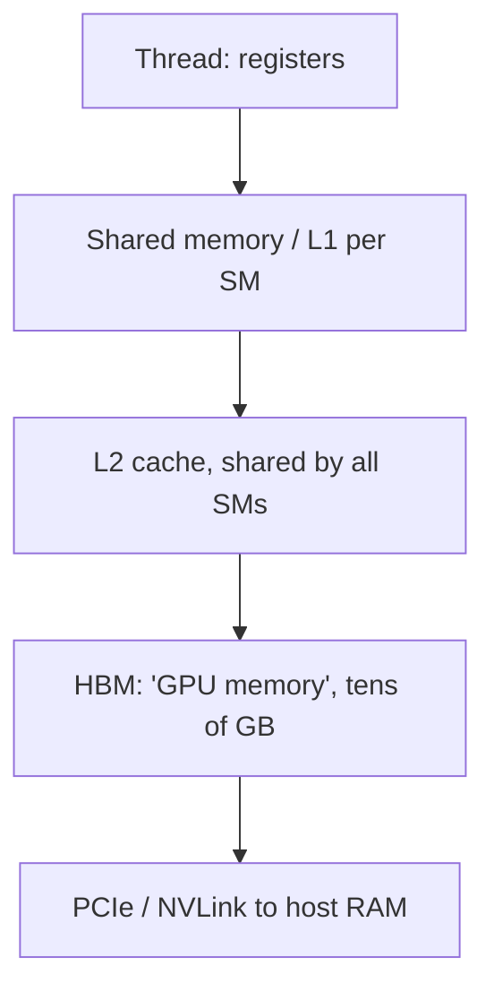

## Where this fits

Every large model you will meet in this academy is trained and served on GPUs, and almost every "why is this so slow?" question about them has the same shape: **the arithmetic is cheap, getting the numbers to the arithmetic units is expensive**. [[dl.04]] showed you `tensor.to("cuda")` and a training loop that suddenly ran fast; [[sys.01]] showed that the KV cache is a *memory* problem, not a compute problem. This lesson opens the box underneath: what actually happens when you launch work on a GPU, why some code patterns are many times faster than others that compute exactly the same thing, and how to estimate the cost of a kernel with a pencil.

Next, [[gpu.02]] turns this into a quantitative tool (the roofline model) and [[gpu.03]] applies it to mixed-precision training. Neither needs a GPU, and neither does this lesson: every exercise is a NumPy *simulator* of a hardware rule. The CUDA code that appears below is **shown and explained but never executed here**.

A note on honesty about numbers. The sources I read give a few hardware figures (H100 bandwidths, SRAM per SM, memory sizes); those are marked "source". Everything else about concrete chips (warp size 32, register counts, latencies) is general knowledge about NVIDIA GPUs, quoted as orders of magnitude, and changes from generation to generation. Check the vendor's specification sheet before relying on any single number.

## The idea in plain words

Picture a CPU as a small team of brilliant specialists: a handful of cores, each very fast at running one complicated, branching job. A GPU is a **huge factory floor of simple workers**, thousands of them, who all follow the same instruction sheet at the same time on different pieces of data. If your job is "do the same thing to a million numbers" (and matrix multiplication is exactly that), the factory wins by a mile.

The factory is organised in a particular way:

- Workers are grouped into **squads of 32 who must move in lock-step**: at each tick, all 32 do the same instruction (on their own data). The squad is called a **warp**.
- Squads are grouped into **teams (blocks)** that share a small, very fast **whiteboard** (shared memory) and can wait for each other at a barrier.
- Each **workshop (streaming multiprocessor, SM)** hosts several teams at once. When one squad is waiting for a delivery from the warehouse, the workshop simply switches to another squad that is ready. This is how GPUs hide waiting time: not with clever prediction like a CPU, but with so many squads in flight that someone is always ready.
- The **warehouse** (HBM, the "GPU memory" in `nvidia-smi`) is large but far away. A **closer shelf** (L2 cache) is shared by all workshops. Each worker has a few **pockets** (registers).

Three things make a factory slow even though the workers are fast:

1. **Lock-step is wasteful when workers disagree.** If half a squad wants to do task A and half task B, the squad does A while the B-people stand idle, then B while the A-people stand idle. Cost: both.
2. **Deliveries are fastest in big contiguous crates.** If 32 workers ask for 32 neighbouring items, one truck brings one crate. If they ask for 32 scattered items, 32 trucks drive.
3. **Not enough squads in flight.** If each worker's pockets or each team's whiteboard are so large that few teams fit in a workshop, the workshop runs out of ready squads and idles while waiting for the warehouse.

Everything in this lesson is a precise version of those three sentences.

## The execution model

### Threads, blocks, grids

You write one function, a **kernel**, and launch it over a **grid** of **blocks** of **threads**. Every thread runs the same code; it tells itself apart by built-in indices. In CUDA (NVIDIA's programming model) these are `threadIdx` (position inside the block), `blockIdx` (position of the block in the grid), `blockDim` and `gridDim` (the sizes). A thread typically computes its own global position

$$
i=\text{blockIdx.x}\cdot\text{blockDim.x}+\text{threadIdx.x}
$$

and works on element `i`. Blocks and grids can be 1-, 2- or 3-dimensional; for matrices you use 2-D.

Launch rules of thumb (general knowledge, true for NVIDIA GPUs of the last decade): a block holds at most 1024 threads; all threads of a block run on the **same SM**; different blocks are independent and may run in any order, on any SM, so blocks cannot wait for each other inside one launch.

### SIMT and warps

The SM executes threads in groups of **32 consecutive threads (by flattened thread index) called a warp**. The model is called **SIMT** (single instruction, multiple threads): one instruction is fetched and issued for the whole warp, and each of the 32 lanes applies it to its own registers. A block of 256 threads is 8 warps. The warp size of 32 is a fact about NVIDIA hardware (AMD uses 32 or 64 depending on the generation).

### Warp divergence

Take a kernel with `if (cond) A else B`. If **all** 32 lanes of a warp agree, the warp runs only one side. If they disagree, the hardware runs side A with the lanes that took B switched off ("masked"), then side B with the A lanes masked: **two passes**. Exercise 1 counts passes. Three conditions on 128 threads (4 warps):

| condition | what each warp does | total passes |
|---|---|---|
| `tid % 2 == 0` | every warp has even and odd lanes | 8 (efficiency 0.5) |
| `(tid // 32) % 2 == 0` | each warp is uniform | 4 (efficiency 1.0) |
| `tid < 48` | warp 1 (threads 32-63) splits at 48 | 5 (efficiency 0.8) |

The lesson: branch on something that is **constant within a warp** (like the warp's index or a block-wide parameter), not on something that varies lane by lane. Divergence costs time but never correctness. Note that divergence is only a problem when the two sides do real work; a tiny `if (i < n)` bounds check at the end of the array costs nothing noticeable.

### Streaming multiprocessors

An SM contains the arithmetic units, a large **register file**, a small block of **shared memory / L1 cache**, and warp schedulers. A modern data-centre GPU has on the order of 100 SMs (for instance 108 on an A100, 132 on an H100 SXM; general knowledge). Each SM keeps many warps *resident* (up to 64 warps, 2048 threads, on recent NVIDIA parts; general knowledge) and every cycle each scheduler picks a resident warp whose operands are ready. Switching between warps is free because every resident warp has its own registers permanently allocated: nothing needs saving or restoring.

## The memory hierarchy



Orders of magnitude (the first row's bandwidth and the HBM and SRAM figures marked *source* come from the KV-cache/FlashAttention lesson I read, written for an H100; the rest are general knowledge for recent NVIDIA parts, quoted loosely):

| level | scope | size (order) | latency (order) | bandwidth (order) |
|---|---|---|---|---|
| registers | one thread | up to 255 per thread; 64K 32-bit per SM | about 1 cycle | highest |
| shared memory / L1 | one SM (one block) | about 100-250 KB per SM (source: about 256 KB on H100) | tens of cycles | source: about 30 TB/s aggregate "SRAM" |
| L2 cache | whole chip | tens of MB | a few hundred cycles | several TB/s |
| HBM (global memory) | whole chip | source: 80 GB on H100 | several hundred cycles | source: about 3 TB/s |
| host RAM over PCIe | other side of the link | hundreds of GB | microseconds | tens of GB/s |

Read the table vertically and you get the central fact of GPU programming: **each step down costs roughly 10x in bandwidth and 10x or more in latency**. The source quotes SRAM at about 10x HBM bandwidth; I would not read more precision into any cell than "order of magnitude". A kernel is fast when most of its data is reused out of registers and shared memory rather than fetched from HBM again.

Two terms you will hear: **global memory** is the CUDA name for the part of HBM your kernel can address; **VRAM** is the same thing from `nvidia-smi`'s point of view. Tensor Cores (named in the setup lesson I read) are dedicated matrix-multiply units inside each SM; we meet them in [[gpu.03]].

### Coalescing

When the 32 lanes of a warp execute a load, the hardware looks at the 32 addresses and merges them into as few **memory transactions** as possible. The unit is a contiguous aligned segment (commonly 32-128 bytes; I use 128-byte lines in the simulator). If lane `j` reads element `base + j` of a float32 array, the warp touches 128 contiguous bytes: **1 transaction**. This is a **coalesced** access.

If lane `j` reads `base + stride*j`, the warp spans `128*stride` bytes: the number of lines grows with the stride until it saturates at 32. The classic accident is walking down a *column* of a row-major matrix: the elements of a column are `N` floats apart, so every lane lands in a different line (32 transactions, with 31/32 of every line fetched for nothing).

In the simulator (`coalesced_transactions`), for 64 threads (2 warps) reading float32:

| access pattern | transactions per warp | total for 2 warps |
|---|---|---|
| `index = tid` | 1 | 2 |
| `index = 2*tid` | 2 | 4 |
| `index = tid + 1` (misaligned) | 2 | 4 |
| `index = 32*tid` (column of a matrix) | 32 | 64 |

Rule: **make consecutive threads touch consecutive addresses**, i.e. let `threadIdx.x` index the fastest-moving dimension in memory.

### Shared-memory banks

Shared memory is split into **32 banks**, one 4-byte word per bank per cycle, with consecutive words in consecutive banks: word `w` lives in bank `w mod 32`. If the 32 lanes access 32 words in 32 different banks, all are served in one cycle. If several lanes want **different words in the same bank**, the accesses are **serialised** (an `m`-way bank conflict takes `m` cycles). If several lanes want the **same word**, it is a broadcast and free.

| access (word index per lane) | degree |
|---|---|
| `lane` | 1 (conflict-free) |
| `2*lane` | 2 |
| `32*lane` | 32 (every lane in bank 0) |
| `33*lane` | 1 |

The last row is the standard padding trick: a tile stored as `float tile[32][33]` (one extra unused column) makes a column access stride 33 words and spreads it across all banks. That is the whole story behind the odd-looking `+1` you see in transpose kernels.

### Occupancy

**Occupancy** is the ratio of resident warps on an SM to the maximum it supports. The number of resident blocks is limited by whichever resource runs out first:

$$
\text{blocks per SM}=\min\!\Big(B_{\max},\ \Big\lfloor \tfrac{T_{\max}}{t}\Big\rfloor,\ \Big\lfloor \tfrac{R}{r\cdot 32\cdot w}\Big\rfloor,\ \Big\lfloor \tfrac{S}{s}\Big\rfloor\Big)
$$

where $t$ is threads per block, $w=\lceil t/32\rceil$ warps per block, $r$ registers per thread, $s$ shared bytes per block, and $B_{\max}$, $T_{\max}$, $R$, $S$ are the SM's limits on blocks, threads, registers and shared bytes. Then

$$
\text{occupancy}=\frac{\text{blocks per SM}\cdot w}{W_{\max}}.
$$

Example with illustrative SM limits (2048 threads, 32 blocks, 64 warps, 65,536 registers, 96 KB shared; these are plausible Ampere-class numbers, not a specific datasheet):

| block | registers/thread | shared | blocks per SM | occupancy | limited by |
|---|---|---|---|---|---|
| 256 threads | 32 | 0 | 8 | 100% | threads |
| 256 threads | 64 | 0 | 4 | 50% | registers |
| 256 threads | 128 | 0 | 2 | 25% | registers |
| 256 threads | 32 | 32 KB | 3 | 37.5% | shared memory |

Higher occupancy gives the scheduler more warps to switch to while others wait for memory, so low occupancy *can* expose latency. But occupancy is a means, not a goal: a kernel that uses more registers per thread to keep values on-chip (like the tiled matmul accumulators) often runs faster at 50% occupancy than a register-starved one at 100%. Measure before you tune.

## Reading a kernel: CUDA vector add

> **Not executed here.** This is CUDA C++ shown for explanation; the exercises in this academy never compile it.

```cuda
__global__ void vec_add(const float* a, const float* b, float* c, int n) {
    int i = blockIdx.x * blockDim.x + threadIdx.x;
    if (i < n) {
        c[i] = a[i] + b[i];
    }
}

// host side
int threads = 256;
int blocks  = (n + threads - 1) / threads;   // ceiling division
vec_add<<<blocks, threads>>>(d_a, d_b, d_c, n);
```

Line by line:

1. `__global__` marks a function that runs on the GPU and is launched from the host.
2. `const float* a, ...`: pointers into **global memory** (HBM), already copied there (`d_a` is the device copy of the host array `a`).
3. `int i = blockIdx.x * blockDim.x + threadIdx.x`: this thread's global index. Block 3 of 256-thread blocks, thread 5 gets $3\cdot256+5=773$.
4. `if (i < n)`: the grid is rounded up to whole blocks, so the last block may have spare threads. The branch diverges only in that one warp.
5. `c[i] = a[i] + b[i]`: two loads, one add, one store. Consecutive threads touch consecutive `i`, so every load and the store is **coalesced**: one transaction per warp per array.
6. Host: `blocks = ceil(n / 256)`; `<<<blocks, threads>>>` is the launch syntax (grid size, block size).

This kernel does 1 FLOP per 12 bytes moved (two 4-byte loads and one 4-byte store per add). Its speed is set entirely by HBM bandwidth. We will turn that observation into a number in [[gpu.02]].

## Reading a kernel: tiled matrix multiplication

Matrix product $C=AB$ with $A\in\mathbb{R}^{M\times K}$, $B\in\mathbb{R}^{K\times N}$, $C\in\mathbb{R}^{M\times N}$, each element $C_{ij}=\sum_k A_{ik}B_{kj}$.

**Naive kernel.** One thread per output element. Each thread loops over $k$ and reads a row of $A$ and a column of $B$ from global memory: $2K$ loads for $2K$ FLOPs. Over the whole output that is $2MNK$ loads. The same row of $A$ is re-read by all $N$ threads that need it. Almost all traffic is redundant.

**Tiled kernel.** A block of $T\times T$ threads computes a $T\times T$ tile of $C$. March along $k$ in chunks of $T$: the block cooperatively loads a $T\times T$ tile of $A$ and one of $B$ into **shared memory**, waits at a barrier, then every thread does $T$ multiply-adds out of shared memory.

> **Not executed here.** CUDA C++ for explanation only. Assumes `M`, `N`, `K` are multiples of `TILE`.

```cuda
#define TILE 16
__global__ void matmul_tiled(const float* A, const float* B, float* C,
                             int M, int N, int K) {
    __shared__ float As[TILE][TILE];
    __shared__ float Bs[TILE][TILE];

    int row = blockIdx.y * TILE + threadIdx.y;
    int col = blockIdx.x * TILE + threadIdx.x;
    float acc = 0.0f;

    for (int t = 0; t < K / TILE; ++t) {
        As[threadIdx.y][threadIdx.x] = A[row * K + t * TILE + threadIdx.x];
        Bs[threadIdx.y][threadIdx.x] = B[(t * TILE + threadIdx.y) * N + col];
        __syncthreads();
        for (int k = 0; k < TILE; ++k)
            acc += As[threadIdx.y][k] * Bs[k][threadIdx.x];
        __syncthreads();
    }
    C[row * N + col] = acc;
}
```

Line by line:

1. `TILE 16`: a block is $16\times16=256$ threads (8 warps). The launch is `dim3 block(16,16); dim3 grid(N/16, M/16);`.
2. `__shared__ float As, Bs`: two $16\times16$ float arrays (2 KB total) living in the SM's shared memory, one copy per block, visible to all 256 threads.
3. `row`, `col`: the output element this thread owns. `y` indexes rows, `x` columns.
4. `acc`: lives in a **register**; it accumulates the dot product across all tiles.
5. Loop over `t`: tile number along the shared dimension $K$.
6. First load: thread $(y,x)$ copies one element of the current $A$ tile. `A[row*K + t*TILE + x]`: consecutive `x` read consecutive addresses, so the warp's load is **coalesced**.
7. Second load: thread $(y,x)$ copies one element of the $B$ tile. `B[(t*TILE+y)*N + col]`: consecutive `x` map to consecutive columns: also coalesced.
8. `__syncthreads()` (1): a barrier. Without it a fast warp could start computing before slower warps have finished writing the tile. It is the reason all threads of a block must be on the same SM.
9. Inner loop over `k`: 16 multiply-adds per thread per tile, reading `As[y][k]` (all lanes with the same `y` read the same word: a broadcast, free) and `Bs[k][x]` (consecutive `x`: consecutive banks, no conflict).
10. `__syncthreads()` (2): do not overwrite the tiles in the next iteration until everyone has finished reading them.
11. Write `C[row*N+col] = acc`: coalesced store.

**Traffic model.** Each element of $A$ is needed by the $N$ outputs in its row. Without tiling it is loaded $N$ times; with $T\times T$ tiles it is loaded once per tile column of $C$, i.e. $N/T$ times. Likewise each element of $B$ is loaded $M/T$ times. Therefore

$$
\text{loads}_{\text{tiled}}=MK\cdot\frac{N}{T}+KN\cdot\frac{M}{T}=\frac{2MNK}{T},\qquad
\text{loads}_{\text{naive}}=2MNK,
$$

plus $MN$ stores in both cases. The reduction is exactly the tile width $T$. With the FLOP count $2MNK$ the arithmetic intensity (FLOPs per byte moved) rises by about $T$.

## Worked example

All numbers below are produced by the solution code of the two exercises (float32, so 4 bytes per element).

**1. Traffic.** $M=N=K=1024$:

| kernel | global traffic | FLOPs per byte |
|---|---|---|
| naive | 8,594,128,896 B (about 8.6 GB) | 0.2499 |
| tiled, $T=16$ | 541,065,216 B (about 541 MB) | 3.97 |
| tiled, $T=32$ | 272,629,760 B (about 273 MB) | 7.88 |

The $T=32$ kernel moves 31.5 times fewer bytes than the naive one (the ratio is slightly under 32 because of the $MN$ stores). On a small case you can check by hand: $M=N=K=64$, naive is $4\,(2\cdot64^3+64^2)=2{,}113{,}536$ bytes; with $T=16$ it is $4\,(2\cdot64^3/16+64^2)=147{,}456$ bytes.

**2. Divergence and coalescing** are in the tables above; they are the test cases of exercise 1.

**3. Occupancy** is the table in the Occupancy section; it is exercise 2's test cases.

## Implementation

The simulators fit in a few lines of NumPy. Warps are just a reshape:

```python
import numpy as np

def divergence_passes(cond, warp=32):
    c = np.asarray(cond, dtype=bool).reshape(-1, warp)   # (n_warps, 32)
    return int(c.any(axis=1).sum() + (~c).any(axis=1).sum())

def coalesced_transactions(index, elem_bytes=4, line=128, warp=32):
    idx = np.asarray(index, dtype=np.int64).reshape(-1, warp)
    return sum(len(set((row * elem_bytes // line).tolist())) for row in idx)
```

What production does instead: you never count transactions by hand. `ncu` (Nsight Compute) reports "global load efficiency", bank conflicts and achieved occupancy for a real kernel, and `cudaOccupancyMaxActiveBlocksPerMultiprocessor` computes the occupancy formula above. Deep-learning code rarely writes these kernels: cuBLAS and cuDNN provide tuned matmuls, FlashAttention provides attention, and Triton lets you write tiled kernels in Python. To confirm a GPU is present and benchmark a matmul you would run the following; it **needs a GPU** and is not run here.

```python
# needs a GPU (not executed in this academy)
import time, torch
x = torch.randn(4096, 4096, device="cuda")
torch.cuda.synchronize()
t0 = time.time()
y = x @ x
torch.cuda.synchronize()   # kernels are asynchronous: wait before reading the clock
print(f"{time.time() - t0:.4f} s")
```

The `synchronize` calls matter: a CUDA launch returns immediately, so without them you would time only the launch.

## Shapes

| quantity | shape / value |
|---|---|
| `A`, `B`, `C` | `(M, K)`, `(K, N)`, `(M, N)`, row-major (element `(i, j)` at `i*cols + j`) |
| block (matmul) | `(16, 16)` threads = 256 = 8 warps |
| grid (matmul) | `(N/16, M/16)` blocks |
| warp | 32 consecutive threads in flattened block order (`threadIdx.x` varies fastest) |
| shared tiles `As`, `Bs` | `(16, 16)` floats each |
| simulator input `cond`, `index` | 1-D, length a multiple of 32 |

## Common misconceptions

- **"A GPU thread is like a CPU thread."** A GPU thread is a lane of a warp; it has no independent instruction pointer in the programming model's performance picture, and creating a million of them is normal.
- **"More threads per block is always better."** Block size trades against registers per thread and shared memory per block; it only matters through occupancy and warp-level efficiency, and 128-256 is a common sensible default.
- **"Divergence makes the result wrong."** It only makes it slower; masked lanes keep their values.
- **"100% occupancy is the goal."** It is a latency-hiding tool. Kernels with plenty of independent work per thread can saturate the hardware at 25-50%.
- **"Shared memory is just a faster global memory."** It is explicitly managed by you, per block, limited in size, and has its own failure mode (bank conflicts).
- **"GPU kernels run in program order."** Launches are asynchronous with respect to the host; use `torch.cuda.synchronize()` (or CUDA events) before timing.
- **"The GPU is faster at everything."** For small or branchy work, or when data must cross PCIe, the CPU can win. The setup lesson I read makes the same point: tiny jobs do not need a GPU.

## Key takeaways

- A GPU runs a grid of blocks of threads; threads execute in lock-step warps of 32 on SMs, and the SM hides memory latency by switching between many resident warps.
- Warp divergence costs one pass per distinct path in the warp; branch on warp-uniform conditions.
- Memory is a hierarchy; each level is roughly an order of magnitude smaller, nearer and faster. Keep reused data in registers and shared memory.
- Coalesce: consecutive lanes should touch consecutive addresses (1 transaction per warp instead of up to 32). Avoid bank conflicts (pad to stride 33).
- Occupancy is a minimum over four resource limits; it helps latency hiding but is not an objective.
- Tiling with $T\times T$ tiles divides global-memory traffic of matmul by $T$.

## Explain it yourself

1. Explain, to someone who knows only Python, why a GPU can be many times slower on a "column sum" than on a "row sum" of the same row-major matrix, without mentioning the number of cores.
2. A colleague's kernel has `if (threadIdx.x % 2 == 0) heavyA(); else heavyB();`. What does it cost compared with `if (blockIdx.x % 2 == 0)`? How would you restructure it?

## Further reading

- NVIDIA CUDA C++ Programming Guide: execution model, memory hierarchy, shared memory (the primary source for every hardware rule here; not read for this lesson).
- Kirk and Hwu, *Programming Massively Parallel Processors* (tiled matmul chapter; not read for this lesson).
- [[gpu.02]] for turning bytes and FLOPs into a performance bound; [[adv.06]] and [[gpu.03]] for training-scale memory.

## Mastery criteria

- Given a condition over thread ids, count warp passes by hand and by code.
- Given an index expression and an element size, count global-memory transactions per warp and name the stride that fixes it.
- Compute occupancy from block size, registers and shared memory, and name the limiting resource.
- Derive the tiled-matmul traffic formula $2MNK/T$ and explain where the reuse comes from.
- Read a short CUDA kernel and say which accesses are coalesced and where a barrier is required.
