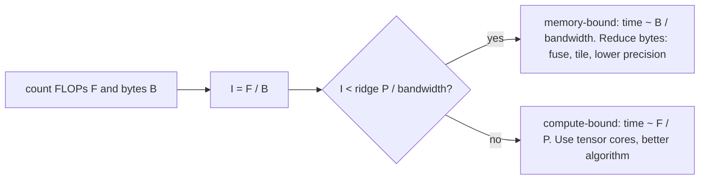

## Où cela s'inscrit

[[gpu.01]] t'a appris qu'un GPU possède une puissance arithmétique énorme et une mémoire comparativement lente, et que le tiling augmente la réutilisation de chaque octet. Cette leçon en fait un **nombre que tu peux calculer avant d'écrire la moindre ligne de code**. Pour une opération donnée, combien d'opérations en virgule flottante demande-t-elle, et combien d'octets doit-elle déplacer ? Le rapport des deux te dit si la puce sera limitée par ses unités arithmétiques ou par sa mémoire, et dans quelle mesure. C'est le **modèle roofline**.

Il répond à des questions que tu rencontreras constamment : pourquoi un plus grand batch rend l'inférence moins chère par échantillon, pourquoi softmax et layer norm sont « gratuits en FLOPs mais pas en temps », pourquoi FlashAttention est plus rapide alors qu'il fait la même arithmétique, et pourquoi accélérer les matmuls d'une étape d'entraînement d'un facteur 10 peut n'accélérer l'étape que d'un facteur 2 (loi d'Amdahl). Il se prolonge vers [[sys.01]], où le décodage avec un KV cache est limité par la mémoire pour exactement ces raisons, et vers [[gpu.03]], où les formats de plus faible précision réduisent le nombre d'octets.

Aucun GPU n'est nécessaire : les exercices sont des calculatrices. Quand je montre du code de profilage qui demanderait un GPU, c'est signalé.

## L'idée en mots simples

Une boulangerie possède des fours et une camionnette de livraison. Les fours peuvent cuire un nombre fixe de pains par heure (le **plafond de calcul**). La camionnette peut apporter une quantité fixe de farine par heure (le **plafond de bande passante**). Le nombre de pains réellement produits dépend de la recette : une recette qui donne beaucoup de pains avec peu de farine (une pâtisserie riche faite avec un petit sac) occupe les fours en permanence et est **limitée par les fours**. Une recette qui demande beaucoup de farine par pain (des crackers fins) laisse les fours inactifs en attendant la camionnette et est **limitée par la camionnette**.

Le rapport « travail par unité de matière livrée » est l'**intensité arithmétique**. Trace le meilleur résultat possible en fonction de l'intensité et tu obtiens une courbe en forme de toit : une pente à gauche (limité par la camionnette : plus d'intensité achète proportionnellement plus de vitesse) qui rejoint un plafond plat à droite (limité par les fours : rien de plus à gagner). Le coin est le **point de crête** (ridge point).

Deux conséquences pratiques :

- Si tu es sur la pente, acheter un four plus rapide ne sert à rien. Tu dois réduire les livraisons : réutiliser les données (tiling), déplacer moins d'octets (formats numériques plus petits, fusion d'étapes), ou faire plus de travail par livraison (plus grands batchs).
- Si tu es sur la partie plate, les livraisons ne sont pas le problème ; utilise les tensor cores et une meilleure précision, ou accepte d'être à la limite.

L'autre moitié de la leçon est la **loi d'Amdahl** : si tu rends une partie du travail infiniment rapide, le travail prend quand même au moins autant de temps que les parties que tu n'as pas touchées. Les profileurs servent à trouver quelles sont ces parties.

## FLOPs, octets et intensité arithmétique

**FLOPs** compte les opérations en virgule flottante. Convention : une multiplication-addition vaut 2 FLOPs, donc un produit scalaire de longueur $K$ coûte $2K$. (Ne confonds pas FLOPs, un nombre, avec FLOP/s, un débit.)

**Octets** compte le trafic entre la mémoire principale (HBM) et la puce, en supposant que chaque tenseur est lu ou écrit une seule fois sauf indication contraire. C'est une borne inférieure pour un noyau idéal ; les noyaux réels déplacent au moins autant.

**Intensité arithmétique** :

$$
I=\frac{\text{FLOPs}}{\text{bytes moved}}\quad[\text{FLOP/byte}]
$$

Règles de comptage (mes conventions, utilisées par les exercices) :

| opération | formes | FLOPs | octets (éléments $\times$ taille d'élément $e$) |
|---|---|---|---|
| matmul | $(M,K)(K,N)\to(M,N)$ | $2MNK$ | $e\,(MK+KN+MN)$ |
| softmax par lignes | $(R,C)$ | $5RC$ (max, soustraction, exp, somme, division) | $2eRC$ (lu une fois, écrit une fois) |
| layer norm | $(R,C)$ | $8RC$ (moyenne, variance, normalisation, scale-shift) | $2eRC$ (paramètres ignorés) |
| addition élément par élément | $(n)$ | $n$ | $3en$ |

Les décomptes de FLOPs pour softmax et layer norm sont des conventions approximatives (un `exp` coûte plus qu'un FLOP ordinaire sur du matériel réel) ; les conclusions ci-dessous ne dépendent pas des constantes exactes car les intensités sont un à deux ordres de grandeur sous le point de crête.

Pour un matmul carré $M=N=K=n$ : $I=\dfrac{2n^3}{3en^2}=\dfrac{2n}{3e}$, qui **croît avec $n$** : les grandes matrices réutilisent chaque élément de nombreuses fois. Pour les opérations élément par élément, $I$ est une constante inférieure à 1, quelle que soit la taille du tenseur.

## Le roofline : dérivation

Soit une puce de débit arithmétique crête $P$ (FLOP/s) et de bande passante mémoire $\beta$ (octets/s). Une opération de $F$ FLOPs et $B$ octets demande au moins $F/P$ secondes juste pour l'arithmétique et au moins $B/\beta$ secondes juste pour déplacer les données. Si l'arithmétique et les transferts se recouvrent parfaitement (le meilleur cas), le temps est le plus grand des deux :

$$
t\ \ge\ \max\!\Big(\frac{F}{P},\ \frac{B}{\beta}\Big).
$$

Le débit atteint est $F/t$. Divise numérateur et dénominateur par $B$ et utilise $I=F/B$ :

$$
\frac{F}{t}\ \le\ \frac{F}{\max(F/P,\,B/\beta)}=\min\!\Big(P,\ \frac{F\beta}{B}\Big)=\min\big(P,\ \beta I\big).
$$

C'est le roofline. Deux régimes :

- $\beta I<P$, c'est-à-dire $I<I^*$ : **limité par la mémoire**, débit $\beta I$ (une pente).
- $I\ge I^*$ : **limité par le calcul**, débit $P$ (plat).

avec le **point de crête**

$$
I^*=\frac{P}{\beta}.
$$

Intuition : $I^*$ est le nombre de FLOPs que la puce peut effectuer pendant le temps qu'il faut pour aller chercher un octet. Les opérations qui font moins de FLOPs par octet ne peuvent pas garder la puce occupée.

**Chiffres matériels.** Pour des valeurs concrètes, j'utilise un accélérateur de **classe A100** : environ $P=312$ TFLOP/s (crête tensor-core bf16/fp16, dense) et $\beta=2.0$ To/s de bande passante HBM. Ce sont des connaissances générales sur cette puce, pas issues des sources que j'ai lues ; les sources ne donnent que la bande passante HBM d'un H100 (environ 3 To/s) et un débit FlashAttention-3 (environ 740 TFLOP/s en fp16), cohérents avec le même ordre de grandeur. Alors

$$
I^*=\frac{312\times10^{12}}{2.0\times10^{12}}=156\ \text{FLOP/byte}.
$$

Les puces plus récentes ont des points de crête plus grands (le calcul a progressé plus vite que la bande passante), donc davantage de tes opérations tombent sur la pente. L'arithmétique fp32 simple (hors tensor cores) a une crête bien plus basse (environ 20 TFLOP/s sur cette puce, toujours des connaissances générales), donc un point de crête proche de 10 : la précision mixte déplace le plafond autant que les octets.



## Exemple travaillé : la classification

Tout ceci est produit par l'exercice roofline (`P=312e12`, `bw=2e12`, fp16 donc $e=2$). Les temps sont les bornes inférieures du roofline.

| opération | intensité (FLOP/octet) | limite | temps | utilisation de la crête |
|---|---|---|---|---|
| matmul $4096^3$ | 1365.3 | calcul | 440.5 us | 100% |
| couche linéaire, batch 1 ($1\times4096\to4096$) | 1.0 | mémoire | 16.8 us | 0.64% |
| couche linéaire, batch 64 | 62.1 | mémoire | 17.3 us | 39.8% |
| couche linéaire, batch 256 | 227.6 | calcul | 27.5 us | 100% |
| softmax sur $4096\times4096$ | 1.25 | mémoire | 33.6 us | 0.8% |
| layer norm sur $4096\times4096$ | 2.0 | mémoire | 33.6 us | 1.3% |

Lis le tableau :

- Le gros matmul est limité par le calcul : la vitesse des tensor cores décide.
- Softmax et layer norm sont minuscules en FLOPs, et pourtant chacun coûte 33.6 us, parce qu'ils sont limités par la mémoire : temps $=B/\beta=2\cdot2\cdot4096^2/(2\times10^{12})=33.6\ \mu$s. C'est déjà 8% du temps du gros matmul, pour presque aucune arithmétique, et leur utilisation est inférieure à 2%. C'est pourquoi on les fusionne avec leurs voisins (voir [[gpu.03]]) plutôt que de les optimiser seuls.
- **La taille de batch est un bouton d'intensité.** Une couche linéaire $y=xW$ avec $W\in\mathbb{R}^{d\times d}$ et un batch $B$ a $2Bd^2$ FLOPs et environ $e\,(d^2+2Bd)$ octets, donc pour $d\gg B$ et $e=2$ l'intensité vaut presque exactement $B$. Le batch 1 (décodage token par token) est donc à environ 1 FLOP/octet : la puce fait défiler tous les poids depuis la HBM pour faire une multiplication-addition par poids. Le batch 64 atteint 62 ; le point de crête proche de 156 est atteint autour du batch 160 dans ce modèle. C'est l'arithmétique derrière « le batching rend le service moins cher par requête » et derrière la phase de décodage d'un LLM limitée par la mémoire ([[sys.01]]).

## Attention et FlashAttention : un argument d'E/S

Prends une tête d'attention : $Q,K,V\in\mathbb{R}^{N\times d}$, scores $S=QK^\top\in\mathbb{R}^{N\times N}$, probabilités $P=\operatorname{softmax}(S)$ ligne par ligne, sortie $O=PV\in\mathbb{R}^{N\times d}$.

**FLOPs.** $QK^\top$ coûte $2N^2d$, $PV$ coûte $2N^2d$, softmax $5N^2$ (convention) : $F=4N^2d+5N^2$. Ce décompte est le même quelle que soit la façon d'écrire les noyaux.

**Octets, implémentation standard (trois noyaux séparés ou plus).** Chaque noyau lit ses entrées depuis la HBM et réécrit sa sortie :

1. $S=QK^\top$ : lire $Q,K$ ($2Nd$), écrire $S$ ($N^2$)
2. $P=\operatorname{softmax}(S)$ : lire $S$ ($N^2$), écrire $P$ ($N^2$)
3. $O=PV$ : lire $P$ ($N^2$) et $V$ ($Nd$), écrire $O$ ($Nd$)

Total d'éléments : $4Nd+4N^2$. En octets : $B_{\text{std}}=e\,(4Nd+4N^2)$.

Pour $N$ grand, les termes en $N^2$ dominent, donc

$$
I_{\text{std}}\approx\frac{4N^2d}{4eN^2}=\frac{d}{e}.
$$

**L'intensité de l'attention standard vaut environ $d/e$ quelle que soit la longueur de séquence** : avec $d=64$ et fp16 ($e=2$), environ 32 FLOP/octet, bien en dessous du point de crête de 156. L'attention est limitée par la mémoire pour des tailles de tête typiques, et le coupable est constitué des matrices $N\times N$ $S$ et $P$ qui font l'aller-retour vers la HBM. (La source fait la même remarque : pour $N\ge2$K, l'attention devient limitée par la mémoire avant de l'être par les FLOPs.)

**Attention par tuiles (FlashAttention).** Traite un bloc de $B_r$ lignes de requêtes à la fois. Pour chaque bloc, parcours en flux les blocs de $K$ et $V$, garde la tuile de scores et un softmax courant (max courant et somme courante, en rééchelonnant la sortie partielle quand le max change) dans la mémoire rapide sur puce, et écris uniquement le bloc final de $O$. La matrice de scores n'existe jamais en HBM.

Trafic HBM : $Q$ est lu une fois ($Nd$) ; pour chacun des $N/B_r$ blocs de requêtes, tout $K$ et $V$ est parcouru ($2Nd$ à chaque fois) ; $O$ est écrit une fois ($Nd$) :

$$
B_{\text{tiled}}=e\,\Big(2Nd+2Nd\cdot\frac{N}{B_r}\Big)\approx\frac{2eN^2d}{B_r}.
$$

Donc

$$
I_{\text{tiled}}\approx\frac{4N^2d}{2eN^2d/B_r}=\frac{2B_r}{e},
$$

de sorte que **l'intensité croît linéairement avec la taille du bloc de requêtes**, elle-même limitée par la taille de la mémoire rapide. Si la mémoire rapide contient $M$ éléments et qu'une tuile en demande environ $B_r d$, alors $B_r\sim M/d$ et le trafic est $\sim N^2d^2/M$ : c'est l'énoncé de complexité d'E/S. (Cela découle de ma dérivation ; l'article FlashAttention énonce un résultat de cette forme, mais je n'ai pas ouvert l'article et je ne donne aucune référence de page.)

*Exactitude.* Le softmax courant garde $(m,s)$ par ligne. Quand une nouvelle tuile a un max $m'$ supérieur à $m$, rééchelonne l'ancienne somme et l'ancienne sortie partielle par $e^{m-m'}$. La division finale par $s$ donne le softmax identique. La source insiste sur le fait que FlashAttention calcule la même sortie que l'attention standard, à la non-associativité près de la virgule flottante, et que la mémoire de travail passe de $O(N^2)$ à $O(N)$.

**Chiffres** ($N=4096$, $d=64$, fp16, une tête ; produits par l'exercice sur l'attention) :

| quantité | valeur |
|---|---|
| FLOPs | 4,378,853,376 |
| octets standard | 136,314,880 |
| intensité standard | 32.1 FLOP/octet (limité par la mémoire face à un point de crête de 156) |
| par tuiles, $B_r=64$ : octets / intensité | 68,157,440 / 64.2 (2.0x moins de trafic) |
| par tuiles, $B_r=128$ : octets / intensité | 34,603,008 / 126.5 (3.9x moins de trafic) |
| par tuiles, $B_r=256$ : octets / intensité | 17,825,792 / 245.6 (7.6x moins de trafic, désormais limité par le calcul) |

Dépendance en $N$ (standard contre tuiles avec $B_r=128$) : intensité 30.7 contre 116.0 à $N=1024$, 32.1 contre 126.5 à $N=4096$, 32.5 contre 129.5 à $N=16384$. L'intensité de l'attention standard reste proche de $d/e=32$ pour tout $N$ ; celle de la version par tuiles reste proche de $B_r$ (avec $e=2$, $2B_r/e=B_r$).

Jusqu'où peut aller $B_r$ ? L'exercice 2 modélise une itération comme contenant une tuile $Q$ ($B_rd$), des tuiles $K$ et $V$ ($2B_cd$), la tuile de scores ($B_rB_c$) et l'accumulateur de sortie ($B_rd$). Pour $d=64$, fp16 et 100 Ko de mémoire rapide, $B_r=B_c=128$ tient (98,304 octets) mais 256 non ; avec 300 Ko, 256 tient. C'est pourquoi la taille de mémoire partagée par SM (source : environ 256 Ko sur H100) plafonne le gain de vitesse.

*Comparaison avec la source.* La source rapporte des accélérations en temps réel de 2 à 4x sur A100 pour les noyaux d'origine et davantage sur les versions plus récentes. Mon modèle d'octets prédit une réduction du trafic de 2 à 8x pour $B_r$ entre 64 et 256 ; les accélérations réelles dépendent de nombreux éléments que le modèle omet (la passe arrière, le masquage causal, les surcoûts de noyau), donc considère mes chiffres comme le *mécanisme*, pas comme une prédiction.

## Lire une timeline de profileur

Un profileur dessine une **timeline** : une ligne par ressource matérielle (thread CPU, stream GPU, moteur de copie mémoire), un rectangle coloré par événement. Ce qu'il faut chercher :

```text
CPU thread : [load batch.........][launch][launch][launch]....[load batch.........]
H2D copy   :                  [copy]                                  [copy]
GPU stream :                         [matmul][gelu][matmul]...  idle  ...[matmul]
```

| motif dans la timeline | diagnostic | remède typique |
|---|---|---|
| longues plages d'inactivité du GPU pendant que la ligne CPU est occupée par des données | **limité par l'entrée** (data loader) | plus de workers, prefetch, cache, augmentation moins coûteuse |
| la ligne GPU est pleine de noyaux très courts avec de petits écarts | **limité par le lancement** (beaucoup de petites opérations) | fusionner les opérations, plus grand batch, CUDA graphs |
| copies hôte-vers-périphérique sur le chemin critique | limité par le transfert | mémoire épinglée, copie asynchrone, garder les données sur le périphérique |
| une bande où le GPU attend `.item()`, `print` ou `.cpu()` | **synchronisation** accidentelle | lire les scalaires moins souvent |
| les noyaux matmul dominent et sont denses | probablement limité par le calcul | vérifier la précision, l'usage des tensor cores |
| longs noyaux élément par élément / softmax / norm | limité par la mémoire | fusionner (voir [[gpu.03]]), précision plus basse |

La leçon de mise en place et de débogage que j'ai lue dit que la constatation la plus courante est que **le chargement des données occupe une grande part d'une étape d'entraînement (elle cite 60%)** et que le remède est `num_workers > 0`, pas un GPU plus rapide. Sa recette de chronométrage consiste à entourer le chargement des données, la passe avant et la passe arrière d'un chronomètre. Sur un GPU, souviens-toi de synchroniser avant de lire l'horloge, sinon tu ne mesures que le lancement ([[gpu.01]]).

Code de profilage qui **nécessite un GPU** (non exécuté ici) :

```python
# needs a GPU (not executed in this academy)
import torch
from torch.profiler import profile, ProfilerActivity

with profile(activities=[ProfilerActivity.CPU, ProfilerActivity.CUDA]) as prof:
    for _ in range(3):
        loss = model(batch).sum()
        loss.backward()
print(prof.key_averages().table(sort_by="cuda_time_total", row_limit=10))
```

Un chiffre connexe utile est le **MFU** (model FLOPs utilisation) : les FLOPs requis par le modèle par seconde divisés par la crête de la puce. Un entraînement sain de grand modèle atteint une fraction de la crête, pas 100%, précisément parce que de nombreuses opérations se trouvent sur la pente du roofline. (Les fractions exactes rapportées en pratique varient et je n'ai lu aucune source à ce sujet ; n'en cite aucune sans mesurer.)

## La loi d'Amdahl pour les pipelines

Supposons qu'une étape prenne un temps total $T$ et qu'une fraction $p$ de ce temps soit accélérée d'un facteur $s$. Le nouveau temps est

$$
T'=(1-p)\,T+\frac{p\,T}{s}
\quad\Longrightarrow\quad
\text{speed-up}=\frac{T}{T'}=\frac{1}{(1-p)+p/s}.
$$

Faire tendre $s\to\infty$ donne le plafond $1/(1-p)$. Pour plusieurs étapes de temps $t_i$ et d'accélérations individuelles $s_i$, le nouveau total est $\sum_i t_i/s_i$ et l'accélération est $\sum_i t_i\big/\sum_i (t_i/s_i)$.

Chiffres (issus de l'exercice) :

- 90% du temps accéléré 10x : $1/(0.1+0.09)=5.26$. Le plafond est 10.
- 95% accéléré par un facteur énorme : environ 20.
- Une étape avec 40 ms de chargement des données et 60 ms de calcul ; rends le calcul 10x plus rapide (un bien meilleur GPU) : l'étape passe de 100 ms à $40+6=46$ ms, une accélération de **2.17, pas 10**. Une étape à trois phases (30 ms de chargement, 10 ms de surcoût hôte, 60 ms de calcul) dont le calcul est rendu 8x plus rapide accélère de 2.11.

C'est la raison quantitative de profiler d'abord. Si le loader représente 40% de l'étape, un GPU plus rapide rapporte au plus 2.5x quelle que soit sa vitesse, tandis que corriger le loader (workers, prefetching pour que le chargement recouvre le calcul) peut faire passer l'étape de $\text{load}+\text{compute}$ à $\max(\text{load},\text{compute})$. Ce modèle fait partie des calculatrices de [[gpu.03]].

## Implémentation

Le cœur de la calculatrice roofline tient en cinq lignes :

```python
def ridge(hw):                 # hw = {"peak": FLOP/s, "bw": bytes/s}
    return hw["peak"] / hw["bw"]

def attainable(hw, intensity):
    return min(hw["peak"], hw["bw"] * intensity)

def op_time(hw, flops, nbytes):
    return max(flops / hw["peak"], nbytes / hw["bw"])
```

Ce que fait la production à la place : tu calcules rarement cela à la main. Nsight Compute et le profileur PyTorch rapportent les FLOP/s et la bande passante atteints par noyau, et Nsight peut tracer lui-même le graphique roofline. Le modèle reste l'outil mental : avant de profiler, tu sais déjà quels noyaux *devraient* se trouver sur la pente.

## Formes

| symbole | forme |
|---|---|
| $Q,K,V,O$ (une tête) | $(N,d)$ |
| $S,P$ | $(N,N)$ |
| entrées / sortie du matmul | $(M,K),(K,N)\to(M,N)$ |
| poids de la couche linéaire | $(d_{\text{in}},d_{\text{out}})$ ; activations $(B,d_{\text{in}})$ |
| liste `ops` pour la calculatrice | liste de `(name, flops, bytes)` |

## Idées reçues courantes

- **« Les FLOPs prédisent le temps d'exécution. »** Seulement sur la partie plate du roofline. Softmax et layer norm sont bon marché en FLOPs et coûteux en temps.
- **« FlashAttention approxime l'attention. »** Il est exact ; il change l'endroit où vivent les valeurs intermédiaires, pas ce qui est calculé. Ses gains viennent de moins d'octets HBM, avec les mêmes FLOPs (ou légèrement plus).
- **« Un plus grand batch aide toujours. »** Seulement jusqu'à franchir le point de crête ; au-delà, tu es limité par le calcul et tu ne gagnes plus rien par échantillon (et l'usage mémoire continue de croître).
- **« Limité par la mémoire veut dire mauvais. »** Cela veut dire que la limite est la bande passante ; le remède est moins d'octets, pas une arithmétique plus rapide.
- **« Une utilisation GPU de 100% dans `nvidia-smi` signifie que le GPU est efficace. »** Ce compteur dit qu'un noyau tournait, pas à quel point il a bien utilisé la puce ; un noyau limité par la mémoire peut afficher 100% tout en utilisant 1% des FLOP/s crête.
- **« Amdahl dit que le parallélisme est inutile. »** Il dit que la partie que tu n'accélères pas fixe le plafond, donc mesure d'abord cette partie.

## Points clés à retenir

- Intensité $I=F/B$ ; débit roofline $=\min(P,\beta I)$ ; point de crête $I^*=P/\beta$ (environ 156 FLOP/octet pour les chiffres de classe A100 utilisés ici).
- L'intensité d'un matmul carré croît avec la taille ; les opérations élément par élément, softmax et layer norm se situent autour de 1-2 FLOP/octet : limitées par la mémoire.
- L'intensité d'une couche linéaire vaut environ la taille du batch, donc le décodage à petit batch est limité par la mémoire.
- L'intensité de l'attention standard vaut environ $d/e$, indépendamment de $N$ ; le tiling la porte à environ $2B_r/e$ et évite de stocker la matrice $N\times N$.
- Amdahl : accélération $=1/((1-p)+p/s)$ ; profile pour trouver $1-p$ avant d'optimiser $p$.

## Explique-le toi-même

1. Explique à un collègue pourquoi remplacer un GPU par un autre ayant deux fois plus de FLOP/s crête peut ne pas changer du tout la vitesse de softmax et de layer norm.
2. À l'aide du décompte d'octets, explique avec tes propres mots pourquoi FlashAttention est plus rapide alors qu'il effectue la même arithmétique.

## Pour aller plus loin

- Dao et al., *FlashAttention* (2022) et les travaux suivants : l'analyse de complexité d'E/S et les preuves exactes (cités par la source que j'ai lue ; les articles eux-mêmes n'ont pas été ouverts ici).
- Williams, Waterman, Patterson, *Roofline: an insightful visual performance model* (2009 ; non ouvert ici).
- [[gpu.01]] pour le matériel derrière les chiffres, [[gpu.03]] pour les formats, la mémoire et la fusion.

## Critères de maîtrise

- Calculer les FLOPs, les octets et l'intensité d'un matmul, d'un softmax et d'un layer norm et classer chacun par rapport à un point de crête donné.
- Dériver la formule min du roofline à partir de $t\ge\max(F/P,B/\beta)$.
- Dériver $I_{\text{std}}\approx d/e$ et $I_{\text{tiled}}\approx2B_r/e$ pour l'attention et dire ce qui limite $B_r$.
- Expliquer la taille de batch comme un bouton d'intensité.
- Appliquer la loi d'Amdahl à une étape d'entraînement à plusieurs phases et dire ce qu'il faut corriger en premier.
