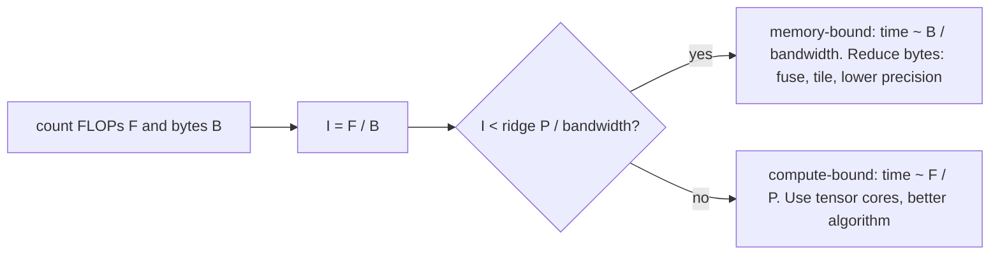

## Where this fits

[[gpu.01]] told you that a GPU has enormous arithmetic power and comparatively slow memory, and that tiling raises the reuse of every byte. This lesson makes that a **number you can compute before writing any code**. Given an operation, how many floating-point operations does it need and how many bytes must it move? Dividing the two tells you whether the chip will be limited by its arithmetic units or by its memory, and by how much. That is the **roofline model**.

It answers questions you will face constantly: why a bigger batch makes inference cheaper per sample, why softmax and layer norm are "free in FLOPs but not in time", why FlashAttention is faster despite doing the same arithmetic, and why speeding up the matmuls of a training step by 10x may speed the step up by only 2x (Amdahl's law). It connects forward to [[sys.01]], where decoding with a KV cache is memory-bound for exactly these reasons, and to [[gpu.03]], where lower-precision formats shrink the bytes.

No GPU is needed: the exercises are calculators. Where I show profiler code that would need a GPU, it is marked.

## The idea in plain words

A bakery has ovens and a delivery van. The ovens can bake a fixed number of loaves per hour (the **compute roof**). The van can bring a fixed amount of flour per hour (the **bandwidth roof**). How many loaves you actually make depends on the recipe: a recipe that bakes a lot from a little flour (a rich pastry made from a small bag) keeps the ovens busy and is **oven-limited**. A recipe that needs lots of flour for each loaf (thin crackers) leaves the ovens idle waiting for the van and is **van-limited**.

The ratio "work per unit of delivered material" is the **arithmetic intensity**. Plot the best you can do against intensity and you get a roof-shaped curve: a slope on the left (van-limited: more intensity buys proportionally more speed) that meets a flat ceiling on the right (oven-limited: nothing more to gain). The corner is the **ridge point**.

Two practical consequences:

- If you are on the slope, buying a faster oven does nothing. You must reduce deliveries: reuse data (tiling), move fewer bytes (smaller number formats, fusing steps), or do more work per delivery (bigger batches).
- If you are on the flat part, deliveries are not the problem; use tensor cores and better precision, or accept you are at the limit.

The other half of the lesson is **Amdahl's law**: if you make one part of the job infinitely fast, the job still takes at least as long as the parts you did not touch. Profilers exist to find which parts those are.

## FLOPs, bytes and arithmetic intensity

**FLOPs** counts floating-point operations. Convention: one multiply-add is 2 FLOPs, so a dot product of length $K$ costs $2K$. (Do not confuse FLOPs, a count, with FLOP/s, a rate.)

**Bytes** counts traffic between main memory (HBM) and the chip, assuming each tensor is read or written once unless stated otherwise. It is a lower bound for an ideal kernel; real kernels move at least this much.

**Arithmetic intensity**:

$$
I=\frac{\text{FLOPs}}{\text{bytes moved}}\quad[\text{FLOP/byte}]
$$

Counting rules (my conventions, used by the exercises):

| operation | shapes | FLOPs | bytes (elements $\times$ element size $e$) |
|---|---|---|---|
| matmul | $(M,K)(K,N)\to(M,N)$ | $2MNK$ | $e\,(MK+KN+MN)$ |
| softmax over rows | $(R,C)$ | $5RC$ (max, subtract, exp, sum, divide) | $2eRC$ (read once, write once) |
| layer norm | $(R,C)$ | $8RC$ (mean, variance, normalise, scale-shift) | $2eRC$ (parameters ignored) |
| element-wise add | $(n)$ | $n$ | $3en$ |

The FLOP counts for softmax and layer norm are rough conventions (an `exp` is more than one ordinary FLOP on real hardware); the conclusions below do not depend on the exact constants because the intensities are one to two orders of magnitude below the ridge point.

For a square matmul $M=N=K=n$: $I=\dfrac{2n^3}{3en^2}=\dfrac{2n}{3e}$, which **grows with $n$**: big matrices reuse each element many times. For element-wise operations $I$ is a constant below 1, no matter how big the tensor.

## The roofline: derivation

Let the chip have a peak arithmetic rate $P$ (FLOP/s) and a memory bandwidth $\beta$ (bytes/s). An operation with $F$ FLOPs and $B$ bytes needs at least $F/P$ seconds just to do the arithmetic and at least $B/\beta$ seconds just to move the data. If arithmetic and transfers overlap perfectly (the best case), the time is the larger of the two:

$$
t\ \ge\ \max\!\Big(\frac{F}{P},\ \frac{B}{\beta}\Big).
$$

The achieved rate is $F/t$. Divide numerator and denominator by $B$ and use $I=F/B$:

$$
\frac{F}{t}\ \le\ \frac{F}{\max(F/P,\,B/\beta)}=\min\!\Big(P,\ \frac{F\beta}{B}\Big)=\min\big(P,\ \beta I\big).
$$

This is the roofline. Two regimes:

- $\beta I<P$, i.e. $I<I^*$: **memory-bound**, rate $\beta I$ (a slope).
- $I\ge I^*$: **compute-bound**, rate $P$ (flat).

with the **ridge point**

$$
I^*=\frac{P}{\beta}.
$$

Intuition: $I^*$ is the number of FLOPs the chip can perform in the time it takes to fetch one byte. Operations that do fewer FLOPs per byte than that cannot keep the chip busy.

**Hardware numbers.** For concrete figures I use an **A100-class** accelerator: roughly $P=312$ TFLOP/s (bf16/fp16 tensor-core peak, dense) and $\beta=2.0$ TB/s of HBM bandwidth. These are general knowledge about that chip, not from the sources I read; the sources give only an H100's HBM bandwidth (about 3 TB/s) and one FlashAttention-3 throughput (about 740 TFLOP/s fp16) that are consistent with the same order of magnitude. Then

$$
I^*=\frac{312\times10^{12}}{2.0\times10^{12}}=156\ \text{FLOP/byte}.
$$

Newer chips have larger ridge points (compute grew faster than bandwidth), so more of your operations fall on the slope. Plain fp32 (non-tensor-core) arithmetic has a much lower peak (roughly 20 TFLOP/s on that chip, again general knowledge), hence a ridge near 10: mixed precision moves the roof as well as the bytes.



## Worked example: the classification

Everything here is produced by the roofline exercise (`P=312e12`, `bw=2e12`, fp16 so $e=2$). Times are the roofline lower bounds.

| operation | intensity (FLOP/byte) | bound | time | utilisation of peak |
|---|---|---|---|---|
| matmul $4096^3$ | 1365.3 | compute | 440.5 us | 100% |
| linear layer, batch 1 ($1\times4096\to4096$) | 1.0 | memory | 16.8 us | 0.64% |
| linear layer, batch 64 | 62.1 | memory | 17.3 us | 39.8% |
| linear layer, batch 256 | 227.6 | compute | 27.5 us | 100% |
| softmax on $4096\times4096$ | 1.25 | memory | 33.6 us | 0.8% |
| layer norm on $4096\times4096$ | 2.0 | memory | 33.6 us | 1.3% |

Read the table:

- The big matmul is compute-bound: tensor-core speed decides.
- Softmax and layer norm are tiny in FLOPs, yet each costs 33.6 us, because they are memory-bound: time $=B/\beta=2\cdot2\cdot4096^2/(2\times10^{12})=33.6\ \mu$s. That is already 8% of the big matmul's time, for almost no arithmetic, and their utilisation is below 2%. This is why they are fused with their neighbours (see [[gpu.03]]) rather than optimised on their own.
- **Batch size is an intensity knob.** A linear layer $y=xW$ with $W\in\mathbb{R}^{d\times d}$ and batch $B$ has $2Bd^2$ FLOPs and about $e\,(d^2+2Bd)$ bytes, so for $d\gg B$ and $e=2$ the intensity is almost exactly $B$. Batch 1 (token-by-token decoding) is therefore at about 1 FLOP/byte: the chip streams all weights from HBM to do one multiply-add per weight. Batch 64 gets 62; the ridge near 156 is reached around batch 160 in this model. This is the arithmetic behind "batching makes serving cheaper per request" and behind the memory-bound decode phase of an LLM ([[sys.01]]).

## Attention and FlashAttention: an IO argument

Take one attention head: $Q,K,V\in\mathbb{R}^{N\times d}$, scores $S=QK^\top\in\mathbb{R}^{N\times N}$, probabilities $P=\operatorname{softmax}(S)$ row-wise, output $O=PV\in\mathbb{R}^{N\times d}$.

**FLOPs.** $QK^\top$ costs $2N^2d$, $PV$ costs $2N^2d$, softmax $5N^2$ (convention): $F=4N^2d+5N^2$. The count is the same no matter how the kernels are written.

**Bytes, standard implementation (three or more separate kernels).** Each kernel reads its inputs from HBM and writes its output back:

1. $S=QK^\top$: read $Q,K$ ($2Nd$), write $S$ ($N^2$)
2. $P=\operatorname{softmax}(S)$: read $S$ ($N^2$), write $P$ ($N^2$)
3. $O=PV$: read $P$ ($N^2$) and $V$ ($Nd$), write $O$ ($Nd$)

Total elements: $4Nd+4N^2$. In bytes: $B_{\text{std}}=e\,(4Nd+4N^2)$.

For large $N$ the $N^2$ terms dominate, so

$$
I_{\text{std}}\approx\frac{4N^2d}{4eN^2}=\frac{d}{e}.
$$

**The intensity of standard attention is about $d/e$ whatever the sequence length**: with $d=64$ and fp16 ($e=2$), about 32 FLOP/byte, well under the ridge of 156. Attention is memory-bound for typical head sizes, and the culprit is the $N\times N$ matrices $S$ and $P$ that make the round trip to HBM. (The source makes the same point: for $N\ge2$K attention becomes memory-bound before FLOP-bound.)

**Tiled attention (FlashAttention).** Process a block of $B_r$ query rows at a time. For each block, stream over blocks of $K$ and $V$, keep the score tile and a running softmax (running max and running sum, rescaling the partial output when the max changes) in fast on-chip memory, and write only the final $O$ block. The score matrix never exists in HBM.

HBM traffic: $Q$ is read once ($Nd$); for each of the $N/B_r$ query blocks all of $K$ and $V$ are streamed ($2Nd$ each time); $O$ is written once ($Nd$):

$$
B_{\text{tiled}}=e\,\Big(2Nd+2Nd\cdot\frac{N}{B_r}\Big)\approx\frac{2eN^2d}{B_r}.
$$

Hence

$$
I_{\text{tiled}}\approx\frac{4N^2d}{2eN^2d/B_r}=\frac{2B_r}{e},
$$

so **intensity grows linearly with the query-block size**, which is limited by the size of fast memory. If fast memory holds $M$ elements and a tile needs about $B_r d$ of them, $B_r\sim M/d$ and the traffic is $\sim N^2d^2/M$: the IO-complexity statement. (This follows from my derivation; the FlashAttention paper states a result of this form, but I did not open the paper and give no page reference.)

*Exactness.* The running softmax keeps $(m,s)$ per row. When a new tile has max $m'$ larger than $m$, rescale the old sum and the old partial output by $e^{m-m'}$. The final division by $s$ gives the identical softmax. The source stresses that FlashAttention computes the same output as standard attention up to floating-point non-associativity, and that the working memory falls from $O(N^2)$ to $O(N)$.

**Numbers** ($N=4096$, $d=64$, fp16, one head; produced by the attention exercise):

| quantity | value |
|---|---|
| FLOPs | 4,378,853,376 |
| standard bytes | 136,314,880 |
| standard intensity | 32.1 FLOP/byte (memory-bound vs ridge 156) |
| tiled, $B_r=64$: bytes / intensity | 68,157,440 / 64.2 (2.0x less traffic) |
| tiled, $B_r=128$: bytes / intensity | 34,603,008 / 126.5 (3.9x less traffic) |
| tiled, $B_r=256$: bytes / intensity | 17,825,792 / 245.6 (7.6x less traffic, now compute-bound) |

Dependence on $N$ (standard vs tiled with $B_r=128$): intensity 30.7 vs 116.0 at $N=1024$, 32.1 vs 126.5 at $N=4096$, 32.5 vs 129.5 at $N=16384$. Standard attention's intensity stays near $d/e=32$ for every $N$; the tiled version's stays near $B_r$ (with $e=2$, $2B_r/e=B_r$).

How big can $B_r$ be? Exercise 2 models one iteration as holding a $Q$ tile ($B_rd$), $K$ and $V$ tiles ($2B_cd$), the score tile ($B_rB_c$) and the output accumulator ($B_rd$). For $d=64$, fp16 and 100 KB of fast memory, $B_r=B_c=128$ fits (98,304 bytes) but 256 does not; with 300 KB, 256 fits. That is why shared-memory size per SM (source: about 256 KB on H100) caps the speed-up.

*Compared with the source.* The source reports wall-clock speed-ups of 2-4x on an A100 for the original kernels and more on newer versions. My byte model predicts a 2-8x traffic reduction for $B_r$ between 64 and 256; real speed-ups depend on many things the model leaves out (the backward pass, causal masking, kernel overheads), so treat my numbers as the *mechanism*, not a prediction.

## Reading a profiler timeline

A profiler draws a **timeline**: one row per hardware resource (CPU thread, GPU stream, memory-copy engine), one coloured rectangle per event. What to look for:

```text
CPU thread : [load batch.........][launch][launch][launch]....[load batch.........]
H2D copy   :                  [copy]                                  [copy]
GPU stream :                         [matmul][gelu][matmul]...  idle  ...[matmul]
```

| pattern in the timeline | diagnosis | typical fix |
|---|---|---|
| long GPU idle gaps while the CPU row is busy with data work | **input-bound** (data loader) | more workers, prefetch, cache, cheaper augmentation |
| the GPU row is full of very short kernels with small gaps between | **launch-bound** (many tiny ops) | fuse operations, bigger batch, CUDA graphs |
| host-to-device copies sitting on the critical path | transfer-bound | pinned memory, copy asynchronously, keep data on device |
| a stripe where the GPU waits for `.item()`, `print` or `.cpu()` | accidental **synchronisation** | read scalars less often |
| matmul kernels dominate and are dense | likely compute-bound | check precision, tensor-core use |
| long element-wise / softmax / norm kernels | memory-bound | fuse (see [[gpu.03]]), lower precision |

The setup-and-debugging lesson I read says the most common finding is that **data loading takes a large share of a training step (it cites 60%)** and that the cure is `num_workers > 0`, not a faster GPU. Its timing recipe is to wrap the data load, forward pass and backward pass in a timer. On a GPU, remember to synchronise before reading the clock, otherwise you measure only the launch ([[gpu.01]]).

Profiling code that **needs a GPU** (not run here):

```python
# needs a GPU (not executed in this academy)
import torch
from torch.profiler import profile, ProfilerActivity

with profile(activities=[ProfilerActivity.CPU, ProfilerActivity.CUDA]) as prof:
    for _ in range(3):
        loss = model(batch).sum()
        loss.backward()
print(prof.key_averages().table(sort_by="cuda_time_total", row_limit=10))
```

A related useful number is **MFU** (model FLOPs utilisation): the model's required FLOPs per second divided by the chip's peak. Healthy large-model training reaches a fraction of peak, not 100%, precisely because many operations lie on the slope of the roofline. (The exact fractions reported in practice vary and I did not read a source for them; do not quote one without measuring.)

## Amdahl's law for pipelines

Suppose a step takes total time $T$ and a fraction $p$ of it is accelerated by a factor $s$. The new time is

$$
T'=(1-p)\,T+\frac{p\,T}{s}
\quad\Longrightarrow\quad
\text{speed-up}=\frac{T}{T'}=\frac{1}{(1-p)+p/s}.
$$

Letting $s\to\infty$ gives the ceiling $1/(1-p)$. For several stages with times $t_i$ and individual speed-ups $s_i$, the new total is $\sum_i t_i/s_i$ and the speed-up is $\sum_i t_i\big/\sum_i (t_i/s_i)$.

Numbers (from the exercise):

- 90% of the time accelerated 10x: $1/(0.1+0.09)=5.26$. The ceiling is 10.
- 95% accelerated by a huge factor: about 20.
- A step with data loading 40 ms and compute 60 ms; make the compute 10x faster (a much better GPU): the step goes from 100 ms to $40+6=46$ ms, a speed-up of **2.17, not 10**. A three-stage step (30 ms loading, 10 ms host overhead, 60 ms compute) with the compute made 8x faster speeds up by 2.11.

This is the quantitative reason to profile first. If the loader is 40% of the step, a faster GPU buys at most 2.5x however fast it is, while fixing the loader (workers, prefetching so that loading overlaps compute) can change the step from $\text{load}+\text{compute}$ to $\max(\text{load},\text{compute})$. That model is a part of [[gpu.03]]'s calculators.

## Implementation

The core of the roofline calculator is five lines:

```python
def ridge(hw):                 # hw = {"peak": FLOP/s, "bw": bytes/s}
    return hw["peak"] / hw["bw"]

def attainable(hw, intensity):
    return min(hw["peak"], hw["bw"] * intensity)

def op_time(hw, flops, nbytes):
    return max(flops / hw["peak"], nbytes / hw["bw"])
```

What production does instead: you rarely compute this by hand. Nsight Compute and the PyTorch profiler report achieved FLOP/s and bandwidth per kernel, and Nsight can draw the roofline chart itself. The model is still the mental tool: before profiling, you already know which kernels *should* be on the slope.

## Shapes

| symbol | shape |
|---|---|
| $Q,K,V,O$ (one head) | $(N,d)$ |
| $S,P$ | $(N,N)$ |
| matmul inputs / output | $(M,K),(K,N)\to(M,N)$ |
| linear layer weights | $(d_{\text{in}},d_{\text{out}})$; activations $(B,d_{\text{in}})$ |
| `ops` list for the calculator | list of `(name, flops, bytes)` |

## Common misconceptions

- **"FLOPs predict runtime."** Only on the flat part of the roofline. Softmax and layer norm are cheap in FLOPs and expensive in time.
- **"FlashAttention approximates attention."** It is exact; it changes where intermediate values live, not what is computed. Its gains come from fewer HBM bytes, with the same (or slightly more) FLOPs.
- **"A bigger batch always helps."** Only until you cross the ridge; beyond it you are compute-bound and gain nothing per sample (and memory use keeps growing).
- **"Memory-bound means bad."** It means the limit is bandwidth; the remedy is fewer bytes, not faster arithmetic.
- **"Using 100% GPU utilisation in `nvidia-smi` means the GPU is efficient."** That counter says a kernel was running, not how well it used the chip; a memory-bound kernel can show 100% while using 1% of peak FLOP/s.
- **"Amdahl says parallelism is useless."** It says the part you do not accelerate sets the ceiling, so measure the part first.

## Key takeaways

- Intensity $I=F/B$; roofline rate $=\min(P,\beta I)$; ridge $I^*=P/\beta$ (about 156 FLOP/byte for the A100-class numbers used here).
- Square matmul intensity grows with size; element-wise ops, softmax and layer norm sit at roughly 1-2 FLOP/byte: memory-bound.
- A linear layer's intensity is about the batch size, so small-batch decoding is memory-bound.
- Standard attention's intensity is about $d/e$, independent of $N$; tiling raises it to about $2B_r/e$ and avoids storing the $N\times N$ matrix.
- Amdahl: speed-up $=1/((1-p)+p/s)$; profile to find $1-p$ before optimising $p$.

## Explain it yourself

1. Explain to a colleague why replacing a GPU with one that has twice the peak FLOP/s may change the speed of softmax and layer norm not at all.
2. Using the byte count, explain in your own words why FlashAttention is faster even though it performs the same arithmetic.

## Further reading

- Dao et al., *FlashAttention* (2022) and follow-ups: the IO-complexity analysis and exact proofs (cited by the source I read; the papers themselves not opened here).
- Williams, Waterman, Patterson, *Roofline: an insightful visual performance model* (2009; not opened here).
- [[gpu.01]] for the hardware behind the numbers, [[gpu.03]] for formats, memory and fusion.

## Mastery criteria

- Compute FLOPs, bytes and intensity of a matmul, softmax and layer norm and classify each against a given ridge point.
- Derive the roofline min formula from $t\ge\max(F/P,B/\beta)$.
- Derive $I_{\text{std}}\approx d/e$ and $I_{\text{tiled}}\approx2B_r/e$ for attention and say what limits $B_r$.
- Explain batch size as an intensity knob.
- Apply Amdahl's law to a multi-stage training step and say what to fix first.
