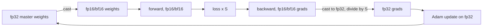

## Où cela s'inscrit

Dans [[gpu.02]], tu as appris que la plupart des opérations d'un réseau sont limitées par le trafic mémoire, pas par l'arithmétique, et que le nombre d'**octets** par nombre compte donc doublement : il fixe ce qui tient sur la carte et la vitesse à laquelle les données circulent. Cette leçon porte sur la façon de dépenser intelligemment ces octets pendant l'**entraînement**, où la facture est bien plus élevée que pour l'inférence : en plus des poids, il faut conserver les gradients, l'état de l'optimiseur et les activations de la passe avant.

Elle s'appuie sur [[math.15]] (formats en virgule flottante et pourquoi les arrondis mordent), sur [[dl.04]] (la boucle d'entraînement PyTorch avec `autocast` et `GradScaler`, que tu peux maintenant comprendre plutôt que copier), et recoupe volontairement [[adv.06]], qui traite le sharding ZeRO/FSDP, le parallélisme et le checkpointing à l'échelle d'un cluster. Ici, l'accent est mis sur la vue matérielle à un seul GPU : pourquoi chaque astuce fonctionne en termes d'octets, de plage et de temps. Le problème de mémoire côté inférence (KV cache) est traité dans [[sys.01]].

Aucun GPU n'est nécessaire. Les exercices simulent le comportement de float16 avec le vrai type `float16` de NumPy et calculent la mémoire et le temps avec de petits modèles. Le code qui utiliserait un GPU est signalé par « needs a GPU ».

## L'idée en mots simples

**Précision.** Un format numérique est un budget de bits réparti entre la *plage* (quelle taille ou quelle petitesse un nombre peut avoir) et la *précision* (combien de valeurs distinctes tu peux distinguer). Une règle graduée en millimètres jusqu'à un mètre est précise mais courte ; une règle graduée en mètres jusqu'à mille kilomètres est longue mais grossière. L'apprentissage profond demande étonnamment peu de précision mais une plage étonnamment grande : les activations sont modérées, mais les gradients peuvent être minuscules. Un format court à plage courte (fp16) transforme silencieusement de minuscules gradients en zéro exact ; un format court à longue plage (bf16) les conserve mais est plus grossier.

Le **loss scaling** est une astuce qui redimensionne le monde : multiplie la perte par une grande constante avant la passe arrière, de sorte que chaque gradient soit autant de fois plus grand et tombe confortablement dans la plage de fp16, puis divise de nouveau par la constante avant d'utiliser les gradients.

**Poids maîtres.** Les mises à jour sont petites par rapport aux poids. Ajouter un petit nombre à un grand dans un format grossier fait perdre entièrement le petit nombre (comme ajouter un grain de sable à un seau et essayer de le peser sur un pèse-personne). L'optimiseur garde donc une copie maîtresse haute précision des poids et fait les petites additions là.

**Comptabilité mémoire.** L'entraînement conserve quatre sortes de choses : les poids, les gradients, l'état de l'optimiseur (pour Adam, deux nombres de plus par poids) et les activations (ce que la passe avant doit mémoriser pour la passe arrière). Les trois premiers varient avec le nombre de paramètres ; les activations varient avec la taille de batch, la longueur de séquence et la profondeur.

**Échanger du temps contre de la mémoire.** Le gradient checkpointing jette les activations et les recalcule. L'accumulation de gradients exécute plusieurs petits batchs et additionne leurs gradients. Le prefetching cache le data loader derrière le calcul. La fusion de noyaux évite d'écrire des résultats intermédiaires en mémoire pour les relire aussitôt.

## Formats numériques

Un nombre en virgule flottante a un bit de signe, $e$ bits d'exposant et $m$ bits de mantisse (fraction). Pour un format de style IEEE avec un biais d'exposant $b=2^{e-1}-1$ :

$$
\text{max normal}=(2-2^{-m})\,2^{b},\qquad
\text{min normal}=2^{1-b},\qquad
\text{min subnormal}=2^{1-b-m},\qquad
\varepsilon=2^{-m},
$$

où $\varepsilon$ est l'espacement relatif des nombres juste au-dessus de 1 (environ la précision). Les sous-normaux sont les valeurs supplémentaires minuscules sous le minimum normal qui sacrifient de la précision pour un peu plus de plage près de zéro.

| format | bits (s/e/m) | max | min normal | min subnormal | $\varepsilon$ |
|---|---|---|---|---|---|
| fp32 | 1/8/23 | $3.4\times10^{38}$ | $1.2\times10^{-38}$ | $1.4\times10^{-45}$ | $1.2\times10^{-7}$ |
| tf32 | 1/8/10 (calculé à partir d'entrées fp32) | comme fp32 | comme fp32 | n/a | $2^{-10}\approx10^{-3}$ |
| fp16 | 1/5/10 | 65,504 | $6.1\times10^{-5}$ | $6.0\times10^{-8}$ | $9.8\times10^{-4}$ |
| bf16 | 1/8/7 | $3.39\times10^{38}$ | $1.2\times10^{-38}$ | $9.2\times10^{-41}$ | $7.8\times10^{-3}$ |
| fp8 E5M2 | 1/5/2 | 57,344 | $6.1\times10^{-5}$ | $1.5\times10^{-5}$ | 0.25 |
| fp8 E4M3 | 1/4/3 | 448 (pas selon la formule, voir ci-dessous) | environ $1.6\times10^{-2}$ | environ $2\times10^{-3}$ | 0.125 |

Toutes les entrées pour fp32, fp16, bf16 et E5M2 sont calculées par `format_stats` de l'exercice (et fp16 est vérifié avec `finfo` de NumPy). Remarques :

- **fp16 contre bf16** est la paire clé, et la source que j'ai lue l'énonce ainsi : fp16 a 5 bits d'exposant et 10 de mantisse ; bf16 a la plage d'exposant de fp32 (8 bits) avec seulement 7 bits de mantisse, donc il a rarement besoin de loss scaling, et « l'industrie s'est largement tournée vers bf16 » pour cette raison (une affirmation de la source ; je ne l'ai pas vérifiée indépendamment). Le tableau des dtypes de la leçon PyTorch donne la même image : fp16 environ 3.3 chiffres décimaux, bf16 même plage que fp32 mais moins de précision.
- **tf32** est un mode tensor-core NVIDIA (connaissance générale) : valeurs stockées en fp32, mais la multiplication utilise 10 bits de mantisse, ce qui donne la vitesse des tensor cores pour du code d'apparence fp32 avec une précision des produits proche de fp16. Il affecte l'arithmétique, pas le stockage.
- **fp8** existe en deux variantes (connaissance générale) : E4M3, plus de précision, utilisé pour les poids et activations ; E5M2, plus de plage, utilisé pour les gradients. E4M3 tel que standardisé réutilise des codes qu'IEEE dépenserait pour l'infini, donc son maximum est 448 plutôt que les 240 que donnerait la formule de style IEEE ; les entrées sous-normal et min normal pour E4M3 ci-dessus sont celles de la formule, étiquetées approximatives. L'entraînement en fp8 demande un scaling soigneux par tenseur et reste un domaine actif ; la source ne mentionne fp8 qu'en passant (FlashAttention de l'ère Hopper, KV cache fp8), donc considère les détails ici comme de la connaissance générale.
- Le coût suit les octets : fp32 = 4, tf32 stocké sur 4, fp16/bf16 = 2, fp8 = 1. Diviser les octets par deux divise par deux le trafic mémoire (un gain sur la pente limitée par la mémoire du roofline) et, sur les tensor cores, relève aussi le plafond de calcul.

## Pourquoi les gradients fp16 disparaissent, et le loss scaling

Les gradients des réseaux profonds s'étalent sur de nombreux ordres de grandeur, et beaucoup sont bien en dessous du minimum de fp16. Tout ce qui est inférieur à la moitié du plus petit sous-normal, environ $3\times10^{-8}$, est arrondi à **exactement zéro** ; entre cette valeur et $6.1\times10^{-5}$, les valeurs ne survivent qu'avec une précision réduite.

Le loss scaling utilise la linéarité du gradient. Pour un facteur d'échelle $S$ :

$$
\frac{\partial (S\cdot L)}{\partial \theta}=S\cdot\frac{\partial L}{\partial\theta}.
$$

Donc : (1) calcule la perte ; (2) multiplie-la par $S$ ; (3) exécute la passe arrière en fp16 : chaque gradient est $S$ fois plus grand, donc les minuscules se trouvent désormais dans la plage représentable ; (4) convertis les gradients en fp32 et divise par $S$ ; (5) fais le pas d'optimiseur sur les poids maîtres fp32. Mathématiquement rien n'a changé ; numériquement, les petits gradients ont survécu.

**Choisir $S$.** Trop petit et les gradients s'annulent encore ; trop grand et les plus gros gradients débordent vers `inf` (au-dessus de 65,504), ce qui est détecté et le pas est sauté. Le **loss scaling dynamique** adapte donc $S$ : commencer grand, le diviser par deux dès qu'un débordement est détecté (et sauter ce pas), et le doubler après une série de bons pas consécutifs. L'exercice implémente `update_scale` ainsi (le `GradScaler` de PyTorch fait de même avec ses propres constantes par défaut, que je n'ai pas vérifiées ici).

**Simulation (exercice 1).** Prends 20,000 gradients de magnitudes uniformes en $\log_{10}$ entre $10^{-10}$ et $10^{-3}$, de signe aléatoire, convertis en fp16 après multiplication par $S$ :

| échelle $S$ | fraction des gradients non nuls devenus exactement 0 | débordement ? |
|---|---|---|
| 1 | 0.345 | non |
| 1024 | 0.000 | non |
| 65,536 | 0.000 | non |
| $2^{30}$ | 0.000 | **oui** (des infinis apparaissent) |

Vérification à la main : à $S=1$, tout ce qui est en dessous de $2^{-25}\approx3\times10^{-8}$ disparaît ; la part de l'intervalle $[10^{-10},10^{-3}]$ en échelle log vaut $(\log_{10}(3\times10^{-8})+10)/7\approx0.35$, ce qui correspond à 0.345. Une échelle de 1024 remonte la plus petite valeur $10^{-10}$ à $10^{-7}$, au-dessus du plus petit sous-normal. (Cette distribution synthétique est de moi ; les distributions de gradients réelles diffèrent.)

**bf16 n'a besoin de rien de tout cela** : son plus petit sous-normal est d'environ $9\times10^{-41}$, sous tout gradient que tu verras, mais sa précision grossière ($\varepsilon\approx0.8\%$) rend le point suivant plus important.

## Poids maîtres

Supposons qu'un poids vaille 1.0 et que chaque pas ajoute $10^{-4}$. En fp16, l'espacement des nombres près de 1.0 est d'environ $10^{-3}$, donc $1.0+10^{-4}$ est arrondi directement à 1.0 : **la mise à jour disparaît, à chaque fois**. Après 1000 pas en fp16, le poids vaut toujours exactement 1.0 (exercice : `accumulate(1.0, 1e-4, 1000, np.float16)` renvoie 1.0). La même boucle en fp32 renvoie 1.1000166, comme il se doit. Le même raisonnement s'applique à bf16 avec un espacement encore plus grand.

La **précision mixte** consiste donc à : garder les **poids maîtres et l'état de l'optimiseur en fp32** ; fabriquer une copie fp16/bf16 pour les passes avant et arrière (bon marché, tensor cores) ; remonter les gradients en précision supérieure et appliquer la mise à jour à la copie fp32. La description de la précision mixte par la source correspond à cette recette.



## Comptabilité de la mémoire d'entraînement

Pour $P$ paramètres entraînés avec Adam (deux moyennes mobiles supplémentaires par paramètre) dans le style PyTorch de [[dl.04]] :

| élément | entraînement fp32 | précision mixte (bf16/fp16 + maître fp32) |
|---|---|---|
| poids utilisés par forward/backward | 4 o | 2 o |
| gradients | 4 o | 2 o |
| copie maîtresse fp32 | (les poids eux-mêmes) | 4 o |
| premier moment d'Adam $m$ (fp32) | 4 o | 4 o |
| second moment d'Adam $v$ (fp32) | 4 o | 4 o |
| **total** | **16 o / paramètre** | **16 o / paramètre** |

Surprenant mais vrai : **la précision mixte ne réduit pas cette partie de la mémoire** ; elle déplace les octets. Ses économies de mémoire se trouvent dans les **activations** (stockées en format 2 octets) et ses gains sont en vitesse. Le `training_bytes` de l'exercice renvoie 16 octets par paramètre dans les deux modes : un modèle de 7B paramètres demande $7\times10^9\times16=112$ Go avant toute activation, plus qu'une carte de 80 Go.

**Un désaccord avec une source.** La leçon sur le passage à l'échelle que j'ai lue tabule le modèle 7B à 112 Go pour « fp32 partout » (28 + 56 + 28, ce qui correspond au tableau ci-dessus) mais à 84 Go pour « mixte (bf16 + maître fp32) » (14 + 56 + 14). Cette ligne mixte omet la copie maîtresse fp32 que la même leçon décrit en prose (28 Go) ; avec elle, le total est de 112 Go, comme le dit la comptabilité standard de 16 octets par paramètre. Je fais confiance à la comptabilité de 16 octets (elle découle aussi de la recette ci-dessus) et je considère le chiffre de 84 Go comme une omission. Les autres chiffres de la source (états d'Adam à 8 octets par paramètre en fp32, par ex. 560 Go pour 70B) sont cohérents avec mon tableau.

**Activations.** La leçon sur le checkpointing que j'ai lue donne une règle approximative d'environ $12\,B\,L\,d$ valeurs stockées par couche (batch $B$, longueur de séquence $L$, largeur du modèle $d$), soit $12BLd\cdot e$ octets. Pour 32 couches, $B=1$, $L=4096$, $d=4096$, bf16 ($e=2$) : $32\times12\times4096\times4096\times2=12{,}884{,}901{,}888$ o $\approx12.9$ Go. À $B=8$, c'est environ 103 Go. Cela croît linéairement en $B$ et $L$ (et inclut des termes d'attention quadratiques sauf si FlashAttention est utilisé, qui ne stocke jamais la matrice $N\times N$, d'après [[gpu.02]]). C'est un modèle approximatif : la vraie constante dépend de l'architecture et du framework.

Là où [[adv.06]] répartit ces octets sur plusieurs GPU (étapes ZeRO), les outils ci-dessous les réduisent sur un seul GPU.

## Gradient checkpointing : le modèle

Sans checkpointing, la passe arrière a besoin des activations des $n$ couches. Avec un checkpointing toutes les $k$ couches, tu ne gardes que l'**entrée de chaque segment** (coût $a_{\text{in}}$ chacune, $n/k$ au total), et quand la passe arrière atteint un segment, tu recalcules sa passe avant et tu conserves les activations complètes de ce seul segment ($k\,a_{\text{layer}}$) pendant que tu le dérives :

$$
\text{mem}(k)=\frac{n}{k}\,a_{\text{in}}+k\,a_{\text{layer}}.
$$

**Espacement optimal.** Traite $k$ comme continu et dérive :

$$
\frac{d\,\text{mem}}{dk}=-\frac{n\,a_{\text{in}}}{k^2}+a_{\text{layer}}=0
\ \Longrightarrow\
k^*=\sqrt{\frac{n\,a_{\text{in}}}{a_{\text{layer}}}}.
$$

Si $a_{\text{in}}\approx a_{\text{layer}}$, c'est l'espacement classique en $\sqrt{n}$, que la source attribue à l'article original de 2016 (Chen et al.). Avec la règle $12BLd$, les activations d'une couche valent environ 12 fois son entrée, donc $k^*=\sqrt{n/12}$.

**Coût en temps.** Un pas normal coûte une passe avant ($1$) plus une passe arrière ($\approx2$, d'après la source) $=3$ unités ; le checkpointing ajoute une passe avant supplémentaire pour les segments recalculés : $1+1+2=4$ unités, un facteur $4/3$, soit environ **33% de calcul en plus** (le chiffre de la source). La source décrit aussi le recalcul *sélectif* : ne recalculer que les parties bon marché à recalculer mais grosses à stocker (comme les scores d'attention), pour environ 5% de surcoût selon ses chiffres, et note que si l'attention utilise déjà FlashAttention (qui recalcule le softmax en interne), un checkpointing supplémentaire au niveau des couches apporte peu.

**Chiffres** ($n=32$ couches ; $a_{\text{layer}}=12$ unités, $a_{\text{in}}=1$ ; exercice 2) :

| $k$ | mémoire (unités) | contre aucun (384) | calcul |
|---|---|---|---|
| aucun | 384 | 1x | 1.00 |
| 1 | 44 | 8.7x de moins | 1.33 |
| **2** | **40** | **9.6x de moins** | 1.33 |
| 4 | 56 | 6.9x de moins | 1.33 |
| 8 | 100 | 3.8x de moins | 1.33 |

Le meilleur diviseur est $k=2$ ($k^*=\sqrt{32/12}=1.63$). Le checkpointing est un marché qui achète une grande réduction de mémoire pour un tiers de calcul en plus, fixe ; utilise-le quand l'alternative est de ne pas tenir, ou de ne tenir qu'avec un minuscule batch. Une alternative mentionnée par la source est de décharger les activations vers la mémoire CPU, ce qui coûte de la bande passante PCIe plutôt que des FLOPs.

```python
# needs a GPU for the memory benefit (not executed in this academy)
from torch.utils.checkpoint import checkpoint
for block in model.blocks:
    x = checkpoint(block, x, use_reentrant=False)   # keep only x; recompute inside backward
```

## Accumulation de gradients

Les grands batchs stabilisent l'entraînement mais leurs activations peuvent ne pas tenir. **Accumule** sur $n_\mu$ micro-batchs : pour chacun, exécute forward et backward sur un petit morceau, en ajoutant son gradient (divisé par $n_\mu$ si la perte de chaque micro-batch est une moyenne) dans les mêmes tampons `.grad` ; fais un seul pas d'optimiseur à la fin.

Pourquoi c'est exact pour une perte moyenne : pour un batch de $B$ exemples divisé en $n_\mu$ morceaux égaux $\mathcal{B}_j$,

$$
\nabla\!\Big(\tfrac1B\sum_{i}\ell_i\Big)=\frac{1}{n_\mu}\sum_{j=1}^{n_\mu}\nabla\!\Big(\tfrac{n_\mu}{B}\sum_{i\in\mathcal{B}_j}\ell_i\Big),
$$

donc la moyenne des gradients moyens des micro-batchs reproduit le gradient du batch complet. L'exercice le vérifie numériquement pour une perte des moindres carrés avec 4 et 16 micro-batchs (`np.allclose` avec le gradient complet).

Mémoire : les activations varient avec le **micro**-batch ; le tampon de gradient a la même taille dans les deux cas. Temps : légèrement plus lent qu'un seul gros batch (moins de parallélisme par pas), même nombre de pas d'optimiseur que le gros batch. Réserves : les couches à statistiques de batch (batch norm) voient le micro-batch, pas le batch entier ; avec des séquences de longueur variable, la « moyenne des moyennes » diffère de la vraie moyenne par token sauf si tu pondères par le nombre de tokens ; les plannings de learning rate doivent compter les pas d'optimiseur, pas les micro-pas. Le batch effectif vaut $\text{micro-batch}\times n_\mu\times\text{number of GPUs}$.

## Goulots d'étranglement du data loader

Si préparer un batch (lecture, décodage, augmentation) prend $t_{\text{load}}$ avec $w$ workers en parallèle et que le pas GPU prend $t_{\text{gpu}}$ :

- sans recouvrement : $t_{\text{step}}=t_{\text{load}}/w+t_{\text{gpu}}$ ;
- avec prefetching (chargement du batch suivant pendant que le GPU travaille) : $t_{\text{step}}=\max(t_{\text{load}}/w,\ t_{\text{gpu}})$.

Avec $t_{\text{load}}=50$ ms, $t_{\text{gpu}}=30$ ms : un worker, sans prefetch 80 ms ; un worker avec prefetch 50 ms ; quatre workers avec prefetch 30 ms (le GPU redevient la limite). La leçon de débogage que j'ai lue rapporte que le chargement des données occupe souvent une grande part d'un pas (60% dans son exemple) et que `num_workers > 0` dans le `DataLoader`, et non un GPU plus rapide, est le remède. Réglages connexes issus de la connaissance générale : la mémoire hôte épinglée (page-locked) et les copies `non_blocking=True` permettent aux transferts hôte-vers-périphérique de recouvrir le calcul. La loi d'Amdahl de [[gpu.02]] s'applique : tant que le loader n'est pas masqué, un GPU plus rapide est gaspillé.

## Fusion de noyaux et `torch.compile`

Une chaîne élément par élément comme `y = gelu(x * a + b)` exécutée en mode eager correspond à plusieurs noyaux ; chacun lit toute son entrée depuis la HBM et réécrit toute sa sortie, alors que chacun fait un FLOP ou deux par élément. C'est le côté gauche du roofline : **le temps, c'est les octets sur la bande passante**. Avec $k$ opérations élément par élément sur $n$ éléments de $e$ octets, le trafic non fusionné est $2k\,e\,n$ et le trafic fusionné (lire une fois, tout calculer dans les registres, écrire une fois) est $2\,e\,n$ : un facteur $k$ de moins, avec les mêmes FLOPs. Exemple, $n=10^8$ éléments fp16, $k=5$, à 2 To/s : non fusionné $2\cdot5\cdot2\cdot10^8=2$ Go, 1.0 ms ; fusionné 0.4 Go, 0.2 ms.

**`torch.compile`** (connaissance générale ; non couvert par mes sources) capture les opérations du modèle dans un graphe et génère des noyaux fusionnés pour de telles chaînes (et pour les motifs softmax et norm), de sorte que tu obtiens le bénéfice sans écrire de CUDA à la main. Il ajoute un délai de compilation ponctuel et peut se rabattre sur le mode eager là où le code est trop dynamique. La même idée sous-tend FlashAttention : c'est un noyau fusionné dont le gain est d'éviter les allers-retours intermédiaires. Utilisation :

```python
# needs a GPU for the speed-up (not executed in this academy)
model = torch.compile(model)         # first call compiles; later calls reuse the kernels
```

La boucle standard de précision mixte de la leçon PyTorch que j'ai lue, pour fp16 avec loss scaling (nécessite aussi un GPU) :

```python
# needs a GPU (not executed in this academy)
from torch.amp import autocast, GradScaler
scaler = GradScaler()
for inputs, targets in loader:
    with autocast(device_type="cuda"):          # matmuls in fp16, sensitive ops stay fp32
        loss = criterion(model(inputs), targets)
    scaler.scale(loss).backward()               # backward on loss * S
    scaler.step(optimizer)                      # unscales; skips the step if inf/nan found
    scaler.update()                             # dynamic scale: halve on overflow, grow after good steps
    optimizer.zero_grad()
```

Avec bf16, tu utilises `autocast(device_type="cuda", dtype=torch.bfloat16)` et tu omets normalement le scaler.

## Implémentation

Le cœur de la simulation, exécutable n'importe où avec NumPy (l'exercice contient la version complète avec tests) :

```python
import numpy as np

def underflow_fraction(grads, scale):
    g = np.asarray(grads, dtype=np.float32)
    nz = g != 0
    h = (g * np.float32(scale)).astype(np.float16)   # what backward would store
    return float(np.sum(nz & (h == 0)) / np.sum(nz))

def update_scale(scale, found_inf, good_steps, growth_interval=4):
    if found_inf:
        return scale / 2.0, 0
    good_steps += 1
    return (scale * 2.0, 0) if good_steps >= growth_interval else (scale, good_steps)
```

## Formes

| quantité | taille |
|---|---|
| paramètres | $P$ valeurs ; poids, gradients, $m$, $v$ ont chacun la même forme que les paramètres |
| activations par couche (règle) | environ $12\cdot B\cdot L\cdot d$ valeurs |
| entrée d'un segment | $B\cdot L\cdot d$ valeurs |
| gradient de micro-batch | même forme que les paramètres, accumulé sur place |
| loader | $w$ workers produisant chacun un batch de $B$ exemples |

## Idées reçues courantes

- **« L'entraînement fp16 divise simplement la mémoire par deux. »** Les poids et les gradients sont divisés par deux, mais la copie maîtresse fp32 et l'état Adam fp32 maintiennent le total à 16 octets par paramètre ; les économies sont dans les activations et la vitesse.
- **« Le loss scaling change l'objectif d'entraînement. »** Il s'annule exactement (mathématiquement) ; c'est un artifice numérique.
- **« bf16 est plus précis que fp16. »** Il a plus de plage et moins de précision (7 contre 10 bits de mantisse). Il évite l'underflow, pas l'arrondi.
- **« Le checkpointing rend l'entraînement 33% plus lent. »** Il ajoute environ 33% au *calcul* d'un pas ; le ralentissement réel dépend de la part du calcul dans le pas, et de la mémoire libérée qui permet un batch plus grand et plus efficace.
- **« L'accumulation de gradients = un plus grand batch sans inconvénient. »** C'est mathématiquement le même gradient mais cela casse les statistiques de la batch norm et demande une normalisation correcte de la perte.
- **« Un GPU plus rapide règle un entraînement lent. »** Si le loader ou le code hôte domine, la loi d'Amdahl dit que non.

## Points clés à retenir

- Un format est un compromis entre plage (bits d'exposant) et précision (bits de mantisse) : fp16 5/10, bf16 8/7, fp32 8/23.
- Les gradients fp16 inférieurs à environ $3\times10^{-8}$ deviennent zéro ; multiplier la perte par $S$ les ramène dans la plage ; le scaling dynamique divise par deux en cas de débordement et grandit après de bons pas.
- Garde des poids maîtres fp32 car les petites mises à jour sont avalées par les formats grossiers.
- La mémoire d'entraînement est de 16 octets par paramètre (Adam, dans les deux cas) plus des activations d'environ $12BLd\,e$ par couche.
- Checkpointing : $\text{mem}=(n/k)a_{\text{in}}+k\,a_{\text{layer}}$, meilleur $k\approx\sqrt{n\,a_{\text{in}}/a_{\text{layer}}}$, pour environ 4/3 du calcul.
- Accumule les gradients de micro-batchs mis à l'échelle par $1/n_\mu$ pour égaler un grand batch ; masque le loader avec des workers et du prefetching ; fusionne les chaînes limitées par la mémoire (ce que `torch.compile` automatise).

## Explique-le toi-même

1. Un collègue dit « on est passé à bf16 et on a divisé notre mémoire par deux ». D'après la comptabilité ci-dessus, que lui demandes-tu, et quelles économies peut-il réellement attendre ?
2. Tu as une carte de 24 Go et un modèle dont les activations à batch 16 demandent 40 Go. Nomme deux façons de l'entraîner et ce que chacune coûte.

## Pour aller plus loin

- Micikevicius et al., *Mixed Precision Training* (2018) pour le loss scaling et les poids maîtres (non ouvert pour cette leçon).
- Chen et al., *Training Deep Nets with Sublinear Memory Cost* (2016) et Korthikanti et al., *Reducing Activation Recomputation in Large Transformer Models* (2022), tous deux cités par la leçon sur le checkpointing que j'ai lue ; les articles eux-mêmes n'ont pas été ouverts.
- [[adv.06]] pour ZeRO/FSDP et le parallélisme, [[math.15]] pour les fondamentaux de la virgule flottante, [[sys.01]] pour le KV cache.

## Critères de maîtrise

- Calculer le max, le min normal, le sous-normal et l'epsilon d'un format à partir de sa répartition de bits et expliquer fp16 contre bf16.
- Expliquer pourquoi le loss scaling fonctionne, simuler l'underflow en float16 NumPy et implémenter les mises à jour dynamiques de l'échelle.
- Expliquer pourquoi les poids maîtres sont nécessaires avec un exemple numérique.
- Calculer la mémoire d'entraînement pour un modèle, une précision et un optimiseur donnés, ainsi que le terme d'activations à partir de $B$, $L$, $d$ et de la profondeur.
- Appliquer le modèle de checkpointing pour choisir $k$ et énoncer son compromis mémoire/calcul.
- Montrer que l'accumulation de gradients reproduit le gradient du batch complet et nommer ses réserves.
