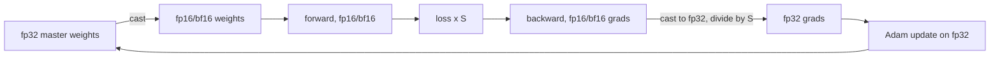

## Where this fits

In [[gpu.02]] you learned that most of a network's operations are limited by memory traffic, not arithmetic, and that the number of **bytes** per number therefore matters twice: it sets how much fits on the card and how fast data moves. This lesson is about spending those bytes wisely during **training**, where the bill is far higher than for inference: besides the weights you must keep gradients, optimiser state and the activations of the forward pass.

It builds on [[math.15]] (floating-point formats and why rounding bites), [[dl.04]] (the PyTorch training loop with `autocast` and `GradScaler`, which you can now understand rather than copy), and overlaps deliberately with [[adv.06]], which treats ZeRO/FSDP sharding, parallelism and checkpointing at cluster scale. Here the focus is the single-GPU hardware view: why each trick works in terms of bytes, range and time. The inference-side memory problem (KV cache) is in [[sys.01]].

No GPU is needed. The exercises simulate float16 behaviour with NumPy's real `float16` type and compute memory and time with small models. Code that would use a GPU is marked "needs a GPU".

## The idea in plain words

**Precision.** A number format is a budget of bits split between *range* (how big or small a number can be) and *precision* (how many distinct values you can tell apart). A ruler marked in millimetres up to one metre is precise but short; a ruler marked in metres up to a thousand kilometres is long but coarse. Deep learning needs surprisingly little precision but surprisingly large range: activations are moderate, but gradients can be tiny. A short format with a short range (fp16) silently turns tiny gradients into exact zero; a short format with a long range (bf16) keeps them but is coarser.

**Loss scaling** is a trick of rescaling the world: multiply the loss by a large constant before the backward pass so that every gradient is that many times bigger and lands comfortably inside fp16's range, then divide the constant out again before using the gradients.

**Master weights.** Updates are small compared with weights. Adding a small number to a big one in a coarse format loses the small number entirely (like adding one grain of sand to a bucket and trying to weigh it on a bathroom scale). So the optimiser keeps a high-precision master copy of the weights and does the small additions there.

**Memory accounting.** Training holds four kinds of things: weights, gradients, optimiser state (for Adam, two more numbers per weight) and activations (what the forward pass must remember for the backward pass). The first three scale with the number of parameters; activations scale with batch size, sequence length and depth.

**Trading time for memory.** Gradient checkpointing throws activations away and recomputes them. Gradient accumulation runs several small batches and adds their gradients. Prefetching hides the data loader behind compute. Kernel fusion avoids writing intermediate results to memory and reading them straight back.

## Number formats

A floating-point number has a sign bit, $e$ exponent bits and $m$ mantissa (fraction) bits. For an IEEE-style format with exponent bias $b=2^{e-1}-1$:

$$
\text{max normal}=(2-2^{-m})\,2^{b},\qquad
\text{min normal}=2^{1-b},\qquad
\text{min subnormal}=2^{1-b-m},\qquad
\varepsilon=2^{-m},
$$

where $\varepsilon$ is the relative spacing of numbers just above 1 (about the precision). Subnormals are the extra tiny values below the min normal that trade precision for a little more range near zero.

| format | bits (s/e/m) | max | min normal | min subnormal | $\varepsilon$ |
|---|---|---|---|---|---|
| fp32 | 1/8/23 | $3.4\times10^{38}$ | $1.2\times10^{-38}$ | $1.4\times10^{-45}$ | $1.2\times10^{-7}$ |
| tf32 | 1/8/10 (computed from fp32 inputs) | like fp32 | like fp32 | n/a | $2^{-10}\approx10^{-3}$ |
| fp16 | 1/5/10 | 65,504 | $6.1\times10^{-5}$ | $6.0\times10^{-8}$ | $9.8\times10^{-4}$ |
| bf16 | 1/8/7 | $3.39\times10^{38}$ | $1.2\times10^{-38}$ | $9.2\times10^{-41}$ | $7.8\times10^{-3}$ |
| fp8 E5M2 | 1/5/2 | 57,344 | $6.1\times10^{-5}$ | $1.5\times10^{-5}$ | 0.25 |
| fp8 E4M3 | 1/4/3 | 448 (not by the formula, see below) | about $1.6\times10^{-2}$ | about $2\times10^{-3}$ | 0.125 |

All entries for fp32, fp16, bf16 and E5M2 are computed by the exercise's `format_stats` (and fp16 is checked against NumPy's `finfo`). Notes:

- **fp16 vs bf16** is the key pair, and the source I read states it as: fp16 has 5 exponent and 10 mantissa bits; bf16 has the exponent range of fp32 (8 bits) with only 7 mantissa bits, so it rarely needs loss scaling, and "the industry has largely moved to bf16" for this reason (a statement from the source; I did not verify it independently). The PyTorch lesson's dtype table gives the same picture: fp16 about 3.3 decimal digits, bf16 same range as fp32 but less precision.
- **tf32** is an NVIDIA tensor-core mode (general knowledge): values stored as fp32, but the multiply uses 10 mantissa bits, so you get tensor-core speed for fp32-looking code at roughly fp16 precision in the products. It affects arithmetic, not storage.
- **fp8** comes in two variants (general knowledge): E4M3, more precision, used for weights and activations; E5M2, more range, used for gradients. E4M3 as standardised reuses codes that IEEE would spend on infinity, so its maximum is 448 rather than the 240 that the IEEE-style formula would give; the subnormal and min-normal entries for E4M3 above are the formula's, labelled approximate. fp8 training needs careful per-tensor scaling and is an active area; the source mentions fp8 only in passing (Hopper-era FlashAttention, fp8 KV cache), so treat the details here as general knowledge.
- Cost scales with bytes: fp32 = 4, tf32 stored as 4, fp16/bf16 = 2, fp8 = 1. Halving the bytes halves memory traffic (a gain on the memory-bound slope of the roofline) and, on tensor cores, raises the compute roof too.

## Why fp16 gradients vanish, and loss scaling

Gradients of deep networks span many orders of magnitude, and many are far below the fp16 minimum. Anything smaller than half the min subnormal, about $3\times10^{-8}$, rounds to **exactly zero**; between that and $6.1\times10^{-5}$ values survive only with reduced precision.

Loss scaling uses linearity of the gradient. For a scale $S$:

$$
\frac{\partial (S\cdot L)}{\partial \theta}=S\cdot\frac{\partial L}{\partial\theta}.
$$

So: (1) compute the loss; (2) multiply it by $S$; (3) run backward in fp16: every gradient is $S$ times larger, so tiny ones now lie inside the representable range; (4) convert the gradients to fp32 and divide by $S$; (5) take the optimiser step on the fp32 master weights. Mathematically nothing changed; numerically, small gradients survived.

**Choosing $S$.** Too small and gradients still underflow; too large and the largest gradients overflow to `inf` (above 65,504), which is detected and the step is skipped. **Dynamic loss scaling** therefore adapts $S$: start large, halve it whenever an overflow is found (and skip that step), and double it after a run of consecutive good steps. The exercise implements `update_scale` this way (PyTorch's `GradScaler` does the same with its own default constants, which I have not verified here).

**Simulation (exercise 1).** Take 20,000 gradients with magnitudes uniform in $\log_{10}$ between $10^{-10}$ and $10^{-3}$, random sign, converted to fp16 after multiplying by $S$:

| scale $S$ | fraction of non-zero gradients that became exactly 0 | overflow? |
|---|---|---|
| 1 | 0.345 | no |
| 1024 | 0.000 | no |
| 65,536 | 0.000 | no |
| $2^{30}$ | 0.000 | **yes** (infinities appear) |

Check by hand: at $S=1$ everything below $2^{-25}\approx3\times10^{-8}$ vanishes; the share of the interval $[10^{-10},10^{-3}]$ in log scale is $(\log_{10}(3\times10^{-8})+10)/7\approx0.35$, matching 0.345. Scaling by 1024 lifts the smallest value $10^{-10}$ to $10^{-7}$, above the min subnormal. (This synthetic distribution is mine; real gradient distributions differ.)

**bf16 needs none of this**: its min subnormal is about $9\times10^{-41}$, below any gradient you will see, but its coarse precision ($\varepsilon\approx0.8\%$) makes the next point more important.

## Master weights

Suppose a weight is 1.0 and each step adds $10^{-4}$. In fp16, the spacing of numbers near 1.0 is about $10^{-3}$, so $1.0+10^{-4}$ rounds straight back to 1.0: **the update vanishes, every time**. After 1000 steps in fp16 the weight is still exactly 1.0 (exercise: `accumulate(1.0, 1e-4, 1000, np.float16)` returns 1.0). The same loop in fp32 returns 1.1000166, as it should. The same arithmetic applies to bf16 with even larger spacing.

So **mixed precision** is: keep the **master weights and the optimiser state in fp32**; make a fp16/bf16 copy for the forward and backward passes (cheap, tensor cores); upcast the gradients and apply the update to the fp32 copy. The source's description of mixed precision matches this recipe.



## Training-memory accounting

For $P$ parameters trained with Adam (two extra running averages per parameter) in the PyTorch style of [[dl.04]]:

| item | fp32 training | mixed precision (bf16/fp16 + fp32 master) |
|---|---|---|
| weights used by forward/backward | 4 B | 2 B |
| gradients | 4 B | 2 B |
| fp32 master copy | (the weights themselves) | 4 B |
| Adam first moment $m$ (fp32) | 4 B | 4 B |
| Adam second moment $v$ (fp32) | 4 B | 4 B |
| **total** | **16 B / parameter** | **16 B / parameter** |

Surprising but true: **mixed precision does not reduce this part of the memory**; it moves the bytes around. Its memory savings are in the **activations** (stored in 2-byte format) and its gains are in speed. The exercise's `training_bytes` returns 16 bytes per parameter in both modes: a 7B-parameter model needs $7\times10^9\times16=112$ GB before any activation, more than one 80 GB card.

**A disagreement with a source.** The scaling lesson I read tabulates the 7B model as 112 GB for "fp32 everywhere" (28 + 56 + 28, matching the table above) but 84 GB for "mixed (bf16 + fp32 master)" (14 + 56 + 14). That mixed row leaves out the fp32 master copy that the same lesson describes in prose (28 GB); with it the total is 112 GB, as the standard 16-bytes-per-parameter accounting says. I trust the 16-byte accounting (it also follows from the recipe above) and treat the 84 GB figure as an omission. The source's other numbers (Adam states at 8 bytes per parameter in fp32, e.g. 560 GB for 70B) are consistent with my table.

**Activations.** The checkpointing lesson I read gives a rough rule of about $12\,B\,L\,d$ stored values per layer (batch $B$, sequence length $L$, model width $d$), i.e. $12BLd\cdot e$ bytes. For 32 layers, $B=1$, $L=4096$, $d=4096$, bf16 ($e=2$): $32\times12\times4096\times4096\times2=12{,}884{,}901{,}888$ B $\approx12.9$ GB. At $B=8$ it is about 103 GB. It grows linearly in $B$ and $L$ (and includes quadratic attention terms unless FlashAttention is used, which never stores the $N\times N$ matrix, per [[gpu.02]]). This is a rough model: the true constant depends on the architecture and the framework.

Where [[adv.06]] shards these bytes across GPUs (ZeRO stages), the tools below reduce them on one GPU.

## Gradient checkpointing: the model

Without checkpointing, backward needs the activations of all $n$ layers. With checkpointing every $k$ layers you keep only the **input of each segment** (cost $a_{\text{in}}$ each, $n/k$ of them), and when backward reaches a segment you recompute its forward pass and hold that one segment's full activations ($k\,a_{\text{layer}}$) while you differentiate it:

$$
\text{mem}(k)=\frac{n}{k}\,a_{\text{in}}+k\,a_{\text{layer}}.
$$

**Optimal spacing.** Treat $k$ as continuous and differentiate:

$$
\frac{d\,\text{mem}}{dk}=-\frac{n\,a_{\text{in}}}{k^2}+a_{\text{layer}}=0
\ \Longrightarrow\
k^*=\sqrt{\frac{n\,a_{\text{in}}}{a_{\text{layer}}}}.
$$

If $a_{\text{in}}\approx a_{\text{layer}}$ this is the classic $\sqrt{n}$ spacing, which the source attributes to the original 2016 paper (Chen et al.). With the $12BLd$ rule, a layer's activations are about 12 times its input, so $k^*=\sqrt{n/12}$.

**Time cost.** A normal step costs forward ($1$) plus backward ($\approx2$, per the source) $=3$ units; checkpointing adds one extra forward for the recomputed segments: $1+1+2=4$ units, a factor $4/3$, i.e. about **33% more compute** (the source's number). The source also describes *selective* recomputation: recompute only the cheap-to-recompute but large-to-store parts (such as attention scores), for about 5% overhead on its figures, and notes that if attention already uses FlashAttention (which recomputes softmax internally) extra layer-level checkpointing adds little.

**Numbers** ($n=32$ layers; $a_{\text{layer}}=12$ units, $a_{\text{in}}=1$; exercise 2):

| $k$ | memory (units) | vs none (384) | compute |
|---|---|---|---|
| none | 384 | 1x | 1.00 |
| 1 | 44 | 8.7x less | 1.33 |
| **2** | **40** | **9.6x less** | 1.33 |
| 4 | 56 | 6.9x less | 1.33 |
| 8 | 100 | 3.8x less | 1.33 |

The best divisor is $k=2$ ($k^*=\sqrt{32/12}=1.63$). Checkpointing is a deal that buys a large memory cut for a fixed one-third more compute; use it when the alternative is not fitting, or fitting only with a tiny batch. An alternative the source mentions is offloading activations to CPU memory, which costs PCIe bandwidth instead of FLOPs.

```python
# needs a GPU for the memory benefit (not executed in this academy)
from torch.utils.checkpoint import checkpoint
for block in model.blocks:
    x = checkpoint(block, x, use_reentrant=False)   # keep only x; recompute inside backward
```

## Gradient accumulation

Large batches stabilise training but their activations may not fit. **Accumulate** over $n_\mu$ micro-batches: for each, run forward and backward on a small chunk, adding its gradient (divided by $n_\mu$ if each micro-batch loss is a mean) into the same `.grad` buffers; step the optimiser once at the end.

Why it is exact for a mean loss: for a batch of $B$ examples split into $n_\mu$ equal chunks $\mathcal{B}_j$,

$$
\nabla\!\Big(\tfrac1B\sum_{i}\ell_i\Big)=\frac{1}{n_\mu}\sum_{j=1}^{n_\mu}\nabla\!\Big(\tfrac{n_\mu}{B}\sum_{i\in\mathcal{B}_j}\ell_i\Big),
$$

so averaging the micro-batch mean gradients reproduces the full-batch gradient. The exercise checks it numerically for a least-squares loss with 4 and 16 micro-batches (`np.allclose` to the full gradient).

Memory: activations scale with the **micro**-batch; the gradient buffer is the same size either way. Time: slightly slower than one big batch (less parallelism per step), same number of optimiser steps as the big batch. Caveats: batch-statistics layers (batch norm) see the micro-batch, not the whole batch; with variable-length sequences "mean of means" differs from the true token mean unless you weight by token counts; learning-rate schedules should count optimiser steps, not micro-steps. The effective batch is $\text{micro-batch}\times n_\mu\times\text{number of GPUs}$.

## Data-loader bottlenecks

If preparing a batch (reading, decoding, augmenting) takes $t_{\text{load}}$ with $w$ workers in parallel and the GPU step takes $t_{\text{gpu}}$:

- no overlap: $t_{\text{step}}=t_{\text{load}}/w+t_{\text{gpu}}$;
- with prefetching (loading the next batch while the GPU works): $t_{\text{step}}=\max(t_{\text{load}}/w,\ t_{\text{gpu}})$.

With $t_{\text{load}}=50$ ms, $t_{\text{gpu}}=30$ ms: one worker, no prefetch 80 ms; one worker with prefetch 50 ms; four workers with prefetch 30 ms (the GPU is the limit again). The debugging lesson I read reports that data loading often takes a large part of a step (60% in its example) and that `num_workers > 0` in the `DataLoader`, not a faster GPU, is the cure. Related knobs from general knowledge: pinned (page-locked) host memory and `non_blocking=True` copies let host-to-device transfers overlap with compute. Amdahl's law from [[gpu.02]] applies: until the loader is hidden, a faster GPU is wasted.

## Kernel fusion and `torch.compile`

An element-wise chain such as `y = gelu(x * a + b)` run eagerly is several kernels; each reads its whole input from HBM and writes its whole output back, although each does a FLOP or two per element. That is the left side of the roofline: **time is bytes over bandwidth**. With $k$ element-wise ops on $n$ elements of $e$ bytes, the unfused traffic is $2k\,e\,n$ and the fused traffic (read once, compute everything in registers, write once) is $2\,e\,n$: a factor $k$ less, with the same FLOPs. Example, $n=10^8$ fp16 elements, $k=5$, at 2 TB/s: unfused $2\cdot5\cdot2\cdot10^8=2$ GB, 1.0 ms; fused 0.4 GB, 0.2 ms.

**`torch.compile`** (general knowledge; not covered by my sources) captures the model's operations into a graph and generates fused kernels for such chains (and for softmax and norm patterns), so you get the benefit without hand-writing CUDA. It adds a one-time compilation delay and can fall back where code is too dynamic. The same idea underlies FlashAttention: it is a fused kernel whose win is avoiding intermediate round trips. Usage:

```python
# needs a GPU for the speed-up (not executed in this academy)
model = torch.compile(model)         # first call compiles; later calls reuse the kernels
```

The standard mixed-precision loop from the PyTorch lesson I read, for fp16 with loss scaling (also needs a GPU):

```python
# needs a GPU (not executed in this academy)
from torch.amp import autocast, GradScaler
scaler = GradScaler()
for inputs, targets in loader:
    with autocast(device_type="cuda"):          # matmuls in fp16, sensitive ops stay fp32
        loss = criterion(model(inputs), targets)
    scaler.scale(loss).backward()               # backward on loss * S
    scaler.step(optimizer)                      # unscales; skips the step if inf/nan found
    scaler.update()                             # dynamic scale: halve on overflow, grow after good steps
    optimizer.zero_grad()
```

With bf16 you use `autocast(device_type="cuda", dtype=torch.bfloat16)` and normally omit the scaler.

## Implementation

The heart of the simulation, runnable anywhere with NumPy (the exercise has the full version with tests):

```python
import numpy as np

def underflow_fraction(grads, scale):
    g = np.asarray(grads, dtype=np.float32)
    nz = g != 0
    h = (g * np.float32(scale)).astype(np.float16)   # what backward would store
    return float(np.sum(nz & (h == 0)) / np.sum(nz))

def update_scale(scale, found_inf, good_steps, growth_interval=4):
    if found_inf:
        return scale / 2.0, 0
    good_steps += 1
    return (scale * 2.0, 0) if good_steps >= growth_interval else (scale, good_steps)
```

## Shapes

| quantity | size |
|---|---|
| parameters | $P$ values; weights, gradients, $m$, $v$ each have the same shape as the parameters |
| per-layer activations (rule) | about $12\cdot B\cdot L\cdot d$ values |
| segment input | $B\cdot L\cdot d$ values |
| micro-batch gradient | same shape as the parameters, accumulated in place |
| loader | $w$ workers each producing a batch of $B$ examples |

## Common misconceptions

- **"fp16 training just halves memory."** Weights and gradients halve, but the fp32 master copy and fp32 Adam state keep the total at 16 bytes per parameter; the savings are in activations and speed.
- **"Loss scaling changes the training objective."** It cancels exactly (mathematically); it is a numerical device.
- **"bf16 is more accurate than fp16."** It has more range and less precision (7 vs 10 mantissa bits). It avoids underflow, not rounding.
- **"Checkpointing makes training 33% slower."** It adds about 33% to the *compute* of a step; the real slowdown depends on how much of the step is compute, and on the memory it frees allowing a bigger, more efficient batch.
- **"Gradient accumulation = bigger batch with no downside."** It is mathematically the same gradient but breaks batch-norm statistics and needs correct loss normalisation.
- **"A faster GPU fixes slow training."** If the loader or host code dominates, Amdahl's law says it will not.

## Key takeaways

- A format is range (exponent bits) versus precision (mantissa bits): fp16 5/10, bf16 8/7, fp32 8/23.
- fp16 gradients below about $3\times10^{-8}$ become zero; scaling the loss by $S$ shifts them into range; dynamic scaling halves on overflow and grows after good steps.
- Keep fp32 master weights because small updates are swallowed by coarse formats.
- Training memory is 16 bytes per parameter (Adam, either way) plus activations of about $12BLd\,e$ per layer.
- Checkpointing: $\text{mem}=(n/k)a_{\text{in}}+k\,a_{\text{layer}}$, best $k\approx\sqrt{n\,a_{\text{in}}/a_{\text{layer}}}$, for about 4/3 the compute.
- Accumulate micro-batch gradients scaled by $1/n_\mu$ to match a large batch; hide the loader with workers and prefetching; fuse memory-bound chains (what `torch.compile` automates).

## Explain it yourself

1. A colleague says "we switched to bf16 and halved our memory". Using the accounting above, what do you ask them, and what savings can they actually expect?
2. You have a 24 GB card and a model whose activations at batch 16 need 40 GB. Name two ways to train it and what each costs.

## Further reading

- Micikevicius et al., *Mixed Precision Training* (2018) for loss scaling and master weights (not opened for this lesson).
- Chen et al., *Training Deep Nets with Sublinear Memory Cost* (2016) and Korthikanti et al., *Reducing Activation Recomputation in Large Transformer Models* (2022), both cited by the checkpointing lesson I read; the papers themselves not opened.
- [[adv.06]] for ZeRO/FSDP and parallelism, [[math.15]] for floating-point fundamentals, [[sys.01]] for the KV cache.

## Mastery criteria

- Compute max, min normal, subnormal and epsilon of a format from its bit split and explain fp16 vs bf16.
- Explain why loss scaling works, simulate underflow in NumPy float16 and implement dynamic scale updates.
- Explain why master weights are needed with a numeric example.
- Compute training memory for a given model, precision and optimiser, and the activation term from $B$, $L$, $d$, depth.
- Apply the checkpointing model to choose $k$, and state its memory/compute trade-off.
- Show that gradient accumulation reproduces the full-batch gradient and name its caveats.
