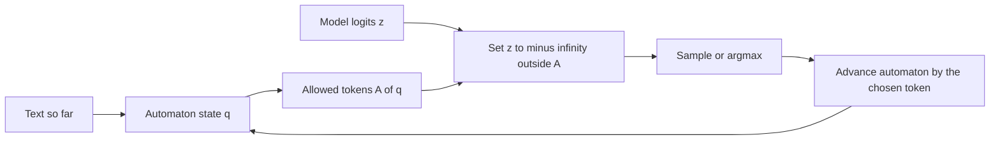
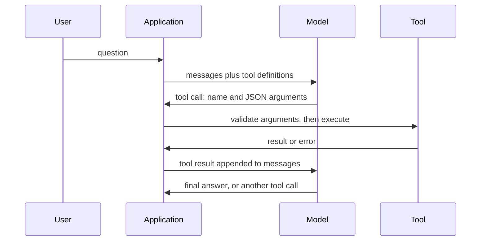

## Où cela s'inscrit

Un modèle de langage renvoie une chaîne de caractères. Ton programme a besoin d'un enregistrement : un prix qui est un nombre, un drapeau qui est un booléen, un nom de fonction pris dans une liste fixe. L'écart entre les deux est l'endroit où se produisent de nombreuses défaillances en production : des blocs de code markdown autour du JSON, un préambule aimable, une virgule en trop, une chaîne là où un nombre était attendu. Cette leçon comble l'écart de trois façons de plus en plus fortes : **valider et réessayer** (vérifier après coup), **contraindre le décodeur** (rendre la sortie invalide impossible), et **l'appel d'outils** (un protocole où la sortie structurée du modèle déclenche de vraies actions dans ton code). Elle s'appuie sur les leviers de prompt de [[app.01]] et sur l'échantillonnage à partir des logits (`llm.sampling`). Encadrer ce que les outils peuvent faire relève de [[app.05]] ; partager des outils entre applications est le Model Context Protocol dans [[app.06]].

## L'idée en termes simples

Pense à un formulaire avec des cases. Tu peux demander à un employé de le remplir « soigneusement » (le prompting). Tu peux vérifier le formulaire rempli et le renvoyer avec de l'encre rouge quand une case est fausse (valider et réparer). Ou tu peux remettre un formulaire où seuls des caractères légaux peuvent être saisis dans chaque case (décodage contraint). Cette dernière approche ne produit jamais de formulaire invalide, mais un formulaire peut être parfaitement valide et contenir quand même la mauvaise réponse : la structure garantit la *forme*, pas la *vérité*.

Un appel d'outil est aussi un formulaire. Le modèle remplit « nom de fonction : get_weather, ville : Tokyo ». Il ne peut pas appuyer sur le bouton. Ton code lit le formulaire, décide s'il faut appuyer sur le bouton, appuie, et recolle le résultat dans la conversation. Le modèle est le cerveau ; ton code est les mains et a le droit de veto.

## Le spectre des sorties structurées

De la garantie la plus faible à la plus forte :

1. **Prompt seul** (« réponds en JSON »). Fonctionne généralement, enveloppe ou tronque parfois.
2. **Mode JSON** : la sortie s'analyse comme du JSON, mais les clés et les types ne sont pas garantis.
3. **Mode schéma** : l'API prend un JSON Schema et renvoie une sortie conforme (proposé par les grands fournisseurs sous divers noms).
4. **Décodage contraint** : tu contrôles le décodeur (modèles auto-hébergés) et tu masques toi-même les jetons. La garantie tient par construction.

## JSON Schema comme contrat

Un JSON Schema décrit les valeurs autorisées. Les mots-clés que tu utiliseras le plus :

| Mot-clé | Signification |
|---|---|
| `type` | `object`, `array`, `string`, `integer`, `number`, `boolean`, `null` |
| `properties`, `required` | les clés, et lesquelles sont obligatoires |
| `additionalProperties: false` | aucune clé inattendue |
| `enum` | la valeur doit appartenir à une liste |
| `minimum`, `maximum`, `minLength` | bornes numériques et de chaînes |
| `items` | schéma de chaque élément d'un tableau |

Deux pièges. En Python, `True` est un `int`, mais dans JSON Schema un booléen n'est pas un nombre, donc un validateur doit tester `bool` en premier. Et **l'ordre des champs est de la logique** : si `answer` vient avant `reasoning` dans le schéma, le modèle s'engage avant de réfléchir (voir [[app.01]]).

## Décodage contraint : un masque sur une grammaire

À chaque pas, le modèle produit un vecteur de logits $z\in\mathbb{R}^{V}$ sur un vocabulaire de taille $V$. Un **processeur de logits** se place entre le modèle et l'échantillonneur. Étant donné le texte jusqu'ici, il calcule l'ensemble $A$ des jetons qui peuvent encore mener à une sortie valide et remplace $z_t$ par $-\infty$ pour chaque $t\notin A$. Après le softmax, la masse de probabilité ne se trouve que sur les jetons autorisés :

$$
p_c(t\mid s)=\frac{e^{z_t}}{\sum_{u\in A(s)}e^{z_u}}\quad\text{for }t\in A(s),\qquad p_c(t\mid s)=0\text{ otherwise.}
$$

L'ensemble $A(s)$ provient d'un **automate** du langage cible (une expression régulière, ou un schéma compilé en machine à états finis ; les grammaires hors contexte gèrent les structures récursives). L'automate a un état ; chaque caractère le fait passer à l'état suivant ou à « mort ». La subtilité est que les jetons sont **multi-caractères**, donc un jeton est autorisé dans l'état $q$ si et seulement si lui fournir ses caractères un par un ne tombe jamais sur une transition manquante. Le jeton de fin de séquence n'est autorisé que dans un état d'acceptation.



Deux conséquences à connaître :

- Le masquage **renormalise** la distribution du modèle. Si le modèle préférait fortement un jeton invalide, la masse se déplace vers le jeton valide qui reste, éventuellement peu naturel. Contraindre le format ne rend pas le contenu bon.
- **Le vocabulaire compte.** Si la grammaire exige un caractère qu'aucun jeton ne peut fournir dans un certain état, l'ensemble autorisé est vide et le décodage est bloqué. Dans l'exercice, proposer un seul jeton `{` sans aucun jeton commençant par un guillemet double derrière produit exactement cette impasse. Les outils de production compilent la grammaire contre le tokenizer réel pour l'éviter.

Le décodage contraint peut aussi être *plus rapide* : là où la grammaire impose les caractères suivants (échafaudage comme `{"sentiment":"`), le moteur peut les émettre sans échantillonner.

## Exemple détaillé

La grammaire de l'exercice est `{"sentiment":"(positive|negative)","score":[0-9]{1,2}}` et son vocabulaire compte 25 jetons, dont des déchets comme `Sure`. Le faux modèle place une forte préférence sur `Sure` au premier pas, donc le décodage glouton non contraint commence par du bavardage et ne produit jamais d'objet valide. Avec le masque :

| pas | jetons autorisés (sur 25) | choisi |
|---|---|---|
| 0 | 2 (`{"` et `{"sentiment":"`) | `{"sentiment":"` |
| 1 | 4 (`pos`, `positive`, `neg`, `negative`) | `negative` |
| 2 | 1 (`","score":`) | `","score":` |
| 3 | 6 (cinq jetons chiffres et `42`) | `9` |
| 4 | 6 (chiffres et `}`) | `1` |
| 5 | 1 (`}`) | `}` |
| 6 | 1 (`<eos>`) | `<eos>` |

Sortie : `{"sentiment":"negative","score":91}`. Note le pas 5 : après deux chiffres, seule l'accolade fermante est légale, car la grammaire autorise au plus deux chiffres.

## Valider et réparer

Quand tu ne peux pas contraindre le décodeur (un modèle hébergé sans mode schéma), tu vérifies après coup et tu redemandes avec le message d'erreur :

1. extrais le JSON de la réponse (retire les blocs de code et le préambule) ;
2. `json.loads` ; en cas d'échec, le retour est le message de l'analyseur ;
3. valide par rapport au schéma ; en cas d'échec, le retour est la liste des erreurs avec leurs chemins ;
4. ajoute le retour à la conversation et réessaie, jusqu'à un petit maximum.

Dans l'exercice, une exécution en trois tentatives sur un enregistrement de produit donne le retour `$.price: expected number, got str` après la première réponse (le prix était la chaîne `"348"`), puis `invalid JSON: Expecting property name enclosed in double quotes` pour une virgule en trop, et réussit à la troisième réponse. Un bon retour nomme le **chemin** et la **règle**, pour que le modèle puisse corriger une seule chose. Les réessais coûtent de l'argent et de la latence ; suis le taux de réessais comme métrique de qualité, et plafonne les tentatives.

## Appel de fonctions

Le protocole, pas à pas :



Règles de conception qui en découlent :

- Une **définition d'outil** est un JSON Schema pour les arguments plus une `description` en langage naturel. La description est un prompt : le modèle la lit pour décider quand et comment appeler. « Obtient la météo actuelle d'une ville ; renvoie les degrés Celsius et les conditions » sélectionne mieux que « obtient la météo ».
- **Valide les arguments** avec le même validateur que ci-dessus avant d'exécuter ; le modèle peut émettre de mauvais types ou des valeurs inventées.
- **Renvoie les erreurs comme résultats**, pas comme exceptions, pour que le modèle puisse se rétablir (« ville introuvable, essaie une autre orthographe »).
- **Appels parallèles** : un modèle peut demander plusieurs appels indépendants en un tour ; exécute-les et renvoie tous les résultats.
- **Borne la boucle** : fixe un nombre maximal de tours d'outils, sinon un modèle perdu peut appeler des outils indéfiniment. [[app.06]] formalise cela comme une machine à états.
- **Moindre privilège** : le modèle décide *quoi demander*, ton code décide *ce qui est permis*. Tout ce qui est destructeur exige une vérification de permission ou une approbation humaine ([[app.05]]).

Les fournisseurs diffèrent par la syntaxe de surface (comment un appel apparaît dans la réponse, comment forcer un appel) mais convergent sur JSON Schema pour les définitions. Consulte la documentation actuelle pour les noms exacts des champs ; ne te fie pas à ta mémoire d'une API en particulier.

## Implémentation

Le cœur du validateur (la version complète avec `enum`, bornes, `items` et chemins est l'exercice) :

```python
TYPES = {"object": dict, "array": list, "string": str, "boolean": bool, "null": type(None)}

def type_ok(v, t):
    if t in ("integer", "number"):
        kinds = int if t == "integer" else (int, float)
        return isinstance(v, kinds) and not isinstance(v, bool)
    return isinstance(v, TYPES[t])
```

et le masque de jetons :

```python
def token_mask(dfa, state, vocab):
    return [(state == dfa["accept"]) if t == "<eos>" else dfa_step(dfa, state, t) is not None
            for t in vocab]
```

En pratique, tu utiliserais Pydantic ou `jsonschema` pour la validation, et Outlines, XGrammar/llguidance ou l'option de décodage guidé d'un moteur de service pour le masquage.

## Idées reçues courantes

- « Un JSON valide signifie une réponse correcte. » Il signifie une forme correcte. Un modèle contraint hallucine toujours des valeurs.
- « Le décodage contraint est une étape de post-traitement. » Il agit sur les logits à chaque pas ; un post-traitement ne peut pas réparer une chaîne tronquée ou mal structurée.
- « Le modèle appelle la fonction. » Il émet du texte nommant une fonction ; ton code exécute.
- « Réessayer jusqu'à ce que ça marche » est un plan. Sans plafond ni retour d'erreur, cela brûle de l'argent ; avec retour, cela converge généralement en un ou deux tours.
- « Une description d'outil est de la documentation pour les humains. » C'est une instruction au modèle ; des descriptions vagues causent un mauvais choix d'outil.

## Points clés à retenir

- La structure est imposée à quatre niveaux de force : prompt, mode JSON, mode schéma, décodage contraint.
- Le décodage contraint masque les logits à l'aide d'un automate ; les jetons sont multi-caractères, donc la légalité se vérifie en faisant passer les caractères d'un jeton dans l'automate.
- Le masquage garantit la forme, pas la justesse, et exige un vocabulaire capable de compléter la grammaire.
- Valider-et-réparer exige un retour d'erreur précis par chemin et un plafond de réessais.
- Appel d'outils = sortie structurée + ton exécuteur ; valide les arguments, renvoie les erreurs comme données, borne la boucle.

## Explique-le toi-même

1. Pourquoi un jeton peut-il être interdit dans un état de l'automate et autorisé dans un autre, et que se passe-t-il si aucun jeton n'est autorisé ?
2. Ton agent utilisant des outils n'arrête pas d'appeler `search` avec les mêmes arguments. Liste trois contrôles (dans le prompt, dans le schéma, dans le code) qui l'arrêteraient.

## Pour aller plus loin

- Outlines, XGrammar/llguidance et le décodage guidé des moteurs de service (nommés dans les sources ; documentation non ouverte ici).
- La spécification JSON Schema pour l'ensemble complet des mots-clés.

## Critères de maîtrise

- Tu sais écrire un schéma pour un enregistrement et un validateur qui rapporte des erreurs précises par chemin.
- Tu sais implémenter un masque de jetons sur un automate de caractères et expliquer les impasses.
- Tu sais écrire la boucle de réparation et dire quel retour envoyer.
- Tu sais dessiner la séquence d'appel d'outil et nommer deux endroits où la validation a sa place.
