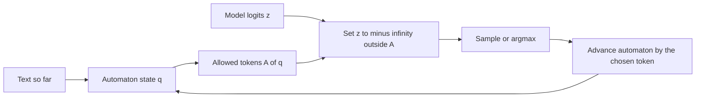
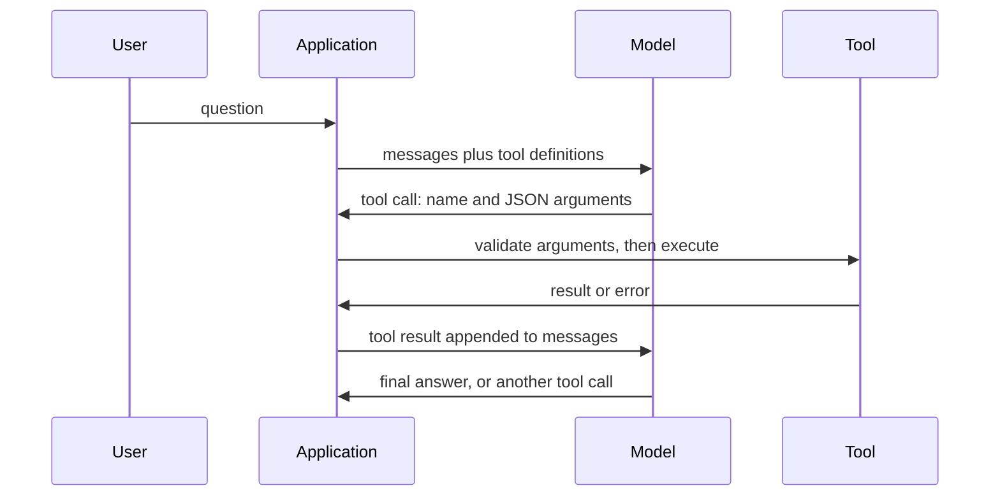

## Where this fits

A language model returns a string. Your program needs a record: a price that is a number, a flag that is a boolean, a function name from a fixed list. The gap between the two is where many production failures happen: markdown fences around the JSON, a friendly preamble, a trailing comma, a string where a number was expected. This lesson closes the gap in three increasingly strong ways: **validate and retry** (check after the fact), **constrain the decoder** (make invalid output impossible), and **tool calling** (a protocol where the model's structured output triggers real actions in your code). It builds on the prompt levers of [[app.01]] and on sampling from logits (`llm.sampling`). Guarding what tools may do is [[app.05]]; sharing tools across applications is the Model Context Protocol in [[app.06]].

## The idea in plain words

Think of a form with boxes. You can ask a clerk to fill it in "carefully" (prompting). You can check the filled form and send it back with red ink when a box is wrong (validate and repair). Or you can hand over a form where only legal characters can be typed into each box (constrained decoding). The last approach never produces an invalid form, but a form can be perfectly valid and still contain the wrong answer: structure guarantees *shape*, not *truth*.

A tool call is a form too. The model fills in "function name: get_weather, city: Tokyo". It cannot press the button. Your code reads the form, decides whether to press the button, presses it, and pastes the result back into the conversation. The model is the brain; your code is the hands and has the veto.

## The structured-output spectrum

From weakest to strongest guarantee:

1. **Prompt only** ("respond in JSON"). Usually works, sometimes wraps or truncates.
2. **JSON mode**: the output parses as JSON, but keys and types are not guaranteed.
3. **Schema mode**: the API takes a JSON Schema and returns output that conforms to it (offered by the large providers under various names).
4. **Constrained decoding**: you control the decoder (self-hosted models) and mask tokens yourself. Guarantee holds by construction.

## JSON Schema as the contract

A JSON Schema describes allowed values. The keywords you will use most:

| Keyword | Meaning |
|---|---|
| `type` | `object`, `array`, `string`, `integer`, `number`, `boolean`, `null` |
| `properties`, `required` | the keys, and which are mandatory |
| `additionalProperties: false` | no unexpected keys |
| `enum` | value must be one of a list |
| `minimum`, `maximum`, `minLength` | numeric and string bounds |
| `items` | schema for each array element |

Two traps. In Python `True` is an `int`, but in JSON Schema a boolean is not a number, so a validator must test `bool` first. And **field order is logic**: if `answer` comes before `reasoning` in the schema, the model commits before it thinks (see [[app.01]]).

## Constrained decoding: a mask over a grammar

At every step the model produces a logit vector $z\in\mathbb{R}^{V}$ over a vocabulary of size $V$. A **logit processor** sits between model and sampler. Given the text so far, it computes the set $A$ of tokens that can still lead to a valid output and replaces $z_t$ by $-\infty$ for every $t\notin A$. After softmax, probability mass sits only on allowed tokens:

$$
p_c(t\mid s)=\frac{e^{z_t}}{\sum_{u\in A(s)}e^{z_u}}\quad\text{for }t\in A(s),\qquad p_c(t\mid s)=0\text{ otherwise.}
$$

The set $A(s)$ comes from an **automaton** for the target language (a regular expression, or a schema compiled to a finite-state machine; context-free grammars handle recursive structures). The automaton has a state; each character moves it to the next state or to "dead". The subtlety is that tokens are **multi-character**, so a token is allowed in state $q$ iff feeding its characters one by one never hits a missing transition. End-of-sequence is allowed only in an accepting state.



Two consequences worth knowing:

- Masking **renormalises** the model's distribution. If the model strongly preferred an invalid token, the mass moves to whatever valid token is left, possibly an unnatural one. Constraining format does not make the content good.
- **The vocabulary matters.** If the grammar demands a character that no token can supply in some state, the allowed set is empty and decoding is stuck. In the exercise, offering a lone `{` token with no token starting with a double quote after it produces exactly this dead end. Production tools compile the grammar against the actual tokenizer to avoid it.

Constrained decoding can also be *faster*: where the grammar forces the next characters (scaffolding such as `{"sentiment":"`) the engine can emit them without sampling.

## Worked example

The exercise's grammar is `{"sentiment":"(positive|negative)","score":[0-9]{1,2}}` and its vocabulary has 25 tokens, including junk such as `Sure`. The fake model puts a strong preference on `Sure` at the first step, so unconstrained greedy decoding starts with chatter and never produces a valid object. With the mask:

| step | allowed tokens (of 25) | chosen |
|---|---|---|
| 0 | 2 (`{"` and `{"sentiment":"`) | `{"sentiment":"` |
| 1 | 4 (`pos`, `positive`, `neg`, `negative`) | `negative` |
| 2 | 1 (`","score":`) | `","score":` |
| 3 | 6 (five digit tokens and `42`) | `9` |
| 4 | 6 (digits and `}`) | `1` |
| 5 | 1 (`}`) | `}` |
| 6 | 1 (`<eos>`) | `<eos>` |

Output: `{"sentiment":"negative","score":91}`. Note step 5: after two digits only the closing brace is legal, because the grammar allows at most two digits.

## Validate and repair

When you cannot constrain the decoder (a hosted model without schema mode), you check afterwards and ask again with the error message:

1. extract the JSON from the reply (strip fences and preamble);
2. `json.loads`; on failure the feedback is the parser's message;
3. validate against the schema; on failure the feedback is the list of errors with their paths;
4. append the feedback to the conversation and retry, up to a small maximum.

In the exercise a three-attempt run on a product record gives feedback `$.price: expected number, got str` after the first reply (the price was the string `"348"`), then `invalid JSON: Expecting property name enclosed in double quotes` for a trailing comma, and succeeds on the third reply. Good feedback names the **path** and the **rule**, so the model can fix one thing. Retries cost money and latency; track the retry rate as a quality metric, and cap attempts.

## Function calling

The protocol, step by step:



Design rules that follow:

- A **tool definition** is a JSON Schema for the arguments plus a natural-language `description`. The description is a prompt: the model reads it to decide when and how to call. "Get current weather for a city; returns Celsius and conditions" selects better than "gets weather".
- **Validate arguments** with the same validator as above before executing; the model can emit wrong types or invented values.
- **Return errors as results**, not exceptions, so the model can recover ("city not found, try another spelling").
- **Parallel calls**: a model may request several independent calls in one turn; execute them and return all results.
- **Bound the loop**: set a maximum number of tool rounds, otherwise a confused model can call tools forever. [[app.06]] formalises this as a state machine.
- **Least privilege**: the model decides *what to ask*, your code decides *what is allowed*. Anything destructive needs a permission check or human approval ([[app.05]]).

Providers differ in surface syntax (how a call appears in the response, how to force a call) but converge on JSON Schema for definitions. Check current documentation for exact field names; do not rely on memory of any one API.

## Implementation

Core of the validator (full version with `enum`, bounds, `items` and paths is the exercise):

```python
TYPES = {"object": dict, "array": list, "string": str, "boolean": bool, "null": type(None)}

def type_ok(v, t):
    if t in ("integer", "number"):
        kinds = int if t == "integer" else (int, float)
        return isinstance(v, kinds) and not isinstance(v, bool)
    return isinstance(v, TYPES[t])
```

and the token mask:

```python
def token_mask(dfa, state, vocab):
    return [(state == dfa["accept"]) if t == "<eos>" else dfa_step(dfa, state, t) is not None
            for t in vocab]
```

In practice you would use Pydantic or `jsonschema` for validation, and Outlines, XGrammar/llguidance or a serving engine's guided-decoding option for masking.

## Common misconceptions

- "Valid JSON means correct answer." It means correct shape. A constrained model still hallucinates values.
- "Constrained decoding is a post-processing step." It acts on logits at every step; post-processing cannot repair a truncated or wrongly-structured string.
- "The model calls the function." It emits text naming a function; your code executes.
- "Retry until it works" is a plan. Without a cap and error feedback it burns money; with feedback it usually converges in one or two rounds.
- "A tool description is documentation for humans." It is an instruction to the model; vague descriptions cause wrong tool choice.

## Key takeaways

- Structure is enforced at four strengths: prompt, JSON mode, schema mode, constrained decoding.
- Constrained decoding masks logits using an automaton; tokens are multi-character, so legality is checked by running a token's characters through the automaton.
- Masking guarantees shape, not correctness, and needs a vocabulary that can complete the grammar.
- Validate-and-repair needs path-specific error feedback and a retry cap.
- Tool calling = structured output + your executor; validate arguments, return errors as data, bound the loop.

## Explain it yourself

1. Why can a token be forbidden at one automaton state and allowed at another, and what happens if no token is allowed?
2. Your tool-using agent keeps calling `search` with the same arguments. List three controls (in prompt, in schema, in code) that would stop it.

## Further reading

- Outlines, XGrammar/llguidance and serving-engine guided decoding (named in the sources; documentation not opened here).
- JSON Schema specification for the full keyword set.

## Mastery criteria

- You can write a schema for a record and a validator that reports path-specific errors.
- You can implement a token mask over a character automaton and explain dead ends.
- You can write the repair loop and say what feedback to send.
- You can draw the tool-call sequence and name two places where validation belongs.
