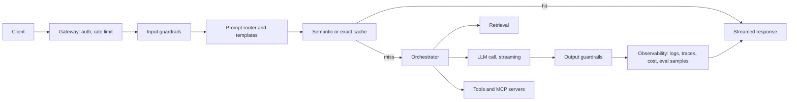
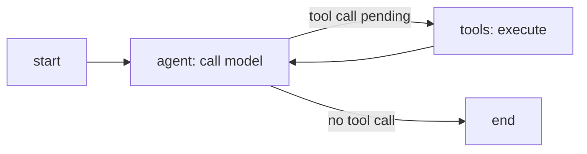

## Où cela s'inscrit

Tu sais maintenant écrire un prompt ([[app.01]]), obtenir des sorties structurées et des appels d'outils ([[app.02]]), gérer le contexte et son coût ([[app.03]]), évaluer les changements ([[app.04]]) et défendre le système ([[app.05]]). Construire une fonctionnalité LLM prend un après-midi ; livrer un produit prend des mois, à cause de tout ce qui entoure le modèle : un utilisateur envoie un document de 50 000 jetons, l'API renvoie une erreur 500 à 2 h du matin, deux utilisateurs posent la même question à quatre secondes d'intervalle, la facture atteint cinq chiffres et personne ne sait quelle fonctionnalité en est la cause, la réponse prend huit secondes et les utilisateurs partent après trois. Ce chapitre de synthèse place les pièces dans une seule architecture, montre comment la **chiffrer et la chronométrer sur le papier**, transforme la boucle d'agent en une **machine à états explicite**, et introduit le **Model Context Protocol** pour partager des outils. Les rouages de la récupération sont dans la leçon `sys.03` ; le cache KV dans `sys.01`.

## L'idée en termes simples

Une application LLM de production est une cuisine de restaurant, pas un chef. Le chef (le modèle) est la partie chère, lente, parfois capricieuse, donc tout ce qui l'entoure existe pour l'occuper avec le bon travail : une porte d'entrée qui vérifie les réservations et écarte les fauteurs de troubles (passerelle, limites de débit, garde-fous), un menu qui associe les demandes à des recettes (routeur de prompts et modèles), un garde-manger de composants préparés (caches, récupération), des commis qui vont chercher des ingrédients à l'extérieur (outils), un contrôle qualité avant que les assiettes ne sortent (garde-fous de sortie), et le registre du gérant notant le temps pris par chaque plat et son coût (observabilité). Quand le chef est malade, un chef de secours ou une assiette froide sort (solutions de repli).

Pour les agents, la boucle du chef « réfléchir, aller chercher, réfléchir encore » est écrite sur un organigramme avec des postes nommés. Une fois la boucle devenue organigramme, tu peux la suspendre à un poste pour la signature d'un responsable, enregistrer une photographie de la cuisine après chaque étape, et plafonner le nombre d'étapes.

## Architecture



À quoi sert chaque partie et où elle a été enseignée :

| Partie | Rôle | Leçon |
|---|---|---|
| Passerelle | authentification, seaux à jetons et quotas par utilisateur, limites de taille des requêtes | [[app.05]] |
| Garde-fous d'entrée / de sortie | injection, PII, politique ; échec en mode fermé pour les actions risquées | [[app.05]] |
| Routeur de prompts, modèles | prompts versionnés ; choisir le modèle et le gabarit selon la tâche | [[app.01]] |
| Cache | cache exact ou sémantique ; cache de préfixes du fournisseur | [[app.03]] |
| Récupération | trouver des preuves dans tes données | `sys.03` |
| Appel LLM | streaming, délais d'attente, réessais, replis | ci-dessous |
| Outils | actions via des schémas validés | [[app.02]] |
| Observabilité | traces, comptabilité des jetons et des coûts, échantillonnage pour évaluation | [[app.04]] |

Habitudes de fiabilité : fixe un **délai d'attente** sur chaque appel externe ; **réessaie** uniquement les appels idempotents, avec un recul exponentiel et du jitter, et un plafond ; replie-toi sur un second fournisseur ou un modèle plus petit ; fais du **streaming** de jetons pour que les utilisateurs voient la sortie après le délai du premier jeton plutôt qu'après toute la génération ; rends les appels d'outils **idempotents** ou protège-les par des identifiants de requête ; place des **budgets** (jetons, dollars, étapes) sur chaque requête et chaque utilisateur.

L'observabilité signifie une **trace** par requête avec un intervalle (span) pour chaque étape, étiqueté avec la version du prompt, le modèle, les jetons d'entrée et de sortie, le succès du cache, les identifiants de récupération, les appels d'outils, les verdicts des garde-fous, la latence et le coût. À partir des traces, tu dérives des percentiles de latence (p50, p95, p99), des taux d'erreur et de repli, le coût par fonctionnalité et par utilisateur, et un flux de sorties échantillonnées à faire juger ([[app.04]]). Fais attention à ce que tu journalises : les prompts contiennent des données d'utilisateurs, donc masque les PII dans les journaux ([[app.05]]).

## Coût et latence sur le papier

Chaque étape $s$ a des jetons d'entrée $n^{in}_s$, des jetons de sortie $n^{out}_s$, des prix $c^{in}_s,c^{out}_s$ (dollars par million de jetons), un délai avant le premier jeton $\tau_s$ et une vitesse de génération $v_s$ (jetons par seconde). Alors

$$
\text{cost}_s=\frac{n^{in}_s c^{in}_s+n^{out}_s c^{out}_s}{10^{6}},\qquad
\text{latency}_s=\tau_s+\frac{n^{out}_s}{v_s}.
$$

Les étapes qui dépendent les unes des autres s'additionnent ; les étapes qui peuvent s'exécuter en même temps (garde-fou d'entrée et recherche d'embedding, par exemple) comptent une fois avec la latence **maximale** du groupe, tandis que leurs coûts s'additionnent quand même. Comme le temps de génération croît linéairement avec la longueur de sortie, **les jetons de sortie dominent la latence**, et comme ils sont facturés plus cher que les jetons d'entrée, ils pèsent aussi lourd dans le coût.

### Exemple détaillé

L'exercice chiffre quatre étapes (prix et vitesses illustratifs) :

| Étape | jetons entrée / sortie | prix entrée / sortie par M | ttft | jetons/s | coût | latence |
|---|---|---|---|---|---|---|
| garde-fou d'entrée (petit modèle) | 300 / 20 | 0.25 / 1.25 | 0.15 s | 200 | 0.000100 | 0.25 s |
| embedding pour la récupération | 50 / 0 | 0.02 / 0 | 0.05 s | n/a | 0.000001 | 0.05 s |
| génération principale | 3000 / 400 | 3 / 15 | 0.60 s | 80 | 0.015000 | 5.60 s |
| garde-fou de sortie (petit modèle) | 450 / 10 | 0.25 / 1.25 | 0.15 s | 200 | 0.000125 | 0.20 s |

Le garde-fou d'entrée et l'embedding s'exécutent en parallèle : cette étape coûte $\max(0.25,0.05)=0.25$ s. Le coût total par requête est de $0.015226$ dollar ; la latence totale est de $0.25+5.60+0.20=6.05$ s (6,10 s si les deux premières s'exécutaient l'une après l'autre, avec la même facture). L'appel principal représente $98.5\%$ du coût et $92.6\%$ de la latence. Avec 10 000 utilisateurs faisant 10 requêtes par jour pendant 30 jours, cela donne $3{,}000{,}000$ requêtes, $45{,}678$ dollars par mois. Leviers, par ordre d'impact : raccourcis ou plafonne la sortie (400 jetons représentent 5 des 5,6 secondes), route les requêtes faciles vers un modèle moins cher, mets en cache le préfixe stable et les questions répétées ([[app.03]]), fais du streaming pour que la latence perçue soit le délai de 0,6 s avant le premier jeton, et réduis l'entrée de 3 000 jetons en récupérant moins.

**Les réessais sont facturés.** Si chaque tentative échoue indépendamment avec la probabilité $p$ et que tu essaies jusqu'à $k$ fois, la tentative $j$ (en comptant depuis 0) a lieu avec la probabilité $p^j$, donc la dépense espérée est

$$
\text{cost}\cdot\sum_{j=0}^{k-1}p^{j}=\text{cost}\cdot\frac{1-p^{k}}{1-p}.
$$

Avec $p=0.5$ et $k=3$, cela fait $1.75\times$. Rappelle-toi aussi que la somme des latences moyennes des étapes n'est pas le p95 du total : les queues de distribution doivent être mesurées à partir des traces.

## Boucles d'agents comme machines à états

Un agent utilisant des outils est une boucle : le modèle lit l'historique, soit répond, soit demande un appel d'outil, ton code exécute l'outil, le résultat est ajouté, et le modèle regarde à nouveau. Écrite en `while True`, c'est une boîte noire : tu ne peux pas la suspendre avant une étape risquée, la rejouer, ni l'arrêter de façon fiable. La même boucle dessinée comme un graphe comporte :

- **État** : un dict qui circule dans le graphe (messages, appel d'outil en attente, compteurs).
- **Nœuds** : des fonctions qui prennent l'état et renvoient une *mise à jour partielle* (« appeler le modèle », « exécuter l'outil »).
- **Arêtes** : le nœud suivant, fixe ou choisi par une fonction de l'état (arête conditionnelle, par exemple « si le dernier message contient un appel d'outil va à `tools`, sinon termine »).
- **Réducteurs** : pour chaque champ, comment une mise à jour se fusionne dans l'ancienne valeur. Écraser est le défaut ; les listes de messages ont besoin d'*ajouter*. Oublie le réducteur et la deuxième mise à jour remplace silencieusement l'historique.

L'agent ReAct classique (raisonner et agir) tient en deux nœuds et deux arêtes :



Une fois la boucle explicite, tu gagnes quatre capacités : le **checkpointing** (enregistrer l'état après chaque nœud pour qu'une exécution plantée reprenne), les **interruptions** (s'arrêter avant un nœud pour une approbation humaine et reprendre plus tard), le **streaming** d'événements intermédiaires, et le **voyage dans le temps** (repartir d'un point de contrôle antérieur pour déboguer ou bifurquer). LangGraph est une bibliothèque très utilisée construite sur ce modèle ; l'exercice implémente l'exécuteur déterministe minimal.

### Exemple détaillé : l'exécuteur

Le modèle scénarisé de l'exercice demande d'abord `add(2, 3)` puis répond. La trace est `agent, tools, agent` ; statut `done` ; les messages passent à quatre (utilisateur, appel de l'assistant, résultat de l'outil, réponse de l'assistant) parce que le réducteur ajoute. Retire le réducteur et l'état final ne garde qu'**un** message : l'historique a été écrasé, le classique bug silencieux. Avec `interrupt_before={"tools"}`, l'exécution s'arrête après la première étape `agent` avec le statut `interrupted` et le nœud suivant `tools` ; reprendre depuis cet état enregistré donne exactement le même état final que l'exécution sans interruption. Un agent qui demande toujours un autre appel d'outil est coupé après `max_steps` = 7 nœuds exécutés avec le statut `max_steps`, donc une boucle incontrôlée coûte un montant borné.

### Choisir un style d'orchestration

La source que nous avons lue compare les bibliothèques selon l'*abstraction* que tu dessines au tableau : un graphe avec état typé (bien quand tu as besoin d'un état explicite, d'interruptions et de rejeu), une équipe de rôles avec des tâches (bien pour des plans courts guidés par des personas), une conversation entre agents (bien pour un dialogue proposeur-critique), ou un agent unique avec outils et mémoire (rapide à construire). Fais correspondre l'abstraction à la forme de ton problème ; la douleur commune en production est l'état : où il vit, comment il persiste, et si tu peux reprendre après un plantage. Évite les conceptions multi-agents quand un seul agent avec de bons outils suffirait : chaque agent supplémentaire ajoute du coût, de la latence et des modes de défaillance.

## Model Context Protocol (MCP) en une page

[[app.02]] définissait les outils en ligne dans chaque application. Si plusieurs applications ont besoin du même outil de base de données ou d'agenda, chacune réimplémente la découverte, l'invocation, les erreurs, le transport et l'autorisation. **MCP** standardise cette surface pour qu'un hôte conforme puisse utiliser n'importe quel serveur conforme sans adaptateur sur mesure.

- **Hôte** : l'application d'IA. Il contient des **clients**, chacun parlant à un **serveur**. Un **transport** (par exemple un processus local via les flux standard, ou HTTP) transporte des messages **JSON-RPC**.
- Un serveur expose trois types de primitives : les **outils** (actions appelables avec un nom, une description et une entrée JSON Schema), les **ressources** (contenu nommé adressé par URI qui peut être lu) et les **prompts** (gabarits réutilisables qu'un hôte peut proposer à un utilisateur).
- Dans la révision décrite par la leçon que nous avons lue (datée du 2026-07-28 ; consulte la spécification actuelle avant de te fier à un détail), la poignée de main et les sessions au niveau du protocole sont supprimées. À la place, chaque requête porte son propre contexte dans `params._meta` : la version du protocole et les capacités du client sont requises, l'identité du client est recommandée. Une requête mal formée renvoie l'erreur JSON-RPC « invalid params » (`-32602`) ; une version bien formée mais non prise en charge renvoie une erreur de version non prise en charge (`-32022`) listant les versions supportées. Un appel `server/discover` renvoie les versions supportées, les capacités et l'identité du serveur. Les résultats portent un `resultType` comme `complete`.
- Si un flux de travail a besoin de continuité, le serveur renvoie un **identifiant opaque** que le client passe plus tard comme un argument d'outil ordinaire ; l'autorisation est toujours vérifiée à chaque requête.

MCP standardise *seulement la communication*. Il ne décide pas quel outil le modèle doit appeler, ne rend pas le contenu non fiable sûr, et ne supprime pas le besoin d'approbations et de moindre privilège : un outil d'un serveur tiers est exactement aussi dangereux que n'importe quel autre outil, et sa sortie est une donnée non fiable ([[app.05]]). Passe des outils en ligne à un serveur MCP quand un outil est partagé entre hôtes ou appartient à une autre équipe.

## Implémentation

```python
def pipeline(stages):
    steps, order = {}, []
    for i, s in enumerate(stages):
        key = s["group"] if s["group"] is not None else ("seq", i)
        if key not in steps:
            steps[key] = []; order.append(key)
        steps[key].append(s)
    cost = sum(stage_cost(s) for s in stages)
    latency = sum(max(stage_latency(s) for s in steps[k]) for k in order)
    return {"cost": cost, "latency": latency}
```

et le cœur de l'exécuteur de graphe :

```python
while node != END and len(trace) < max_steps:
    update = graph["nodes"][node](state)
    for k, v in update.items():
        red = graph["reducers"].get(k)
        state[k] = red(state.get(k), v) if red else v
    trace.append(node)
    checkpoints.append(copy.deepcopy(state))
    nxt = graph["edges"][node]
    node = nxt(state) if callable(nxt) else nxt
```

Équivalents en production : un framework web avec événements envoyés par le serveur pour le streaming, une pile de traçage comme des spans de type OpenTelemetry plus un outil d'observabilité LLM, un magasin durable de points de contrôle (SQLite, Postgres ou Redis) pour l'état des agents, et LangGraph ou un runtime similaire pour les graphes.

## Idées reçues courantes

- « La latence est le problème du modèle. » La longueur de sortie, le nombre d'appels séquentiels et l'absence de streaming sont généralement entre tes mains.
- « Les réessais rendent le système fiable. » Des réessais sans plafond multiplient le coût et peuvent amplifier une panne ; utilise un recul exponentiel et des budgets.
- « Un agent est juste un prompt plus malin. » C'est un programme : il lui faut un état, des bornes, des permissions et des tests.
- « MCP sécurise mes outils. » Il standardise l'interface ; la confiance et la sécurité restent ton travail.
- « Plus d'agents, c'est mieux. » Chacun ajoute du coût, de la latence et des façons d'échouer ; commence avec un seul.

## Points clés à retenir

- Une application de production est un pipeline : passerelle, garde-fous, routeur, cache, récupération, modèle, outils, vérifications de sortie, observabilité.
- Chiffre et chronomètre le pipeline sur le papier : les coûts s'additionnent, les étapes parallèles prennent la latence maximale ; les jetons de sortie dominent la latence ; les réessais multiplient le coût par $(1-p^k)/(1-p)$.
- Fais des boucles d'agents des graphes explicites avec réducteurs, points de contrôle, interruptions et limite d'étapes.
- MCP standardise la découverte et l'invocation d'outils entre hôtes ; il ne supprime pas le besoin de garde-fous.
- Mesure avec des traces et garde l'évaluation et la surveillance actives après le lancement.

## Explique-le toi-même

1. Ta latence p95 est de 9 secondes et l'essentiel vient de la génération principale. Liste quatre changements qui la réduisent, et dis lesquels nuisent à la qualité.
2. Pourquoi un graphe avec état explicite rend-il facile l'approbation humaine d'un outil de paiement, alors qu'une boucle `while True` nue non ?

## Pour aller plus loin

- Documentation de LangGraph et d'OpenTelemetry ; spécification du Model Context Protocol (révision actuelle).
- Leçon `sys.03` (RAG) et `sys.01` (cache KV) pour les deux composants que cette leçon traite comme des boîtes.

## Critères de maîtrise

- Tu sais dessiner l'architecture et justifier chaque composant.
- Tu sais calculer le coût et la latence d'un pipeline à plusieurs étapes, y compris les étapes parallèles et les réessais.
- Tu sais implémenter un exécuteur de graphe déterministe avec réducteurs, points de contrôle, interruptions et plafond d'étapes.
- Tu sais expliquer ce que MCP fournit et ne fournit pas.
