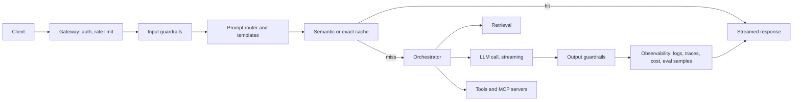
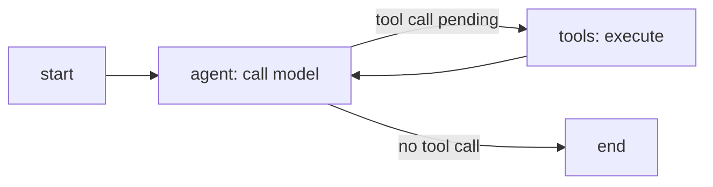

## Where this fits

You can now write a prompt ([[app.01]]), get structured output and tool calls ([[app.02]]), manage the context and its cost ([[app.03]]), evaluate changes ([[app.04]]) and defend the system ([[app.05]]). Building an LLM feature takes an afternoon; shipping a product takes months, because of everything around the model: a user sends a 50,000-token document, the API returns a 500 at 2 a.m., two users ask the same question four seconds apart, the bill reaches five digits and nobody knows which feature caused it, the answer takes eight seconds and users leave after three. This capstone puts the pieces into one architecture, shows how to **price and time it on paper**, turns the agent loop into an **explicit state machine**, and introduces the **Model Context Protocol** for sharing tools. Retrieval internals are in lesson `sys.03`; KV caching in `sys.01`.

## The idea in plain words

A production LLM application is a restaurant kitchen, not a chef. The chef (the model) is the expensive, slow, sometimes temperamental part, so everything around it exists to keep the chef busy with the right work: a front door that checks reservations and turns away troublemakers (gateway, rate limits, guardrails), a menu that maps requests to recipes (prompt router and templates), a pantry of ready-made components (caches, retrieval), runners who fetch ingredients from outside (tools), a quality check before plates leave (output guardrails), and a manager's ledger recording how long every dish took and what it cost (observability). When the chef is sick, a backup chef or a cold plate goes out (fallbacks).

For agents, the chef's loop of "think, fetch, think again" is written on a flowchart with named stations. Once the loop is a flowchart, you can pause it at a station for a manager's signature, save a photograph of the kitchen after each step, and cap the number of steps.

## Architecture



What each part is for and where it was taught:

| Part | Job | Lesson |
|---|---|---|
| Gateway | authentication, per-user token buckets and quotas, request size limits | [[app.05]] |
| Input / output guardrails | injection, PII, policy; fail-closed for risky actions | [[app.05]] |
| Prompt router, templates | versioned prompts; choose model and template by task | [[app.01]] |
| Cache | exact or semantic cache; provider prefix cache | [[app.03]] |
| Retrieval | find evidence in your data | `sys.03` |
| LLM call | streaming, timeouts, retries, fallbacks | below |
| Tools | actions through validated schemas | [[app.02]] |
| Observability | traces, token and cost accounting, eval sampling | [[app.04]] |

Reliability habits: set a **timeout** on every external call; **retry** only idempotent calls, with exponential backoff and jitter, and a cap; fall back to a second provider or a smaller model; **stream** tokens so users see output after the time-to-first-token rather than after the whole generation; make tool calls **idempotent** or guard them with request ids; put **budgets** (tokens, dollars, steps) on every request and on every user.

Observability means one **trace** per request with a span for each stage, tagged with prompt version, model, input and output tokens, cache hit, retrieval ids, tool calls, guardrail verdicts, latency and cost. From traces you derive latency percentiles (p50, p95, p99), error and fallback rates, cost per feature and per user, and a stream of sampled outputs for judging ([[app.04]]). Be careful what you log: prompts contain user data, so redact PII in logs ([[app.05]]).

## Cost and latency on paper

Each stage $s$ has input tokens $n^{in}_s$, output tokens $n^{out}_s$, prices $c^{in}_s,c^{out}_s$ (dollars per million tokens), time-to-first-token $\tau_s$ and generation speed $v_s$ (tokens per second). Then

$$
\text{cost}_s=\frac{n^{in}_s c^{in}_s+n^{out}_s c^{out}_s}{10^{6}},\qquad
\text{latency}_s=\tau_s+\frac{n^{out}_s}{v_s}.
$$

Stages that depend on each other add; stages that can run at the same time (input guard and embedding lookup, say) count once with the **maximum** latency of the group, while their costs still add. Because the time to generate grows linearly with output length, **output tokens dominate latency**, and because output tokens are priced higher than input tokens, they also weigh heavily in cost.

### Worked example

The exercise prices four stages (illustrative prices and speeds):

| Stage | in / out tokens | price in / out per M | ttft | tokens/s | cost | latency |
|---|---|---|---|---|---|---|
| input guard (small model) | 300 / 20 | 0.25 / 1.25 | 0.15 s | 200 | 0.000100 | 0.25 s |
| embed for retrieval | 50 / 0 | 0.02 / 0 | 0.05 s | n/a | 0.000001 | 0.05 s |
| main generation | 3000 / 400 | 3 / 15 | 0.60 s | 80 | 0.015000 | 5.60 s |
| output guard (small model) | 450 / 10 | 0.25 / 1.25 | 0.15 s | 200 | 0.000125 | 0.20 s |

The input guard and the embedding run in parallel: that step costs $\max(0.25,0.05)=0.25$ s. Total cost per request is $0.015226$ dollars; total latency is $0.25+5.60+0.20=6.05$ s (6.10 s if the first two ran one after the other, with the same bill). The main call is $98.5\%$ of the cost and $92.6\%$ of the latency. At 10,000 users making 10 requests a day for 30 days, that is $3{,}000{,}000$ requests, $45{,}678$ dollars a month. Levers, in order of impact: shorten or cap the output (400 tokens is 5 of the 5.6 seconds), route easy requests to a cheaper model, cache the stable prefix and repeated questions ([[app.03]]), stream so perceived latency is the 0.6 s time-to-first-token, and shrink the 3,000-token input by retrieving less.

**Retries are billed.** If each attempt fails independently with probability $p$ and you try up to $k$ times, attempt $j$ (counting from 0) happens with probability $p^j$, so the expected spend is

$$
\text{cost}\cdot\sum_{j=0}^{k-1}p^{j}=\text{cost}\cdot\frac{1-p^{k}}{1-p}.
$$

With $p=0.5$ and $k=3$ this is $1.75\times$. Also remember that the sum of mean stage latencies is not the p95 of the total: tails need measuring from traces.

## Agent loops as state machines

A tool-using agent is a loop: the model reads the history, either answers or requests a tool call, your code runs the tool, the result is appended, and the model looks again. Written as `while True`, it is a black box: you cannot pause it before a risky step, replay it, or reliably stop it. The same loop drawn as a graph has:

- **State**: a dict flowing through the graph (messages, pending tool call, counters).
- **Nodes**: functions that take the state and return a *partial update* ("call the model", "run the tool").
- **Edges**: the next node, either fixed or chosen by a function of the state (conditional edge, for example "if the last message has a tool call go to `tools`, else end").
- **Reducers**: for each field, how an update merges into the old value. Overwrite is the default; message lists need *append*. Forget the reducer and the second update silently replaces the history.

The classic ReAct (reason and act) agent is two nodes and two edges:



Once the loop is explicit you gain four capabilities: **checkpointing** (save the state after every node so a crashed run resumes), **interrupts** (stop before a node for human approval and resume later), **streaming** of intermediate events, and **time-travel** (restart from an earlier checkpoint to debug or branch). LangGraph is a widely used library built on this model; the exercise implements the minimal deterministic runner.

### Worked example: the runner

The exercise's scripted model first requests `add(2, 3)` and then answers. The trace is `agent, tools, agent`; status `done`; messages grow to four (user, assistant call, tool result, assistant answer) because the reducer appends. Remove the reducer and the final state keeps **one** message: the history was overwritten, the classic silent bug. Setting `interrupt_before={"tools"}` stops after the first `agent` step with status `interrupted` and next node `tools`; resuming from that saved state gives exactly the same final state as the uninterrupted run. An agent that always requests another tool call is cut off after `max_steps` = 7 executed nodes with status `max_steps`, so a runaway loop costs a bounded amount.

### Choosing an orchestration style

The source we read compares libraries by the *abstraction* you draw on the whiteboard: a graph with typed state (good when you need explicit state, interrupts and replay), a team of roles with tasks (good for short, persona-driven plans), a conversation between agents (good for proposer-critic dialogue), or a single agent with tools and memory (fast to build). Match the abstraction to the shape of your problem; the common production pain is state: where it lives, how it persists, and whether you can resume after a crash. Avoid multi-agent designs when one agent with good tools would do: every extra agent adds cost, latency and failure modes.

## Model Context Protocol (MCP) in one page

[[app.02]] defined tools inline in each application. If several applications need the same database or calendar tool, each re-implements discovery, invocation, errors, transport and authorisation. **MCP** standardises that surface so a compliant host can use any compliant server without a custom adapter.

- **Host**: the AI application. It contains **clients**, each speaking to one **server**. A **transport** (for example a local process via standard streams, or HTTP) carries **JSON-RPC** messages.
- A server exposes three kinds of primitive: **tools** (callable actions with a name, description and JSON Schema input), **resources** (named content addressed by URI that can be read) and **prompts** (reusable templates a host can offer to a user).
- In the revision described by the lesson we read (dated 2026-07-28; check the current specification before relying on any detail), the handshake and protocol-level sessions are removed. Instead every request carries its own context in `params._meta`: the protocol version and the client's capabilities are required, client identity is recommended. A malformed request returns the JSON-RPC "invalid params" error (`-32602`); a well-formed but unsupported version returns an unsupported-version error (`-32022`) listing supported versions. A `server/discover` call returns supported versions, capabilities and server identity. Results carry a `resultType` such as `complete`.
- If a workflow needs continuity, the server returns an **opaque handle** that the client passes as an ordinary tool argument later; authorisation is still checked on every request.

MCP standardises *communication only*. It does not decide which tool the model should call, does not make untrusted content safe, and does not remove the need for approvals and least privilege: a tool from a third-party server is exactly as dangerous as any other tool, and its output is untrusted data ([[app.05]]). Graduate from inline tools to an MCP server when a tool is shared across hosts or owned by another team.

## Implementation

```python
def pipeline(stages):
    steps, order = {}, []
    for i, s in enumerate(stages):
        key = s["group"] if s["group"] is not None else ("seq", i)
        if key not in steps:
            steps[key] = []; order.append(key)
        steps[key].append(s)
    cost = sum(stage_cost(s) for s in stages)
    latency = sum(max(stage_latency(s) for s in steps[k]) for k in order)
    return {"cost": cost, "latency": latency}
```

and the heart of the graph runner:

```python
while node != END and len(trace) < max_steps:
    update = graph["nodes"][node](state)
    for k, v in update.items():
        red = graph["reducers"].get(k)
        state[k] = red(state.get(k), v) if red else v
    trace.append(node)
    checkpoints.append(copy.deepcopy(state))
    nxt = graph["edges"][node]
    node = nxt(state) if callable(nxt) else nxt
```

Production equivalents: a web framework with server-sent events for streaming, a tracing stack such as OpenTelemetry-style spans plus an LLM-observability tool, a durable checkpoint store (SQLite, Postgres or Redis) for agent state, and LangGraph or a similar runtime for graphs.

## Common misconceptions

- "Latency is the model's problem." Output length, the number of sequential calls and missing streaming are usually in your hands.
- "Retries make the system reliable." Uncapped retries multiply cost and can amplify an outage; use backoff and budgets.
- "An agent is just a smarter prompt." It is a program: it needs state, bounds, permissions and tests.
- "MCP secures my tools." It standardises the interface; trust and safety remain your job.
- "More agents is better." Each adds cost, latency and ways to fail; start with one.

## Key takeaways

- A production app is a pipeline: gateway, guardrails, router, cache, retrieval, model, tools, output checks, observability.
- Price and time the pipeline on paper: costs add, parallel stages take the max latency; output tokens dominate latency; retries multiply cost by $(1-p^k)/(1-p)$.
- Make agent loops explicit graphs with reducers, checkpoints, interrupts and a step limit.
- MCP standardises tool discovery and invocation across hosts; it does not remove the need for guardrails.
- Measure with traces and keep eval and monitoring running after launch.

## Explain it yourself

1. Your p95 latency is 9 seconds and most of it is the main generation. List four changes that reduce it, and say which hurt quality.
2. Why does a graph with explicit state make human approval of a payment tool easy, while a bare `while True` loop does not?

## Further reading

- LangGraph and OpenTelemetry documentation; the Model Context Protocol specification (current revision).
- Lesson `sys.03` (RAG) and `sys.01` (KV cache) for the two components this lesson treats as boxes.

## Mastery criteria

- You can draw the architecture and justify each component.
- You can compute the cost and latency of a multi-stage pipeline, including parallel stages and retries.
- You can implement a deterministic graph runner with reducers, checkpoints, interrupts and a step cap.
- You can explain what MCP does and does not provide.
