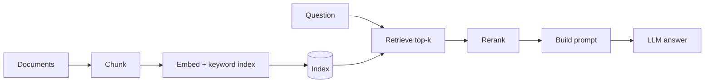

## Où cela s'inscrit

Un modèle de langage connaît ce qui figurait dans ses données d'entraînement jusqu'à une date limite, et rien de ton wiki d'entreprise, de ton code source ou de la réunion de la semaine dernière. Tu peux le fine-tuner sur tes documents, mais c'est lent, coûteux, périmé dès qu'un document change, et cela ne te dit pas de quel document provient une réponse. L'alternative qui domine en pratique est la **génération augmentée par récupération (RAG)** : garder le modèle inchangé, chercher dans tes documents au moment de la question, coller les meilleurs passages dans le prompt, et laisser le modèle répondre à partir d'eux. Les diapositives du cours français (CNAM RCP217) décrivent exactement cela : la question sert à sélectionner des documents, leur texte est ajouté à la question, et la question augmentée est envoyée au LLM.

L'essentiel d'un système RAG n'est pas le modèle de langage. C'est le découpage du texte, une mesure de similarité, un index, et un moyen de fusionner et de reclasser les candidats. Tout cela peut être construit et testé avec NumPy, ce que nous faisons. La leçon suivante montre comment *mesurer* si un tel système fonctionne.

## L'idée en mots simples

**Embeddings.** Imagine une bibliothèque où les livres sont rangés non pas par ordre alphabétique mais par sens : tous les livres de cuisine les uns près des autres, la cuisine pour diabétiques juste à côté. Chaque livre reçoit des coordonnées. Trouver les livres pertinents pour une question, c'est écrire des coordonnées pour la question et marcher jusqu'au rayon le plus proche. Un modèle d'embedding est la machine qui attribue des coordonnées au texte de façon que des textes de sens voisin reçoivent des coordonnées proches.

**Similarité.** « Proche » peut signifier petite distance ou petit angle. Pour le texte, on préfère généralement l'*angle* : un long document et une courte note sur le même sujet pointent dans la même direction même si leurs vecteurs ont des longueurs différentes.

**Découpage en chunks.** Un PDF de 50 pages a un seul embedding qui est une moyenne floue de tous ses sujets. On découpe donc les documents en passages (chunks). Trop petit, et un chunk perd le contexte nécessaire pour être compris ; trop grand, et le vecteur redevient flou, et tu gaspilles la fenêtre de contexte du modèle sur du texte non pertinent. Les diapositives font la même remarque : la granularité de l'indexation et celle de ce qui est renvoyé n'ont pas besoin d'être identiques.

**Plus proches voisins approximatifs.** Comparer la requête à chaque vecteur convient pour des milliers de chunks et est trop lent pour des centaines de millions. Les index sacrifient un peu de précision pour une énorme accélération : *IVF* regroupe les vecteurs en clusters et ne fouille que quelques clusters ; *HNSW* construit un graphe en couches d'« amis » et le parcourt de façon gloutonne depuis des hubs lointains jusqu'au voisinage de la requête.

**Recherche hybride.** Les vecteurs denses comprennent que « annuler mon abonnement » et « résilier votre forfait » veulent dire la même chose mais peuvent brouiller un code d'erreur exact comme `E-4021`. La recherche par mots-clés (BM25) est l'inverse. Exécuter les deux et fusionner les classements donne le meilleur des deux.

## Éléments formels

**Similarité cosinus** entre des vecteurs $a,b$ :

$$
\cos(a,b)=\frac{a^\top b}{\lVert a\rVert\,\lVert b\rVert}.
$$

Si tous les vecteurs sont normalisés à la longueur unité, alors $\cos(a,b)=a^\top b$ et aussi $\lVert a-b\rVert^2=2-2\cos(a,b)$, de sorte que classer par cosinus, par produit scalaire et par distance euclidienne coïncide. C'est pourquoi beaucoup de systèmes normalisent une fois et utilisent le produit scalaire (une seule multiplication matricielle note tout le corpus : $S = X q$ avec $X\in\mathbb{R}^{n\times d}$).

**TF-IDF.** Pour un terme $t$ dans un document $d$ : fréquence du terme $\text{tf}(t,d)$ (comptage), fréquence inverse de document $\text{idf}(t)=\ln\frac{1+N}{1+\text{df}(t)}+1$ avec $N$ documents et $\text{df}$ le nombre de documents contenant $t$. Les mots présents partout reçoivent un petit poids, les mots rares un grand. La ligne $\text{tf}\cdot\text{idf}$ est normalisée à la longueur unité. C'est un « embedding » creux avec une dimension par mot du vocabulaire ; il ne sait pas faire correspondre des synonymes.

**BM25** note un document pour une requête avec une version saturante et normalisée en longueur de la même idée :

$$
\text{BM25}(q,d)=\sum_{t\in q}\text{idf}(t)\,\frac{\text{tf}(t,d)\,(k_1+1)}{\text{tf}(t,d)+k_1\big(1-b+b\,|d|/\overline{|d|}\big)},\qquad
\text{idf}(t)=\ln\!\Big(\frac{N-\text{df}+0.5}{\text{df}+0.5}+1\Big).
$$

Lecture : $\text{tf}/(\text{tf}+k_1\cdot\ldots)$ sature, donc la dixième occurrence d'un mot ajoute bien moins que la première ; $b$ contrôle la force de la pénalisation des longs documents ($b=0$ aucune, $b=1$ totale). Les valeurs par défaut typiques sont $k_1=1.2$, $b=0.75$ (les valeurs utilisées dans le code du cours).

**Fusion de rangs réciproques (RRF).** Étant données plusieurs listes classées, donne à chaque document le score

$$
\text{RRF}(d)=\sum_{R}\frac{1}{k+\text{rank}_R(d)},\qquad k=60 \text{ is a common default.}
$$

Pourquoi cela marche : seuls les rangs sont utilisés, donc inutile de calibrer les scores BM25 (non bornés) contre les cosinus (dans $[-1,1]$). La constante $k$ empêche les premières positions de dominer : l'écart entre les rangs 1 et 2 est $1/61-1/62$, à peine plus grand que celui entre les rangs 10 et 11, donc l'accord entre listes compte plus qu'une seule première place chanceuse.

## Dérivation : pourquoi normaliser transforme la distance en produit scalaire

Pour des vecteurs unitaires, $\lVert a-b\rVert^2=\lVert a\rVert^2+\lVert b\rVert^2-2a^\top b=2-2\,a^\top b$. Une distance plus petite signifie donc un produit scalaire plus grand, avec un ordre identique. C'est aussi ce qui permet à un index vectoriel de servir les trois métriques avec une seule implémentation.

## Le pipeline RAG



Hors ligne : nettoyer les documents, les découper en chunks, calculer l'embedding de chaque chunk, stocker les vecteurs (et un index par mots-clés). En ligne : calculer l'embedding de la question *avec le même modèle d'embedding*, récupérer $k$ candidats (typiquement 20 à 100), éventuellement fusionner dense et BM25, **reclasser** (rerank) avec un modèle plus coûteux, mettre les quelques meilleurs dans le prompt avec la consigne de ne répondre qu'à partir d'eux, et générer.

**Bi-encodeur contre cross-encodeur.** Un bi-encodeur calcule séparément les embeddings de la requête et du document, donc les vecteurs de documents sont précalculés et la recherche est un produit matriciel ; il est rapide mais ne compare que deux résumés. Un cross-encodeur lit la requête et le document *ensemble* et produit un score de pertinence ; il est plus précis mais exige un appel de modèle par candidat, donc il n'est abordable que sur les meilleurs candidats. La recette standard : bi-encodeur (et BM25) pour obtenir 100 candidats, cross-encodeur pour en garder 10.

**Index approximatifs.** IVF : regrouper avec k-means (tu l'as déjà vu) ; au moment de la requête, classer les centroïdes par distance à la requête et ne parcourir que les vecteurs des `nprobe` clusters les plus proches. HNSW : une hiérarchie de graphes, clairsemée en haut pour les longs sauts et dense en bas pour les pas fins ; la recherche descend de façon gloutonne. Le matériel du cours cite environ 95 à 99 pour cent de rappel pour HNSW avec une recherche en temps logarithmique ; ces chiffres dépendent des paramètres et des données et doivent être mesurés sur ton propre corpus, non supposés.

## Exemple détaillé

Cinq minuscules documents : 0 "the cat sat on the mat", 1 "the dog chased the cat", 2 "dogs and cats are pets", 3 "error code e4021 means the disk is full", 4 "how to cancel a subscription and terminate your plan". Le vocabulaire compte 27 tokens. Tous les nombres ci-dessous sont produits par le code de l'exercice.

- Requête "error e4021" : le cosinus TF-IDF classe le document 3 premier avec une similarité de 0.518, tous les autres à 0. BM25 donne au document 3 le score 2.551 et 0 au reste.
- Requête "cat" : BM25 donne $0.909$ au document 0 (six mots) et $0.972$ au document 1 (cinq mots). Les deux contiennent "cat" une fois ; le document le plus court gagne grâce à la normalisation de longueur. Le document 2 contient "cats" mais pas "cat" : les méthodes à correspondance exacte lui donnent 0, c'est le problème de la discordance de vocabulaire auquel répondent les vecteurs denses.
- **RRF** : un document classé 1er par un récupérateur et 5e par l'autre obtient $1/61+1/65=0.03178$. Un document classé 3e et 2e obtient $1/63+1/62=0.03200$ et gagne : un placement régulièrement moyen-haut bat une première place plus une mauvaise. La première somme est aussi celle que calcule le matériel du cours ; nous l'avons recalculée.
- **Découpeur** : 10 mots, taille 4, recouvrement 1 donne `w0..w3`, `w3..w6`, `w6..w9`. Le recouvrement répète la frontière pour qu'une phrase coupée par le bord d'un chunk apparaisse entière dans l'un des deux chunks.
- **IVF** sur 2000 vecteurs synthétiques de dimension 16 tirés de 20 clusters gaussiens, k-means à 20 clusters : sonder 1 cluster parcourt en moyenne 141 des 2000 vecteurs (7 pour cent) et obtient un recall@10 de 0.93 face à la recherche exacte ; sonder 2 clusters en parcourt 267 et atteint un rappel de 1.00 ; sonder les 20 est exact.

## Implémentation

```python
def bm25_scores(query, docs, k1=1.2, b=0.75):
    toks = [tokenize(d) for d in docs]
    N, avgdl = len(docs), np.mean([len(t) for t in toks])
    df = Counter(w for t in toks for w in set(t))
    scores = np.zeros(N)
    for i, t in enumerate(toks):
        c = Counter(t)
        for w in set(tokenize(query)):
            if w in c:
                idf = np.log((N - df[w] + 0.5) / (df[w] + 0.5) + 1)
                scores[i] += idf * c[w] * (k1 + 1) / (c[w] + k1 * (1 - b + b * len(t) / avgdl))
    return scores

def rrf(rankings, k=60):
    sc = {}
    for r in rankings:
        for pos, d in enumerate(r, 1):
            sc[d] = sc.get(d, 0.0) + 1.0 / (k + pos)
    return sorted(sc, key=lambda d: (-sc[d], d)), sc
```

## Formes

| Objet | Forme |
|---|---|
| documents / chunks | liste de $n$ chaînes |
| matrice TF-IDF $X$ | $(n, V)$ creuse en pratique |
| matrice d'embeddings denses | $(n, d)$ avec $d$ de 384 à quelques milliers |
| embedding de la requête $q$ | $(d,)$ |
| scores $Xq$ | $(n,)$ |
| résultat top-$k$ | indices $(k,)$ et scores $(k,)$ |
| centroïdes / affectation IVF | $(c, d)$ et $(n,)$ |

## Modes de défaillance

1. **Échec de récupération.** Le chunk contenant la réponse n'est pas dans le top-$k$ (discordance de vocabulaire, mauvais découpage, un raté d'ANN à très grande échelle). Le LLM répond alors de mémoire ou dit qu'il ne sait pas. La qualité de la récupération est le plafond de la qualité du RAG, donc mesure-la séparément (leçon suivante).
2. **Similarité sémantique n'est pas pertinence.** Un chunk sur la « stratégie de revenus » peut être plus proche de « quel était le chiffre d'affaires du dernier trimestre » que le chunk contenant le nombre mais employant le mot « earnings ». La recherche hybride et le reclassement y répondent.
3. **Mauvaise granularité des chunks.** Trop petits : contexte perdu. Trop grands : embedding flou et budget de prompt gaspillé. La valeur par défaut du cours, 256 à 512 tokens avec un certain recouvrement, est un point de départ à régler, non une loi.
4. **Embedders différents.** Les requêtes et les chunks doivent être encodés par le même modèle (les diapositives y insistent) ; changer de modèle signifie tout réindexer.
5. **Perdu dans le prompt / réponses infidèles.** Même avec les bons chunks, le modèle peut les ignorer ou les contredire.
6. **Questions multi-sauts.** Si la réponse exige des faits de plusieurs chunks, une récupération top-$k$ en un coup en rate souvent un.
7. **Péremption et permissions.** L'index doit être rafraîchi et respecter les droits d'accès ; sinon le RAG fuit ou ment avec aplomb.

## Idées reçues

1. « La recherche dense bat toujours la recherche par mots-clés. » Sur les identifiants exacts, les noms rares et les codes d'erreur, BM25 gagne souvent ; l'hybride est le choix robuste par défaut.
2. « Un $k$ plus grand est plus sûr. » Plus de contexte ajoute du bruit et du coût, et les modèles peuvent être distraits par des passages non pertinents.
3. « Le RAG supprime les hallucinations. » Il les réduit quand la récupération fonctionne ; il peut aussi produire des réponses fluides à partir du mauvais passage.
4. « Les valeurs de similarité cosinus sont comparables d'un modèle à l'autre. » Leur échelle dépend du modèle d'embedding ; utilise-les pour classer, pas comme seuils absolus, sauf calibration.

## Points clés à retenir

- Les embeddings transforment le texte en vecteurs ; des vecteurs normalisés rendent cosinus, produit scalaire et L2 équivalents pour le classement.
- TF-IDF et BM25 sont des scoreurs creux par mots-clés (tokens exacts) ; les vecteurs denses capturent le sens mais peuvent brouiller les chaînes exactes.
- RRF fusionne les classements avec $\sum 1/(k+\text{rank})$ et n'exige aucune calibration de scores.
- Le découpage est un choix de conception avec un compromis entre contexte et précision ; le recouvrement protège les frontières.
- IVF/HNSW sacrifient un peu de rappel contre une grande accélération ; mesure toujours le rappel face à la recherche exacte.
- Récupérer beaucoup à bas coût, reclasser peu à coût élevé, générer à partir du haut du classement.

## Explique-le toi-même

1. Un utilisateur cherche le code d'erreur « E-4021 » et un récupérateur dense renvoie des pages sur « la gestion des erreurs en général ». Explique pourquoi, et comment la récupération hybride avec RRF y remédie.
2. Pourquoi normaliser les vecteurs à la longueur unité fait-il qu'un index à distance euclidienne et un index cosinus renvoient des classements identiques ?

## Pour aller plus loin

- Robertson et Zaragoza, "The Probabilistic Relevance Framework: BM25 and Beyond" (2009).
- Cormack, Clarke, Buettcher, "Reciprocal Rank Fusion outperforms Condorcet and individual rank learning methods" (2009).
- Malkov et Yashunin, HNSW (2016) ; Johnson et al., FAISS, pour IVF et la recherche à l'échelle du milliard.
- Nogueira et Cho, "Passage Re-ranking with BERT" (2019).

## Critères de maîtrise

- [ ] Je sais implémenter TF-IDF, la recherche cosinus, BM25 et RRF et les tester sur un petit corpus.
- [ ] Je sais expliquer pourquoi la normalisation rend les métriques équivalentes et quand cosinus, produit scalaire ou L2 diffèrent.
- [ ] Je sais expliquer IVF et HNSW au niveau de « ce qui est ignoré » et mesurer le rappel face à la recherche exacte.
- [ ] Je sais concevoir une stratégie de découpage et nommer ses modes de défaillance.
- [ ] Je sais citer au moins quatre modes de défaillance d'un système RAG et le composant qui cause chacun.

## Du cours du CNAM (cours-tal-06, pages 19-20)

Les deux dernières diapositives du support n'ajoutent presque aucune nouvelle mécanique mais offrent un résumé utile. La page 19 (conclusions) dit que les systèmes RAG compensent certaines limites des LLM, et que l'essentiel de la marge d'amélioration se trouve à deux endroits : améliorer les **documents** (nettoyer, découper, enrichir ce qui entre dans le magasin) et améliorer les **requêtes** (réécrire la question de l'utilisateur avant la récupération), le LLM conversationnel lui-même étant l'outil capable de faire cette réécriture. Dans le vocabulaire de cette leçon, cela correspond à la section sur le découpage côté documents, et à la réécriture de requête, à la recherche hybride et au reclassement côté requêtes. La page 20 est une webographie citant quatre frameworks pour construire de tels pipelines : Ollama (exécuter des modèles en local), LangChain, LlamaIndex et Haystack. Le support ne donne aucun détail à leur sujet ; considère-les donc seulement comme des noms à rechercher ; le pipeline from scratch de cette leçon montre ce que ces frameworks encapsulent. La leçon associée sur l'outillage des modèles pré-entraînés est [[llm.06]].
