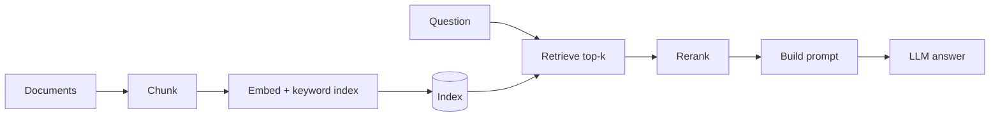

## Where this fits

A language model knows what was in its training data up to a cutoff date, and nothing about your company wiki, your codebase or last week's meeting. You can fine-tune it on your documents, but that is slow, costly, goes stale the moment a document changes, and cannot tell you which document an answer came from. The alternative that dominates practice is **retrieval-augmented generation (RAG)**: keep the model unchanged, search your documents at question time, paste the best passages into the prompt, and let the model answer from them. The French course slides (CNAM RCP217) describe exactly this: the question is used to select documents, their text is added to the question, and the augmented question is sent to the LLM.

Most of a RAG system is not the language model. It is text splitting, a similarity measure, an index, and a way to merge and rerank candidates. All of these can be built and tested with NumPy, which is what we do. The next lesson shows how to *measure* whether such a system works.

## The idea in plain words

**Embeddings.** Imagine a library where books are shelved not alphabetically but by meaning: all cookery books near each other, cookery-for-diabetics next to them. Every book gets coordinates. Finding books relevant to a question means writing coordinates for the question and walking to the nearest shelf. An embedding model is the machine that assigns coordinates to text so that texts with similar meaning get nearby coordinates.

**Similarity.** "Nearby" can mean small distance or small angle. For text, the *angle* is usually preferred: a long document and a short note on the same topic point in the same direction even though their vectors have different lengths.

**Chunking.** A 50-page PDF has one embedding that is a blurry average of every topic in it. So documents are cut into passages (chunks). Too small and a chunk loses the context needed to be understood; too big and the vector is a blur again, and you waste the model's context window on irrelevant text. The slides make the same point: the grain of indexing and the grain of what is returned need not be the same.

**Approximate nearest neighbours.** Comparing the query with every vector is fine for thousands of chunks and too slow for hundreds of millions. Indexes trade a little accuracy for a huge speed-up: *IVF* clusters the vectors and searches only a few clusters; *HNSW* builds a layered graph of "friends" and walks greedily from far-away hubs down to the neighbourhood of the query.

**Hybrid search.** Dense vectors understand that "cancel my subscription" and "terminate your plan" mean the same thing but may blur an exact error code like `E-4021`. Keyword search (BM25) is the reverse. Running both and merging the rankings gets both strengths.

## Formal pieces

**Cosine similarity** between vectors $a,b$:

$$
\cos(a,b)=\frac{a^\top b}{\lVert a\rVert\,\lVert b\rVert}.
$$

If all vectors are normalised to unit length, then $\cos(a,b)=a^\top b$ and also $\lVert a-b\rVert^2=2-2\cos(a,b)$, so ranking by cosine, by dot product and by Euclidean distance coincide. That is why many systems normalise once and use the dot product (a single matrix multiplication scores the whole corpus: $S = X q$ with $X\in\mathbb{R}^{n\times d}$).

**TF-IDF.** For a term $t$ in document $d$: term frequency $\text{tf}(t,d)$ (count), inverse document frequency $\text{idf}(t)=\ln\frac{1+N}{1+\text{df}(t)}+1$ with $N$ documents and $\text{df}$ the number of documents containing $t$. Words that occur everywhere get a small weight, rare words a large one. The row $\text{tf}\cdot\text{idf}$ is normalised to unit length. This is a sparse "embedding" with one dimension per vocabulary word; it cannot match synonyms.

**BM25** scores a document for a query with a saturating, length-normalised version of the same idea:

$$
\text{BM25}(q,d)=\sum_{t\in q}\text{idf}(t)\,\frac{\text{tf}(t,d)\,(k_1+1)}{\text{tf}(t,d)+k_1\big(1-b+b\,|d|/\overline{|d|}\big)},\qquad
\text{idf}(t)=\ln\!\Big(\frac{N-\text{df}+0.5}{\text{df}+0.5}+1\Big).
$$

Reading it: $\text{tf}/(\text{tf}+k_1\cdot\ldots)$ saturates, so the tenth occurrence of a word adds much less than the first; $b$ controls how strongly long documents are penalised ($b=0$ none, $b=1$ full). Typical defaults are $k_1=1.2$, $b=0.75$ (the values used in the course code).

**Reciprocal rank fusion (RRF).** Given several ranked lists, give each document the score

$$
\text{RRF}(d)=\sum_{R}\frac{1}{k+\text{rank}_R(d)},\qquad k=60 \text{ is a common default.}
$$

Why this works: only ranks are used, so no need to calibrate BM25 scores (unbounded) against cosines (in $[-1,1]$). The constant $k$ keeps the top positions from dominating: the gap between ranks 1 and 2 is $1/61-1/62$, barely larger than between ranks 10 and 11, so agreement across lists matters more than a single lucky first place.

## Derivation: why normalising turns distance into a dot product

For unit vectors, $\lVert a-b\rVert^2=\lVert a\rVert^2+\lVert b\rVert^2-2a^\top b=2-2\,a^\top b$. Smaller distance therefore means larger inner product, with the identical ordering. This is also what lets a vector index serve all three metrics with one implementation.

## The RAG pipeline



Offline: clean documents, chunk, embed every chunk, store vectors (and a keyword index). Online: embed the question *with the same embedding model*, retrieve $k$ candidates (typically 20 to 100), optionally fuse dense and BM25, **rerank** with a more expensive model, put the best few into the prompt with instructions to answer only from them, and generate.

**Bi-encoder vs cross-encoder.** A bi-encoder embeds query and document separately, so document vectors are precomputed and search is one matrix product; it is fast but compares only two summaries. A cross-encoder reads query and document *together* and outputs a relevance score; it is more accurate but needs one model call per candidate, so it is only affordable on the top candidates. The standard recipe: bi-encoder (and BM25) to get 100 candidates, cross-encoder to keep 10.

**Approximate indexes.** IVF: cluster with k-means (you have seen it); at query time rank centroids by distance to the query and scan only the vectors in the `nprobe` closest clusters. HNSW: a hierarchy of graphs, sparse at the top for long jumps and dense at the bottom for fine steps; search descends greedily. The course material quotes about 95 to 99 percent recall for HNSW with logarithmic-time search; these figures depend on parameters and data and should be measured on your own corpus, not assumed.

## Worked example

Five tiny documents: 0 "the cat sat on the mat", 1 "the dog chased the cat", 2 "dogs and cats are pets", 3 "error code e4021 means the disk is full", 4 "how to cancel a subscription and terminate your plan". The vocabulary has 27 tokens. All numbers below are produced by the exercise code.

- Query "error e4021": TF-IDF cosine ranks document 3 first with similarity 0.518, all others 0. BM25 gives document 3 the score 2.551 and the rest 0.
- Query "cat": BM25 scores $0.909$ for document 0 (six words) and $0.972$ for document 1 (five words). Both contain "cat" once; the shorter document wins because of length normalisation. Document 2 contains "cats" but not "cat": exact-match methods score it 0, which is the vocabulary-mismatch problem that dense vectors address.
- **RRF**: a document ranked 1st by one retriever and 5th by the other gets $1/61+1/65=0.03178$. A document ranked 3rd and 2nd gets $1/63+1/62=0.03200$ and wins: consistent mid-high placement beats one top place plus a poor one. The first sum is also what the course material computes; we recomputed it.
- **Chunker**: 10 words, size 4, overlap 1 gives `w0..w3`, `w3..w6`, `w6..w9`. Overlap repeats the boundary so a sentence cut by a chunk edge appears whole in one of the two chunks.
- **IVF** on 2000 synthetic 16-dimensional vectors drawn from 20 Gaussian clusters, 20-cluster k-means: probing 1 cluster scans on average 141 of the 2000 vectors (7 percent) and gets recall@10 of 0.93 against exact search; probing 2 clusters scans 267 and reaches recall 1.00; probing all 20 is exact.

## Implementation

```python
def bm25_scores(query, docs, k1=1.2, b=0.75):
    toks = [tokenize(d) for d in docs]
    N, avgdl = len(docs), np.mean([len(t) for t in toks])
    df = Counter(w for t in toks for w in set(t))
    scores = np.zeros(N)
    for i, t in enumerate(toks):
        c = Counter(t)
        for w in set(tokenize(query)):
            if w in c:
                idf = np.log((N - df[w] + 0.5) / (df[w] + 0.5) + 1)
                scores[i] += idf * c[w] * (k1 + 1) / (c[w] + k1 * (1 - b + b * len(t) / avgdl))
    return scores

def rrf(rankings, k=60):
    sc = {}
    for r in rankings:
        for pos, d in enumerate(r, 1):
            sc[d] = sc.get(d, 0.0) + 1.0 / (k + pos)
    return sorted(sc, key=lambda d: (-sc[d], d)), sc
```

## Shapes

| Object | Shape |
|---|---|
| documents / chunks | list of $n$ strings |
| TF-IDF matrix $X$ | $(n, V)$ sparse in practice |
| dense embedding matrix | $(n, d)$ with $d$ from 384 to a few thousand |
| query embedding $q$ | $(d,)$ |
| scores $Xq$ | $(n,)$ |
| top-$k$ result | indices $(k,)$ and scores $(k,)$ |
| IVF centroids / assignment | $(c, d)$ and $(n,)$ |

## Failure modes

1. **Retrieval miss.** The answer chunk is not in the top-$k$ (vocabulary mismatch, bad chunking, an ANN miss at huge scale). The LLM then answers from its memory or says it does not know. Retrieval quality is the ceiling of RAG quality, so measure it separately (next lesson).
2. **Semantic similarity is not relevance.** A chunk about "revenue strategy" can be closer to "what was revenue last quarter" than the chunk holding the number but using the word "earnings". Hybrid search and reranking address this.
3. **Bad chunk grain.** Too small: lost context. Too large: blurred embedding and wasted prompt budget. The course default of 256 to 512 tokens with some overlap is a starting point to tune, not a law.
4. **Mismatched embedders.** Queries and chunks must be embedded by the same model (the slides stress this); changing the model means re-indexing everything.
5. **Lost in the prompt / unfaithful answers.** Even with the right chunks the model may ignore or contradict them.
6. **Multi-hop questions.** If the answer needs facts from several chunks, single-shot top-$k$ retrieval often misses one.
7. **Staleness and permissions.** The index must be refreshed and must respect access rights; otherwise RAG leaks or lies confidently.

## Common misconceptions

1. "Dense retrieval always beats keyword search." On exact identifiers, rare names and error codes BM25 often wins; hybrid is the robust default.
2. "Bigger $k$ is safer." More context adds noise and cost, and models can be distracted by irrelevant passages.
3. "RAG removes hallucinations." It reduces them when retrieval works; it can also produce fluent answers from the wrong passage.
4. "Cosine similarity values are comparable across models." Their scale depends on the embedding model; use them for ranking, not as absolute thresholds, unless you calibrate.

## Key takeaways

- Embeddings turn text into vectors; normalised vectors make cosine, dot product and L2 equivalent for ranking.
- TF-IDF and BM25 are sparse keyword scorers (exact tokens); dense vectors capture meaning but can blur exact strings.
- RRF merges rankings with $\sum 1/(k+\text{rank})$ and needs no score calibration.
- Chunking is a design choice with a trade-off between context and precision; overlap protects boundaries.
- IVF/HNSW trade a little recall for a large speed-up; always measure recall against exact search.
- Retrieve many cheaply, rerank few expensively, generate from the top.

## Explain it yourself

1. A user searches for the error code "E-4021" and a dense retriever returns pages about "error handling in general". Explain why, and how hybrid retrieval with RRF repairs this.
2. Why does normalising vectors to unit length make a Euclidean-distance index and a cosine index return identical rankings?

## Further reading

- Robertson and Zaragoza, "The Probabilistic Relevance Framework: BM25 and Beyond" (2009).
- Cormack, Clarke, Buettcher, "Reciprocal Rank Fusion outperforms Condorcet and individual rank learning methods" (2009).
- Malkov and Yashunin, HNSW (2016); Johnson et al., FAISS, for IVF and billion-scale search.
- Nogueira and Cho, "Passage Re-ranking with BERT" (2019).

## Mastery criteria

- [ ] I can implement TF-IDF, cosine search, BM25 and RRF and test them on a tiny corpus.
- [ ] I can explain why normalisation makes metrics equivalent and when cosine, dot or L2 differ.
- [ ] I can explain IVF and HNSW at the level of "what is skipped" and measure recall versus exact search.
- [ ] I can design a chunking strategy and name its failure modes.
- [ ] I can list at least four failure modes of a RAG system and which component causes each.

## From the CNAM course (cours-tal-06, pages 19-20)

The last two slides of the deck add little new machinery but give a useful summary. Page 19 (conclusions) says that RAG systems compensate for some limitations of LLMs, and that most of the room for improvement is in two places: improving the **documents** (cleaning, chunking, enriching what goes into the store) and improving the **queries** (rewriting the user's question before retrieval), with the conversational LLM itself as the tool that can do the rewriting. In this lesson's vocabulary, that is the chunking section on the document side, and query rewriting plus hybrid search and reranking on the query side. Page 20 is a webography naming four frameworks for building such pipelines: Ollama (running models locally), LangChain, LlamaIndex and Haystack. The deck gives no detail on them, so treat them only as names to look up; the from-scratch pipeline of this lesson shows what such frameworks wrap. The related lesson on pretrained-model tooling is [[llm.06]].
