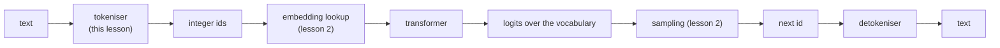

## Où cela s'inscrit

Un réseau de neurones se nourrit de tableaux de nombres. Un modèle de chat, un assistant de code et un système de traduction partent tous du *texte*. Il faut bien que quelque chose découpe ce texte en morceaux et attribue un entier à chaque morceau. Ce quelque chose est le **tokeniseur**, et il se trouve tout au début de chaque pipeline de modèle de langage que tu rencontreras dans ce cours :



Il est facile de traiter la tokenisation comme du « prétraitement ». Ce n'en est pas. Le tokeniseur fixe la taille de la couche de sortie, la longueur de chaque séquence (et donc le coût de l'attention, qui croît avec le carré de la longueur), la quantité de texte qui tient dans la fenêtre de contexte, l'équité avec laquelle les différentes langues sont traitées, et le prix d'un appel d'API, puisque les fournisseurs facturent au token. Les choix faits ici ne peuvent pas être défaits plus tard sans réentraîner le modèle.

## L'idée en mots simples

Imagine que tu doives transmettre un roman à un ami à l'aide d'un livre de codes numérotés, et que tu paies chaque numéro de code envoyé. Tu as trois options.

- **Un code par lettre.** Le livre de codes est minuscule (26 lettres plus la ponctuation) et tu peux tout écrire, mais un mot comme « malheureusement » coûte 14 numéros et ton ami doit réapprendre l'orthographe depuis zéro.
- **Un code par mot.** Les messages sont courts, mais le livre de codes a besoin d'une entrée pour chaque mot jamais utilisé, y compris les noms, les fautes de frappe, « GPT-4o » et les mots composés allemands. Un mot qui n'est pas dans le livre ne peut pas être envoyé du tout ; tu dois écrire « inconnu » à la place.
- **Un code par morceau fréquent.** Les mots courants ont leur propre code (« le », « et »), les mots plus rares sont épelés à partir de morceaux (« mal » + « heureu » + « sement »), et dans le pire des cas un mot est épelé lettre par lettre. Le livre de codes a une taille raisonnable, rien n'est jamais « inconnu », et les messages restent courts.

La troisième option est la **tokenisation en sous-mots**, et tous les modèles de langage modernes en utilisent une variante. Reste la question de *comment choisir les morceaux*. La réponse utilisée par GPT-2, GPT-4 et Llama 3 est une vieille astuce de compression : regarde ton texte d'entraînement, trouve les deux morceaux voisins qui apparaissent le plus souvent côte à côte, colle-les en un nouveau morceau, et recommence. C'est le **byte-pair encoding** (BPE).

Deux raffinements le rendent robuste. D'abord, on part non pas des lettres mais des **octets** bruts du texte (256 valeurs possibles), de sorte que n'importe quelle entrée dans n'importe quelle langue, n'importe quel emoji, même un fichier corrompu, peut être écrit : c'est le **repli sur les octets** (byte-level fallback). Ensuite, quelques morceaux réservés, les **tokens spéciaux**, ne viennent jamais du texte ; ils portent de la structure, comme « ce document se termine ici » ou « le tour de l'assistant commence ici ».

## Cadre formel

Soit un texte vu comme une séquence d'octets $b = (b_1,\dots,b_n)$, $b_i\in\{0,\dots,255\}$ (son encodage UTF-8). Un **tokeniseur** de vocabulaire $\mathcal V$ ($|\mathcal V| = V$) est un couple d'applications

$$
\mathrm{enc}: \text{bytes}\to \mathcal V^{*}, \qquad \mathrm{dec}: \mathcal V^{*}\to \text{bytes}, \qquad \mathrm{dec}(\mathrm{enc}(b)) = b .
$$

La deuxième équation est le contrat : **aller-retour sans perte**. Le *taux de compression* sur un texte est $n/m$ où $m=|\mathrm{enc}(b)|$ est le nombre de tokens (octets par token). C'est le nombre qui te dit combien de contexte une fenêtre contient réellement.

Un tokeniseur BPE est défini par une liste ordonnée de **règles de fusion** $(p_1, p_2,\dots,p_K)$ où chaque $p_k=(x_k,y_k)$ est une paire de tokens existants et la règle crée le nouveau token $256+k$ représentant « $x_k$ suivi de $y_k$ ». Le vocabulaire est constitué des 256 octets, plus les $K$ tokens fusionnés, plus les tokens spéciaux : $V=256+K+|\text{specials}|$.

## Démonstration : le BPE comme compression gloutonne

**Objectif d'entraînement.** On veut un vocabulaire d'une taille donnée qui représente le texte d'entraînement avec le moins de tokens possible. Trouver l'ensemble optimal de $K$ fusions est un problème combinatoire difficile, donc le BPE est *glouton* : à chaque étape, on choisit la fusion unique qui raccourcit le plus le corpus *à cet instant*.

**Pourquoi la « paire la plus fréquente » est cette fusion.** Supposons que le corpus courant soit une séquence de tokens et que la paire $(x,y)$ apparaisse $c(x,y)$ fois comme tokens adjacents *sans chevauchement*. Remplacer chaque occurrence par un nouveau token transforme deux tokens en un, donc le corpus raccourcit d'exactement $c(x,y)$ tokens. La compression gloutonne choisit donc

$$
(x^\star, y^\star)=\arg\max_{(x,y)} c(x,y).
$$

(Quand une paire se chevauche elle-même, comme dans `aaa`, le nombre de remplacements sans chevauchement est inférieur au nombre d'occurrences adjacentes. Les implémentations balaient de gauche à droite et remplacent goulûment, ce que nous faisons ci-dessous.)

**Algorithme.**

1. Partir de la séquence d'octets du corpus ; vocabulaire $=\{0..255\}$.
2. Compter toutes les paires adjacentes, prendre la plus fréquente (départager les égalités de façon déterministe, par exemple par la plus petite paire).
3. Créer le token $256+k$, réécrire le corpus en remplaçant la paire, enregistrer la règle.
4. Répéter pendant $K$ étapes, ou jusqu'à ce qu'aucune paire n'apparaisse deux fois (une paire vue une seule fois n'économise qu'un token et mémorise au lieu de généraliser).

**Encoder du nouveau texte** rejoue les règles *dans l'ordre où elles ont été apprises* : à partir de la séquence d'octets, trouver à plusieurs reprises, parmi les paires présentes, celle de plus petit numéro de règle, la fusionner, et s'arrêter quand aucune paire présente n'est une règle. L'ordre compte car une règle ultérieure peut être construite à partir de la sortie d'une règle antérieure (la règle 258 utilise le token 256).

**Décoder** est trivial car chaque token est une concaténation : le token $256+k$ se développe en les octets de $x_k$ suivis de ceux de $y_k$. On concatène et on décode en UTF-8. Les allers-retours sont exacts par construction, car les fusions ne font que regrouper des octets.

**Pré-tokenisation.** Les tokeniseurs de production découpent d'abord le texte en blocs avec une expression régulière (GPT-2 garde un espace initial attaché au mot, sépare les nombres et la ponctuation) et exécutent le BPE à l'intérieur de chaque bloc, si bien qu'aucun token ne couvre « e c » de « the cat ». Notre implémentation saute cette étape pour garder l'algorithme visible ; la conséquence est que les fusions peuvent traverser les frontières de mots.

## Exemple détaillé

Corpus `banana bandana`, soit 14 octets (`b`=98, `a`=97, `n`=110, espace=32, `d`=100). J'ai vérifié chaque ligne ci-dessous en exécutant le code de l'exercice de cette leçon.

Étape 1. Comptes des paires : $(a,n)$ apparaît 4 fois (deux fois dans « banana », deux fois dans « bandana »), $(n,a)$ 3, $(b,a)$ 2, tout le reste 1. On fusionne $(a,n)\to 256$ : la séquence devient `b 256 256 a ␣ b 256 d 256 a`, 10 tokens (4 économisés, comme le dit la théorie).

Étape 2. Maintenant $(b,256)$ et $(256,a)$ apparaissent tous deux deux fois ; la règle de départage choisit la plus petite paire $(98,256)$. On fusionne $\to 257$ (« ban ») : `257 256 a ␣ 257 d 256 a`, 8 tokens.

Étape 3. $(256,a)\to 258$ (« ana ») deux fois : `257 258 ␣ 257 d 258`, **6 tokens**.

Ainsi 14 octets sont devenus 6 tokens : taux de compression $14/6 = 2.33$ octets par token, après trois fusions, avec un vocabulaire de $256+3=259$ entrées.

Un essai un peu plus grand : le corpus de 87 octets `low low low low low lower lower newest newest newest newest newest newest widest widest` avec 10 fusions donne, dans l'ordre, $(e,s)$ (8 fois), puis (« es »,$t$), puis $(l,o)$, puis (« est », espace) et ainsi de suite, et se compresse en **23 tokens** (3.78 octets par token). Remarque que les fusions apprennent des morceaux de mots (`es`, `est`, `lo`, ` low`) qui n'ont jamais été donnés à l'algorithme.

## Implémentation

```python
from collections import Counter

def get_stats(ids):
    c = Counter()
    for a, b in zip(ids, ids[1:]):
        c[(a, b)] += 1
    return c

def merge(ids, pair, new_id):
    out, i = [], 0
    while i < len(ids):
        if i < len(ids) - 1 and (ids[i], ids[i + 1]) == pair:
            out.append(new_id); i += 2
        else:
            out.append(ids[i]); i += 1
    return out

def train_bpe(text, num_merges):
    ids, merges = list(text.encode("utf-8")), {}
    for k in range(num_merges):
        stats = get_stats(ids)
        if not stats:
            break
        pair = min(stats, key=lambda p: (-stats[p], p))   # most frequent, ties: smallest pair
        if stats[pair] < 2:
            break
        merges[pair] = 256 + k
        ids = merge(ids, pair, 256 + k)
    return merges

def encode(text, merges):
    ids = list(text.encode("utf-8"))
    while len(ids) >= 2:
        stats = get_stats(ids)
        pair = min(stats, key=lambda p: merges.get(p, float("inf")))
        if pair not in merges:
            break
        ids = merge(ids, pair, merges[pair])
    return ids

def decode(ids, merges):
    vocab = {i: bytes([i]) for i in range(256)}
    for (a, b), new in merges.items():
        vocab[new] = vocab[a] + vocab[b]
    return b"".join(vocab[i] for i in ids).decode("utf-8", errors="replace")
```

L'exercice ajoute `encode_with_specials` : découper d'abord le texte sur les chaînes spéciales exactes (une expression régulière avec les chaînes échappées dans un groupe de capture), donner à chacune son id réservé, et n'exécuter le BPE que sur les morceaux situés entre elles.

## Formes

Après la tokenisation, un batch de textes devient un tableau d'entiers `ids` de forme $(B, T)$ (batch, longueur de séquence ; les textes plus courts sont complétés par du padding). La table d'embeddings a la forme $(V, d)$ avec $d$ la largeur du modèle, et la couche de sortie produit des logits de forme $(B, T, V)$. La taille du vocabulaire apparaît donc deux fois dans le nombre de paramètres (embedding en entrée, projection en sortie ; GPT-2 les partage). Pour l'objectif du token suivant, les cibles sont les entrées décalées d'une position : `x = ids[:, :-1]`, `y = ids[:, 1:]`, la même fenêtre glissante que dans le chargeur de données du livre.

## Taille du vocabulaire : le compromis

Soit $V$ la taille du vocabulaire et $d$ la largeur du modèle.

- **Coût d'un grand vocabulaire.** L'embedding d'entrée a $V\cdot d$ paramètres et la projection de sortie encore $V\cdot d$, sauf partage. Avec $d=4096$ : $V=32{,}000$ donne $131{,}072{,}000$ et $V=128{,}000$ donne $524{,}288{,}000$ paramètres pour une seule table. Les tokens rares sont vus peu de fois, donc leurs embeddings sont mal entraînés.
- **Avantage d'un grand vocabulaire.** Moins de tokens par texte, donc des séquences plus courtes : attention moins chère (quadratique en la longueur), plus de texte par fenêtre de contexte, moins d'étapes de génération, factures d'API plus basses. La leçon source rapporte des moyennes en anglais allant d'environ 1.3 token par mot avec 50k entrées à environ 1.1 avec 128k (considère ces moyennes comme des chiffres approximatifs tirés de cette leçon).
- **Équité.** Un vocabulaire entraîné surtout sur de l'anglais découpe les autres langues en beaucoup plus de morceaux, donc la même phrase coûte plus de tokens et divise effectivement le contexte par deux. Des vocabulaires plus grands avec plus de texte non anglais à l'entraînement réduisent cette taxe.

Les cas extrêmes montrent l'allure de la courbe. Caractères ou octets : $V\approx256$, séquences très longues. Mots entiers : séquences courtes mais $V$ de l'ordre de centaines de milliers et un `<unk>` pour chaque mot inconnu. Le BPE interpole entre les deux avec un seul réglage, le nombre de fusions $K$.

## Tokens spéciaux et repli sur les octets

- Les **tokens spéciaux** ont des ids fixes et sont appariés exactement *avant* l'exécution du BPE, donc ils ne sont jamais découpés ni fusionnés. Exemples typiques : fin de texte (`<|endoftext|>`, utilisé par GPT-2 entre des documents indépendants et comme padding, les positions de padding étant de toute façon masquées dans la perte), début/fin de séquence, padding, et marqueurs de rôle pour les gabarits de chat. Un modèle de chat ne voit pas de messages JSON ; il voit une séquence plate de tokens dans laquelle des marqueurs comme `<|im_start|>` délimitent les interlocuteurs, et un mauvais gabarit place l'entrée en dehors de ce sur quoi le modèle a été entraîné.
- **Token inconnu.** Le tokeniseur au niveau des mots du livre a besoin de `<|unk|>` pour les mots inconnus et échoue sur du texte hors de son vocabulaire. Le BPE au niveau des octets n'en a pas besoin : n'importe quelle chaîne est une séquence d'octets, et les 256 octets sont dans le vocabulaire de base.
- **Autres familles.** WordPiece (BERT) choisit les fusions par un score de type vraisemblance plutôt que par la fréquence brute ; SentencePiece travaille sur le texte brut, espaces compris, et propose le BPE ou un modèle unigramme. Elles diffèrent par la façon dont le vocabulaire est choisi ; l'interface (texte vers ids et retour) est identique.

## Idées reçues courantes

- « Un token est un mot. » Généralement c'est une partie de mot, parfois plusieurs mots, parfois un seul octet d'un caractère multi-octets. Les nombres de mots et de tokens diffèrent selon la langue et le type de texte (le code et les nombres se tokenisent mal).
- « Le BPE comprend la morphologie. » Il ne fait que compter des fréquences. Des morceaux comme `ness` apparaissent parce qu'ils sont fréquents, pas parce que quelqu'un lui a parlé de suffixes.
- « Plus de fusions, c'est toujours mieux. » Passé un certain point, les nouveaux tokens sont rares, sous-entraînés, et gonflent la table d'embeddings.
- « Les espaces initiaux n'ont pas d'importance. » ` the` et `the` sont des tokens différents dans les tokeniseurs de type GPT ; un espace parasite change les ids, et donc l'entrée du modèle.
- « Les erreurs de tokenisation sont sans gravité. » Les modèles sont mauvais pour les tâches qui dépendent des caractères à l'intérieur d'un token (compter des lettres, inverser des chaînes) en partie parce que le token les cache.

## Points clés à retenir

- Un tokeniseur est une application texte-vers-ids déterministe et sans perte ; la taille de son vocabulaire $V$ fixe les tailles d'embedding/de sortie et la longueur des séquences.
- BPE : partir des octets, fusionner à plusieurs reprises la paire adjacente la plus fréquente (chaque fusion raccourcit le corpus d'exactement le nombre d'occurrences de cette paire), enregistrer les règles ordonnées.
- Encoder en rejouant les fusions dans l'ordre appris ; décoder en concaténant les octets.
- Un vocabulaire de base au niveau des octets signifie aucun token inconnu ; les tokens spéciaux portent la structure et ne sont jamais fusionnés.
- La taille du vocabulaire échange des paramètres et la qualité des tokens rares contre la longueur de séquence et le coût.

## Explique-le toi-même

1. Pourquoi le BPE choisit-il la paire *la plus fréquente*, et pourquoi l'application des fusions dans l'ordre appris compte-t-elle lors de l'encodage ?
2. Un collègue veut doubler le vocabulaire pour réduire la longueur des séquences. Liste ce qui s'améliore, ce qui se dégrade, et ce que tu mesurerais avant d'accepter.

## Pour aller plus loin

- Raschka, *Build a Large Language Model From Scratch*, chapitre 2 (les classes de tokeniseur et le chargeur de données).
- Sennrich, Haddow, Birch (2016), *Neural Machine Translation of Rare Words with Subword Units*, l'article qui a introduit le BPE en NLP.
- Le `encoder.py` de GPT-2 et la bibliothèque `tiktoken` pour des implémentations de production.

## Critères de maîtrise

- Exécuter le BPE à la main pour trois fusions sur une chaîne de 12 caractères et indiquer le nombre de tokens après chacune.
- Expliquer pourquoi l'aller-retour est exact même pour un texte jamais vu à l'entraînement.
- Calculer la taille de la table d'embeddings pour deux tailles de vocabulaire et justifier un choix pour un cas d'usage donné.
- Dire ce qu'est un token spécial, pourquoi il contourne le BPE, et ce qui peut mal tourner avec un gabarit de chat inadapté.
