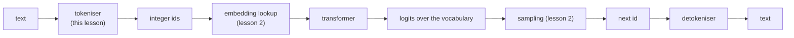

## Where this fits

A neural network eats arrays of numbers. A chat model, a code assistant and a translation system all start from *text*. Something has to cut that text into pieces and give every piece an integer. That something is the **tokeniser**, and it sits at the very front of every language-model pipeline you will meet in this course:



It is easy to treat tokenisation as "preprocessing". It is not. The tokeniser fixes the size of the output layer, the length of every sequence (and therefore the cost of attention, which grows with the square of the length), how much text fits in the context window, how fairly different languages are treated, and what the price of an API call is, because providers bill per token. Choices made here cannot be undone later without retraining the model.

## The idea in plain words

Imagine you must transmit a novel to a friend using a numbered code book, and you pay per code number you send. You have three options.

- **One code per letter.** The code book is tiny (26 letters plus punctuation) and you can write anything, but a word like "unfortunately" costs 13 numbers and your friend has to re-learn spelling from scratch.
- **One code per word.** Messages are short, but the code book needs an entry for every word ever used, including names, typos, "GPT-4o" and German compounds. A word that is not in the book cannot be sent at all; you must write "unknown" instead.
- **One code per frequent chunk.** Common words get their own code ("the", " and"), rarer words are spelled out from chunks ("un" + "happi" + "ness"), and in the worst case a word is spelled letter by letter. The code book has a manageable size, nothing is ever "unknown", and messages stay short.

The third option is **subword tokenisation**, and every modern language model uses a variant of it. The remaining question is *how to choose the chunks*. The answer used by GPT-2, GPT-4 and Llama 3 is an old compression trick: look at your training text, find the two neighbouring pieces that appear next to each other most often, glue them into a new piece, and repeat. This is **byte-pair encoding** (BPE).

Two refinements make it robust. First, you start not from letters but from the raw **bytes** of the text (256 possible values), so any input in any language, any emoji, even a corrupted file can be written down: this is the **byte-level fallback**. Second, a few reserved chunks, the **special tokens**, never come from the text at all; they carry structure such as "this document ends here" or "the assistant's turn starts here".

## Formal setting

Let a text be a sequence of bytes $b = (b_1,\dots,b_n)$, $b_i\in\{0,\dots,255\}$ (its UTF-8 encoding). A **tokeniser** with vocabulary $\mathcal V$ ($|\mathcal V| = V$) is a pair of maps

$$
\mathrm{enc}: \text{bytes}\to \mathcal V^{*}, \qquad \mathrm{dec}: \mathcal V^{*}\to \text{bytes}, \qquad \mathrm{dec}(\mathrm{enc}(b)) = b .
$$

The second equation is the contract: **lossless round trip**. The *compression ratio* on a text is $n/m$ where $m=|\mathrm{enc}(b)|$ is the number of tokens (bytes per token). It is the number that tells you how much context a window really holds.

A BPE tokeniser is defined by an ordered list of **merge rules** $(p_1, p_2,\dots,p_K)$ where each $p_k=(x_k,y_k)$ is a pair of existing tokens and the rule creates the new token $256+k$ standing for "$x_k$ followed by $y_k$". The vocabulary is the 256 bytes, plus the $K$ merged tokens, plus the special tokens: $V=256+K+|\text{specials}|$.

## Derivation: BPE as greedy compression

**Training objective.** We want a vocabulary of a given size that represents the training text with as few tokens as possible. Finding the optimal set of $K$ merges is a hard combinatorial problem, so BPE is *greedy*: at each step choose the single merge that shortens the corpus the most *right now*.

**Why "most frequent pair" is that merge.** Suppose the current corpus is a sequence of tokens and the pair $(x,y)$ occurs $c(x,y)$ times as *non-overlapping* adjacent tokens. Replacing every occurrence by one new token turns two tokens into one, so the corpus gets shorter by exactly $c(x,y)$ tokens. Greedy compression therefore picks

$$
(x^\star, y^\star)=\arg\max_{(x,y)} c(x,y).
$$

(When a pair overlaps itself, as in `aaa`, the count of non-overlapping replacements is smaller than the count of adjacent occurrences. Implementations scan left to right and replace greedily, which is what we do below.)

**Algorithm.**

1. Start with the byte sequence of the corpus; vocabulary $=\{0..255\}$.
2. Count all adjacent pairs, take the most frequent (break ties deterministically, for example by the smallest pair).
3. Create token $256+k$, rewrite the corpus replacing the pair, record the rule.
4. Repeat for $K$ steps, or until no pair occurs twice (a pair seen once only saves one token and memorises rather than generalises).

**Encoding new text** replays the rules *in the order they were learned*: from the byte sequence, repeatedly find, among the pairs present, the one with the lowest rule number, merge it, and stop when no present pair is a rule. Order matters because a later rule may be built from the output of an earlier one (rule 258 uses token 256).

**Decoding** is trivial because every token is a concatenation: token $256+k$ expands to the bytes of $x_k$ followed by the bytes of $y_k$. Concatenate and decode as UTF-8. Round trips are exact by construction, because merges only regroup bytes.

**Pre-tokenisation.** Production tokenisers first cut the text into chunks with a regular expression (GPT-2 keeps a leading space attached to the word, separates numbers and punctuation) and run BPE inside each chunk, so no token spans "e c" from "the cat". Our implementation skips this step to keep the algorithm visible; the consequence is that merges may cross word boundaries.

## Worked example

Corpus `banana bandana`, which is 14 bytes (`b`=98, `a`=97, `n`=110, space=32, `d`=100). I checked every line below by running the exercise code of this lesson.

Step 1. Pair counts: $(a,n)$ occurs 4 times (twice in "banana", twice in "bandana"), $(n,a)$ 3, $(b,a)$ 2, everything else 1. Merge $(a,n)\to 256$: the sequence becomes `b 256 256 a ␣ b 256 d 256 a`, 10 tokens (saved 4, as the theory says).

Step 2. Now $(b,256)$ and $(256,a)$ both occur twice; the tie rule picks the smaller pair $(98,256)$. Merge $\to 257$ ("ban"): `257 256 a ␣ 257 d 256 a`, 8 tokens.

Step 3. $(256,a)\to 258$ ("ana") twice: `257 258 ␣ 257 d 258`, **6 tokens**.

So 14 bytes became 6 tokens: compression ratio $14/6 = 2.33$ bytes per token, after three merges, with vocabulary $256+3=259$ entries.

A slightly larger run: the 87-byte corpus `low low low low low lower lower newest newest newest newest newest newest widest widest` with 10 merges gives, in order, $(e,s)$ (8 times), then ("es",$t$), then $(l,o)$, then ("est", space) and so on, and compresses to **23 tokens** (3.78 bytes per token). Note the merges learn word pieces (`es`, `est`, `lo`, ` low`) that were never given to the algorithm.

## Implementation

```python
from collections import Counter

def get_stats(ids):
    c = Counter()
    for a, b in zip(ids, ids[1:]):
        c[(a, b)] += 1
    return c

def merge(ids, pair, new_id):
    out, i = [], 0
    while i < len(ids):
        if i < len(ids) - 1 and (ids[i], ids[i + 1]) == pair:
            out.append(new_id); i += 2
        else:
            out.append(ids[i]); i += 1
    return out

def train_bpe(text, num_merges):
    ids, merges = list(text.encode("utf-8")), {}
    for k in range(num_merges):
        stats = get_stats(ids)
        if not stats:
            break
        pair = min(stats, key=lambda p: (-stats[p], p))   # most frequent, ties: smallest pair
        if stats[pair] < 2:
            break
        merges[pair] = 256 + k
        ids = merge(ids, pair, 256 + k)
    return merges

def encode(text, merges):
    ids = list(text.encode("utf-8"))
    while len(ids) >= 2:
        stats = get_stats(ids)
        pair = min(stats, key=lambda p: merges.get(p, float("inf")))
        if pair not in merges:
            break
        ids = merge(ids, pair, merges[pair])
    return ids

def decode(ids, merges):
    vocab = {i: bytes([i]) for i in range(256)}
    for (a, b), new in merges.items():
        vocab[new] = vocab[a] + vocab[b]
    return b"".join(vocab[i] for i in ids).decode("utf-8", errors="replace")
```

The exercise adds `encode_with_specials`: split the text on the exact special strings first (a regular expression with the escaped strings in a capture group), give each its reserved id, and run BPE only on the pieces in between.

## Shapes

After tokenisation a batch of texts becomes an integer array `ids` of shape $(B, T)$ (batch, sequence length; shorter texts padded). The embedding table has shape $(V, d)$ with $d$ the model width, and the output layer produces logits of shape $(B, T, V)$. The vocabulary size therefore appears twice in the parameter count (embedding in, projection out; GPT-2 ties them). For training the next-token objective, targets are the inputs shifted by one position: `x = ids[:, :-1]`, `y = ids[:, 1:]`, the same sliding window as in the book's data loader.

## Vocabulary size: the trade-off

Let $V$ be the vocabulary size and $d$ the model width.

- **Cost of a big vocabulary.** The input embedding has $V\cdot d$ parameters and the output projection another $V\cdot d$ unless tied. With $d=4096$: $V=32{,}000$ gives $131{,}072{,}000$ and $V=128{,}000$ gives $524{,}288{,}000$ parameters for one table. Rare tokens are seen few times, so their embeddings are poorly trained.
- **Benefit of a big vocabulary.** Fewer tokens per text, so shorter sequences: cheaper attention (quadratic in length), more text per context window, fewer generation steps, lower API bills. The source lesson reports English averages from roughly 1.3 tokens per word at 50k entries to roughly 1.1 at 128k (treat those averages as approximate figures from that lesson).
- **Fairness.** A vocabulary trained mostly on English splits other languages into many more pieces, so the same sentence costs more tokens and effectively halves the context. Larger vocabularies with more non-English training text reduce that tax.

The extreme cases show the shape of the curve. Characters or bytes: $V\approx256$, very long sequences. Whole words: sequences short but $V$ in the hundreds of thousands and an `<unk>` for every unseen word. BPE interpolates between them with one dial, the number of merges $K$.

## Special tokens and byte fallback

- **Special tokens** have fixed ids and are matched exactly *before* BPE runs, so they are never split or merged. Typical ones: end-of-text (`<|endoftext|>`, used by GPT-2 between independent documents and as padding, the padding positions being masked in the loss anyway), beginning/end of sequence, padding, and role markers for chat templates. A chat model does not see JSON messages; it sees one flat token sequence in which markers like `<|im_start|>` delimit speakers, and a wrong template puts the input outside what the model was trained on.
- **Unknown token.** The book's word-level tokeniser needs `<|unk|>` for unseen words and fails on text outside its vocabulary. Byte-level BPE needs none: any string is a sequence of bytes, and all 256 bytes are in the base vocabulary.
- **Other families.** WordPiece (BERT) chooses merges by a likelihood-style score rather than raw frequency; SentencePiece runs on raw text including spaces and offers BPE or a unigram model. They differ in how the vocabulary is chosen; the interface (text to ids and back) is identical.

## Common misconceptions

- "A token is a word." Usually it is part of a word, sometimes several words, sometimes a single byte of a multi-byte character. Counts of words and tokens differ by language and by text type (code and numbers tokenise badly).
- "BPE understands morphology." It only counts frequencies. Pieces like `ness` appear because they are frequent, not because anyone told it about suffixes.
- "More merges is always better." Past some point new tokens are rare, undertrained, and bloat the embedding table.
- "Leading spaces do not matter." ` the` and `the` are different tokens in GPT-style tokenisers; stray whitespace changes the ids, and so the model's input.
- "Tokenisation errors are harmless." Models are bad at tasks that depend on characters inside a token (counting letters, reversing strings) partly because the token hides them.

## Key takeaways

- A tokeniser is a lossless, deterministic text-to-ids map; its vocabulary size $V$ sets embedding/output sizes and sequence length.
- BPE: start from bytes, repeatedly merge the most frequent adjacent pair (each merge shortens the corpus by exactly that pair's count), record the ordered rules.
- Encode by replaying merges in learned order; decode by concatenating bytes.
- Byte-level base vocabulary means no unknown tokens; special tokens carry structure and are never merged.
- Vocabulary size trades parameters and rare-token quality against sequence length and cost.

## Explain it yourself

1. Why does BPE choose the *most frequent* pair, and why does applying the merges in learned order matter when encoding?
2. A colleague wants to double the vocabulary to cut sequence length. List what improves, what gets worse, and what you would measure before agreeing.

## Further reading

- Raschka, *Build a Large Language Model From Scratch*, chapter 2 (the tokeniser classes and the data loader).
- Sennrich, Haddow, Birch (2016), *Neural Machine Translation of Rare Words with Subword Units*, the paper that brought BPE to NLP.
- The GPT-2 `encoder.py` and the `tiktoken` library for production implementations.

## Mastery criteria

- Run BPE by hand for three merges on a 12-character string and report the token count after each.
- Explain why the round trip is exact even for text unseen in training.
- Compute the embedding-table size for two vocabulary sizes and justify a choice for a given use case.
- State what a special token is, why it bypasses BPE, and what can go wrong with a mismatched chat template.
