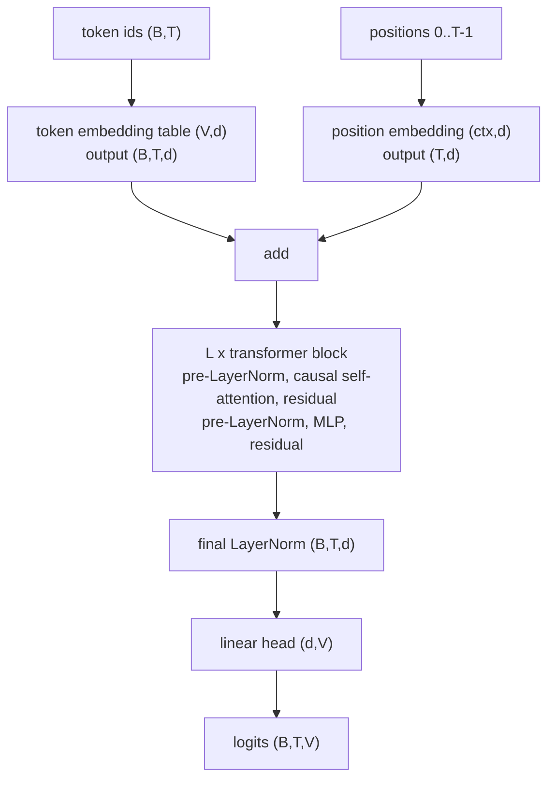

## Où cela s'inscrit

Chaque assistant de chat, chaque outil de complétion de code et chaque modèle de traduction que tu utilises aujourd'hui est, au fond, un programme qui répond sans cesse à une seule question : *étant donné tout ce qui précède, quel token vient ensuite ?* Écrire un paragraphe, c'est appeler ce programme des centaines de fois en réinjectant chaque réponse. Cette leçon explique cette boucle de bout en bout :

- comment le texte devient les entiers de [[llm.01]],
- quel nombre la procédure d'entraînement cherche à rendre petit (l'**entropie croisée** du token suivant),
- à quoi ressemble le modèle des ids de tokens aux scores (l'architecture est résumée ici ; les mathématiques de l'attention appartiennent au cours sur les transformers et ne sont pas répétées),
- comment les scores deviennent du texte (le **décodage** : glouton, température, top-k, top-p), et
- comment on mesure un modèle de langage (la **perplexité**).

Pour que chaque nombre reste vérifiable, nous construisons le plus petit modèle de langage possible, une table de « quel mot suit quel mot », nous l'entraînons par comptage et par descente de gradient, et nous échantillonnons à partir de lui. Tout ce que nous disons sur la perte et les échantillonneurs s'applique sans changement à un transformer de 100 milliards de paramètres : seule la fonction qui produit les scores change.

## L'idée en mots simples

Pense à la saisie prédictive de ton téléphone. Elle regarde ce que tu as tapé et affiche quelques mots suivants probables, chacun avec une « probabilité » implicite. Un **modèle de langage** en est une version très évoluée : pour n'importe quel préfixe, il attribue une probabilité à *chaque* token du vocabulaire.

Pour écrire du texte, il faut deux éléments de plus :

1. **Un moyen d'apprendre les probabilités.** Prends beaucoup de vrai texte. À chaque position, cache le token suivant et demande au modèle de le deviner. Récompense-le quand il a donné une forte probabilité au vrai token et punis-le sinon. La punition a un nom, l'opposé du logarithme de la probabilité de la vérité, et c'est exactement l'entropie croisée que tu as rencontrée dans les leçons de théorie de l'information.
2. **Un moyen de choisir.** Le modèle donne une probabilité pour chaque token ; il faut en choisir un. Toujours prendre le token le plus probable (« glouton ») est sûr mais répétitif et fade. Lancer un dé pondéré est varié mais parfois absurde. Trois réglages se situent entre les deux : la *température* (à quel point le dé est plat), le *top-k* (ne considérer que les k tokens les plus probables) et le *top-p* (ne considérer que le plus petit groupe de tokens qui portent ensemble une probabilité p).

Pourquoi le mot « décodeur seul » ? Le transformer original avait un encodeur qui lisait une phrase source et un décodeur qui écrivait la traduction. Les modèles de type GPT ne gardent que la partie décodeur : une pile qui lit les tokens jusqu'ici (avec un masque qui interdit de regarder le futur) et prédit le suivant.

## Cadre formel

Un texte est une séquence de tokens $x_1,\dots,x_T$ sur un vocabulaire de taille $V$ ([[llm.01]]). La règle de la chaîne des probabilités, qui est une identité et non une hypothèse, factorise sa probabilité :

$$
p(x_1,\dots,x_T)=\prod_{t=1}^{T}p\bigl(x_t\mid x_1,\dots,x_{t-1}\bigr).
$$

Un modèle de langage $p_\theta$ paramètre chaque facteur $p_\theta(\,\cdot\mid x_{<t})$, une distribution sur $V$ tokens. Il le fait en calculant un vecteur de **logits** $z_t\in\mathbb{R}^{V}$ et en appliquant le softmax :

$$
p_\theta(v\mid x_{<t})=\frac{e^{z_{t,v}}}{\sum_{u=1}^{V}e^{z_{t,u}}}.
$$

**Objectif d'entraînement.** Maximiser la vraisemblance du texte d'entraînement, ce qui équivaut à minimiser l'opposé de la log-vraisemblance moyenne, la **perte d'entropie croisée** :

$$
\mathcal L(\theta)=-\frac1{N}\sum_{t}\ln p_\theta\bigl(x_t\mid x_{<t}\bigr).
$$

Pourquoi est-ce l'entropie croisée ? Pour une position, la « distribution cible » $q$ est un one-hot sur le token observé $y$, et $H(q,p_\theta)=-\sum_v q_v\ln p_{\theta,v}=-\ln p_{\theta,y}$. En moyennant sur les positions, on obtient la formule ci-dessus. Entraîner un modèle de langage, c'est donc de la classification multiclasse ordinaire avec $V$ classes, une fois par position. Dans le pipeline de données du livre, les entrées sont une fenêtre de tokens et les cibles sont la même fenêtre décalée d'un cran vers la droite, de sorte qu'une fenêtre de longueur $T$ donne $T$ exemples d'entraînement d'un coup.

**Gradient par rapport aux logits.** Dérivons $-\ln p_y=-z_y+\ln\sum_u e^{z_u}$ par rapport à $z_v$ :

$$
\frac{\partial}{\partial z_v}\bigl(-\ln p_y\bigr)=-\mathbb 1[v=y]+\frac{e^{z_v}}{\sum_u e^{z_u}}=p_v-\mathbb 1[v=y].
$$

Le gradient sur les logits est donc « probabilités prédites moins vérité en one-hot » : on pousse le logit du vrai token vers le haut de $1-p_y$ et chaque autre logit vers le bas de sa propre probabilité. Tout le reste de l'entraînement est la rétropropagation de ce vecteur à travers le réseau (la leçon sur la rétropropagation explique comment il circule jusqu'aux poids). L'exercice bigramme ci-dessous utilise directement cette formule.

**Perplexité.** L'exponentielle de l'entropie croisée,

$$
\mathrm{PPL}=\exp(\mathcal L),
$$

se lit comme le « nombre effectif de tokens équiprobables » entre lesquels le modèle hésite à chaque étape. Un modèle uniforme sur $V$ tokens a une perte $\ln V$ et une perplexité exactement égale à $V$ ; un modèle parfait a une perplexité de 1. Comme le note le livre pour un modèle non entraîné à 50 257 tokens, la perte initiale est énorme et la perplexité du même ordre que le vocabulaire : voilà à quoi ressemble « ne rien savoir ». La perplexité n'est comparable qu'entre des modèles qui utilisent le **même tokeniseur** et le même texte, car les tokens prédits doivent être les mêmes.

## Le modèle des ids aux logits (résumé)

Un modèle de type GPT calcule, pour un batch d'ids de tokens de forme $(B,T)$ :



- **Embeddings.** Chaque id sélectionne une ligne d'une table apprise, de sorte qu'un token devient un vecteur de dimension $d$. L'attention est aveugle à l'ordre par elle-même, donc un vecteur pour la *position* est ajouté.
- **Blocs transformer.** Chaque bloc permet à chaque position de rassembler de l'information venant des positions précédentes (auto-attention causale : un masque supprime le futur, ce qui permet à une seule passe avant d'entraîner les $T$ prédictions du token suivant à la fois) puis transforme chaque position indépendamment avec un petit MLP. Les connexions résiduelles ajoutent l'entrée de chaque sous-couche à sa sortie pour que les gradients atteignent les premières couches, et la normalisation de couche garde les activations dans une plage raisonnable. Les équations de l'attention et les détails du multi-têtes sont démontrés dans le cours sur les transformers ; ici nous traitons la pile comme une fonction produisant des caractéristiques $(B,T,d)$.
- **Tête.** Une application linéaire vers $V$ scores par position.

Tailles pour le plus petit GPT-2 : $V=50{,}257$, $d=768$, 12 couches, 12 têtes, contexte 1024. Construit littéralement, il a environ 163 millions de paramètres ; le chiffre publié de « 124 millions » compte la tête de sortie comme *partagée* avec l'embedding de tokens (la même matrice sert à plonger et à noter), ce qui supprime $50{,}257\times768\approx38.6$ millions de paramètres. La leçon suivante donne le décompte exact.

**Entraînement versus génération.** Pendant l'entraînement, une passe avant sur une fenêtre produit des logits à toutes les $T$ positions et $T$ pertes. Pendant la génération, le modèle est exécuté une fois par nouveau token, en ajoutant l'id échantillonné au contexte ; les implémentations mettent en cache les clés et valeurs des positions précédentes pour que chaque étape ne recalcule pas le passé, et distinguent une phase de *prefill* (lire tout le prompt en parallèle) d'une phase de *decode* (un token à la fois, limitée par le trafic mémoire plutôt que par l'arithmétique).

## Des logits au texte : le décodage

Étant donné les logits $z\in\mathbb{R}^{V}$ du token suivant :

**Glouton.** $\hat y=\arg\max_v z_v$. Déterministe : lance-le deux fois et tu obtiens le même texte, comme l'observe le livre. Il tombe souvent dans la répétition parce que la continuation unique la plus probable d'une phrase répétée est davantage de répétition.

**Température.** On échantillonne à partir de $\operatorname{softmax}(z/T)$ avec $T>0$. Pour deux tokens, le rapport des probabilités est

$$
\frac{p_i}{p_j}=\exp\!\Bigl(\frac{z_i-z_j}{T}\Bigr),
$$

donc diviser par $T$ étire ou comprime les *écarts* entre logits. Quand $T\to0^{+}$, le plus grand logit domine et la distribution tend vers un one-hot sur l'argmax (glouton) ; $T=1$ est la distribution propre du modèle ; quand $T\to\infty$, tous les rapports tendent vers 1 et la distribution tend vers l'uniforme. Une basse $T$ est conservatrice, une haute $T$ est aventureuse et finit par être incohérente. L'échantillonnage pur à $T=1$ a déjà un problème de longue traîne : l'exemple du livre de « every effort moves you » suivi d'un token déplacé environ 3.2 % du temps montre que de nombreuses petites probabilités s'additionnent.

**Top-k.** On garde les $k$ tokens de plus forte probabilité, on met le reste à zéro et on renormalise. Cela coupe la queue de sorte que l'on peut utiliser des températures plus élevées sans tokens absurdes. Un $k$ fixe est grossier : quand le modèle est presque certain, $k=50$ laisse quand même entrer des déchets ; quand il est vraiment incertain, $k=50$ peut exclure de bonnes options.

**Top-p (nucleus).** On trie les probabilités par ordre décroissant et on garde le plus petit préfixe dont la somme cumulée atteint $p$. Le nombre de tokens conservés s'adapte : un ou deux quand le modèle est confiant, beaucoup quand il ne l'est pas. Ordre des opérations en pratique : température, puis top-k, puis top-p, puis tirage.

## Exemple détaillé : le décodage

Logits $z=(2.0,\,1.0,\,0.5,\,0.0,\,-1.0)$ sur cinq tokens. Tous les nombres ci-dessous ont été produits par la solution de l'exercice.

| | token 0 | 1 | 2 | 3 | 4 |
|---|---|---|---|---|---|
| $T=1$ | 0.5630 | 0.2071 | 0.1256 | 0.0762 | 0.0280 |
| $T=0.5$ | 0.8292 | 0.1122 | 0.0413 | 0.0152 | 0.0021 |
| $T=2$ | 0.3745 | 0.2272 | 0.1769 | 0.1378 | 0.0836 |

Top-2 de la ligne $T=1$ : on garde $0.5630$ et $0.2071$, total $0.7701$, renormalisé en $(0.7311,\,0.2689,\,0,0,0)$.

Top-$p$ avec $p=0.9$ : les sommes cumulées dans l'ordre trié sont $0.5630,\,0.7701,\,0.8958,\,0.9720,\,1$. La troisième vaut $0.8958<0.9$, donc il nous faut quatre tokens ; avec $p=0.8$ les trois premiers suffisent ($0.8958\ge0.8$) et les probabilités conservées sont $0.5630,0.2071,0.1256$ divisées par $0.8957$, soit $(0.6286,0.2312,0.1402)$.

## Exemple détaillé : un modèle de langage bigramme, de deux façons

Le modèle le plus simple conditionne sur un seul token précédent : $p(y\mid x)$ est une table $V\times V$. Corpus (mots comme tokens) : `the cat sat on the mat the cat ate the fish`, vocabulaire trié alphabétiquement `ate, cat, fish, mat, on, sat, the` donc $V=7$, avec 11 tokens et $N=10$ exemples de bigrammes.

**Par comptage.** La table des comptes n'est non nulle que pour : $\text{ate}\to\text{the}$ 1 ; $\text{cat}\to\text{ate}$ 1, $\text{cat}\to\text{sat}$ 1 ; $\text{mat}\to\text{the}$ 1 ; $\text{on}\to\text{the}$ 1 ; $\text{sat}\to\text{on}$ 1 ; $\text{the}\to\text{cat}$ 2, $\text{the}\to\text{fish}$ 1, $\text{the}\to\text{mat}$ 1. Diviser les lignes par leur somme donne $p(\text{cat}\mid\text{the})=\tfrac12$, $p(\text{mat}\mid\text{the})=p(\text{fish}\mid\text{the})=\tfrac14$.

Pourquoi compter est-il la bonne réponse ? Pour une ligne de contexte fixée, minimiser $-\sum_y n_y\ln p_y$ sous la contrainte $\sum_y p_y=1$ donne $p_y=n_y/\sum n$ (inégalité de Gibbs : l'entropie croisée $H(q,p)$ est minimale quand $p=q$ ; ici $q$ est la distribution empirique). Donc **compter est la solution exacte du maximum de vraisemblance**.

Log-vraisemblance négative moyenne sur le texte d'entraînement : $0.5545$ nats, perplexité $\exp(0.5545)=1.741$. Faible, car le modèle mémorise dix bigrammes. Une estimation uniforme donnerait $\ln7=1.946$ (perplexité 7).

**Avec le lissage add-one** (ajouter 1 à chaque compte avant de normaliser), les mêmes données donnent une perte $1.4561$, une perplexité $4.29$ : le lissage réserve de la probabilité aux paires pas encore vues, ce qui coûte de l'ajustement sur l'entraînement mais protège d'une perte infinie sur les paires inconnues (un vrai problème : un modèle non lissé donne $p=0$, c'est-à-dire une perte $\infty$, à tout bigramme jamais vu).

**Par descente de gradient.** Soit $W\in\mathbb{R}^{V\times V}$ les logits, la ligne $x$ donnant $p(\cdot\mid x)=\operatorname{softmax}(W_{x})$. Le gradient de la perte moyenne par rapport à la ligne $x$ est la somme, sur les exemples ayant ce contexte, de $(p-\text{onehot}(y))/N$. En partant de $W=0$ (uniforme, perte $\ln7=1.9459$), la descente de gradient sur le batch complet avec un taux d'apprentissage de $1.0$ donne une perte de $1.3342$ après 10 pas, $0.6369$ après 100 et $0.5579$ après 2000, se rapprochant de la perte par comptage $0.5545$ ; le $p(\text{cat}\mid\text{the})\approx0.4993$ appris. Les deux méthodes résolvent le même problème d'optimisation ; la descente de gradient le fait simplement de façon itérative, ce qui est la seule option dès que le modèle est trop compliqué pour une forme close. Un contexte jamais utilisé en entrée (« fish », dernier token) garde une ligne uniforme car aucun gradient ne la touche jamais : le modèle ne peut rien dire de ce qu'il n'a jamais vu, c'est le problème de généralisation qu'un modèle neuronal à embeddings partagés atténue.

## Implémentation

```python
import numpy as np

def softmax(z):
    z = z - z.max(axis=-1, keepdims=True)      # subtract the max: stable
    e = np.exp(z)
    return e / e.sum(axis=-1, keepdims=True)

def top_p_probs(p, top_p):
    order = np.argsort(-p, kind="stable")
    cum = np.cumsum(p[order])
    n = int(np.searchsorted(cum, top_p - 1e-12) + 1)     # smallest prefix with cum >= top_p
    q = np.zeros_like(p); q[order[:n]] = p[order[:n]]
    return q / q.sum()

def grad_bigram(W, ids):                        # W: (V, V) logits, ids: (T,)
    x, y = ids[:-1], ids[1:]; N = len(x)
    P = softmax(W[x])                           # (N, V)
    loss = -np.mean(np.log(P[np.arange(N), y]))
    G = P.copy(); G[np.arange(N), y] -= 1.0; G /= N   # (P - onehot) / N
    dW = np.zeros_like(W); np.add.at(dW, x, G)        # rows with the same context add up
    return loss, dW
```

## Formes

- Ids de tokens : entiers $(B,T)$. Embeddings $(B,T,d)$. Logits $(B,T,V)$.
- Pour la perte, on aplatit batch et temps : logits $(B\cdot T,V)$ et cibles $(B\cdot T)$ ; la perte est la moyenne sur les $B\cdot T$ lignes.
- Bigramme : `W` est $(V,V)$ ; `W[x]` avec $x$ de forme $(N,)$ donne $(N,V)$ ; le tableau de gradient a la forme de `W`.
- Remarque sur la mémoire : le tenseur de logits $B\cdot T\cdot V$ peut dominer la mémoire d'activations pour de grands vocabulaires (par exemple $8\times1024\times50{,}257\approx4.1\times10^{8}$ nombres).

## Limites et compromis

- **La vraisemblance n'est pas la qualité.** Maximiser la probabilité du token suivant ne signifie pas que la *séquence* la plus probable soit le meilleur texte ; la recherche gloutonne et de type beam tendent vers des sorties répétitives et génériques, c'est pourquoi l'échantillonnage existe. À l'inverse, une faible perte sur le texte d'entraînement peut signifier de la mémorisation : la petite exécution du livre montre la perte d'entraînement qui baisse pendant que la perte de validation monte, et le modèle qui reproduit des passages mot pour mot.
- **L'aléa de l'échantillonnage est un réglage, pas un remède.** La température et la troncature échangent diversité contre cohérence ; aucun réglage ne convient à la fois à un poème et à une requête SQL.
- **Le bigramme est trop faible.** Son contexte est d'un seul token ; l'étendre aux $n$-grammes demande $V^{n}$ cellules de table, presque toutes jamais vues. Les modèles neuronaux remplacent la table par une fonction de tout le préfixe qui partage la force statistique entre des contextes similaires.
- **La perplexité dépend de la tokenisation** et ne capture ni la factualité, ni l'utilité, ni la sécurité ; des leçons ultérieures ajoutent des signaux d'entraînement pour cela.

## Idées reçues courantes

- « Le modèle choisit le mot le plus probable. » Seulement avec le décodage glouton ; les systèmes de chat échantillonnent normalement.
- « Température 0 et température 1 ne diffèrent que par l'aléa. » Elles diffèrent aussi par les tokens qui sont atteignables, car $T\to0$ écarte tout sauf l'argmax.
- « Top-p 0.9 garde 90 % des tokens. » Il garde le plus petit ensemble portant 90 % de la *masse de probabilité*, ce qui peut être deux tokens ou deux mille.
- « Perplexité 10 signifie que le modèle connaît 10 mots. » Cela signifie que le modèle est aussi incertain que s'il choisissait uniformément parmi 10 tokens équiprobables à chaque étape.
- « L'entraînement apprend au modèle à répondre aux questions. » Le pré-entraînement n'apprend que la continuation ; le comportement de réponse vient du fine-tuning ([[llm.04]]) et de l'alignement ([[llm.05]]).

## Points clés à retenir

- Un modèle de langage factorise la probabilité d'un texte en distributions du token suivant ; l'entraînement minimise l'opposé du log de la probabilité moyenne du vrai token suivant (entropie croisée) sur toutes les positions.
- Le gradient de la perte sur les logits est $p-\text{onehot}(y)$.
- Perplexité $=e^{\text{loss}}$ ; un modèle uniforme a pour perplexité $V$.
- Le décodage transforme les logits en tokens : glouton, température $z/T$, top-k, top-p, dans cet ordre de traitement.
- Une table de bigrammes entraînée par comptage est l'optimum exact de la même perte que la descente de gradient optimise ; les réseaux de neurones remplacent la table par une fonction à paramètres partagés.

## Explique-le toi-même

1. Pourquoi diviser les logits par une température change-t-il les *rapports* de probabilités mais jamais le classement ? Que change-t-il quand $T\to0$ ?
2. Un modèle obtient une perplexité d'entraînement de 3 et une perplexité de validation de 40. Qu'est-ce que cela suggère et que vérifierais-tu ?

## Pour aller plus loin

- Raschka, *Build a Large Language Model From Scratch*, chapitres 4 et 5.
- Holtzman et al. (2020), *The Curious Case of Neural Text Degeneration*, l'article qui a introduit l'échantillonnage nucleus (top-p).
- Le cours sur les transformers de cette académie pour le mécanisme d'attention à l'intérieur des blocs.

## Critères de maîtrise

- Démontrer $\partial\mathcal L/\partial z=p-\text{onehot}(y)$ sans notes.
- Calculer la perplexité à partir d'une liste de probabilités cibles, à la main.
- Étant donné des logits, produire les distributions après température, top-k et top-p, et dire ce que chacune fait à la queue.
- Expliquer pourquoi compter résout exactement le problème bigramme et pourquoi cela ne passe pas à l'échelle.
