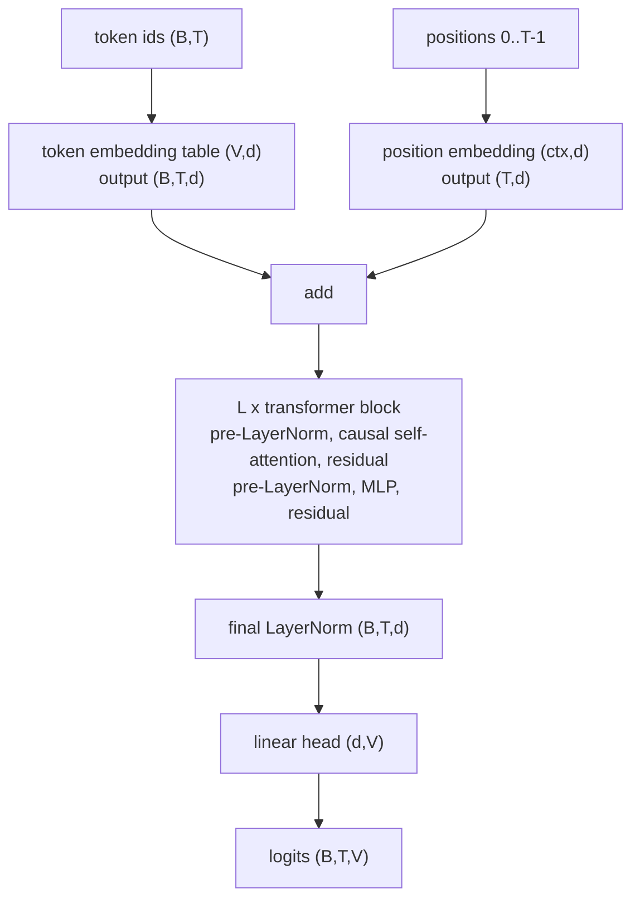

## Where this fits

Every chat assistant, code completer and translation model you use today is, at its core, a program that answers one question over and over: *given everything so far, which token comes next?* Writing a paragraph is calling that program hundreds of times and feeding each answer back in. This lesson explains that loop end to end:

- how text becomes the integers of [[llm.01]],
- what number the training procedure tries to make small (the **cross-entropy** of the next token),
- what the model looks like from token ids to scores (the architecture is summarised here; the attention mathematics itself belongs to the transformers course and is not repeated),
- how scores become text (**decoding**: greedy, temperature, top-k, top-p), and
- how we measure a language model (**perplexity**).

To keep every number checkable we build the smallest possible language model, a table of "which word follows which", train it by counting and by gradient descent, and sample from it. Everything we say about the loss and the samplers applies unchanged to a 100-billion-parameter transformer: only the function that produces the scores changes.

## The idea in plain words

Think of the autocomplete on your phone. It looks at what you have typed and shows a few likely next words, each with an implicit "how likely". A **language model** is a very good version of that: for any prefix it assigns a probability to *every* token in the vocabulary.

To write text you need two more pieces:

1. **A way to learn the probabilities.** Take a lot of real text. At each position, hide the next token and ask the model to guess it. Reward it when it gave the true token a high probability and punish it when it did not. The punishment has a name, the negative log-probability of the truth, and it is exactly the cross-entropy you met in the information-theory lessons.
2. **A way to choose.** The model gives a probability for every token; you must pick one. Always picking the most likely token ("greedy") is safe but repetitive and dull. Rolling a weighted die is varied but occasionally absurd. Three knobs sit in between: *temperature* (how flat the die is), *top-k* (only consider the k most likely tokens) and *top-p* (only consider the smallest group of tokens that together carry probability p).

Why the word "decoder-only"? The original transformer had an encoder that read a source sentence and a decoder that wrote the translation. GPT-style models keep only the decoder part: a stack that reads the tokens so far (with a mask that forbids looking at the future) and predicts the next one.

## Formal setting

A text is a token sequence $x_1,\dots,x_T$ over a vocabulary of size $V$ ([[llm.01]]). The chain rule of probability, which is an identity and not an assumption, factorises its probability:

$$
p(x_1,\dots,x_T)=\prod_{t=1}^{T}p\bigl(x_t\mid x_1,\dots,x_{t-1}\bigr).
$$

A language model $p_\theta$ parametrises each factor $p_\theta(\,\cdot\mid x_{<t})$, a distribution over $V$ tokens. It does so by computing a vector of **logits** $z_t\in\mathbb{R}^{V}$ and applying the softmax:

$$
p_\theta(v\mid x_{<t})=\frac{e^{z_{t,v}}}{\sum_{u=1}^{V}e^{z_{t,u}}}.
$$

**Training objective.** Maximise the likelihood of the training text, equivalently minimise the average negative log-likelihood, the **cross-entropy loss**:

$$
\mathcal L(\theta)=-\frac1{N}\sum_{t}\ln p_\theta\bigl(x_t\mid x_{<t}\bigr).
$$

Why is this the cross-entropy? For one position the "target distribution" $q$ is one-hot on the observed token $y$, and $H(q,p_\theta)=-\sum_v q_v\ln p_{\theta,v}=-\ln p_{\theta,y}$. Averaging over positions gives the formula above. Training a language model is therefore ordinary multiclass classification with $V$ classes, once per position. In the data pipeline of the book, the inputs are a window of tokens and the targets are the same window shifted one place to the right, so a window of length $T$ gives $T$ training examples at once.

**Gradient with respect to the logits.** Differentiate $-\ln p_y=-z_y+\ln\sum_u e^{z_u}$ with respect to $z_v$:

$$
\frac{\partial}{\partial z_v}\bigl(-\ln p_y\bigr)=-\mathbb 1[v=y]+\frac{e^{z_v}}{\sum_u e^{z_u}}=p_v-\mathbb 1[v=y].
$$

So the gradient on the logits is "predicted probabilities minus one-hot truth": push the true token's logit up by $1-p_y$ and every other logit down by its own probability. Everything else in training is backpropagation of this vector through the network (the lesson on backpropagation derives how it flows to weights). The bigram exercise below uses this formula directly.

**Perplexity.** The exponential of the cross-entropy,

$$
\mathrm{PPL}=\exp(\mathcal L),
$$

reads as the "effective number of equally likely tokens" the model is hesitating between at each step. A uniform model over $V$ tokens has loss $\ln V$ and perplexity exactly $V$; a perfect model has perplexity 1. As the book notes for an untrained 50,257-token model, the initial loss is huge and the perplexity of the same order as the vocabulary: that is what "knows nothing" looks like. Perplexity is only comparable between models that use the **same tokeniser** and the same text, because the tokens being predicted must be the same.

## The model from ids to logits (summary)

A GPT-style model computes, for a batch of token ids of shape $(B,T)$:



- **Embeddings.** Each id selects a row of a learned table, so a token becomes a $d$-dimensional vector. Attention is blind to order by itself, so a vector for the *position* is added.
- **Transformer blocks.** Each block lets every position gather information from earlier positions (causal self-attention: a mask removes the future, which is what lets one forward pass train all $T$ next-token predictions at once) and then transforms each position independently with a small MLP. Residual connections add each sublayer's input to its output so that gradients flow to early layers, and layer normalisation keeps activations in range. The attention equations and multi-head details are derived in the transformers course; here we treat the stack as a function producing $(B,T,d)$ features.
- **Head.** A linear map to $V$ scores per position.

Sizes for the smallest GPT-2: $V=50{,}257$, $d=768$, 12 layers, 12 heads, context 1024. Built literally it has about 163 million parameters; the published "124 million" figure counts the output head as *tied* to the token embedding (the same matrix is used to embed and to score), which removes $50{,}257\times768\approx38.6$ million parameters. The next lesson gives the exact count.

**Training versus generation.** During training one forward pass over a window yields logits at all $T$ positions and $T$ losses. During generation the model is run once per new token, appending the sampled id to the context; implementations cache the keys and values of earlier positions so each step does not recompute the past, and distinguish a *prefill* phase (read the whole prompt in parallel) from a *decode* phase (one token at a time, limited by memory traffic rather than arithmetic).

## From logits to text: decoding

Given logits $z\in\mathbb{R}^{V}$ for the next token:

**Greedy.** $\hat y=\arg\max_v z_v$. Deterministic: run it twice and you get the same text, which the book observes. It often falls into repetition because the single most likely continuation of a repeated phrase is more repetition.

**Temperature.** Sample from $\operatorname{softmax}(z/T)$ with $T>0$. For two tokens the ratio of probabilities is

$$
\frac{p_i}{p_j}=\exp\!\Bigl(\frac{z_i-z_j}{T}\Bigr),
$$

so dividing by $T$ stretches or compresses the *gaps* between logits. As $T\to0^{+}$ the largest logit dominates and the distribution tends to one-hot at the argmax (greedy); $T=1$ is the model's own distribution; as $T\to\infty$ all ratios tend to 1 and the distribution tends to uniform. Low $T$ is conservative, high $T$ is adventurous and eventually incoherent. Pure sampling at $T=1$ already has a long tail problem: the book's example of "every effort moves you" followed by an out-of-place token about 3.2% of the time shows that many small probabilities add up.

**Top-k.** Keep the $k$ tokens with the largest probability, set the rest to zero and renormalise. This cuts the tail so higher temperatures can be used without absurd tokens. A fixed $k$ is crude: when the model is nearly certain, $k=50$ still lets in garbage; when it is genuinely unsure, $k=50$ may exclude good options.

**Top-p (nucleus).** Sort the probabilities in decreasing order and keep the smallest prefix whose cumulative sum reaches $p$. The number of kept tokens adapts: one or two when the model is confident, many when it is not. Order of operations in practice: temperature, then top-k, then top-p, then draw.

## Worked example: decoding

Logits $z=(2.0,\,1.0,\,0.5,\,0.0,\,-1.0)$ over five tokens. All numbers below were produced by the exercise solution.

| | token 0 | 1 | 2 | 3 | 4 |
|---|---|---|---|---|---|
| $T=1$ | 0.5630 | 0.2071 | 0.1256 | 0.0762 | 0.0280 |
| $T=0.5$ | 0.8292 | 0.1122 | 0.0413 | 0.0152 | 0.0021 |
| $T=2$ | 0.3745 | 0.2272 | 0.1769 | 0.1378 | 0.0836 |

Top-2 of the $T=1$ row: keep $0.5630$ and $0.2071$, total $0.7701$, renormalise to $(0.7311,\,0.2689,\,0,0,0)$.

Top-$p$ with $p=0.9$: the cumulative sums in sorted order are $0.5630,\,0.7701,\,0.8958,\,0.9720,\,1$. The third is $0.8958<0.9$, so we need four tokens; with $p=0.8$ the first three suffice ($0.8958\ge0.8$) and the kept probabilities are $0.5630,0.2071,0.1256$ divided by $0.8957$, that is $(0.6286,0.2312,0.1402)$.

## Worked example: a bigram language model, two ways

The simplest model conditions on one previous token: $p(y\mid x)$ is a $V\times V$ table. Corpus (words as tokens): `the cat sat on the mat the cat ate the fish`, vocabulary sorted alphabetically `ate, cat, fish, mat, on, sat, the` so $V=7$, with 11 tokens and $N=10$ bigram examples.

**By counting.** The count table is nonzero only for: $\text{ate}\to\text{the}$ 1; $\text{cat}\to\text{ate}$ 1, $\text{cat}\to\text{sat}$ 1; $\text{mat}\to\text{the}$ 1; $\text{on}\to\text{the}$ 1; $\text{sat}\to\text{on}$ 1; $\text{the}\to\text{cat}$ 2, $\text{the}\to\text{fish}$ 1, $\text{the}\to\text{mat}$ 1. Dividing rows by their sums gives $p(\text{cat}\mid\text{the})=\tfrac12$, $p(\text{mat}\mid\text{the})=p(\text{fish}\mid\text{the})=\tfrac14$.

Why is counting the right answer? For a fixed context row, minimising $-\sum_y n_y\ln p_y$ subject to $\sum_y p_y=1$ gives $p_y=n_y/\sum n$ (Gibbs' inequality: the cross-entropy $H(q,p)$ is smallest when $p=q$; here $q$ is the empirical distribution). So **counting is the exact maximum-likelihood solution**.

Average negative log-likelihood on the training text: $0.5545$ nats, perplexity $\exp(0.5545)=1.741$. Low, because the model is memorising ten bigrams. A uniform guess would give $\ln7=1.946$ (perplexity 7).

**With add-one smoothing** (add 1 to every count before normalising) the same data gives loss $1.4561$, perplexity $4.29$: smoothing reserves probability for pairs not yet seen, which costs training fit but protects against infinite loss on unseen pairs (a real problem: an unsmoothed model gives $p=0$, i.e. loss $\infty$, to any unseen bigram).

**By gradient descent.** Let $W\in\mathbb{R}^{V\times V}$ be logits, row $x$ giving $p(\cdot\mid x)=\operatorname{softmax}(W_{x})$. The gradient of the mean loss with respect to row $x$ is the sum over examples with that context of $(p-\text{onehot}(y))/N$. Starting from $W=0$ (uniform, loss $\ln7=1.9459$), full-batch gradient descent with learning rate $1.0$ gives loss $1.3342$ after 10 steps, $0.6369$ after 100 and $0.5579$ after 2000, approaching the counting loss $0.5545$; the learned $p(\text{cat}\mid\text{the})\approx0.4993$. The two methods solve the same optimisation problem; gradient descent just does it iteratively, which is the only option once the model is too complicated for a closed form. A context never used as input ("fish", last token) keeps a uniform row because no gradient ever touches it: the model cannot say anything about what it has never seen, which is the generalisation problem a neural model with shared embeddings softens.

## Implementation

```python
import numpy as np

def softmax(z):
    z = z - z.max(axis=-1, keepdims=True)      # subtract the max: stable
    e = np.exp(z)
    return e / e.sum(axis=-1, keepdims=True)

def top_p_probs(p, top_p):
    order = np.argsort(-p, kind="stable")
    cum = np.cumsum(p[order])
    n = int(np.searchsorted(cum, top_p - 1e-12) + 1)     # smallest prefix with cum >= top_p
    q = np.zeros_like(p); q[order[:n]] = p[order[:n]]
    return q / q.sum()

def grad_bigram(W, ids):                        # W: (V, V) logits, ids: (T,)
    x, y = ids[:-1], ids[1:]; N = len(x)
    P = softmax(W[x])                           # (N, V)
    loss = -np.mean(np.log(P[np.arange(N), y]))
    G = P.copy(); G[np.arange(N), y] -= 1.0; G /= N   # (P - onehot) / N
    dW = np.zeros_like(W); np.add.at(dW, x, G)        # rows with the same context add up
    return loss, dW
```

## Shapes

- Token ids: $(B,T)$ integers. Embeddings $(B,T,d)$. Logits $(B,T,V)$.
- For the loss, flatten batch and time: logits $(B\cdot T,V)$ and targets $(B\cdot T)$; the loss is the mean over the $B\cdot T$ rows.
- Bigram: `W` is $(V,V)$; `W[x]` with $x$ of shape $(N,)$ gives $(N,V)$; the gradient array has the shape of `W`.
- Memory note: the logits tensor $B\cdot T\cdot V$ can dominate activation memory for large vocabularies (for example $8\times1024\times50{,}257\approx4.1\times10^{8}$ numbers).

## Limits and trade-offs

- **Likelihood is not quality.** Maximising probability of the next token does not mean the most probable *sequence* is the best text; greedy and beam-style search tend to repetitive, generic output, which is why sampling exists. Conversely low loss on training text can mean memorisation: the book's small run shows training loss falling while validation loss rises, and the model reproducing passages verbatim.
- **Sampling randomness is a dial, not a fix.** Temperature and truncation trade diversity against coherence; there is no setting that is right for both a poem and a SQL query.
- **Bigram is too weak.** Its context is one token; extending to $n$-grams needs $V^{n}$ table cells, almost all unseen. Neural models replace the table with a function of the whole prefix that shares statistical strength across similar contexts.
- **Perplexity depends on tokenisation** and does not capture factuality, helpfulness or safety; later lessons add training signals for those.

## Common misconceptions

- "The model picks the most likely word." Only under greedy decoding; chat systems normally sample.
- "Temperature 0 and temperature 1 differ only in randomness." They also differ in which tokens are ever reachable, because $T\to0$ discards all but the argmax.
- "Top-p 0.9 keeps 90% of the tokens." It keeps the smallest set carrying 90% of the *probability mass*, which may be two tokens or two thousand.
- "Perplexity 10 means the model knows 10 words." It means the model is as unsure as if it chose uniformly among 10 equally likely tokens at each step.
- "Training teaches the model to answer questions." Pretraining only teaches continuation; answering behaviour comes from fine-tuning ([[llm.04]]) and alignment ([[llm.05]]).

## Key takeaways

- A language model factorises text probability into next-token distributions; training minimises the average negative log-probability of the true next token (cross-entropy) over all positions.
- The logit gradient of the loss is $p-\text{onehot}(y)$.
- Perplexity $=e^{\text{loss}}$; a uniform model has perplexity $V$.
- Decoding turns logits into tokens: greedy, temperature $z/T$, top-k, top-p, in that processing order.
- A bigram table trained by counting is the exact optimum of the same loss that gradient descent optimises; neural networks replace the table by a function with shared parameters.

## Explain it yourself

1. Why does dividing the logits by a temperature change the *ratios* of probabilities but never the ranking? What changes at $T\to0$?
2. A model gets training perplexity 3 and validation perplexity 40. What does that suggest and what would you check?

## Further reading

- Raschka, *Build a Large Language Model From Scratch*, chapters 4 and 5.
- Holtzman et al. (2020), *The Curious Case of Neural Text Degeneration*, the paper that introduced nucleus (top-p) sampling.
- The transformers course of this academy for the attention mechanism inside the blocks.

## Mastery criteria

- Derive $\partial\mathcal L/\partial z=p-\text{onehot}(y)$ without notes.
- Compute perplexity from a list of target probabilities by hand.
- Given logits, produce the distributions after temperature, top-k and top-p, and say what each does to the tail.
- Explain why counting solves the bigram problem exactly and why that does not scale.
