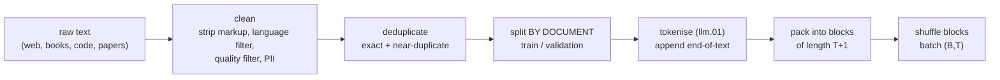

## Où cela s'inscrit

L'architecture d'un modèle se décrit en un paragraphe. Ce qu'il *devient* dépend de deux budgets : les **données** qu'on lui montre et le **calcul** dépensé pour les lui montrer. Les leçons précédentes t'ont donné un tokeniseur et une perte ; celle-ci porte sur l'alimentation de cette perte à grande échelle. Elle répond aux questions pratiques que se pose une équipe avant de dépenser une grosse somme :

- D'où vient le texte et comment est-il nettoyé ?
- Combien de paramètres et combien de tokens faut-il acheter pour un budget de calcul fixé ?
- De combien de FLOPs et de combien de mémoire l'exécution aura-t-elle besoin ?
- Comment reconnaître une exécution qui tourne mal ?

Tout ce qui suit cette leçon, le fine-tuning ([[llm.04]]) et l'alignement ([[llm.05]]), part de la sortie du pré-entraînement, donc ses limites deviennent les leurs.

## L'idée en mots simples

Imagine un chef qui doit apprendre à cuisiner en goûtant. Les *ingrédients* sont le texte d'entraînement, le *nombre de plats goûtés* est le nombre de tokens, et la *taille de la mémoire et du savoir-faire du chef* est le nombre de paramètres. Un cerveau énorme qui n'a goûté que trois plats apprend peu ; un petit cerveau qui goûte un milliard de plats sature, faute de place pour retenir les motifs. Pour un temps fixé en cuisine (le calcul), il faut décider combien en consacrer à agrandir le cerveau et combien à goûter.

Deux choses comptent autant que la quantité :

- **Qualité et variété.** Si un tiers de ce que le chef goûte est le même plat répété, il le mémorise et n'apprend rien de nouveau. Les doublons, le texte passe-partout et le spam gaspillent du calcul et poussent le modèle à les réciter mot pour mot.
- **Test honnête.** Si les questions d'examen ont fuité jusqu'à la cuisine, un score parfait ne veut rien dire. Un jeu de validation doit être réellement inédit.

Enfin, les données doivent être servies sous une forme régulière. Les GPU aiment les batchs rectangulaires, mais les documents ont toutes les longueurs ; on les colle donc bout à bout, séparés par un token de fin de texte, et on découpe le long flux en blocs égaux.

## Construire le pipeline



**Sources et mélange.** Les grands corpus combinent des collectes du web (énormes, bruitées), du web trié, des livres, des articles scientifiques, du code et des mathématiques. Les proportions sont une décision de conception sans formule : la leçon source cite, comme exemple publié, environ la moitié de texte web, un quart de code, et le reste en livres, articles, mathématiques et texte multilingue pour un modèle entraîné sur 15.6 billions (mille milliards) de tokens. Trop peu de code et le modèle ne sait pas programmer ; trop de web de mauvaise qualité et son style se dégrade.

**Nettoyage.** Retirer le HTML et le texte de navigation, détecter la langue, écarter les documents de faible qualité (une approche note les documents avec un petit modèle de langage entraîné sur du texte propre et écarte ceux à forte perplexité, le spam et les listes de mots-clés), et supprimer les identifiants personnels.

**Déduplication.** L'étape la plus efficace. Les doublons *exacts* sont supprimés par hachage du texte normalisé. Les quasi-doublons (le même article, des publicités différentes) sont trouvés avec des **shingles** de $n$-grammes de mots et la **similarité de Jaccard**

$$
J(A,B)=\frac{|S_n(A)\cap S_n(B)|}{|S_n(A)\cup S_n(B)|},
$$

où $S_n(\cdot)$ est l'ensemble des fenêtres de $n$ mots d'un document. Comparer chaque paire est quadratique, donc les systèmes de production hachent chaque ensemble de shingles en une courte signature MinHash et regroupent dans les mêmes casiers les signatures similaires (hachage sensible à la localité) ; l'idée est que la probabilité que deux documents partagent un hachage minimal est égale à leur similarité de Jaccard. La leçon source rapporte qu'un grand laboratoire a ainsi supprimé environ 38 % de ses données web (à considérer comme un chiffre approximatif tiré de cette leçon). Les doublons causent aussi de la **mémorisation** : la petite exécution du livre, entraînée pendant de nombreuses époques sur une courte nouvelle, fait baisser la perte d'entraînement pendant que la perte de validation monte, et génère des passages qui figurent mot pour mot dans le jeu d'entraînement.

**Sépare avant d'empaqueter, et sépare par document.** Choisis d'abord les documents de validation avec une permutation à graine fixée, puis tokenise et empaquette chaque côté séparément. Si tu empaquettes d'abord et sépares les blocs, un document à cheval sur une frontière apparaît des deux côtés, et les quasi-doublons de part et d'autre de la séparation rendent la perte de validation optimiste. Le livre met de côté une fraction (une séparation 90/10) d'un minuscule texte ; les vraies exécutions mettent de côté quelques milliers de documents, et gardent aussi les textes de benchmarks hors des données d'entraînement (contamination).

**Empaquetage.** Fais suivre chaque document d'un id de fin de texte. Concatène tout en un flux $s_0,s_1,\dots$ et découpe des blocs de $T+1$ tokens avec un pas de $T$ :

$$
x^{(i)}=s_{iT:(i+1)T},\qquad y^{(i)}=s_{iT+1:(i+1)T+1}.
$$

Les blocs ne se chevauchent pas en tant qu'entrées (chaque token est une entrée au plus une fois ; la queue incomplète du flux est abandonnée), et chaque bloc donne $T$ exemples d'entraînement. Compare avec le padding de chaque document jusqu'à la longueur du bloc : trois documents de 200, 500 et 100 tokens dans des emplacements de 2048 tokens gaspillent $1-800/6144\approx87\%$ des positions en padding. Quand plusieurs documents partagent un bloc, tu peux en plus vouloir que les tokens ne portent pas leur attention de l'autre côté de la frontière de document : le masque d'attention devient causal *et* diagonal par blocs selon les documents. De nombreux pipelines s'en passent (le token de fin de texte est un indice faible) et acceptent un peu de fuite entre documents par simplicité.

**Mélange et mise en batch.** Mélange les blocs avec un générateur à graine fixée pour que les batchs ne soient pas ordonnés par sujet, puis prends des groupes consécutifs de $B$ blocs : des tenseurs de forme $(B,T)$. Les graines de mélange et l'ordre des données font partie d'une exécution reproductible.

## Lois d'échelle et budget de calcul

### Compter les paramètres

Pour un modèle de style GPT-2 de largeur $d$, $L$ couches, vocabulaire $V$ et positions apprises jusqu'à $T_{\max}$, un bloc a

$$
\underbrace{(3d^2+3d)}_{\text{q,k,v}}+\underbrace{(d^2+d)}_{\text{out proj}}+\underbrace{(8d^2+5d)}_{\text{MLP, width }4d}+\underbrace{4d}_{\text{2 LayerNorms}}=12d^2+13d
$$

paramètres, donc

$$
N=Vd+T_{\max}d+L(12d^2+13d)+2d\quad(+\,Vd\text{ if the output head is not tied}).
$$

Pour GPT-2 small ($V=50257$, $d=768$, $L=12$, $T_{\max}=1024$) : $38{,}597{,}376+786{,}432$ pour les embeddings, $12\times7{,}087{,}872=85{,}054{,}464$ pour les blocs et $1{,}536$ pour la LayerNorm finale, soit un total de **124,439,808** avec une tête partagée et **163,037,184** sans, ce qui correspond à l'observation du livre de 124M contre 163M. À grande largeur, le terme $12Ld^2$ domine : les paramètres croissent quadratiquement avec $d$.

### La règle 6ND

Le coût d'entraînement par token d'un transformer dense est d'environ $6$ FLOPs par paramètre : environ $2N$ pour la passe avant (une multiplication et une addition par poids) et environ $4N$ pour la passe arrière (les gradients par rapport aux activations et par rapport aux poids coûtent chacun environ le coût de la passe avant). Avec $D$ tokens d'entraînement,

$$
C\approx 6\,N\,D.
$$

Cela ignore le calcul des scores d'attention qui croît avec la longueur de séquence et les consultations d'embeddings, donc considère-le comme une estimation correcte à quelques dizaines de pour cent près. Exemple : GPT-2 small sur $D=10^{10}$ tokens demande $6\times124{,}439{,}808\times10^{10}\approx7.47\times10^{18}$ FLOPs ; avec un pic hypothétique de $10^{14}$ FLOP/s et 40 % d'utilisation, cela fait $7.47\times10^{18}/(4\times10^{13})=1.87\times10^{5}$ s, soit environ $2.2$ jours (les débits matériels ici sont des valeurs de substitution ; mets les tiens).

### Quelle répartition entre $N$ et $D$ ?

Fixe $C$. Deux réglages, $N$ et $D=C/(6N)$. Empiriquement, la perte finale suit une loi lisse des deux. La forme paramétrique de Hoffmann et al., telle que citée dans la leçon du dépôt, est

$$
L(N,D)=\frac{A}{N^{\alpha}}+\frac{B}{D^{\beta}}+E,\qquad A\approx406.4,\;B\approx410.7,\;\alpha\approx0.34,\;\beta\approx0.28,\;E\approx1.69 .
$$

$E$ est la perte irréductible (l'entropie du texte lui-même), les deux autres termes sont la pénalité pour trop peu de paramètres et trop peu de données. En substituant $D=C/(6N)$ on obtient $L=AN^{-\alpha}+B(6N/C)^{\beta}+E$ ; le premier terme baisse et le second monte avec $N$, il y a donc un minimum intérieur, trouvé en annulant la dérivée.

La conclusion phare de l'étude Chinchilla est que la répartition optimale en calcul fait croître $N$ et $D$ ensemble, environ **20 tokens par paramètre**. Si $D=rN$ alors $C=6rN^2$, donc $N=\sqrt{C/(6r)}$ : pour $C=5.88\times10^{23}$ et $r=20$, $N=7.0\times10^{10}$ et $D=1.4\times10^{12}$, le point 70B paramètres / 1.4T tokens de l'étude. À l'inverse, le modèle antérieur de 175B paramètres et 300B tokens n'avait qu'environ 1.7 token par paramètre.

**Une mise en garde issue des calculs.** J'ai minimisé la formule citée sur une grille fine à $C=5.88\times10^{23}$ et obtenu $N\approx3.3\times10^{10}$, $D\approx3.0\times10^{12}$ ($D/N\approx92$), perte $1.9300$, alors que le point à 20 par paramètre a une perte de $1.9366$. Donc, avec *ces* constantes, le minimiseur de la formule se situe à un ratio plus élevé que 20, mais les deux pertes ne diffèrent que de $0.007$ nat. Morale : l'optimum est **plat**, les constantes portent une incertitude d'ajustement, et « 20 tokens par paramètre » est une règle empirique, pas un théorème. (L'exercice te permet de le reproduire.)

**Pourquoi on entraîne au-delà de l'optimum.** L'optimal en calcul minimise la perte pour une facture d'*entraînement* donnée. Un modèle déployé tourne pendant des années, donc un modèle plus petit entraîné sur bien plus de tokens est moins cher à servir. La leçon du dépôt donne comme exemple un modèle de 8B entraîné sur 15 billions de tokens, soit 1 875 tokens par paramètre. Le coût : plus de FLOPs d'entraînement pour une perte donnée. L'avantage : un coût d'inférence plus bas pour toujours.

### Exemple détaillé : un plan

Tu veux un modèle optimal en calcul pour $C=10^{22}$ FLOPs (suppose 20 tokens par paramètre). Alors $N=\sqrt{10^{22}/120}=9.13\times10^{9}$, $D=1.83\times10^{11}$ tokens. La mémoire pour entraîner avec des poids fp32, des gradients fp32 et les deux moments d'Adam est de $4+4+8=16$ octets par paramètre avant les activations : $16\times9.13\times10^{9}=146$ GB, ce qui ne tient pas sur un seul accélérateur et doit être réparti. Pour GPT-2 small, le même calcul donne $16\times124{,}439{,}808\approx1.99$ GB. Pour l'inférence, les clés et valeurs de tous les tokens passés sont mises en cache : $2\cdot L\cdot d\cdot T$ nombres par séquence, donc GPT-2 small à 1024 tokens stocke $2\times12\times768\times1024=18{,}874{,}368$ nombres, soit $75.5$ MB en fp32 par séquence (la leçon source cite environ 75 MB), croissant linéairement avec le contexte et la taille du batch. Tous les nombres ci-dessus ont été produits par la calculatrice de l'exercice.

## Implémentation

```python
import numpy as np

def pack(docs_ids, eos, block):
    stream = []
    for d in docs_ids:
        stream.extend(d); stream.append(eos)
    s = np.array(stream)
    n = (len(s) - 1) // block
    x = np.stack([s[i*block:(i+1)*block] for i in range(n)])          # (n, block)
    y = np.stack([s[i*block+1:(i+1)*block+1] for i in range(n)])      # shifted by one
    return x, y

def gpt_params(V, d, L, ctx, tied=True, m=4):
    block = (3*d*d + 3*d) + (d*d + d) + (d*m*d + m*d) + (m*d*d + d) + 4*d
    total = V*d + ctx*d + L*block + 2*d
    return total if tied else total + V*d

def compute_optimal(C, r=20):
    N = (C / (6*r)) ** 0.5
    return N, r * N
```

Sur `pack([[1,2,3],[4,5],[6,7,8,9]], eos=0, block=3)`, le flux est `1 2 3 0 4 5 0 6 7 8 9 0`, ce qui donne `x = [[1,2,3],[0,4,5],[0,6,7]]` et `y = [[2,3,0],[4,5,0],[6,7,8]]`.

## Formes

- Flux : $(S,)$ ids de tokens. Blocs $x,y$ : $(n,T)$ avec $n=\lfloor (S-1)/T\rfloor$. Un batch : $(B,T)$.
- Masque de document pour un bloc : $(T,T)$ booléen, causal et de même document.
- Tenseurs de perte : logits $(B,T,V)$ ; tokens par pas d'optimiseur $=B\cdot T$ fois le nombre de pas d'accumulation. Le batch de 1024 séquences de Llama 2 7B est cité dans le livre comme illustration de l'échelle des batchs.

## Ce qui casse, et comment on le voit

Lis la **courbe de perte** (entraînement et validation en fonction des tokens vus).

- **Démarre à $\ln V$.** Un modèle fraîchement initialisé est quasi uniforme, donc la première perte vaut environ $\ln V$ ($\approx10.8$ pour $V=50257$). Une valeur de départ très différente pointe vers un bug (mauvaises cibles, mauvaise normalisation).
- **L'entraînement baisse, la validation reste plate ou monte.** Surapprentissage ou mémorisation : trop d'époques sur trop peu de données ou des données trop dupliquées. Plus de données distinctes, déduplication, moins de répétitions.
- **Pics et divergence.** La perte saute brusquement ou devient NaN : taux d'apprentissage trop élevé, mauvais batch, problèmes numériques. Les remèdes standard cités dans le livre sont l'échauffement (warmup) du taux d'apprentissage, la décroissance en cosinus et l'écrêtage des gradients.
- **Plateau bien au-dessus de la perte attendue.** Sous-entraînement (trop peu de tokens pour $N$), mauvais taux d'apprentissage, mélange de données trop bruité, ou désalignement entrée-cible.
- **Excellente perte, mauvais comportement.** La perte est une moyenne sur tout ; une contamination des données de test, une duplication des données ou un mélange biaisé peuvent la faire baisser sans rendre le modèle utile. Une évaluation sur données mises de côté, sur les tâches qui t'intéressent, est nécessaire.
- **L'extrapolation des lois d'échelle échoue.** Les ajustements proviennent d'une plage limitée de calcul (la leçon du dépôt note que Chinchilla a étudié environ $10^{22}$ à $10^{23}$ FLOPs) ; extrapoler sur de nombreux ordres de grandeur dérive. La qualité des données, les modèles à mélange d'experts et de meilleurs optimiseurs déplacent les constantes et non la forme. Les benchmarks qui ressemblent à une « émergence » soudaine sont souvent un artefact d'un score tout-ou-rien ; une perte lisse est la grandeur la plus fiable pour planifier.

## Idées reçues courantes

- « Plus de paramètres signifie toujours un meilleur modèle. » À budget de calcul fixé, un modèle plus gros voit moins de tokens et peut être moins bon.
- « 20 tokens par paramètre, c'est la loi. » C'est une règle empirique issue d'un ajustement ; l'optimum est plat et le coût de déploiement pousse les vrais modèles bien au-delà.
- « 6ND est exact. » C'est une estimation au premier ordre pour les transformers denses ; l'attention à contexte long, le recalcul des activations et les inefficacités changent le nombre réel.
- « La déduplication fait perdre des données. » Elle supprime la redondance ; c'est généralement l'une des étapes les plus précieuses.
- « Mélange les blocs, puis sépare. » Cela fait fuiter des documents et des quasi-doublons dans la validation.

## Points clés à retenir

- Données = nettoyage + déduplication + séparation par document + empaquetage en blocs $(n,T)$ avec des cibles décalées d'un cran.
- Paramètres d'un modèle de style GPT-2 : $Vd+T_{\max}d+L(12d^2+13d)+2d$ (plus $Vd$ sans partage).
- Calcul d'entraînement $\approx6ND$ FLOPs ; l'entraînement Adam en fp32 demande environ 16 octets par paramètre avant les activations.
- La mise à l'échelle optimale en calcul fait croître $N$ et $D$ ensemble (environ 20 tokens par paramètre, un optimum plat) ; un usage dominé par l'inférence justifie d'entraîner des modèles plus petits sur bien plus de tokens.
- Surveille la courbe de perte par rapport à $\ln V$ au départ et l'écart entraînement/validation tout au long.

## Explique-le toi-même

1. Pourquoi la séparation par document se fait-elle avant l'empaquetage, et qu'est-ce qui fuite exactement si on la fait après ?
2. Tu as le double du budget de calcul. Comment $N$ et $D$ doivent-ils évoluer selon la règle des 20 tokens par paramètre, et pourquoi pourrais-tu l'ignorer ?

## Pour aller plus loin

- Hoffmann et al. (2022), *Training Compute-Optimal Large Language Models* (Chinchilla) ; Kaplan et al. (2020), *Scaling Laws for Neural Language Models*.
- Sardana et Frankle (2024), *Beyond Chinchilla-Optimal: Accounting for Inference in Language Model Scaling Laws*.
- Raschka, *Build a Large Language Model From Scratch*, chapitre 5, et son annexe sur les raffinements de la boucle d'entraînement.

## Critères de maîtrise

- Calculer à la main le nombre de paramètres d'une configuration de style GPT-2 et retrouver 124,439,808.
- Étant donné un budget de FLOPs, produire $(N,D)$ et la mémoire d'entraînement pour les poids, les gradients et les états d'Adam.
- Expliquer, avec les nombres de cette leçon, pourquoi le ratio optimal pour la perte est plat et pourquoi la pratique s'en écarte.
- Décrire trois signatures distinctes d'une exécution qui échoue et la première chose que tu vérifierais pour chacune.
