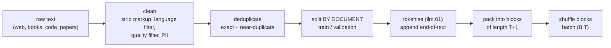

## Where this fits

A model's architecture takes a paragraph to describe. What it *becomes* depends on two budgets: the **data** it is shown and the **compute** spent showing it. The lessons before this one gave you a tokeniser and a loss; this one is about feeding that loss at scale. It answers the practical questions a team asks before spending a large sum:

- Where does the text come from and how is it cleaned?
- How many parameters and how many tokens should one buy for a fixed compute budget?
- How many FLOPs and how much memory will the run need?
- How do I recognise a run that is going wrong?

Everything after this lesson, fine-tuning ([[llm.04]]) and alignment ([[llm.05]]), starts from the output of pretraining, so its limits become theirs.

## The idea in plain words

Picture a chef who must learn to cook by tasting. The *ingredients* are the training text, the *number of dishes tasted* is the number of tokens, and the *size of the chef's memory and skill* is the number of parameters. A huge brain that has tasted three dishes learns little; a small brain that tastes a billion dishes saturates, because it has no room left to remember patterns. Given a fixed time in the kitchen (compute), you must decide how much to spend on growing the brain and how much on tasting.

Two things matter as much as quantity:

- **Quality and variety.** If a third of what the chef tastes is the same dish repeated, he memorises it and learns nothing new. Duplicates, boilerplate and spam waste compute and make the model recite them verbatim.
- **Honest testing.** If exam questions leaked into the kitchen, a perfect score means nothing. A validation set must be genuinely unseen.

Finally, the data has to be served in a regular shape. GPUs like rectangular batches, but documents have every length, so we glue them end to end, separated by an end-of-text token, and cut the long stream into equal blocks.

## Building the pipeline



**Sources and mix.** Large corpora combine web crawls (huge, noisy), curated web, books, academic papers, code, and maths. The proportions are a design decision with no formula: the source lesson quotes, as a disclosed example, roughly half web text, a quarter code, and the rest books, papers, maths and multilingual text for a model trained on 15.6 trillion tokens. Too little code and the model cannot program; too much low-quality web and its style degrades.

**Cleaning.** Strip HTML and navigation text, detect language, drop low-quality documents (one approach scores documents with a small language model trained on clean text and drops those with high perplexity, spam and keyword lists), and remove personal identifiers.

**Deduplication.** The most effective step. *Exact* duplicates are removed by hashing normalised text. *Near* duplicates (same article, different ads) are found with word $n$-gram **shingles** and the **Jaccard similarity**

$$
J(A,B)=\frac{|S_n(A)\cap S_n(B)|}{|S_n(A)\cup S_n(B)|},
$$

where $S_n(\cdot)$ is the set of $n$-word windows of a document. Comparing every pair is quadratic, so production systems hash each shingle set into a short MinHash signature and bucket similar signatures together (locality-sensitive hashing); the idea is that the probability two documents share a minimum hash equals their Jaccard similarity. The source lesson reports that one large lab removed roughly 38% of its web data this way (treat as an approximate figure from that lesson). Duplicates also cause **memorisation**: the book's small run, trained for many epochs on one short story, drives training loss down while validation loss goes up, and generates passages that are in the training set verbatim.

**Split before you pack, and split by document.** Choose the validation documents first with a seeded permutation, then tokenise and pack each side separately. If you pack first and split blocks, a document straddling a boundary appears on both sides, and near-duplicates across the split make the validation loss optimistic. The book holds out a fraction (a 90/10 split) of a tiny text; real runs hold out a few thousand documents, and also keep benchmark texts out of the training data (contamination).

**Packing.** Let each document be followed by an end-of-text id. Concatenate all into a stream $s_0,s_1,\dots$ and cut blocks of $T+1$ tokens with stride $T$:

$$
x^{(i)}=s_{iT:(i+1)T},\qquad y^{(i)}=s_{iT+1:(i+1)T+1}.
$$

Blocks do not overlap as inputs (each token is an input at most once; the incomplete tail of the stream is dropped), and each block gives $T$ training examples. Compare with padding every document up to the block length: three documents of 200, 500 and 100 tokens in 2048-token slots waste $1-800/6144\approx87\%$ of the positions on padding. When several documents share a block, you may additionally want tokens not to attend across the document boundary: the attention mask becomes causal *and* block-diagonal in documents. Many pipelines skip this (the end-of-text token is a weak hint) and accept a little cross-document leakage for simplicity.

**Shuffling and batching.** Shuffle blocks with a seeded generator so the batches are not ordered by topic, then take consecutive groups of $B$ blocks: tensors of shape $(B,T)$. Shuffle seeds and data order are part of a reproducible run.

## Scaling laws and the compute budget

### Counting parameters

For a GPT-2-style model with width $d$, $L$ layers, vocabulary $V$ and learned positions up to $T_{\max}$, one block has

$$
\underbrace{(3d^2+3d)}_{\text{q,k,v}}+\underbrace{(d^2+d)}_{\text{out proj}}+\underbrace{(8d^2+5d)}_{\text{MLP, width }4d}+\underbrace{4d}_{\text{2 LayerNorms}}=12d^2+13d
$$

parameters, so

$$
N=Vd+T_{\max}d+L(12d^2+13d)+2d\quad(+\,Vd\text{ if the output head is not tied}).
$$

For GPT-2 small ($V=50257$, $d=768$, $L=12$, $T_{\max}=1024$): $38{,}597{,}376+786{,}432$ for the embeddings, $12\times7{,}087{,}872=85{,}054{,}464$ for the blocks and $1{,}536$ for the final LayerNorm, total **124,439,808** with a tied head and **163,037,184** without, matching the book's 124M versus 163M observation. At large width the term $12Ld^2$ dominates: parameters grow quadratically with $d$.

### The 6ND rule

Training cost per token for a dense transformer is about $6$ FLOPs per parameter: roughly $2N$ for the forward pass (one multiply and one add per weight) and about $4N$ for the backward pass (the gradients with respect to activations and with respect to weights each cost about the forward cost). With $D$ training tokens,

$$
C\approx 6\,N\,D.
$$

This ignores the attention score computation that grows with sequence length and the embedding lookups, so treat it as an estimate good to tens of percent. Example: GPT-2 small on $D=10^{10}$ tokens needs $6\times124{,}439{,}808\times10^{10}\approx7.47\times10^{18}$ FLOPs; at a hypothetical $10^{14}$ FLOP/s peak and 40% utilisation that is $7.47\times10^{18}/(4\times10^{13})=1.87\times10^{5}$ s, about $2.2$ days (the hardware rates here are placeholders; plug in your own).

### Which split of $N$ and $D$?

Fix $C$. Two knobs, $N$ and $D=C/(6N)$. Empirically the final loss follows a smooth law of both. The parametric form of Hoffmann et al. as quoted in the repo lesson is

$$
L(N,D)=\frac{A}{N^{\alpha}}+\frac{B}{D^{\beta}}+E,\qquad A\approx406.4,\;B\approx410.7,\;\alpha\approx0.34,\;\beta\approx0.28,\;E\approx1.69 .
$$

$E$ is the irreducible loss (the entropy of the text itself), the other two terms are the penalty for too few parameters and too little data. Substituting $D=C/(6N)$ gives $L=AN^{-\alpha}+B(6N/C)^{\beta}+E$; the first term falls and the second rises with $N$, so there is an interior minimum, found by setting the derivative to zero.

The headline conclusion of the Chinchilla study is that the compute-optimal split grows $N$ and $D$ together, about **20 tokens per parameter**. If $D=rN$ then $C=6rN^2$, so $N=\sqrt{C/(6r)}$: at $C=5.88\times10^{23}$ and $r=20$, $N=7.0\times10^{10}$ and $D=1.4\times10^{12}$, the 70B parameters / 1.4T tokens point of the study. By contrast the earlier 175B-parameter, 300B-token model had only about 1.7 tokens per parameter.

**A caution that comes from running the numbers.** I minimised the quoted formula on a fine grid at $C=5.88\times10^{23}$ and got $N\approx3.3\times10^{10}$, $D\approx3.0\times10^{12}$ ($D/N\approx92$), loss $1.9300$, whereas the 20-per-parameter point has loss $1.9366$. So with *these* constants the formula's minimiser sits at a higher ratio than 20, but the two losses differ by only $0.007$ nats. Moral: the optimum is **flat**, the constants carry fitting uncertainty, and "20 tokens per parameter" is a rule of thumb, not a theorem. (The exercise lets you reproduce this.)

**Why people train beyond the optimum.** Compute-optimal minimises loss for a given *training* bill. A deployed model is run for years, so a smaller model trained on far more tokens is cheaper to serve. The repo lesson gives an 8B model trained on 15 trillion tokens, 1,875 tokens per parameter, as the example. The cost: more training FLOPs for a given loss. The benefit: lower inference cost forever.

### Worked example: a plan

You want a compute-optimal model for $C=10^{22}$ FLOPs (assume 20 tokens per parameter). Then $N=\sqrt{10^{22}/120}=9.13\times10^{9}$, $D=1.83\times10^{11}$ tokens. Memory to train with fp32 weights, fp32 gradients and Adam's two moments is $4+4+8=16$ bytes per parameter before activations: $16\times9.13\times10^{9}=146$ GB, which does not fit on one accelerator and has to be sharded. For GPT-2 small the same accounting gives $16\times124{,}439{,}808\approx1.99$ GB. For inference, the keys and values of all past tokens are cached: $2\cdot L\cdot d\cdot T$ numbers per sequence, so GPT-2 small at 1024 tokens stores $2\times12\times768\times1024=18{,}874{,}368$ numbers, $75.5$ MB in fp32 per sequence (the source lesson quotes about 75 MB), growing linearly with context and batch size. All numbers above were produced by the exercise calculator.

## Implementation

```python
import numpy as np

def pack(docs_ids, eos, block):
    stream = []
    for d in docs_ids:
        stream.extend(d); stream.append(eos)
    s = np.array(stream)
    n = (len(s) - 1) // block
    x = np.stack([s[i*block:(i+1)*block] for i in range(n)])          # (n, block)
    y = np.stack([s[i*block+1:(i+1)*block+1] for i in range(n)])      # shifted by one
    return x, y

def gpt_params(V, d, L, ctx, tied=True, m=4):
    block = (3*d*d + 3*d) + (d*d + d) + (d*m*d + m*d) + (m*d*d + d) + 4*d
    total = V*d + ctx*d + L*block + 2*d
    return total if tied else total + V*d

def compute_optimal(C, r=20):
    N = (C / (6*r)) ** 0.5
    return N, r * N
```

On `pack([[1,2,3],[4,5],[6,7,8,9]], eos=0, block=3)` the stream is `1 2 3 0 4 5 0 6 7 8 9 0`, giving `x = [[1,2,3],[0,4,5],[0,6,7]]` and `y = [[2,3,0],[4,5,0],[6,7,8]]`.

## Shapes

- Stream: $(S,)$ token ids. Blocks $x,y$: $(n,T)$ with $n=\lfloor (S-1)/T\rfloor$. A batch: $(B,T)$.
- Document mask for one block: $(T,T)$ boolean, causal and same-document.
- Loss tensors: logits $(B,T,V)$; tokens per optimiser step $=B\cdot T$ times the number of accumulation steps. Llama 2 7B's batch of 1024 sequences is quoted in the book as an illustration of batch scale.

## What breaks, and how you see it

Read the **loss curve** (training and validation versus tokens seen).

- **Starts at $\ln V$.** A freshly initialised model is near uniform, so the first loss is about $\ln V$ ($\approx10.8$ for $V=50257$). A very different starting value points to a bug (wrong targets, wrong normalisation).
- **Training falls, validation flat or rising.** Overfitting or memorisation: too many epochs on too little or too duplicated data. More distinct data, deduplication, fewer repeats.
- **Spikes and divergence.** Loss suddenly jumps or becomes NaN: learning rate too high, bad batch, numerical issues. Standard remedies named in the book are learning-rate warmup, cosine decay and gradient clipping.
- **Plateau far above the expected loss.** Under-training (too few tokens for $N$), a poor learning rate, a data mix that is too noisy, or an input-target misalignment.
- **Great loss, bad behaviour.** Loss is an average over everything; contamination of test data, data duplication or a skewed mix can lower it without making the model useful. Held-out evaluation on the tasks you care about is needed.
- **Scaling-law extrapolation fails.** The fits come from a limited range of compute (the repo lesson notes Chinchilla studied roughly $10^{22}$ to $10^{23}$ FLOPs); extrapolating many orders of magnitude drifts. Data quality, mixture-of-experts models and better optimisers shift the constants and not the shape. Benchmarks that look like sudden "emergence" are often an artefact of all-or-nothing scoring; smooth loss is the more reliable quantity to plan against.

## Common misconceptions

- "More parameters always means a better model." At a fixed compute budget a bigger model sees fewer tokens and may be worse.
- "20 tokens per parameter is the law." It is a rule of thumb from one fit; the optimum is flat and deployment cost pushes real models far beyond it.
- "6ND is exact." It is a first-order estimate for dense transformers; attention at long context, activation recomputation and inefficiency change the real number.
- "Deduplication loses data." It removes redundancy; it is usually one of the most valuable steps.
- "Shuffle the blocks, then split." Leaks documents and near-duplicates into validation.

## Key takeaways

- Data = cleaning + deduplication + a by-document split + packing into $(n,T)$ blocks with targets shifted by one.
- Parameters of a GPT-2-style model: $Vd+T_{\max}d+L(12d^2+13d)+2d$ (plus $Vd$ untied).
- Training compute $\approx6ND$ FLOPs; fp32 Adam training needs about 16 bytes per parameter before activations.
- Compute-optimal scaling grows $N$ and $D$ together (about 20 tokens per parameter, a flat optimum); inference-heavy use justifies training smaller models on many more tokens.
- Watch the loss curve against $\ln V$ at the start and the train/validation gap throughout.

## Explain it yourself

1. Why is the by-document split done before packing, and what exactly leaks if you do it after?
2. You have double the compute budget. How should $N$ and $D$ change under the 20-tokens-per-parameter rule, and why might you ignore it?

## Further reading

- Hoffmann et al. (2022), *Training Compute-Optimal Large Language Models* (Chinchilla); Kaplan et al. (2020), *Scaling Laws for Neural Language Models*.
- Sardana and Frankle (2024), *Beyond Chinchilla-Optimal: Accounting for Inference in Language Model Scaling Laws*.
- Raschka, *Build a Large Language Model From Scratch*, chapter 5, and its appendix on training-loop refinements.

## Mastery criteria

- Compute the parameter count of a GPT-2-style configuration by hand and match 124,439,808.
- Given a FLOP budget, produce $(N,D)$ and the training memory for weights, gradients and Adam states.
- Explain, with the numbers of this lesson, why the loss-optimal ratio is flat and why practice departs from it.
- Describe three distinct signatures of a failing run and the first thing you would check for each.
