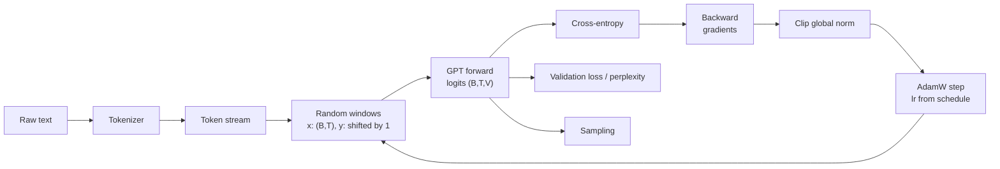

## Où cela s'inscrit

Tu connais déjà les pièces : un tokenizer transforme le texte en entiers ([[llm.01]]), un modèle décodeur seul prédit le prochain token ([[llm.02]]), l'attention et le bloc transformer sont les matériaux de construction ([[trf.01]], [[trf.02]], [[trf.03]], [[trf.04]]), les optimiseurs et les plannings sont le moteur ([[dl.01]]), et PyTorch est l'outil ([[dl.04]]). [[llm.03]] t'a dit ce que coûte un entraînement sur le papier. Cette leçon comble l'écart qui reste : **tu l'exécutes vraiment**. Chaque modèle de pointe, d'un jouet de 20 millions de paramètres à un système d'un trillion de paramètres, est entraîné par la même boucle que tu vas écrire ici ; ce qui change, c'est l'échelle, le parallélisme et les données.

À la fin, tu auras entraîné un vrai (petit) GPT sur CPU en moins d'une minute, vu la perte passer sous celle du meilleur modèle qui ignore le contexte, et échantillonné du texte avec lui. Tu sauras aussi calculer, pour n'importe quelle configuration, combien de paramètres elle a, combien de mémoire l'optimiseur requiert, combien de FLOPs l'entraînement coûte et à peu près combien de tokens par seconde attendre.

## L'idée en mots simples

Imagine que tu apprennes à quelqu'un à finir des phrases. Tu lui tends un long livre, tu masques un passage au hasard, tu lui montres les mots jusque-là et tu lui demandes le mot suivant, puis tu révèles la réponse. Chaque erreur affine son intuition. Tu fais cela des millions de fois avec des passages différents. C'est le pré-entraînement.

Des détails pratiques décident si cela fonctionne :

- **Où couper.** Tu choisis des fenêtres aléatoires dans le livre, et chaque position d'une fenêtre est un petit exercice (« avec ces trois mots, quel est le suivant ? avec ces quatre, quel est le suivant ? »), donc une fenêtre de $T$ tokens donne $T$ leçons d'un coup.
- **Quelle taille de pas.** Au tout début, l'élève ne sait rien et ses premières réponses sont folles ; un grand coup de pouce maintenant détruirait le peu qu'il a, donc tu commences par de minuscules coups de pouce (**warmup**), tu en donnes de grands au milieu, et tu termines par de très prudents (**décroissance en cosinus**).
- **Ne pas se fier à un exemple aberrant.** Parfois un batch est si surprenant que la correction est énorme. L'**écrêtage de gradient** dit : quelle que soit la force du cri, on ne bouge jamais de plus d'une distance fixe.
- **Pas assez de mémoire pour un grand batch.** Si tu ne peux pas faire tenir 512 fenêtres d'un coup, fais 8 fenêtres 64 fois, additionne les corrections et bouge une seule fois (**accumulation de gradients**). Le résultat doit être exactement le même que le grand batch.
- **Un examen honnête.** Garde une partie du livre de côté et interroge l'élève dessus de temps en temps (**perte de validation**). Un élève qui a mémorisé les pages obtient un score parfait sur les pages vues et mauvais sur le reste.
- **Un étalon.** Un élève qui ne connaît que la fréquence de chaque lettre (aucun contexte) fixe un plancher que tu dois nettement battre, sinon le modèle n'a rien appris du contexte.



## Mise en place et notation

- $V$ taille du vocabulaire, $T$ longueur de contexte (aussi appelée taille de bloc), $d$ largeur du modèle, $L$ nombre de blocs transformer, $h$ têtes d'attention de taille $d/h$.
- Un **flux de tokens** $s_0,s_1,\dots,s_{S-1}$ d'entiers dans $\{0,\dots,V-1\}$.
- Une **fenêtre** commençant en $a$ donne les entrées $x=(s_a,\dots,s_{a+T-1})$ et les cibles $y=(s_{a+1},\dots,s_{a+T})$. Les débuts valides sont $0\le a\le S-T-1$.
- Un **batch** empile $B$ fenêtres : $x,y\in\mathbb{Z}^{B\times T}$.
- Sortie du modèle : **logits** $Z\in\mathbb{R}^{B\times T\times V}$ ; la ligne $Z_{b,t}$ attribue un score à chaque token possible pouvant suivre $x_{b,1..t}$.

Comme le modèle est causal ([[trf.02]]), la position $t$ ne peut pas voir $x_{t+1}$ bien qu'il soit dans le même tenseur. C'est pourquoi une seule passe avant donne $BT$ prédictions indépendantes.

## Le modèle, en formes

Un décodeur de style GPT-2 ([[trf.04]]) :

1. Embedding de tokens : table $E\in\mathbb{R}^{V\times d}$ ; ids $(B,T)\to(B,T,d)$.
2. Embedding de position appris : table $P\in\mathbb{R}^{T\times d}$, lignes $0..T-1$ ajoutées (broadcast sur $B$).
3. $L$ blocs pre-norm, chacun : $x\leftarrow x+\mathrm{Attn}(\mathrm{LN}(x))$, puis $x\leftarrow x+\mathrm{MLP}(\mathrm{LN}(x))$. Le MLP est $d\to4d\to$ GELU $\to d$. Les formes restent $(B,T,d)$ partout.
4. LayerNorm final, puis la **tête LM** $(B,T,d)\to(B,T,V)$.

Dans l'attention : $\mathrm{qkv}$ est une couche linéaire $d\to3d$ ; découpe et remodèle en $(B,h,T,d/h)$ ; les scores $QK^\top/\sqrt{d/h}$ ont la forme $(B,h,T,T)$ ; les entrées au-dessus de la diagonale sont mises à $-\infty$ avant le softmax ; le résultat multiplié par $V$ est refusionné en $(B,T,d)$ et projeté par une couche $d\times d$.

**Poids liés (weight tying).** La tête multiplie par une matrice $d\times V$, l'embedding est une table $V\times d$. Lier les poids fait que le poids de la tête est la table d'embedding elle-même, donc une seule matrice sert à la fois pour « id vers vecteur » et « vecteur vers scores ». Cela économise $Vd$ paramètres (environ 38.6 millions pour GPT-2 small) et, comme le note le livre, la version originale de GPT-2 l'utilisait ; l'implémentation non liée du livre a 163 millions de paramètres au lieu de 124 millions.

### Compter les paramètres

Par bloc (avec biais, style GPT-2) : l'attention $\mathrm{qkv}$ vaut $3d^2+3d$, la projection de sortie $d^2+d$, le MLP $8d^2+5d$ ($d\cdot4d+4d+4d\cdot d+d$), deux LayerNorm $2\cdot2d=4d$. Somme : $12d^2+13d$. En ajoutant les tables et le LayerNorm final :

$$
N = Vd + Td + L\,(12d^2+13d) + 2d \quad(\text{tied head}),\qquad N_{\text{untied}} = N + Vd .
$$

Pour GPT-2 small ($V=50257$, $T=1024$, $d=768$, $L=12$) : $38{,}597{,}376+786{,}432+12\cdot7{,}087{,}872+1{,}536=124{,}439{,}808$. Le tableau de la leçon du dépôt cite 124,438,272 ; la différence de 1,536 est le LayerNorm final, et son chiffre par bloc omet aussi les biais de l'attention et du MLP, donc considère le total lié comme 124,439,808 (le chiffre que tu peux reproduire avec `sum(p.numel() ...)`). Notre modèle jouet ($V=24$, $T=32$, $d=64$, $L=2$) a $1{,}536+2{,}048+2\cdot49{,}984+128=103{,}680$ paramètres, et l'exercice vérifie que PyTorch est d'accord.

## La perte

Pour une position avec des logits $z\in\mathbb{R}^V$ et le vrai prochain token $y$, la probabilité du modèle est $p=\mathrm{softmax}(z)$ et la perte est

$$
\ell = -\log p_y = \log\sum_j e^{z_j} - z_y .
$$

La perte d'entraînement est la moyenne de $\ell$ sur les $B\cdot T$ positions. Son gradient par rapport aux logits a une forme célèbrement simple. Dérive le log-sum-exp : $\partial \log\sum_j e^{z_j}/\partial z_k = p_k$, et $\partial z_y/\partial z_k=[k=y]$, donc

$$
\frac{\partial \ell}{\partial z_k} = p_k - [k=y] .
$$

« Probabilité prédite moins la vérité one-hot » : le modèle est poussé à augmenter le logit du bon token et à diminuer les autres proportionnellement à leur probabilité. Pour la stabilité numérique, soustrais $\max_j z_j$ avant d'exponentier (cela ne change pas $\ell$).

La **perplexité** est $\exp(\ell)$, le nombre effectif de tokens équiprobables entre lesquels le modèle hésite ([[llm.03]], Sec. 5.1.2 du livre). Un modèle qui devine uniformément a une perte $\ln V$ et une perplexité $V$. Cela donne un **contrôle de cohérence** gratuit : un modèle fraîchement initialisé doit commencer à environ $\ln V$. Sinon, quelque chose cloche avec les cibles, le masquage ou l'initialisation (l'initialisation $N(0,0.02)$ garde les logits minuscules, donc le softmax est presque uniforme).

## L'optimiseur, le planning et l'écrêtage

**AdamW** ([[dl.01]]) garde deux moyennes mobiles par paramètre (premier et second moments) et découple le weight decay du pas de gradient. Les recettes de LLM utilisent typiquement $\beta_1=0.9$, $\beta_2$ proche de 0.95 (plutôt que le 0.999 par défaut, qui réagit trop lentement au paysage de perte d'un grand entraînement), et un weight decay d'environ 0.1 appliqué aux matrices de poids. Le chapitre 5 du livre avertit que l'état de l'optimiseur doit être sauvegardé avec le checkpoint, car il contient des valeurs supplémentaires pour chaque poids ; c'est la facture mémoire que nous calculons plus bas.

**Warmup puis décroissance en cosinus.** Avec une longueur de warmup $w$, un total de pas $S_{\text{tot}}$, un pic $\eta_{\max}$ et un plancher $\eta_{\min}$ :

$$
\eta(t)=\begin{cases}\eta_{\max}\,\dfrac{t+1}{w}, & t<w\\[2mm] \eta_{\min}+\tfrac12(\eta_{\max}-\eta_{\min})\Bigl(1+\cos\bigl(\pi\,\tfrac{t-w}{S_{\text{tot}}-w}\bigr)\Bigr), & t\ge w .\end{cases}
$$

Vérifie le cosinus : à $t=w$ l'angle est 0 donc $\cos=1$ et $\eta=\eta_{\max}$ ; à mi-chemin l'angle est $\pi/2$, $\cos=0$ et $\eta$ est la moyenne des deux limites ; à $t=S_{\text{tot}}$ l'angle est $\pi$, $\cos=-1$ et $\eta=\eta_{\min}$. Le warmup compte parce que les premiers gradients sont bruités et que l'estimation du second moment d'Adam a vu peu d'échantillons.

**Écrêtage de gradient par norme globale.** Empile le gradient de chaque paramètre dans un seul vecteur $g$ de norme $\|g\|_2=\sqrt{\sum_i\|g_i\|^2}$. Si $\|g\|_2>c$, remets à l'échelle $g\leftarrow g\cdot c/\|g\|_2$, sinon laisse tel quel. La *direction* est préservée et seule la longueur est plafonnée, donc un seul batch pathologique ne peut pas projeter les poids très loin. Écrête toujours la norme **globale** ; écrêter chaque tenseur séparément change la direction. La norme affichée avant l'écrêtage est un signal de santé utile : elle doit se stabiliser, et un pic soudain précède souvent un pic de perte.

**Accumulation de gradients.** Soit un batch complet de $N$ exemples et le gradient de la perte moyenne $g=\frac1N\sum_{i=1}^N g_i$. Découpe en morceaux $C_k$ de tailles $n_k$ avec $\sum n_k=N$. Le gradient moyen propre à chaque morceau est $\bar g_k=\frac1{n_k}\sum_{i\in C_k}g_i$, donc

$$
g=\sum_k\frac{n_k}{N}\,\bar g_k .
$$

Si tous les morceaux ont la même taille, c'est la moyenne simple des $\bar g_k$ ; avec un dernier morceau inégal, tu dois pondérer par $n_k/N$. Dans PyTorch, on divise la perte de chaque micro-batch par le nombre de pas d'accumulation et on appelle `backward()` plusieurs fois avant un seul `step()`. Une réserve : cette équivalence est exacte pour la perte elle-même, mais les couches qui mélangent les exemples d'un batch (batch normalisation) la brisent ; les GPT à base de LayerNorm ne posent pas de problème.

## Évaluer : perte, perplexité et référence

Mets de côté la fin du flux (découpe par position ou, pour un vrai corpus, par *document* comme dans [[llm.03]]) et calcule de temps en temps la perte moyenne sur un nombre fixe de fenêtres de validation, le modèle en mode évaluation et sans gradients. Rapporte-la en nats et en perplexité.

Deux nombres de référence encadrent le résultat :

- **Estimation uniforme :** perte $\ln V$.
- **Modèle unigramme :** prédire à partir des seules fréquences de caractères (ou de tokens), en ignorant le contexte. Son entropie croisée est l'entropie de la distribution des symboles. Un modèle de langage qui ne l'a pas nettement battu n'a pas appris à utiliser le contexte.

Au-delà, la meilleure perte atteignable est l'entropie conditionnelle réelle des données, qui pour le texte naturel est inconnue et non nulle. Dans notre corpus synthétique, elle peut être estimée, ce qui fait du jouet un cas pédagogique utile.

## Exemple travaillé : le minuscule entraînement

L'exercice génère du texte à partir d'une petite grammaire (« the {adjective} {noun} {verb} the {adjective} {noun}. »), 54,128 caractères, $V=24$ caractères, les 10% finaux étant mis de côté. Modèle : $T=32$, $d=64$, $L=2$, $h=4$, 103,680 paramètres. Entraînement : 300 pas, batch de 32 fenêtres, AdamW(0.9, 0.95, weight decay 0.1), learning rate de pic $3\times10^{-3}$, plancher $3\times10^{-4}$, 30 pas de warmup, écrêtage 1.0. Tous les nombres ci-dessous sont affichés par le code de l'exercice (graine fixée, CPU) :

| quantité | valeur |
|---|---|
| estimation uniforme $\ln V$ | 3.178 nats (perplexité 24) |
| perte de validation à l'initialisation | 3.199 |
| référence unigramme sur la validation | 2.780 nats (perplexité 16.1) |
| perte d'entraînement aux pas 0, 50, 100, 150, 200, 250 | 3.199, 1.025, 0.512, 0.355, 0.328, 0.303 |
| perte de validation après 300 pas | 0.308 (perplexité 1.36) |
| plancher d'entropie approximatif de la grammaire | environ 0.23 nats par caractère (mon estimation, en traitant les phrases comme indépendantes : 8.19 nats de choix par phrase sur 36.1 caractères) |
| learning rate aux pas 0, 9, 29, 30, 165, 300 | 1e-4, 1e-3, 3e-3, 3e-3, 1.65e-3, 3e-4 |

Lecture : la perte commence à la valeur uniforme, chute fortement quand le modèle apprend l'orthographe et la ponctuation, puis s'aplatit près du plancher. Le modèle bat la référence sans contexte de 2.5 nats, ce qui signifie qu'il a appris quel caractère suit quel préfixe. Un échantillon après l'entraînement ressemble à `the red tree finds the red river.` / `the bright child ...`, avec de temps en temps un mot cassé (« fivears ») parce que la température 0.8 et l'échantillonnage top-5 autorisent encore de rares erreurs.

L'arithmétique de coût de cet entraînement : tokens vus $D=300\cdot32\cdot32=307{,}200$, donc FLOPs d'entraînement $\approx6ND=6\cdot103{,}680\cdot307{,}200\approx1.9\times10^{11}$. En environ 20 secondes, cela fait à peu près $10^{10}$ FLOPs par seconde sur un CPU, donc autour de $1.5\times10^{4}$ tokens par seconde (dépend du matériel ; considère-le comme un ordre de grandeur). Paramètre plus gradient plus deux moments d'Adam, en float32, font $16$ octets chacun : environ 1.7 Mo.

### La même arithmétique à l'échelle de GPT-2 small

- Paramètres : 124,439,808.
- Mémoire d'entraînement avant activations : poids 4 o + gradients 4 o + Adam $m$ 4 o + Adam $v$ 4 o $=16$ o par paramètre, donc $\approx1.99$ Go. Les activations s'y ajoutent et croissent avec la taille de batch, le contexte et la profondeur ; le recalcul (gradient checkpointing) échange du calcul contre de la mémoire d'activations.
- FLOPs par token $\approx6N\approx7.5\times10^8$ (plus des termes d'attention qui croissent avec $T$).
- Tokens par seconde $\approx$ (FLOP/s soutenus) / ($6N$). Un débit soutenu de $10^{14}$ FLOP/s donne environ $1.3\times10^5$ tokens/s. L'utilisation réelle n'est souvent que de 30-50% de la crête d'un GPU, donc indique le débit soutenu que tu as mesuré, pas celui de la fiche technique.
- Un entraînement sur $D=3\times10^{11}$ tokens demande $6ND\approx2.2\times10^{20}$ FLOPs. Cela représente des heures à des jours d'un nœud multi-GPU, c'est pourquoi on entraîne GPT-2 small comme exercice de reproduction mais pas sur un portable.
- Tokens par pas d'optimiseur $=B\cdot T\cdot(\text{accumulation steps})\cdot(\text{data-parallel replicas})$. Par exemple $B=8$, $T=1024$, 8 pas d'accumulation et 8 GPU donnent 524,288 tokens par pas (une taille dans la fourchette des recettes de pointe).

## Implémentation

Le cœur de la boucle (le modèle complet et les tests sont dans les exercices) :

```python
for step in range(steps):
    for g in opt.param_groups:
        g["lr"] = lr_at(step, max_lr, min_lr, warmup, steps)   # schedule
    x, y = get_batch(train_data, B, T, gen)                    # (B,T) ints, y shifted by 1
    logits = model(x)                                          # (B,T,V)
    loss = F.cross_entropy(logits.reshape(-1, V), y.reshape(-1))
    opt.zero_grad(set_to_none=True)
    loss.backward()
    gnorm = torch.nn.utils.clip_grad_norm_(model.parameters(), clip)  # norm BEFORE clipping
    opt.step()
```

Avec l'accumulation de gradients, tu diviserais chaque perte par `accum`, appellerais `backward()` `accum` fois, puis écrêterais et ferais un pas une seule fois. Ce que la pile de production ajoute : précision mixte (activations bfloat16, poids maîtres float32), noyaux d'attention fusionnés, optimiseurs data-parallel ou shardés (FSDP/ZeRO), checkpoint/reprise avec l'état de l'optimiseur, et évaluation périodique sur plusieurs jeux mis de côté.

## Échantillonnage

Après l'entraînement, la génération est la boucle de [[llm.02]] : prends les logits de la dernière position, divise par la température, garde éventuellement seulement les top-$k$ (ou le plus petit ensemble de probabilité cumulée $p$), applique le softmax, tire un token, ajoute-le, tronque le contexte aux $T$ derniers tokens et recommence. Une température inférieure à 1 aiguise la distribution (plus sûr, plus répétitif), supérieure à 1 l'aplatit. L'échantillonnage n'est qu'une *vue* du modèle : la perte de validation le mesure de façon plus fiable.

## Idées reçues courantes

- « Une perte d'entraînement plus basse signifie un meilleur modèle. » Seule la perte sur données mises de côté te renseigne sur la généralisation ; avec des données minuscules ou répétées, la perte d'entraînement peut tomber presque à zéro par mémorisation.
- « La perte doit se comparer entre vocabulaires. » Une perte de 0.3 nat au niveau caractère et une perte de 2.0 nats au niveau token BPE ne sont pas comparables ; convertis en bits par caractère ou compare avec le même tokenizer.
- « L'écrêtage corrige un mauvais learning rate. » Il limite les dégâts des rares valeurs aberrantes ; un learning rate trop élevé pour le batch médian diverge quand même.
- « L'accumulation de gradients change l'optimisation. » Avec la bonne pondération, elle calcule le même gradient que le grand batch ; elle ne change que la vitesse et la mémoire.
- « Lier les poids est une approximation qui nuit. » C'est un régularisateur qui aide généralement les petits modèles et ne coûte rien ; c'est un choix de conception, pas un bug.
- « La première perte peut être n'importe quoi. » Elle doit être proche de $\ln V$ ; le vérifier prend quelques secondes et attrape de nombreux bugs (cibles décalées, mauvaises formes, masque manquant).
- « Une perplexité de 1.36 signifie que le modèle est presque parfait. » Sur cette grammaire le plancher n'est pas 1 ; et la perplexité est relative au tokenizer et aux données.

## Points clés à retenir

- Un pas de pré-entraînement : échantillonner des fenêtres, forward, entropie croisée moyenne sur $B\cdot T$ positions, backward, écrêter la norme globale, pas d'AdamW avec le learning rate planifié.
- La perte de début d'entraînement $\approx\ln V$ ; bats nettement la référence unigramme avant de croire que le modèle utilise le contexte.
- Paramètres : $Vd+Td+L(12d^2+13d)+2d$ (lié) ; l'entraînement AdamW fp32 demande 16 octets par paramètre avant les activations ; calcul $\approx6ND$ FLOPs.
- L'accumulation est exacte quand les morceaux sont pondérés par leur taille ; l'écrêtage doit utiliser la norme globale.
- Rapporte la perte de validation et la perplexité sur des données mises de côté, en précisant le tokenizer.

## Explique-le toi-même

1. Un collègue rapporte « la première perte du modèle était 11.0 avec un vocabulaire de 50,257 tokens ». Qu'est-ce que cela te dit, et qu'est-ce qui t'inquiéterait si c'avait été 1.5 ou 25 ?
2. Tu dois entraîner avec un batch effectif de 512 séquences mais seulement 64 tiennent en mémoire. Décris exactement ce que tu changes dans la boucle, par quoi tu divises, et pourquoi le dernier morceau inégal demande de l'attention.

## Pour aller plus loin

- Raschka, *Build a Large Language Model From Scratch*, chapitres 4-5 et Annexe D (warmup, décroissance en cosinus, écrêtage).
- Radford et al. (2019), *Language Models are Unsupervised Multitask Learners* (GPT-2) ; Loshchilov et Hutter (2019), *Decoupled Weight Decay Regularization* (AdamW) ; Hoffmann et al. (2022), *Training Compute-Optimal Large Language Models*.
- [[llm.03]] pour le contexte de passage à l'échelle et de pipeline de données, et [[llm.08]] pour ce qui entre dans le corpus.

## Critères de maîtrise

- Écrire un échantillonneur de batchs de prochain token et prouver par un test que les cibles sont les entrées décalées d'un cran et restent dans le flux.
- Implémenter l'entropie croisée stable et la perplexité, et énoncer la perte initiale attendue.
- Implémenter le warmup plus la décroissance en cosinus et donner sa valeur à la fin du warmup, au milieu et à la fin.
- Montrer que l'accumulation de gradients égale le gradient du batch complet, y compris avec un dernier morceau inégal, et implémenter l'écrêtage par norme globale.
- Calculer les paramètres, la mémoire de l'optimiseur et les FLOPs 6ND pour une configuration donnée et retrouver 124,439,808 pour GPT-2 small.
- Entraîner un minuscule GPT, montrer que sa perte de validation bat la référence unigramme, et échantillonner avec lui.
