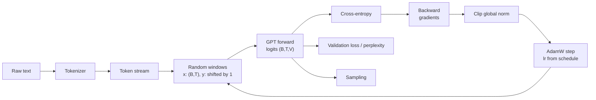

## Where this fits

You already know the pieces: a tokenizer turns text into integers ([[llm.01]]), a decoder-only model predicts the next token ([[llm.02]]), attention and the transformer block are the building material ([[trf.01]], [[trf.02]], [[trf.03]], [[trf.04]]), optimisers and schedules are the engine ([[dl.01]]), and PyTorch is the tool ([[dl.04]]). [[llm.03]] told you what a run costs on paper. This lesson closes the gap that is left: **you actually run it**. Every frontier model, from a 20-million-parameter toy to a trillion-parameter system, is trained by the same loop you will write here; what changes is scale, parallelism and data.

By the end you will have trained a real (small) GPT on CPU in under a minute, watched the loss drop below the best possible model that ignores context, and sampled text from it. You will also be able to compute, for any configuration, how many parameters it has, how much memory the optimiser needs, how many FLOPs the run costs and roughly how many tokens per second to expect.

## The idea in plain words

Imagine teaching someone to finish sentences. You hand them a long book, cover a random stretch of it, show the words so far and ask for the next word, then reveal the answer. Every mistake nudges their intuition. You do this millions of times with different stretches. That is pre-training.

Practical details decide whether it works:

- **Where to cut.** You pick random windows from the book, and every position in a window is a little exercise ("given these three words, what comes next? given these four, what comes next?"), so one window of $T$ tokens gives $T$ lessons at once.
- **How big a step to take.** At the very start the student knows nothing and their first guesses are wild; a big nudge now would wreck what little they have, so you start with tiny nudges (**warmup**), use big nudges in the middle, and finish with very careful ones (**cosine decay**).
- **Not trusting one freak example.** Occasionally a batch is so surprising that the correction is enormous. **Gradient clipping** says: whatever the size of the shout, you never move more than a fixed distance.
- **Not enough memory for a big batch.** If you cannot fit 512 windows at once, do 8 windows 64 times, add up the corrections and move once (**gradient accumulation**). The result should be exactly the same as the big batch.
- **An honest exam.** Hold some of the book back and quiz the student on it from time to time (**validation loss**). A student who memorised the pages scores perfectly on the pages they have seen and badly on the rest.
- **A yardstick.** A student who only knows how often each letter occurs (no context at all) sets a floor you must clearly beat, otherwise the model has learned nothing about context.



## Setup and notation

- $V$ vocabulary size, $T$ context length (also called block size), $d$ model width, $L$ number of transformer blocks, $h$ attention heads of size $d/h$.
- A **token stream** $s_0,s_1,\dots,s_{S-1}$ of integers in $\{0,\dots,V-1\}$.
- A **window** starting at $a$ gives inputs $x=(s_a,\dots,s_{a+T-1})$ and targets $y=(s_{a+1},\dots,s_{a+T})$. Legal starts are $0\le a\le S-T-1$.
- A **batch** stacks $B$ windows: $x,y\in\mathbb{Z}^{B\times T}$.
- Model output: **logits** $Z\in\mathbb{R}^{B\times T\times V}$; row $Z_{b,t}$ scores every possible token that could follow $x_{b,1..t}$.

Because the model is causal ([[trf.02]]), position $t$ cannot see $x_{t+1}$ even though it is in the same tensor. That is why one forward pass yields $BT$ independent predictions.

## The model, in shapes

A GPT-2 style decoder ([[trf.04]]):

1. Token embedding: table $E\in\mathbb{R}^{V\times d}$; ids $(B,T)\to(B,T,d)$.
2. Learned position embedding: table $P\in\mathbb{R}^{T\times d}$, rows $0..T-1$ added (broadcast over $B$).
3. $L$ pre-norm blocks, each: $x\leftarrow x+\mathrm{Attn}(\mathrm{LN}(x))$, then $x\leftarrow x+\mathrm{MLP}(\mathrm{LN}(x))$. The MLP is $d\to4d\to$ GELU $\to d$. Shapes stay $(B,T,d)$ throughout.
4. Final LayerNorm, then the **LM head** $(B,T,d)\to(B,T,V)$.

Inside attention: $\mathrm{qkv}$ is one linear layer $d\to3d$; split and reshape to $(B,h,T,d/h)$; scores $QK^\top/\sqrt{d/h}$ have shape $(B,h,T,T)$; entries above the diagonal are set to $-\infty$ before the softmax; the result times $V$ is merged back to $(B,T,d)$ and projected by a $d\times d$ layer.

**Weight tying.** The head multiplies by a $d\times V$ matrix, the embedding is a $V\times d$ table. Tying sets the head's weight to be the embedding table itself, so one matrix serves "id to vector" and "vector to scores". It saves $Vd$ parameters (about 38.6 million for GPT-2 small) and, as the book notes, GPT-2's original release used it; the book's untied implementation has 163 million parameters instead of 124 million.

### Counting parameters

Per block (with biases, GPT-2 style): attention $\mathrm{qkv}$ is $3d^2+3d$, output projection $d^2+d$, MLP $8d^2+5d$ ($d\cdot4d+4d+4d\cdot d+d$), two LayerNorms $2\cdot2d=4d$. Sum: $12d^2+13d$. Adding the tables and the final LayerNorm:

$$
N = Vd + Td + L\,(12d^2+13d) + 2d \quad(\text{tied head}),\qquad N_{\text{untied}} = N + Vd .
$$

For GPT-2 small ($V=50257$, $T=1024$, $d=768$, $L=12$): $38{,}597{,}376+786{,}432+12\cdot7{,}087{,}872+1{,}536=124{,}439{,}808$. The repo lesson's table quotes 124,438,272; the difference of 1,536 is the final LayerNorm, and its per-block figure also leaves out the attention and MLP biases, so treat the tied total as 124,439,808 (the figure you can reproduce by `sum(p.numel() ...)`). Our toy model ($V=24$, $T=32$, $d=64$, $L=2$) has $1{,}536+2{,}048+2\cdot49{,}984+128=103{,}680$ parameters, and the exercise asserts that PyTorch agrees.

## The loss

For one position with logits $z\in\mathbb{R}^V$ and true next token $y$, the model's probability is $p=\mathrm{softmax}(z)$ and the loss is

$$
\ell = -\log p_y = \log\sum_j e^{z_j} - z_y .
$$

The training loss is the mean of $\ell$ over all $B\cdot T$ positions. Its gradient with respect to the logits has a famously simple form. Differentiate the log-sum-exp: $\partial \log\sum_j e^{z_j}/\partial z_k = p_k$, and $\partial z_y/\partial z_k=[k=y]$, so

$$
\frac{\partial \ell}{\partial z_k} = p_k - [k=y] .
$$

"Predicted probability minus the one-hot truth": the model is pushed to raise the logit of the right token and lower the others in proportion to their probability. For numerical stability, subtract $\max_j z_j$ before exponentiating (this does not change $\ell$).

**Perplexity** is $\exp(\ell)$, the effective number of equally likely tokens the model is torn between ([[llm.03]], the book's Sec. 5.1.2). A model that guesses uniformly has loss $\ln V$ and perplexity $V$. This gives a free **sanity check**: a freshly initialised model must start at about $\ln V$. If it does not, something is wrong with targets, masking or initialisation (initialisation $N(0,0.02)$ keeps logits tiny, so the softmax is nearly uniform).

## The optimiser, schedule and clipping

**AdamW** ([[dl.01]]) keeps two running averages per parameter (first and second moments) and decouples weight decay from the gradient step. LLM recipes typically use $\beta_1=0.9$, $\beta_2$ near 0.95 (rather than the default 0.999, which reacts too slowly to the loss landscape of a large run), and weight decay around 0.1 applied to weight matrices. The book's chapter 5 warns that the optimiser state must be saved with the checkpoint, because it holds extra values for every weight; that is the memory bill we compute below.

**Warmup then cosine decay.** With warmup length $w$, total steps $S_{\text{tot}}$, peak $\eta_{\max}$ and floor $\eta_{\min}$:

$$
\eta(t)=\begin{cases}\eta_{\max}\,\dfrac{t+1}{w}, & t<w\\[2mm] \eta_{\min}+\tfrac12(\eta_{\max}-\eta_{\min})\Bigl(1+\cos\bigl(\pi\,\tfrac{t-w}{S_{\text{tot}}-w}\bigr)\Bigr), & t\ge w .\end{cases}
$$

Check the cosine: at $t=w$ the angle is 0 so $\cos=1$ and $\eta=\eta_{\max}$; halfway the angle is $\pi/2$, $\cos=0$ and $\eta$ is the average of the two limits; at $t=S_{\text{tot}}$ the angle is $\pi$, $\cos=-1$ and $\eta=\eta_{\min}$. Warmup matters because early gradients are noisy and Adam's second-moment estimate has seen few samples.

**Gradient clipping by global norm.** Stack every parameter's gradient into one vector $g$ with norm $\|g\|_2=\sqrt{\sum_i\|g_i\|^2}$. If $\|g\|_2>c$, rescale $g\leftarrow g\cdot c/\|g\|_2$, otherwise leave it. The *direction* is preserved and only the length is capped, so one pathological batch cannot throw the weights far away. Always clip the **global** norm; clipping each tensor separately changes the direction. The norm printed before clipping is a useful health signal: it should settle down, and a sudden spike often precedes a loss spike.

**Gradient accumulation.** Let the full batch have $N$ examples and the gradient of the mean loss be $g=\frac1N\sum_{i=1}^N g_i$. Split into chunks $C_k$ of sizes $n_k$ with $\sum n_k=N$. Each chunk's own mean gradient is $\bar g_k=\frac1{n_k}\sum_{i\in C_k}g_i$, so

$$
g=\sum_k\frac{n_k}{N}\,\bar g_k .
$$

If all chunks have equal size this is the plain average of $\bar g_k$; with an uneven last chunk you must weight by $n_k/N$. In PyTorch one divides each micro-batch loss by the number of accumulation steps and calls `backward()` repeatedly before one `step()`. One caveat: this equivalence is exact for the loss itself, but layers that mix examples inside a batch (batch normalisation) break it; LayerNorm-based GPTs are fine.

## Evaluating: loss, perplexity and the baseline

Hold out the tail of the stream (split by position or, for a real corpus, by *document* as in [[llm.03]]) and every so often compute the mean loss over a fixed number of validation windows with the model in evaluation mode and no gradients. Report it in nats and as perplexity.

Two reference numbers frame the result:

- **Uniform guess:** loss $\ln V$. 
- **Unigram model:** predict from character (or token) frequencies alone, ignoring context. Its cross-entropy is the entropy of the symbol distribution. A language model that has not clearly beaten it has not learned to use context.

Beyond these, the best attainable loss is the true conditional entropy of the data, which for natural text is unknown and not zero. In our synthetic corpus it can be estimated, which makes the toy a useful teaching case.

## Worked example: the tiny run

The exercise generates text from a small grammar ("the {adjective} {noun} {verb} the {adjective} {noun}."), 54,128 characters, $V=24$ characters, with the last 10% held out. Model: $T=32$, $d=64$, $L=2$, $h=4$, 103,680 parameters. Training: 300 steps, batch 32 windows, AdamW(0.9, 0.95, weight decay 0.1), peak learning rate $3\times10^{-3}$, floor $3\times10^{-4}$, 30 warmup steps, clip 1.0. All numbers below are printed by the exercise code (seeded, CPU):

| quantity | value |
|---|---|
| uniform guess $\ln V$ | 3.178 nats (perplexity 24) |
| validation loss at initialisation | 3.199 |
| unigram baseline on validation | 2.780 nats (perplexity 16.1) |
| training loss at steps 0, 50, 100, 150, 200, 250 | 3.199, 1.025, 0.512, 0.355, 0.328, 0.303 |
| validation loss after 300 steps | 0.308 (perplexity 1.36) |
| rough entropy floor of the grammar | about 0.23 nats per character (my estimate, treating sentences as independent: 8.19 nats of choices per sentence over 36.1 characters) |
| learning rate at steps 0, 9, 29, 30, 165, 300 | 1e-4, 1e-3, 3e-3, 3e-3, 1.65e-3, 3e-4 |

Reading it: the loss starts at the uniform value, drops steeply as the model learns spelling and punctuation, and then flattens near the floor. The model beats the context-free baseline by 2.5 nats, which means that it has learned which character follows which prefix. A sample after the run looks like `the red tree finds the red river.` / `the bright child ...`, with the occasional broken word ("fivears") because temperature 0.8 and top-5 sampling still allow rare errors.

The cost arithmetic for this run: tokens seen $D=300\cdot32\cdot32=307{,}200$, so training FLOPs $\approx6ND=6\cdot103{,}680\cdot307{,}200\approx1.9\times10^{11}$. At about 20 seconds that is roughly $10^{10}$ FLOPs per second on a CPU, hence around $1.5\times10^{4}$ tokens per second (hardware dependent; treat as order of magnitude). Parameter plus gradient plus two Adam moments, in float32, is $16$ bytes each: about 1.7 MB.

### The same arithmetic at GPT-2 small scale

- Parameters: 124,439,808.
- Training memory before activations: weights 4 B + gradients 4 B + Adam $m$ 4 B + Adam $v$ 4 B $=16$ B per parameter, so $\approx1.99$ GB. Activations come on top and grow with batch size, context and depth; recomputation (gradient checkpointing) trades compute for activation memory.
- FLOPs per token $\approx6N\approx7.5\times10^8$ (plus attention terms that grow with $T$).
- Tokens per second $\approx$ (sustained FLOP/s) / ($6N$). A sustained $10^{14}$ FLOP/s gives roughly $1.3\times10^5$ tokens/s. Real utilisation is often only 30-50% of a GPU's peak, so state the sustained number you measured, not the datasheet.
- A run on $D=3\times10^{11}$ tokens needs $6ND\approx2.2\times10^{20}$ FLOPs. That is hours-to-days of a multi-GPU node, which is why people train GPT-2 small as a reproduction exercise but not on a laptop.
- Tokens per optimiser step $=B\cdot T\cdot(\text{accumulation steps})\cdot(\text{data-parallel replicas})$. For example $B=8$, $T=1024$, 8 accumulation steps and 8 GPUs gives 524,288 tokens per step (a size in the range frontier recipes use).

## Implementation

The core of the loop (the full model and tests are in the exercises):

```python
for step in range(steps):
    for g in opt.param_groups:
        g["lr"] = lr_at(step, max_lr, min_lr, warmup, steps)   # schedule
    x, y = get_batch(train_data, B, T, gen)                    # (B,T) ints, y shifted by 1
    logits = model(x)                                          # (B,T,V)
    loss = F.cross_entropy(logits.reshape(-1, V), y.reshape(-1))
    opt.zero_grad(set_to_none=True)
    loss.backward()
    gnorm = torch.nn.utils.clip_grad_norm_(model.parameters(), clip)  # norm BEFORE clipping
    opt.step()
```

With gradient accumulation you would divide each loss by `accum`, call `backward()` `accum` times, then clip and step once. Things the production stack adds: mixed precision (bfloat16 activations, float32 master weights), fused attention kernels, data-parallel or sharded optimisers (FSDP/ZeRO), checkpoint/resume with optimiser state, and periodic evaluation on several held-out sets.

## Sampling

After training, generation is the loop of [[llm.02]]: take the last position's logits, divide by temperature, optionally keep only the top-$k$ (or smallest set with cumulative probability $p$), softmax, sample one token, append, crop the context to the last $T$ tokens and repeat. Temperature below 1 sharpens the distribution (safer, more repetitive), above 1 flattens it. Sampling is only a *view* of the model: validation loss measures it more reliably.

## Common misconceptions

- "Lower training loss means a better model." Only the held-out loss tells you about generalisation; with tiny or repeated data the training loss can fall to near zero by memorisation.
- "Loss must be compared across vocabularies." A character-level loss of 0.3 nats and a BPE-token loss of 2.0 nats are not comparable; convert to bits per character or compare with the same tokenizer.
- "Clipping fixes a bad learning rate." It limits damage from rare outliers; a learning rate that is too high for the median batch still diverges.
- "Gradient accumulation changes the optimisation." With correct weighting it computes the same gradient as the large batch; it changes only speed and memory.
- "Weight tying is an approximation that hurts." It is a regulariser that usually helps small models and costs nothing; it is a design choice, not a bug.
- "The first loss can be anything." It should be near $\ln V$; checking this takes seconds and catches many bugs (shifted targets, wrong shapes, missing mask).
- "Perplexity 1.36 means the model is almost perfect." On this grammar the floor is not 1; and perplexity is relative to the tokenizer and the data.

## Key takeaways

- A pre-training step is: sample windows, forward, mean cross-entropy over $B\cdot T$ positions, backward, clip the global norm, AdamW step with the scheduled learning rate.
- Start-of-training loss $\approx\ln V$; beat the unigram baseline clearly before believing the model uses context.
- Parameters: $Vd+Td+L(12d^2+13d)+2d$ (tied); fp32 AdamW training needs 16 bytes per parameter before activations; compute $\approx6ND$ FLOPs.
- Accumulation is exact when chunks are weighted by their size; clipping must use the global norm.
- Report validation loss and perplexity on held-out data, with the tokenizer stated.

## Explain it yourself

1. A colleague reports "the model's first loss was 11.0 with a 50,257-token vocabulary". What does that tell you, and what would worry you if it had been 1.5 or 25?
2. You must train with an effective batch of 512 sequences but only 64 fit in memory. Describe exactly what you change in the loop, what you divide by, and why the last uneven chunk needs care.

## Further reading

- Raschka, *Build a Large Language Model From Scratch*, chapters 4-5 and Appendix D (warmup, cosine decay, clipping).
- Radford et al. (2019), *Language Models are Unsupervised Multitask Learners* (GPT-2); Loshchilov and Hutter (2019), *Decoupled Weight Decay Regularization* (AdamW); Hoffmann et al. (2022), *Training Compute-Optimal Large Language Models*.
- [[llm.03]] for the scaling and data-pipeline context, and [[llm.08]] for what goes into the corpus.

## Mastery criteria

- Write a next-token batch sampler and prove with a test that targets are the inputs shifted by one and stay inside the stream.
- Implement stable cross-entropy and perplexity, and state the expected initial loss.
- Implement warmup plus cosine decay and give its value at the warmup end, the midpoint and the end.
- Show that gradient accumulation equals the full-batch gradient, including an uneven last chunk, and implement global-norm clipping.
- Compute parameters, optimiser memory and 6ND FLOPs for a given configuration and match 124,439,808 for GPT-2 small.
- Train a tiny GPT, show its validation loss beating the unigram baseline, and sample from it.
