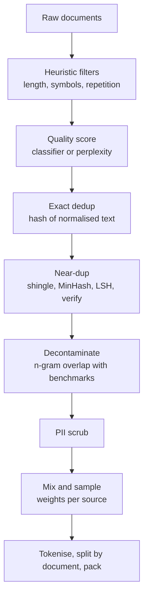

## Où cela s'insère

[[llm.03]] a montré la forme d'un pipeline de pré-entraînement : nettoyer, dédupliquer, découper par document, empaqueter, entraîner. [[llm.07]] a montré ce que fait l'entraîneur du résultat. Cette leçon ouvre la première boîte. Un modèle de langage est un miroir de son corpus : si un cinquième des pages web sont du texte standard quasi identique, il apprendra ce texte standard ; si le jeu de test est dans le corpus, son score de benchmark mentira. La leçon d'évaluation ([[sys.04]]) avertissait que les scores peuvent tromper et la leçon sur les données ([[ops.02]]) couvrait l'ingénierie des données générique ; ici, les mêmes inquiétudes deviennent des algorithmes que tu peux exécuter sur du texte.

Tu vas implémenter chaque couche en NumPy et en Python standard, mesurer l'efficacité du détecteur de quasi-doublons et voir précisément comment un contrôle de contamination naïf produit des faux positifs.

## L'idée en mots simples

Imagine que tu doives constituer une bibliothèque pour un étudiant à partir de dix millions de pages photocopiées trouvées dans la rue.

- D'abord tu jettes les déchets évidents : les pages de trois mots, les pages de symboles aléatoires, les pages où une ligne est répétée cinquante fois. Une règle bon marché et une règle de comptage font cela (**filtres heuristiques**).
- Certains déchets passent la règle. Les pages qui bourrent « achetez pas cher cliquez maintenant » ont des lettres d'apparence normale. Une personne les repérerait à leur vocabulaire, donc tu laisses un petit assistant apprendre à partir de quelques milliers d'exemples étiquetés de bonnes et de mauvaises pages et noter le reste (**classifieur de qualité**).
- Beaucoup de pages sont des copies. Certaines sont des photocopies parfaites ; d'autres ont un en-tête différent ou un paragraphe modifié. Les garder toutes signifie que l'étudiant lit le même texte des dizaines de fois et se met à le réciter. Pour trouver les copies parmi des millions sans comparer chaque paire, tu donnes à chaque page une courte empreinte construite de sorte que des pages similaires aient des empreintes similaires, et tu ne compares que les pages dont les empreintes entrent en collision (**MinHash et LSH**).
- L'étudiant sera interrogé sur un ensemble connu de questions. Toute question d'examen, ou toute copie proche, présente dans la bibliothèque doit en être retirée avant l'examen (**décontamination**), sinon l'examen ne prouve rien.
- Tu décides quelle part de chaque rayon de la bibliothèque lire (**mélange**), et tu barres les numéros de téléphone et les adresses e-mail (**suppression des PII**).
- Enfin, certaines pages ne sont pas à toi pour être copiées. Aucun algorithme ne décide cela à ta place (**licence et consentement**).



L'ordre est un choix de conception : les étapes bon marché à fort rappel d'abord, pour que les étapes coûteuses voient moins de données ; la suppression des PII et la décontamination s'appliquent généralement à ce qui survit. La décontamination doit s'exécuter sur le texte final, après toute réécriture.

## Couche 1 : filtres heuristiques

Calcule des statistiques simples par document et élimine les documents hors des plages que tu fixes en regardant des exemples (la note du pipeline du dépôt recommande de lire 20 documents aléatoires acceptés, 20 rejetés et 20 paires de doublons signalées à chaque étape, pour calibrer les seuils) :

- **Longueur** : nombre de mots, trop court (rien à apprendre) ou absurdement long.
- **Longueur moyenne des mots** : des valeurs très petites ou très grandes indiquent du non-texte (listes de tokens, URL concaténées).
- **Fraction alphabétique** : part des caractères qui sont des lettres ; de faibles valeurs signalent des tableaux, des dumps de code ou du bruit.
- **Fraction de symboles** : part de `#{}[]<>|^~@$%&*=_` ; balisage et texte standard.
- **Répétition** : $1-\frac{\#\text{unique word trigrams}}{\#\text{word trigrams}}$ ; un texte qui boucle obtient un score élevé. Des variantes comptent les lignes répétées et les paragraphes répétés.

Forces : transparents et rapides. Faiblesses : chaque seuil est une estimation, et les règles éliminent du contenu légitime (la poésie a des taux de symboles étranges ; les textes juridiques sont répétitifs ; le code a une faible fraction alphabétique et exige ses propres règles). Le spam bourré de mots-clés comme « buy buy buy cheap cheap click here » passe tout ce qui précède, ce qui motive la couche suivante.

## Couche 2 : notation de la qualité par un modèle

Deux idées courantes :

1. **Filtrage par perplexité.** Entraîne un petit modèle de langage sur un texte de confiance (une encyclopédie, par exemple) et note chaque document par sa perplexité ([[llm.02]], [[llm.07]]). Une perplexité élevée signifie un texte dissemblable du texte de confiance ; une perplexité très basse peut signifier du texte standard. La leçon du dépôt décrit cela comme le filtre de type RefinedWeb. La réserve est que « ressembler à la référence » est aussi un biais : tu apprends au modèle que seul le texte du style de la référence est bon.
2. **Un classifieur de qualité supervisé.** Étiquette des documents comme bons ou mauvais (par exemple, des documents liés depuis des sources sélectionnées contre des pages aléatoires du crawl) et entraîne un classifieur à noter le reste. Puis conserve les documents au-dessus d'un seuil, ou échantillonne-les avec une probabilité croissante avec le score.

Nous implémentons le second avec le modèle le plus simple possible, une régression logistique sur des caractéristiques de **sac de mots**. Soit un vocabulaire de $m$ mots et soit $x\in\{0,1\}^m$ qui enregistre quels mots apparaissent dans un document. Le modèle est

$$
p(\text{good}\mid x)=\sigma(w^\top x+b),\qquad \sigma(z)=\frac1{1+e^{-z}} .
$$

Avec des étiquettes $y\in\{0,1\}$, $N$ documents d'entraînement et un poids L2 $\lambda$, la perte et ses gradients (dérivation : $\partial\sigma/\partial z=\sigma(1-\sigma)$ fait s'effondrer le gradient de l'entropie croisée en prédiction moins étiquette) sont

$$
\mathcal L=-\frac1N\sum_i\bigl[y_i\log p_i+(1-y_i)\log(1-p_i)\bigr]+\frac\lambda2\|w\|^2,
$$

$$
\nabla_w\mathcal L=\frac1N X^\top(p-y)+\lambda w,\qquad \frac{\partial\mathcal L}{\partial b}=\frac1N\sum_i(p_i-y_i).
$$

Formes : $X\in\mathbb{R}^{N\times m}$, $w\in\mathbb{R}^m$, $p,y\in\mathbb{R}^N$. Les poids sont lisibles : les mots les plus négatifs forment le vocabulaire du spam. Cette interprétabilité est une raison pour laquelle les classifieurs linéaires simples sont attrayants pour cette tâche (je n'ai pas vérifié, dans les sources que j'ai ouvertes, quels systèmes en utilisent à l'échelle du web).

Dans les données synthétiques de l'exercice (documents de 25 mots, un vocabulaire partagé de mots grammaticaux et de mots neutres, plus 88 mots de la classe bonne et 68 mots de la classe spam, 600 documents, 226 mots de vocabulaire, 400 pour l'entraînement, 200 mis de côté) le classifieur entraîné atteint une exactitude de 1.0 sur les données mises de côté et une perte d'entraînement de 0.044, et les poids les plus négatifs sont tous des mots de spam (`deal21`, `deal5`, ...). Les données réelles sont bien plus difficiles : l'étiquette elle-même est un jugement (« valeur éducative », « bien écrit ») et le classifieur en hérite les biais.

**Limites.** Un score de qualité encode la définition de la qualité de quelqu'un. Filtrer par « ressemble à Wikipédia » élimine les dialectes, les registres informels et les textes en langues minoritaires qui se trouvent avoir un aspect différent. Mesure ce que tu as retiré par tranche (par exemple par langue ou par source) avant de faire confiance à un filtre.

## Couche 3 : détection des doublons exacts et des quasi-doublons

Pourquoi dédupliquer ? Un texte répété est appris de façon répétée, ce qui gaspille du calcul ; il augmente le risque de mémorisation mot pour mot ; et lorsqu'il franchit la frontière entre entraînement et validation, il gonfle les scores de validation. La leçon du dépôt cite la suppression rapportée par Llama d'environ 38 % de ses données web et dit que les dumps typiques de Common Crawl contiennent 30 à 40 % de doublons ; considère ces chiffres comme rapportés, pas comme des constantes.

### Doublons exacts

Normalise (minuscules, espaces réduits), hache, garde la première occurrence de chaque hachage. Le coût est linéaire. Cela rate tout ce qui diffère d'un seul caractère, comme une publicité changée autour d'un article.

### Quasi-doublons : le shingling

Représente un document par son ensemble de **$k$-shingles de mots** (toutes les suites de $k$ mots consécutifs). Pour « the quick brown fox » et $k=3$ l'ensemble est {"the quick brown", "quick brown fox"}. La similarité de deux ensembles de shingles $A,B$ est l'**indice de Jaccard**

$$
J(A,B)=\frac{|A\cap B|}{|A\cup B|}\in[0,1] .
$$

Attention à l'amplification : modifier un mot change jusqu'à $k$ shingles. Dans le corpus de l'exercice (documents de 120 mots, $k=5$), remplacer 2 %, 5 % et 10 % des mots donne des similarités de Jaccard d'environ 0.84, 0.62 et 0.39 avec l'original. Ainsi « 10 % des mots changés » est déjà une correspondance faible avec des 5-shingles ; choisis $k$ et le seuil ensemble.

### MinHash : une courte empreinte qui préserve Jaccard

Calculer $J$ pour toutes les paires de $D$ documents coûte $O(D^2)$ intersections d'ensembles : impossible à l'échelle du web. MinHash compresse chaque ensemble en une signature de $n$ nombres telle que la fraction de positions concordantes estime $J$.

Choisis une fonction de hachage aléatoire $h$ qui associe un nombre à chaque shingle. Définis $m_h(A)=\min_{s\in A}h(s)$. Considère l'union $A\cup B$ : le shingle de plus petite valeur $h$ dans l'union est également susceptible d'être n'importe lequel de ses éléments. Les minima de $A$ et $B$ coïncident exactement lorsque ce minimiseur global se trouve dans $A\cap B$. Donc

$$
\Pr\bigl[m_h(A)=m_h(B)\bigr]=\frac{|A\cap B|}{|A\cup B|}=J(A,B) .
$$

Avec $n$ fonctions de hachage indépendantes, la fraction de positions égales est une estimation non biaisée de $J$ d'écart type $\sqrt{J(1-J)/n}$ (au plus $0.5/\sqrt n\approx0.044$ pour $n=128$). Dans le code, le shingle est d'abord converti en entier avec CRC32 puis passé dans $n$ hachages universels $h_i(x)=(a_ix+b_i)\bmod P$ avec $P=2^{31}-1$ ; la signature est le vecteur des minima. Notre exercice mesure une erreur absolue moyenne de 0.025 entre $J$ estimé et vrai pour les paires avec $J\ge0.5$.

### Le banding LSH : éviter toutes les paires

Découpe la signature de longueur $n$ en $b$ bandes de $r$ lignes ($n=br$). Place chaque document dans un seau par bande, indexé par les $r$ valeurs ; deux documents deviennent **candidats** s'ils partagent un seau dans au moins une bande. Pour des documents de similarité $s$, une bande correspond avec la probabilité $s^r$ (les $r$ minima concordent tous), donc

$$
\Pr[\text{candidate}]=1-(1-s^r)^b .
$$

Cette courbe en S a sa partie abrupte près de $s^*\approx(1/b)^{1/r}$. Pour $b=16,r=8$ ($s^*\approx0.71$) :

| $s$ | 16x8 | 32x4 | 8x16 |
|---|---|---|---|
| 0.5 | 0.061 | 0.873 | 0.000 |
| 0.7 | 0.613 | 1.000 | 0.026 |
| 0.8 | 0.947 | 1.000 | 0.204 |
| 0.9 | 1.000 | 1.000 | 0.806 |

Plus de bandes plus courtes abaissent le seuil (plus de candidats, dont plus de faux) ; moins de bandes plus longues le relèvent (moins de candidats, paires manquées). Après LSH, on **vérifie** chaque candidat avec le Jaccard exact des ensembles de shingles et on garde les paires au-dessus du seuil ; cela transforme les faux candidats en non-événements.

### Rappel et précision mesurés

Sur le corpus de l'exercice (260 documents : 40 documents de base, chacun avec quatre variantes, plus 60 sans lien ; les vrais quasi-doublons sont les paires de $J\ge0.8$ exact, 128 hachages) les ensembles de candidats se comparent ainsi (le test les affiche) :

| disposition | candidats | rappel à $J\ge0.8$ | précision des candidats à $J\ge0.8$ |
|---|---|---|---|
| 16 bandes x 8 lignes | 149 | 1.000 | 0.805 |
| 32 bandes x 4 lignes | 312 | 1.000 | 0.385 |
| 8 bandes x 16 lignes | 84 | 0.700 | 1.000 |

Lecture du tableau : la disposition 16x8 trouve toutes les vraies paires tandis que 19.5 % de ses candidats sont des paires avec $0.5\lesssim J<0.8$, que la vérification exacte écarte (la précision de l'ensemble vérifié est de 1.0 par construction). 32x4 trouve aussi tout mais gaspille du travail sur de faux candidats. 8x16 est bon marché et précis mais rate 30 % des paires. Les systèmes réels règlent $(b,r)$ pour atteindre un seuil cible au rappel requis. Une fois les doublons trouvés, ils sont regroupés en clusters (composantes connexes du graphe « est un quasi-doublon de ») et un représentant par cluster est conservé.

## Couche 4 : décontamination des benchmarks

Un benchmark est un ensemble de questions aux réponses connues. Si le corpus d'entraînement contient ces questions (copies sur des forums, des sites d'étude, GitHub, ou le dépôt du benchmark lui-même), le modèle peut les avoir mémorisées, et le score mesure le rappel au lieu de la capacité ([[sys.04]] ; la leçon d'évaluation du dépôt cite la contamination, l'entraînement pour le test et la saturation comme les trois façons dont les benchmarks cessent de signifier ce qu'ils prétendent). La décontamination retire des données d'entraînement tout ce qui recoupe les jeux d'évaluation. De façon équivalente, on peut marquer des éléments du benchmark comme contaminés et rapporter les scores sur le sous-ensemble propre.

**Recouvrement de n-grammes.** Construis l'ensemble $G_{\text{train}}$ des $n$-grammes de mots du corpus d'entraînement. Pour un élément de benchmark d'ensemble de n-grammes $G_{\text{item}}$ définis

$$
\text{score}(\text{item})=\frac{|G_{\text{item}}\cap G_{\text{train}}|}{|G_{\text{item}}|},
$$

et signale l'élément lorsque $\text{score}\ge\tau$. Les choix typiques de $n$ dans la littérature se situent autour de 8 à 13 mots (je m'en souviens par connaissance générale plutôt que par les sources que j'ai ouvertes), assez longs pour que partager l'un d'eux ne soit pas un accident de phrases courantes.

Les compromis, mesurés dans l'exercice (300 documents d'entraînement, 40 éléments de chaque type, $n=8$ sauf indication) :

| règle | fuites mot pour mot signalées | paraphrasés (20 % des mots changés) | propres | partagent seulement une phrase standard |
|---|---|---|---|---|
| un 8-gramme quelconque correspond ($\tau\to0$) | 1.00 | 0.88 | 0.00 | **1.00** |
| 8-gramme, recouvrement $\ge0.5$ | 1.00 | 0.00 | 0.00 | 0.00 |
| 4-gramme, recouvrement $\ge0.5$ | 1.00 | 0.10 | 0.00 | 0.00 |

Deux modes d'échec apparaissent d'un coup.

- **Faux positifs.** Les questions à choix multiples commencent par la même phrase toute faite (« which of the following statements is true about the ... »). La règle « un n-gramme quelconque correspond » signale tous ces éléments alors que les questions sont différentes. Exiger qu'une fraction des n-grammes de l'élément corresponde les élimine.
- **Faux négatifs.** Changer un mot sur cinq détruit presque tous les 8-grammes ; à $\tau=0.5$ les paraphrases ne sont pas détectées du tout, et la règle « une correspondance quelconque » ne les attrape que par des fragments accidentels. Des n-grammes plus courts en récupèrent une partie (0.10 pour $n=4$) mais augmentent aussi les faux positifs. La vraie contamination peut être traduite, reformatée (options réordonnées) ou paraphrasée ; le recouvrement de n-grammes ne la voit pas. La similarité d'embeddings ou des contrôles à base de modèle en trouvent davantage, au prix de plus de fausses alertes et de coût.

Énonce ta règle quand tu publies un chiffre : « scores sur le sous-ensemble sans recouvrement de 13-grammes » est une affirmation que quelqu'un peut vérifier.

**Ne décontamine pas dans le mauvais sens.** Retirer les documents de benchmark de l'entraînement protège le benchmark, mais la découpe de validation d'un modèle doit aussi être décontaminée de l'entraînement, sinon tu mesures la mémorisation (le problème de fuite des leçons de ML classique). Déduplique avant de séparer entraînement et validation, par document.

## Mélanges et curricula

Un **mélange** attribue à chaque source $i$ (web, code, livres, maths, multilingue) un poids d'échantillonnage $w_i$. La leçon du dépôt cite un mélange Llama 3 divulgué d'environ 50 % de web, 25 % de code, 13 % de livres et articles académiques, 8 % de maths et 4 % de multilingue, et insiste sur le fait qu'il n'existe aucune formule : le ratio se trouve par l'expérience et l'évaluation.

Un réglage courant est l'**échantillonnage par température** : avec $n_i$ tokens disponibles dans la source $i$, échantillonne avec

$$
w_i=\frac{n_i^{\alpha}}{\sum_j n_j^{\alpha}},\qquad 0\le\alpha\le1 .
$$

Pour trois sources de 1000, 100 et 10 tokens : $\alpha=1$ donne les poids 0.901, 0.090, 0.009 (proportions naturelles) ; $\alpha=0.5$ donne 0.706, 0.223, 0.071 ; $\alpha=0$ donne un tiers chacune. Si tu tires ensuite un budget de 1000 tokens, la plus petite source est vue $0.33\times$ à $\alpha=1$, $7.06\times$ à $\alpha=0.5$ et $33\times$ à $\alpha=0$. Sur-pondérer une petite source de haute qualité signifie la répéter, et les données répétées sont exactement ce que la déduplication cherchait à retirer, donc le nombre d'epochs sur une source est une quantité à surveiller.

Un **curriculum** ordonne les données dans le temps au lieu de les mélanger uniformément, par exemple en terminant l'entraînement avec une part plus élevée de données de haute qualité ou spécifiques à un domaine pendant que le taux d'apprentissage décroît. Que cela aide, et de combien, dépend de la recette, et j'énonce l'idée sans source que j'aie ouverte ; considère tout gain annoncé comme quelque chose à tester sur une exécution proxy réduite ([[llm.07]]) plutôt qu'à supposer.

## Bases de la suppression des PII

Le texte du web contient des adresses e-mail, des numéros de téléphone, des adresses IP, des numéros d'identité et des noms. La suppression repose sur deux techniques :

1. **La recherche de motifs** pour les éléments structurés. Nous implémentons des expressions régulières pour l'e-mail, les numéros de téléphone (avec ou sans indicatif de pays et parenthèses) et l'IPv4 (quatre octets de 0 à 255, avec des look-arounds pour que `1.2.3.4.5`, une chaîne de version, et `999.1.1.1` ne correspondent pas), en remplaçant chaque occurrence par un marqueur tel que `<EMAIL>`. La phrase de l'exercice « Contact jane.doe@example.org or call (555) 123-4567 / 555-987-6543 from 192.168.1.20. Version 1.2.3.4.5 released 2024-05-01 costs 3.14. » devient « Contact `<EMAIL>` or call `<PHONE>` / `<PHONE>` from `<IP>`. Version 1.2.3.4.5 released 2024-05-01 costs 3.14. »
2. **La reconnaissance d'entités nommées** pour les noms et adresses dans le texte courant, qui est un modèle avec ses propres erreurs.

Sois honnête sur les limites : les regex ratent les formats auxquels tu n'as pas pensé et peuvent correspondre à des nombres innocents ; la suppression réduit le risque mais ne l'élimine pas, et certains usages (par exemple la biographie d'une personnalité publique) sont légitimes. Qu'un usage donné de données personnelles soit licite dépend de la juridiction et de la finalité.

## Licence, consentement et provenance

Les filtres techniques ne peuvent pas te dire si tu as le droit d'entraîner sur un document. Questions à te poser hors du code : quelle licence ou quelles conditions régissent la source ; le site a-t-il publié un signal robots ou d'opt-out ; les données contiennent-elles des données personnelles de personnes qui n'ont pas consenti ; ta juridiction a-t-elle des règles pour la fouille de textes et de données ou pour les données personnelles ; redistribueras-tu le jeu de données ou seulement un modèle. **Cette leçon n'est pas un conseil juridique** ; les règles diffèrent selon les pays et changent, et les affaires judiciaires sur les données d'entraînement ne sont pas tranchées dans de nombreux endroits. Des habitudes d'ingénierie pratiques qui aident n'importe quel juriste : tenir un **manifeste** des sources avec licence, date de crawl et filtres appliqués ; conserver la provenance au niveau du document pour pouvoir retirer une source qui a fait opt-out ; et versionner le code des filtres et les seuils pour qu'un jeu de données soit reproductible.

## Implémentation (pièces principales)

```python
def shingles(text, k=5):
    w = normalize(text).split(" ")
    return {" ".join(w[i:i + k]) for i in range(len(w) - k + 1)}

def minhash_signature(sh, hashes):                       # hashes = (A, B), arrays of n uint64
    A, B = hashes
    x = np.array([zlib.crc32(s.encode()) % P for s in sh], dtype=np.uint64)
    return ((A[:, None] * x[None, :] + B[:, None]) % np.uint64(P)).min(axis=1)   # (n,)

def contamination_score(item, train_ngrams, n):
    g = ngram_set(item, n)
    return len(g & train_ngrams) / len(g) if g else 0.0
```

Les outils de production font la même chose à grande échelle : MinHash en flux sur des données fragmentées, déduplication exacte de sous-chaînes par suffix array (non couverte ici), classifieurs fastText pour la langue et la qualité, et bibliothèques dédiées aux PII. Les idées sont celles ci-dessus.

## Idées reçues

- « Plus de données, c'est toujours mieux. » Des données répétées, de mauvaise qualité ou contaminées peuvent faire paraître un modèle meilleur alors qu'il est pire.
- « MinHash calcule l'indice de Jaccard. » Il l'estime, avec une erreur qui décroît comme $1/\sqrt n$ ; LSH arbitre ensuite entre rappel et nombre de candidats.
- « Un seuil de 0.8 signifie que 20 % des mots ont changé. » Le shingling amplifie les modifications ; une modification de 10 % des mots donne déjà $J\approx0.39$ pour $k=5$.
- « Tout recouvrement de n-grammes signifie contamination. » Les phrases toutes faites partagées créent des faux positifs ; utilise des fractions de recouvrement, un $n$ plus long et une revue manuelle d'échantillons.
- « Aucun recouvrement signifie aucune contamination. » La paraphrase, la traduction et les options réordonnées échappent à la correspondance de n-grammes.
- « Les filtres de qualité sont neutres. » Ils encodent une définition de la qualité et peuvent éliminer silencieusement des dialectes, des langues ou des sujets.
- « La suppression des PII rend les données sûres. » Elle ne réduit l'exposition que pour les motifs auxquels tu as pensé.
- « La déduplication perd de l'information. » Elle retire la redondance ; l'information est conservée une fois.

## Points clés à retenir

- Ordre : filtres heuristiques bon marché, score de qualité appris, suppression des doublons exacts puis des quasi-doublons, décontamination, suppression des PII, puis mélange.
- Les heuristiques sont rapides et grossières ; une régression logistique sur sac de mots est un évaluateur de qualité transparent, mais ses étiquettes définissent la « qualité ».
- La probabilité de concordance de MinHash égale la similarité de Jaccard ; les candidats LSH apparaissent avec la probabilité $1-(1-s^r)^b$ ; vérifie exactement les candidats.
- Choisis $(b,r)$ pour le seuil de similarité qui t'importe et mesure le rappel et la précision sur des paires étiquetées.
- La décontamination par recouvrement de n-grammes demande une fraction de recouvrement, un $n$ raisonnable et un énoncé honnête de ce qu'elle ne peut pas détecter.
- Les poids du mélange contrôlent l'exposition et les epochs par source ; la température $\alpha$ interpole entre naturel et uniforme.
- Licence et consentement exigent des décisions humaines et juridiques et des enregistrements de provenance ; cette leçon n'est pas un conseil juridique.

## Explique-le toi-même

1. Pourquoi la probabilité que deux minima MinHash concordent est-elle égale à l'indice de Jaccard ? Argumente-le en mots en utilisant l'union des deux ensembles.
2. Ton score de benchmark gagne 6 points après un rafraîchissement des données. Décris les contrôles que tu ferais pour décider si la contamination l'explique, et ce que chaque contrôle peut et ne peut pas exclure.

## Pour aller plus loin

- Broder (1997), sur la ressemblance et l'inclusion de documents (l'origine de MinHash) ; Leskovec, Rajaraman et Ullman, *Mining of Massive Datasets*, chapitre sur la recherche d'éléments similaires (shingling, MinHash, LSH).
- Lee et al. (2022), *Deduplicating Training Data Makes Language Models Better* ; Penedo et al. (2023), l'article RefinedWeb ; Brown et al. (2020), l'article GPT-3 (analyse de contamination).
- [[llm.03]] pour le pipeline environnant, [[ops.02]] pour l'ingénierie des données en général, [[sys.04]] pour l'évaluation.

## Critères de maîtrise

- Calculer des statistiques de mots et décider quelle règle de filtre rejette quel type de mauvais document, et donner un exemple que les règles ne peuvent pas attraper.
- Entraîner et lire un classifieur de qualité logistique sur sac de mots, et dire ce que ses étiquettes y incorporent.
- Implémenter le shingling, MinHash et le banding LSH, et calculer la probabilité de candidat pour un $(s,b,r)$ donné.
- Rapporter le rappel et la précision de la détection de quasi-doublons pour plusieurs dispositions de bandes et en choisir une.
- Implémenter la décontamination par n-grammes avec une fraction de recouvrement et expliquer, chiffres à l'appui, ses faux positifs et faux négatifs.
- Calculer les poids de mélange et les epochs par source pour une température donnée.
- Décrire un manifeste qui supporte les audits de licence, d'opt-out et de PII, et dire clairement que la question juridique est hors de l'algorithme.
