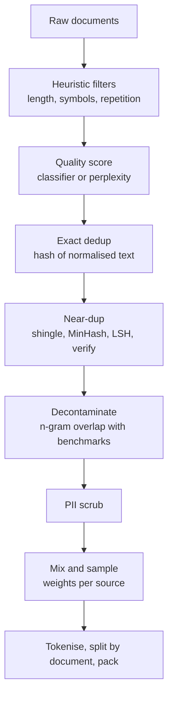

## Where this fits

[[llm.03]] showed the shape of a pre-training pipeline: clean, deduplicate, split by document, pack, train. [[llm.07]] showed what the trainer does with the result. This lesson opens the first box. A language model is a mirror of its corpus: if a fifth of the web pages are near-identical boilerplate it will learn boilerplate; if the test set is inside the corpus its benchmark score will lie. The evaluation lesson ([[sys.04]]) warned that scores can mislead and the data lesson ([[ops.02]]) covered generic data engineering; here the same worries are turned into algorithms you can run on text.

You will implement every layer in NumPy and standard-library Python, measure how well the near-duplicate detector works, and see exactly how a naive contamination check produces false positives.

## The idea in plain words

Imagine you must build a library for a student from ten million photocopied pages found in the street.

- First you throw away the obvious junk: pages that are three words long, pages of random symbols, pages where one line is repeated fifty times. A cheap ruler and a counting rule do this (**heuristic filters**).
- Some junk passes the ruler. Pages that stuff in "buy cheap click now" have normal-looking letters. A person would spot them by their vocabulary, so you let a small assistant learn from a few thousand labelled examples of good and bad pages and score the rest (**quality classifier**).
- Many pages are copies. Some are perfect photocopies; some have a different header or one changed paragraph. Keeping all of them means the student reads the same text dozens of times and starts reciting it. To find copies among millions without comparing every pair, you give each page a short fingerprint built so that similar pages get similar fingerprints, and compare only pages whose fingerprints collide (**MinHash and LSH**).
- The student will be examined on a known set of questions. Any exam question, or a close copy, that is in the library must be removed from it before the exam (**decontamination**), or the exam proves nothing.
- You decide how much of each section of the library to read (**mixture**), and cross out phone numbers and e-mail addresses (**PII scrubbing**).
- Finally, some pages are not yours to copy. No algorithm decides that for you (**licensing and consent**).



The order is a design choice: cheap, high-recall steps first so that expensive steps see less data; PII scrubbing and decontamination are usually applied to whatever survives. Decontamination must run on the final text, after all rewriting.

## Layer 1: heuristic filters

Compute simple statistics per document and drop documents outside ranges that you set by looking at examples (the repo's pipeline note recommends reading 20 random documents that passed, 20 that failed, and 20 flagged duplicate pairs at each stage, to calibrate thresholds):

- **Length**: number of words, too short (nothing to learn) or absurdly long.
- **Mean word length**: very small or very large values indicate non-prose (token lists, concatenated URLs).
- **Alphabetic fraction**: share of characters that are letters; low values mean tables, code dumps or noise.
- **Symbol fraction**: share of `#{}[]<>|^~@$%&*=_`; markup and boilerplate.
- **Repetition**: $1-\frac{\#\text{unique word trigrams}}{\#\text{word trigrams}}$; looped text scores high. Variants count repeated lines and repeated paragraphs.

Strengths: transparent and fast. Weaknesses: every threshold is a guess, and rules drop legitimate content (poetry has odd symbol rates; legal text is repetitive; code has a low alphabetic fraction and needs its own rules). Keyword-stuffed spam such as "buy buy buy cheap cheap click here" passes all of the above, which is the motivation for the next layer.

## Layer 2: model-based quality scoring

Two common ideas:

1. **Perplexity filtering.** Train a small language model on text you trust (an encyclopaedia, for example) and score each document by its perplexity ([[llm.02]], [[llm.07]]). High perplexity means unlike the trusted text; very low perplexity can mean boilerplate. The repo lesson describes this as the RefinedWeb-style filter. The caveat is that "like the reference" is also a bias: you teach the model that only reference-style text is good.
2. **A supervised quality classifier.** Label some documents good and bad (for instance, documents linked from curated sources versus random crawl pages) and train a classifier to score the rest. Then keep documents above a threshold or sample them with probability increasing in the score.

We implement the second with the simplest possible model, logistic regression on **bag-of-words** features. Let the vocabulary have $m$ words and let $x\in\{0,1\}^m$ record which words occur in a document. The model is

$$
p(\text{good}\mid x)=\sigma(w^\top x+b),\qquad \sigma(z)=\frac1{1+e^{-z}} .
$$

With labels $y\in\{0,1\}$, $N$ training documents and L2 weight $\lambda$, the loss and its gradients (derivation: $\partial\sigma/\partial z=\sigma(1-\sigma)$ makes the cross-entropy gradient collapse to prediction minus label) are

$$
\mathcal L=-\frac1N\sum_i\bigl[y_i\log p_i+(1-y_i)\log(1-p_i)\bigr]+\frac\lambda2\|w\|^2,
$$

$$
\nabla_w\mathcal L=\frac1N X^\top(p-y)+\lambda w,\qquad \frac{\partial\mathcal L}{\partial b}=\frac1N\sum_i(p_i-y_i).
$$

Shapes: $X\in\mathbb{R}^{N\times m}$, $w\in\mathbb{R}^m$, $p,y\in\mathbb{R}^N$. The weights are readable: the most negative words are the spam vocabulary. That interpretability is a reason simple linear classifiers are attractive for this job (I did not verify from the sources I opened which systems use them at web scale).

In the exercise's synthetic data (25-word documents, a shared vocabulary of function words and neutral words, plus 88 good-class and 68 spam-class words, 600 documents, 226 vocabulary words, 400 for training, 200 held out) the trained classifier reaches held-out accuracy 1.0 and training loss 0.044, and the most negative weights are all spam words (`deal21`, `deal5`, ...). Real data is far harder: the label itself is a judgement ("educational value", "well written") and the classifier inherits its biases.

**Limits.** A quality score encodes someone's definition of quality. Filtering by "looks like Wikipedia" removes dialects, informal registers and minority-language text that happen to look different. Measure what you removed by slice (for instance by language or source) before trusting a filter.

## Layer 3: exact and near-duplicate detection

Why dedupe at all? Repeated text is trained on repeatedly, wasting compute; it raises the chance of verbatim memorisation; and when it spans the train/validation boundary it inflates validation scores. The repo lesson cites Llama's reported removal of about 38% of its web data and says typical Common Crawl dumps contain 30-40% duplicates; treat those as reported figures, not constants.

### Exact duplicates

Normalise (lowercase, collapse whitespace), hash, keep the first occurrence of each hash. Cost is linear. It misses everything that differs by a single character, such as a changed ad around an article.

### Near-duplicates: shingling

Represent a document by its set of **word $k$-shingles** (all runs of $k$ consecutive words). For "the quick brown fox" and $k=3$ the set is {"the quick brown", "quick brown fox"}. Similarity of two shingle sets $A,B$ is the **Jaccard index**

$$
J(A,B)=\frac{|A\cap B|}{|A\cup B|}\in[0,1] .
$$

Mind the amplification: editing one word changes up to $k$ shingles. In the exercise corpus (120-word documents, $k=5$), replacing 2%, 5% and 10% of the words gives Jaccard similarities of about 0.84, 0.62 and 0.39 with the original. So "10% of the words changed" is already a weak match under 5-shingles; choose $k$ and the threshold together.

### MinHash: a short fingerprint that preserves Jaccard

Computing $J$ for all pairs of $D$ documents costs $O(D^2)$ set intersections: impossible at web scale. MinHash compresses each set into a signature of $n$ numbers such that the fraction of agreeing positions estimates $J$.

Pick a random hash function $h$ that maps each shingle to a number. Define $m_h(A)=\min_{s\in A}h(s)$. Consider the union $A\cup B$: the shingle with the smallest $h$ value in the union is equally likely to be any element of it. The minima of $A$ and $B$ coincide exactly when that overall minimiser lies in $A\cap B$. Therefore

$$
\Pr\bigl[m_h(A)=m_h(B)\bigr]=\frac{|A\cap B|}{|A\cup B|}=J(A,B) .
$$

With $n$ independent hash functions, the fraction of equal positions is an unbiased estimate of $J$ with standard deviation $\sqrt{J(1-J)/n}$ (at most $0.5/\sqrt n\approx0.044$ for $n=128$). In code the shingle is first mapped to an integer with CRC32 and then passed through $n$ universal hashes $h_i(x)=(a_ix+b_i)\bmod P$ with $P=2^{31}-1$; the signature is the vector of minima. Our exercise measures a mean absolute error of 0.025 between estimated and true $J$ for pairs with $J\ge0.5$.

### LSH banding: avoiding all pairs

Split the $n$-length signature into $b$ bands of $r$ rows ($n=br$). Put each document in a bucket per band keyed by the $r$ values; two documents become **candidates** if they share a bucket in at least one band. For documents with similarity $s$, one band matches with probability $s^r$ (all $r$ minima agree), so

$$
\Pr[\text{candidate}]=1-(1-s^r)^b .
$$

This S-shaped curve has its steep part near $s^*\approx(1/b)^{1/r}$. For $b=16,r=8$ ($s^*\approx0.71$):

| $s$ | 16x8 | 32x4 | 8x16 |
|---|---|---|---|
| 0.5 | 0.061 | 0.873 | 0.000 |
| 0.7 | 0.613 | 1.000 | 0.026 |
| 0.8 | 0.947 | 1.000 | 0.204 |
| 0.9 | 1.000 | 1.000 | 0.806 |

More, shorter bands lower the threshold (more candidates, more false ones); fewer, longer bands raise it (fewer candidates, missed pairs). After LSH one **verifies** each candidate with the exact Jaccard of the shingle sets and keeps the pairs above the threshold; that turns the false candidates into non-events.

### Measured recall and precision

On the exercise corpus (260 documents: 40 base documents, each with four variants, plus 60 unrelated; true near-duplicates are pairs with exact $J\ge0.8$, 128 hashes) the candidate sets compare as follows (the test prints these):

| layout | candidates | recall at $J\ge0.8$ | precision of candidates at $J\ge0.8$ |
|---|---|---|---|
| 16 bands x 8 rows | 149 | 1.000 | 0.805 |
| 32 bands x 4 rows | 312 | 1.000 | 0.385 |
| 8 bands x 16 rows | 84 | 0.700 | 1.000 |

Reading the table: the 16x8 layout finds every true pair while 19.5% of its candidates are pairs with $0.5\lesssim J<0.8$, which exact verification discards (precision of the verified set is 1.0 by construction). 32x4 also finds everything but wastes work on false candidates. 8x16 is cheap and precise yet misses 30% of the pairs. Real systems tune $(b,r)$ to hit a target threshold at the required recall. Once duplicates are found, they are grouped into clusters (connected components of the "is a near-duplicate of" graph) and one representative per cluster is kept.

## Layer 4: benchmark decontamination

A benchmark is a set of questions with known answers. If the training corpus contains those questions (copies on forums, study sites, GitHub, or the benchmark's own repository), the model may have memorised them, and the score measures recall instead of capability ([[sys.04]]; the repo's evaluation lesson lists contamination, teaching to the test, and saturation as the three ways benchmarks stop meaning what they claim). Decontamination removes, from the training data, anything that overlaps the evaluation sets. Equivalently one can mark benchmark items as contaminated and report scores on the clean subset.

**N-gram overlap.** Build the set $G_{\text{train}}$ of word $n$-grams of the training corpus. For a benchmark item with n-gram set $G_{\text{item}}$ define

$$
\text{score}(\text{item})=\frac{|G_{\text{item}}\cap G_{\text{train}}|}{|G_{\text{item}}|},
$$

and flag the item when $\text{score}\ge\tau$. Typical choices of $n$ in the literature are around 8 to 13 words (I am recalling this from general knowledge rather than from the sources I opened), long enough that sharing one is not an accident of common phrases.

The trade-offs, measured in the exercise (300 training documents, 40 items of each kind, $n=8$ unless stated):

| rule | verbatim leaks flagged | paraphrased (20% words changed) | clean | share only a boilerplate phrase |
|---|---|---|---|---|
| any 8-gram matches ($\tau\to0$) | 1.00 | 0.88 | 0.00 | **1.00** |
| 8-gram, overlap $\ge0.5$ | 1.00 | 0.00 | 0.00 | 0.00 |
| 4-gram, overlap $\ge0.5$ | 1.00 | 0.10 | 0.00 | 0.00 |

Two failure modes show up at once.

- **False positives.** Multiple-choice questions begin with the same stock phrase ("which of the following statements is true about the ..."). The rule "any matching n-gram" flags every such item although the questions are different. Requiring a fraction of the item's n-grams to match removes them.
- **False negatives.** Changing one word in five destroys almost every 8-gram; at $\tau=0.5$ the paraphrases are not caught at all, and the "any match" rule catches them only through accidental fragments. Shorter n-grams recover some (0.10 at $n=4$) but also raise false positives. Real contamination can be translated, reformatted (options reordered), or paraphrased; n-gram overlap cannot see it. Embedding similarity or model-based checks find more of it, at the price of more false alarms and cost.

State your rule when you publish a number: "scores on the subset with no 13-gram overlap" is a claim someone can check.

**Do not decontaminate the wrong way round.** Removing benchmark documents from training protects the benchmark, but a model's validation split must also be decontaminated from training or you are measuring memorisation (the leakage problem of the classical-ML lessons). Deduplicate before you split into train and validation, by document.

## Mixtures and curricula

A **mixture** assigns each source $i$ (web, code, books, maths, multilingual) a sampling weight $w_i$. The repo lesson quotes a disclosed Llama 3 mix of roughly 50% web, 25% code, 13% books and academic papers, 8% maths and 4% multilingual, and stresses that there is no formula: the ratio is found by experiment and evaluation.

A common knob is **temperature sampling**: with $n_i$ tokens available in source $i$, sample with

$$
w_i=\frac{n_i^{\alpha}}{\sum_j n_j^{\alpha}},\qquad 0\le\alpha\le1 .
$$

For three sources with 1000, 100 and 10 tokens: $\alpha=1$ gives weights 0.901, 0.090, 0.009 (natural proportions); $\alpha=0.5$ gives 0.706, 0.223, 0.071; $\alpha=0$ gives one third each. If you then draw a budget of 1000 tokens, the smallest source is seen $0.33\times$ at $\alpha=1$, $7.06\times$ at $\alpha=0.5$ and $33\times$ at $\alpha=0$. Up-weighting a small high-quality source means repeating it, and repeated data is exactly what deduplication tried to remove, so the number of epochs on a source is a quantity to watch.

A **curriculum** orders the data over time instead of mixing it uniformly, for instance finishing training with a higher share of high-quality or domain-specific data while the learning rate decays. Whether and how much this helps depends on the recipe, and I am stating the idea without a source I opened; treat any claimed gain as something to test on a small proxy run ([[llm.07]]) rather than assume.

## PII scrubbing basics

Web text contains e-mail addresses, phone numbers, IP addresses, ID numbers and names. Scrubbing is two techniques:

1. **Pattern matching** for structured items. We implement regular expressions for e-mail, phone numbers (with or without country code and parentheses) and IPv4 (four octets of 0-255, with look-arounds so that `1.2.3.4.5`, a version string, and `999.1.1.1` are not matched), replacing each hit with a placeholder such as `<EMAIL>`. The exercise sentence "Contact jane.doe@example.org or call (555) 123-4567 / 555-987-6543 from 192.168.1.20. Version 1.2.3.4.5 released 2024-05-01 costs 3.14." becomes "Contact `<EMAIL>` or call `<PHONE>` / `<PHONE>` from `<IP>`. Version 1.2.3.4.5 released 2024-05-01 costs 3.14."
2. **Named-entity recognition** for names and addresses in running text, which is a model with its own errors.

Be honest about limits: regexes miss formats you did not think of and can match innocent numbers; scrubbing reduces risk but does not eliminate it, and some uses (for example a public figure's biography) are legitimate. Whether a given use of personal data is lawful depends on jurisdiction and purpose.

## Licensing, consent and provenance

Technical filters cannot tell you whether you may train on a document. Questions you must ask outside the code: what licence or terms govern the source; did the site publish a robots or opt-out signal; does the data contain personal data of people who did not consent; does your jurisdiction have rules for text and data mining or for personal data; will you redistribute the dataset or only a model. **This lesson is not legal advice**; rules differ by country and change, and court cases about training data are unresolved in many places. Practical engineering habits that help any lawyer: keep a **manifest** of sources with licence, crawl date and filters applied; keep document-level provenance so an opted-out source can be removed; and keep the filter code and thresholds versioned so a dataset can be reproduced.

## Implementation (core pieces)

```python
def shingles(text, k=5):
    w = normalize(text).split(" ")
    return {" ".join(w[i:i + k]) for i in range(len(w) - k + 1)}

def minhash_signature(sh, hashes):                       # hashes = (A, B), arrays of n uint64
    A, B = hashes
    x = np.array([zlib.crc32(s.encode()) % P for s in sh], dtype=np.uint64)
    return ((A[:, None] * x[None, :] + B[:, None]) % np.uint64(P)).min(axis=1)   # (n,)

def contamination_score(item, train_ngrams, n):
    g = ngram_set(item, n)
    return len(g & train_ngrams) / len(g) if g else 0.0
```

Production tools do the same at scale: streaming MinHash over sharded data, suffix-array exact substring dedup (not covered here), fastText classifiers for language and quality, and dedicated PII libraries. The ideas are the ones above.

## Common misconceptions

- "More data is always better." Repeated, low-quality or contaminated data can make a model look better while being worse.
- "MinHash computes the Jaccard index." It estimates it, with error shrinking like $1/\sqrt n$; LSH then trades recall against candidate count.
- "A threshold of 0.8 means 20% of the words changed." Shingling amplifies edits; a 10% word edit already gives $J\approx0.39$ at $k=5$.
- "Any n-gram overlap means contamination." Shared stock phrases create false positives; use overlap fractions, longer $n$, and manual review of samples.
- "No overlap means no contamination." Paraphrase, translation and reordered options evade n-gram matching.
- "Quality filters are neutral." They encode a definition of quality and can silently remove dialects, languages or topics.
- "PII scrubbing makes data safe." It reduces exposure only for the patterns you thought of.
- "Deduplication loses information." It removes redundancy; the information is kept once.

## Key takeaways

- Order: cheap heuristic filters, a learned quality score, exact then near-duplicate removal, decontamination, PII scrubbing, then mixing.
- Heuristics are fast and blunt; a logistic regression on bag-of-words is a transparent quality scorer, but its labels define "quality".
- MinHash agreement probability equals Jaccard similarity; LSH candidates appear with probability $1-(1-s^r)^b$; verify candidates exactly.
- Choose $(b,r)$ for the similarity threshold you care about and measure recall and precision on labelled pairs.
- Decontamination by n-gram overlap needs an overlap fraction, a sensible $n$, and an honest statement of what it cannot detect.
- Mixture weights control exposure and epochs per source; temperature $\alpha$ interpolates between natural and uniform.
- Licensing and consent need human and legal decisions and provenance records; this lesson is not legal advice.

## Explain it yourself

1. Why does the probability that two MinHash minima agree equal the Jaccard index? Argue it in words using the union of the two sets.
2. Your benchmark score jumps 6 points after a data refresh. Describe the checks you would run to decide whether contamination explains it, and what each check can and cannot rule out.

## Further reading

- Broder (1997), on resemblance and containment of documents (the origin of MinHash); Leskovec, Rajaraman and Ullman, *Mining of Massive Datasets*, chapter on finding similar items (shingling, MinHash, LSH).
- Lee et al. (2022), *Deduplicating Training Data Makes Language Models Better*; Penedo et al. (2023), the RefinedWeb paper; Brown et al. (2020), the GPT-3 paper (contamination analysis).
- [[llm.03]] for the surrounding pipeline, [[ops.02]] for data engineering in general, [[sys.04]] for evaluation.

## Mastery criteria

- Compute word statistics and decide which filter rule rejects which kind of bad document, and give one example the rules cannot catch.
- Train and read a bag-of-words logistic quality classifier, and state what its labels bake in.
- Implement shingling, MinHash and LSH banding, and compute the candidate probability for a given $(s,b,r)$.
- Report recall and precision of near-duplicate detection for several band layouts and choose one.
- Implement n-gram decontamination with an overlap fraction and explain its false positives and false negatives with numbers.
- Compute mixture weights and epochs per source for a given temperature.
- Describe a manifest that supports licence, opt-out and PII audits, and say plainly that the legal question is outside the algorithm.
