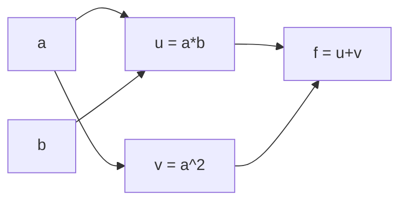

## Objectifs d'apprentissage

- Décrire un calcul comme un graphe orienté acyclique d'opérations primitives avec des dérivées locales.
- Expliquer le mode direct (forward) par opposition au mode inverse (reverse) et pourquoi l'apprentissage profond utilise le mode inverse.
- Construire un moteur d'autodiff scalaire en mode inverse (environ 40 lignes) et l'utiliser pour dériver des expressions.
- Utiliser l'autograd de PyTorch, éviter ses pièges classiques, et valider une implémentation écrite à partir de zéro contre lui.

## Prérequis

Entraînement et test de gradient ([[f2n.11]]).

## Intuition

La rétropropagation (leçon 10) n'est pas liée aux MLP. Tout programme qui compose des primitives différentiables ($+,\times,\exp,\tanh,\dots$) définit un graphe. Si chaque primitive connaît sa propre minuscule dérivée locale, la règle de la chaîne permet à une machine d'assembler automatiquement le gradient du programme entier. C'est la **différentiation automatique** (« autodiff ») : ni algèbre symbolique ni approximation numérique, mais des dérivées exactes du calcul réellement exécuté, obtenues par une comptabilité mécanique.

## Le graphe de calcul

Prenons $f(a,b)=ab+a^2$ en $a=3,b=2$. Nœuds intermédiaires : $u=ab=6$, $v=a^2=9$, $f=u+v=15$.



Dérivées locales : $\partial f/\partial u=1,\ \partial f/\partial v=1,\ \partial u/\partial a=b=2,\ \partial u/\partial b=a=3,\ \partial v/\partial a=2a=6$.

**Mode inverse.** Pars de $\bar f=1$ et propage vers l'arrière, en *accumulant* avec $+=$ partout où un nœud alimente plusieurs consommateurs :

- $\bar u=\bar f\cdot1=1,\ \bar v=\bar f\cdot1=1$
- $\bar a=\bar u\cdot b+\bar v\cdot2a=2+6=8$ (deux chemins partent de $a$ ; les contributions s'additionnent)
- $\bar b=\bar u\cdot a=3$

Vérification à la main : $f=ab+a^2\Rightarrow\partial f/\partial a=b+2a=2+6=8$ ✓, $\partial f/\partial b=a=3$ ✓.

## Mode direct contre mode inverse

Pour $F:\mathbb{R}^n\to\mathbb{R}^m$, la jacobienne est de taille $m\times n$.

- Le **mode direct** propage des « tangentes » de l'entrée vers la sortie et fournit une *colonne* de la jacobienne par passe : coût $\approx n$ passes.
- Le **mode inverse** propage des « adjoints » de la sortie vers l'entrée et fournit une *ligne* par passe : coût $\approx m$ passes.

Une perte d'entraînement a $m=1$ et $n$ de l'ordre de millions, donc une seule passe inverse donne tout le gradient. Le prix est la mémoire : les valeurs de la passe avant nécessaires aux dérivées locales doivent être stockées (le cache de la leçon 10).

## Algorithme pour un moteur scalaire

1. Chaque `Value` stocke `data`, `grad` (initialement 0), ses nœuds parents, et une fermeture `_backward` qui, à partir de `self.grad`, **ajoute** la contribution de chaque parent au `grad` du parent.
2. `backward()` construit un ordre topologique du graphe (parents avant enfants), pose `self.grad=1`, puis appelle `_backward` dans l'ordre topologique inverse.

Règles locales : pour $c=a+b$ : $\bar a\mathrel{+}=\bar c$, $\bar b\mathrel{+}=\bar c$. Pour $c=ab$ : $\bar a\mathrel{+}=b\,\bar c$, $\bar b\mathrel{+}=a\,\bar c$. Pour $c=\tanh a$ : $\bar a\mathrel{+}=(1-c^2)\,\bar c$. Pour $c=\mathrm{ReLU}(a)$ : $\bar a\mathrel{+}=\mathbb{1}[a>0]\,\bar c$. Pour $c=a^p$ : $\bar a\mathrel{+}=p\,a^{p-1}\bar c$. Pour $c=e^a$ : $\bar a\mathrel{+}=c\,\bar c$.

Tout dans PyTorch repose sur la même idée avec des tenseurs : chaque opération sur tenseurs enregistre un nœud dont la passe arrière est un produit vecteur-jacobienne (les formules de la leçon 6).

## L'autograd de PyTorch en 10 lignes

```python
import torch

x = torch.tensor([1.0, 2.0], requires_grad=True)
w = torch.tensor([[1.0, 2.0], [3.0, 4.0]], requires_grad=True)
y = w @ x                  # graph is recorded
loss = (y * torch.tensor([1.0, -1.0])).sum()
loss.backward()            # fills .grad on leaf tensors
print(x.grad)              # tensor([-2., -2.])   = W^T g   (lesson 6 worked example)
print(w.grad)              # [[1,2],[-1,-2]]      = g x^T
```

Compare avec l'exemple résolu de la leçon 6 : mêmes formules, calculées cette fois par une machine.

## Valider ton implémentation contre l'autograd

1. Convertis tes paramètres NumPy en `torch.tensor(..., dtype=torch.float64, requires_grad=True)`. **Utilise float64** : float32 n'est d'accord qu'à environ $10^{-6}$ près, ce qui masque des bugs subtils.
2. Exécute le même calcul de passe avant avec des opérations torch et `F.cross_entropy` (qui prend des *logits*, fusionnant softmax et perte comme dans la leçon 8).
3. Appelle `.backward()` et compare chaque `p.grad` avec ton gradient en utilisant `np.allclose` ou une erreur relative maximale. Attends-toi à $\lesssim10^{-10}$ en float64.
4. Pour un test plus strict, utilise `torch.autograd.gradcheck`, qui compare l'autograd aux différences finies.

## Pièges

- **Les gradients s'accumulent.** Appeler `backward()` deux fois sans remise à zéro double `.grad`. Les boucles d'entraînement appellent `optimizer.zero_grad()` à chaque pas.
- **Les modifications en place** de tenseurs nécessaires à la passe arrière provoquent des erreurs ou corrompent silencieusement les gradients.
- **`.detach()` ou `torch.no_grad()`** coupent le graphe : les gradients s'arrêtent là. Utilise `no_grad` pour l'évaluation.
- **Seuls les tenseurs feuilles avec `requires_grad=True` reçoivent `.grad`** ; les tenseurs intermédiaires non, sauf si tu appelles `retain_grad()`.
- **Les points non différentiables** (ReLU en 0, `max`) reçoivent une convention, pas une dérivée.

## Idées reçues

- **« L'autodiff est de la dérivation numérique. »** Il est exact à la précision flottante près ; les différences finies ne servent qu'à le *tester*.
- **« L'autodiff est symbolique. »** Il dérive le programme exécuté, donc le flot de contrôle (boucles, `if`) est géré gratuitement.

## Points clés à retenir

- L'autodiff dérive exactement le programme exécuté, par des règles locales sur un graphe.
- Le mode inverse coûte une passe par sortie, ce qui convient à une perte scalaire avec des millions d'entrées.
- Les contributions au gradient sont accumulées avec `+=` car un nœud peut alimenter plusieurs consommateurs.
- Valide ta propre passe arrière contre PyTorch en float64 et attends-toi à un accord proche de 1e-10.

## Explique-le toi-même

Réponds à voix haute ou par écrit, sans regarder en arrière. Si tu bloques, c'est exactement l'endroit à relire.

1. Propage les adjoints à la main à travers `f(a, b) = a*b + a^2` en `a = 3, b = 2`.
2. Pourquoi les gradients de PyTorch s'accumulent-ils, et que prévient `zero_grad()` ?

## Pour aller plus loin

- *Mathematics for Machine Learning*, Sec. 5.6, PDF p.145-176.
- Bibliothèque source : `ai-engineering-from-scratch` phase 01 leçon 05 et phase 03 leçon 11 ; Raschka, *LLMs from scratch*, annexe A.

## Critères de maîtrise

Tu sais dessiner le graphe d'une expression et propager les adjoints à la main, tu as un moteur d'autodiff scalaire fonctionnel, et tu peux montrer par un script que ta passe arrière NumPy est égale à l'autograd de PyTorch à $10^{-10}$ près en float64.
