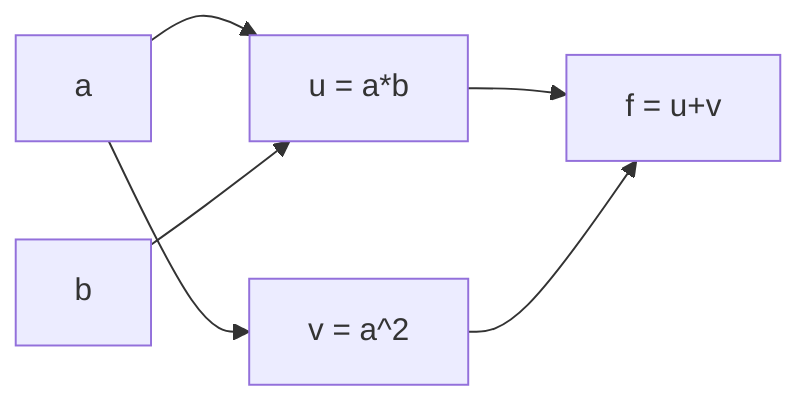

## Learning objectives

- Describe a computation as a directed acyclic graph of primitive operations with local derivatives.
- Explain forward-mode versus reverse-mode and why deep learning uses reverse mode.
- Build a scalar reverse-mode autodiff engine (about 40 lines) and use it to differentiate expressions.
- Use PyTorch autograd, avoid its classic pitfalls, and validate a from-scratch implementation against it.

## Prerequisites

Training and gradient checking ([[f2n.11]]).

## Intuition

Backpropagation (lesson 10) is not tied to MLPs. Any program that composes differentiable primitives ($+,\times,\exp,\tanh,\dots$) defines a graph. If every primitive knows its own tiny local derivative, the chain rule lets a machine assemble the gradient of the whole program automatically. This is **automatic differentiation** ("autodiff"): neither symbolic algebra nor numerical approximation, but exact derivatives of the actual computation by mechanical bookkeeping.

## The computational graph

Take $f(a,b)=ab+a^2$ at $a=3,b=2$. Intermediate nodes: $u=ab=6$, $v=a^2=9$, $f=u+v=15$.



Local derivatives: $\partial f/\partial u=1,\ \partial f/\partial v=1,\ \partial u/\partial a=b=2,\ \partial u/\partial b=a=3,\ \partial v/\partial a=2a=6$.

**Reverse mode.** Start with $\bar f=1$ and push backwards, *accumulating* with $+=$ wherever a node feeds several consumers:

- $\bar u=\bar f\cdot1=1,\ \bar v=\bar f\cdot1=1$
- $\bar a=\bar u\cdot b+\bar v\cdot2a=2+6=8$ (two paths from $a$; contributions add)
- $\bar b=\bar u\cdot a=3$

Check by hand: $f=ab+a^2\Rightarrow\partial f/\partial a=b+2a=2+6=8$ ✓, $\partial f/\partial b=a=3$ ✓.

## Forward versus reverse mode

For $F:\mathbb{R}^n\to\mathbb{R}^m$ the Jacobian is $m\times n$.

- **Forward mode** propagates "tangents" input-to-output and yields one *column* of the Jacobian per pass: cost $\approx n$ passes.
- **Reverse mode** propagates "adjoints" output-to-input and yields one *row* per pass: cost $\approx m$ passes.

A training loss has $m=1$ and $n$ in the millions, so one reverse pass gives the whole gradient. The price is memory: the forward values needed by local derivatives must be stored (lesson 10's cache).

## Algorithm for a scalar engine

1. Each `Value` stores `data`, `grad` (initially 0), its parent nodes, and a closure `_backward` that, given `self.grad`, **adds** each parent's contribution to the parent's `grad`.
2. `backward()` builds a topological order of the graph (parents before children), sets `self.grad=1`, then calls `_backward` in reverse topological order.

Local rules: for $c=a+b$: $\bar a\mathrel{+}=\bar c$, $\bar b\mathrel{+}=\bar c$. For $c=ab$: $\bar a\mathrel{+}=b\,\bar c$, $\bar b\mathrel{+}=a\,\bar c$. For $c=\tanh a$: $\bar a\mathrel{+}=(1-c^2)\,\bar c$. For $c=\mathrm{ReLU}(a)$: $\bar a\mathrel{+}=\mathbb{1}[a>0]\,\bar c$. For $c=a^p$: $\bar a\mathrel{+}=p\,a^{p-1}\bar c$. For $c=e^a$: $\bar a\mathrel{+}=c\,\bar c$.

Everything in PyTorch is the same idea with tensors: each tensor operation registers a node whose backward is a vector-Jacobian product (the formulas of lesson 6).

## PyTorch autograd in 10 lines

```python
import torch

x = torch.tensor([1.0, 2.0], requires_grad=True)
w = torch.tensor([[1.0, 2.0], [3.0, 4.0]], requires_grad=True)
y = w @ x                  # graph is recorded
loss = (y * torch.tensor([1.0, -1.0])).sum()
loss.backward()            # fills .grad on leaf tensors
print(x.grad)              # tensor([-2., -2.])   = W^T g   (lesson 6 worked example)
print(w.grad)              # [[1,2],[-1,-2]]      = g x^T
```

Compare with lesson 6's worked example: same formulas, now computed by a machine.

## Validating your implementation against autograd

1. Convert your NumPy parameters to `torch.tensor(..., dtype=torch.float64, requires_grad=True)`. **Use float64**: float32 only agrees to about $10^{-6}$, which hides subtle bugs.
2. Run the same forward computation with torch ops and `F.cross_entropy` (which takes *logits*, fusing softmax and the loss as in lesson 8).
3. Call `.backward()` and compare each `p.grad` with your gradient using `np.allclose` or a max relative error. Expect $\lesssim10^{-10}$ in float64.
4. For a stricter test use `torch.autograd.gradcheck`, which compares autograd to finite differences.

## Pitfalls

- **Gradients accumulate.** Calling `backward()` twice without zeroing doubles `.grad`. Training loops call `optimizer.zero_grad()` each step.
- **In-place edits** of tensors needed for backward raise errors or silently corrupt gradients.
- **`.detach()` or `torch.no_grad()`** cut the graph: gradients stop there. Use `no_grad` for evaluation.
- **Only leaf tensors with `requires_grad=True` get `.grad`**; intermediate tensors do not unless you call `retain_grad()`.
- **Non-differentiable points** (ReLU at 0, `max`) get a convention, not a derivative.

## Common misconceptions

- **"Autodiff is numerical differentiation."** It is exact up to floating point; finite differences are only used to *test* it.
- **"Autodiff is symbolic."** It differentiates the executed program, so control flow (loops, `if`) is handled for free.

## Key takeaways

- Autodiff differentiates the executed program exactly, by local rules on a graph.
- Reverse mode costs one pass per output, which is why it fits a scalar loss with millions of inputs.
- Gradient contributions are accumulated with `+=` because a node can feed several consumers.
- Validate your own backward pass against PyTorch in float64 and expect agreement near 1e-10.

## Explain it yourself

Answer these out loud or in writing, without looking back. If you get stuck, that is the exact spot to re-read.

1. Push adjoints by hand through `f(a, b) = a*b + a^2` at `a = 3, b = 2`.
2. Why do PyTorch gradients accumulate, and what does `zero_grad()` prevent?

## Further reading

- *Mathematics for Machine Learning*, Sec. 5.6, PDF p.145-176.
- Source library: `ai-engineering-from-scratch` phase 01 lesson 05 and phase 03 lesson 11; Raschka, *LLMs from scratch*, appendix A.

## Mastery criteria

You can draw the graph of an expression and push adjoints by hand, you have a working scalar autodiff engine, and you can show with a script that your NumPy backward pass equals PyTorch autograd to $10^{-10}$ in float64.
