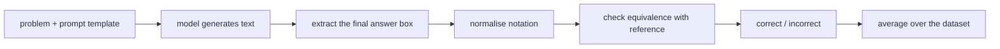

## Où cela s'inscrit

Un « modèle de raisonnement » est un modèle de langage qui, avant de s'engager sur une réponse finale, écrit une longue suite d'étapes intermédiaires (une **chaîne de pensée**). Tout ce cours vise à obtenir plus de bonnes réponses d'un tel modèle : en dépensant plus de calcul au moment de répondre ([[rsn.02]], [[rsn.03]]), en l'entraînant par apprentissage par renforcement ([[rsn.04]], [[rsn.05]]) ou en apprenant à un petit modèle à imiter un grand ([[rsn.05]]).

Tout cela exige un ingrédient banal mais crucial : un moyen de dire, automatiquement et de façon fiable, **si une réponse est juste**. Si ton vérificateur se trompe 10 % du temps, tu ne peux pas distinguer une vraie amélioration du bruit, et si tu branches un vérificateur défectueux sur de l'apprentissage par renforcement, le modèle apprendra à le tromper. Cette leçon construit ce vérificateur, puis les statistiques nécessaires pour lire sa sortie. Elle s'appuie sur la façon dont un modèle décodeur seul écrit du texte token par token ([[llm.02]]) et sur l'échantillonnage ([[llm.02]]).

## L'idée en mots simples

Imagine deux élèves qui reçoivent le même problème de maths. L'un doit répondre immédiatement ; l'autre peut utiliser autant de brouillon qu'il veut. Le second est plus lent et consomme bien plus de papier, mais il réussit en général plus de problèmes, car chaque ligne de brouillon est une petite étape facile et l'étape suivante peut s'appuyer sur la précédente.

Un modèle de langage n'a pas de brouillon caché : le seul endroit où il peut « penser » est le texte qu'il écrit. Chaque mot supplémentaire est un passage de plus dans tout le réseau, donc **une chaîne de pensée plus longue, c'est littéralement plus de calcul dépensé pour la question**. C'est la première idée du cours : *raisonner = transformer du calcul en texte.*

La seconde idée concerne la correction de l'examen. Un brouillon est désordonné, on ne peut donc pas le noter directement. On convient d'une règle (« entoure ta réponse finale »), on trouve le cercle, on met la notation au propre (`0.5` ou `1/2` ?), puis on compare avec le corrigé. Chacune de ces étapes peut mal tourner, et chacune est un endroit où le correcteur peut être injuste envers l'élève. Enfin, comme un élève peut avoir de la chance ou de la malchance, on ne juge pas sur un seul essai : on le laisse essayer plusieurs fois et on rapporte la probabilité qu'au moins un essai soit juste (c'est le **pass@k**), avec l'ampleur dont ton score aurait pu fluctuer par le seul hasard.

## La chaîne de pensée, c'est du calcul

Un LLM produit du texte avec une boucle : on lui donne les tokens jusqu'ici, on lit les scores du token suivant, on en choisit un, on l'ajoute, et on recommence jusqu'à un token spécial de fin de séquence ou une limite de longueur. Le décodage glouton choisit à chaque fois le meilleur score (le `generate_text_basic_stream` du livre est exactement cette boucle). Un **cache KV** stocke des valeurs d'attention intermédiaires pour que chaque nouveau token ne recalcule pas tout le préfixe ([[sys.01]]) ; il ne change que la vitesse, pas le texte.

Le coût d'une réponse est donc à peu près proportionnel à son **nombre de tokens générés**. Le livre mesure cela sur MATH-500 (500 problèmes de mathématiques de compétition avec de courtes réponses de référence) avec un modèle Qwen3 de 0,6 milliard de paramètres, en décodage glouton, sur un seul GPU :

| modèle | précision MATH-500 | longueur moyenne de réponse | temps réel pour 500 problèmes |
|---|---|---|---|
| modèle de base, réponse directe | 15,2 % (15,6 % dans une autre exécution) | 78,85 tokens | environ 10 min |
| variante de raisonnement | 48,2 % | 1369,79 tokens | environ 182 min |

La variante de raisonnement écrit $1369.79/78.85\approx17.4$ fois plus de tokens et prend environ 18 fois plus de temps, pour environ trois fois la précision. Demander simplement au modèle de base d'« expliquer pas à pas » (prompting par chaîne de pensée, chapitre 4) le fait passer de 15,2 % à 40,6 %, ce qui montre qu'une bonne part du gain vient du raisonnement écrit lui-même et non de connaissances nouvelles. (Les 15,2 % contre 15,6 % pour le même modèle de base viennent de deux exécutions différentes du livre ; cet écart est un premier indice du bruit discuté plus bas.)

## Le pipeline d'évaluation

Le chapitre 3 du livre découpe le travail en étapes ; l'exercice de cette leçon implémente celles du milieu sans aucun modèle, car il s'agit de pur traitement de texte :



### 1. Extraction

On dit aux modèles (dans le prompt) de terminer par `\boxed{ANSWER}`. Pour la trouver, on ne peut pas utiliser une expression régulière naïve, car la réponse peut contenir des accolades : `\boxed{\frac{14}{3}}`. La méthode robuste consiste à trouver le **dernier** `\boxed`, sauter les espaces, attendre `{`, puis avancer en comptant une profondeur d'imbrication (+1 pour `{`, -1 pour `}`) jusqu'à revenir à zéro. Le contenu entre les deux est la réponse. Si les accolades ne s'équilibrent jamais (sortie tronquée), on ne renvoie rien.

S'il n'y a pas de boîte, tu choisis un **repli** : prendre le dernier nombre du texte, ou tout le texte, ou rien. Le choix compte. Pour *mesurer* un modèle, un repli indulgent évite de punir une bonne réponse pour une erreur de format. Pour une *récompense d'entraînement* ([[rsn.04]]), le livre exige délibérément la boîte, afin que le modèle apprenne à produire le format requis.

### 2. Normalisation

Des chaînes différentes désignent la même chose : `\dfrac{14}{3}`, `\frac{14}{3}`, `14/3`, `14/3.`, `(14)/(3)`. La normalisation réécrit une chaîne sous une forme canonique : retirer la décoration LaTeX (`\left`, `\right`, `\(`...), déballer `\text{...}`, transformer `\frac{a}{b}` en `(a)/(b)`, `\sqrt{x}` en `sqrt(x)`, `^` en `**`, supprimer les séparateurs de milliers et le point final, passer en minuscules. Ce sont des heuristiques. Chaque règle corrige des faux négatifs et peut en principe créer un faux positif, donc chaque règle ajoutée doit s'accompagner d'un test.

### 3. Équivalence

Après normalisation, on compare les *valeurs*, pas les chaînes. Le livre analyse les deux côtés avec SymPy et teste si leur différence se simplifie en zéro. Dans l'exercice (NumPy et bibliothèque standard uniquement), tu fais le même travail avec des fractions Python, ce qui soulève une question de politique instructive : `0.3333333333` est-il égal à `1/3` ? En arithmétique **exacte**, non (la différence est $3.3\times10^{-11}$, pas zéro), et la table de tests du livre le marque comme une non-correspondance. Avec une tolérance, il serait accepté. Aucun des deux n'est « juste » ; l'essentiel est de décider en connaissance de cause. L'exercice utilise : la comparaison exacte quand les deux côtés sont des rationnels exacts, et une tolérance relative serrée (1e-9) quand apparaît un irrationnel comme $\sqrt2$, car la virgule flottante ne peut pas le représenter exactement.

Les tuples demandent du soin : `(14/3, 2/3)` se compare partie par partie, dans l'ordre, et `(2,1)` n'est **pas** `(1,2)`.

### 4. De la notation à une récompense

Une **récompense vérifiable** est simplement la sortie du correcteur utilisée comme un nombre : $r=1$ si la réponse extraite est équivalente à la référence, sinon $0$. Déterministe, bon marché, impossible à charmer. C'est le signal qui remplace un modèle de « préférence » appris dans l'apprentissage par renforcement à récompenses vérifiables ([[rsn.04]] ; à comparer avec le RLHF dans [[llm.05]]). Cela signifie aussi que *tous les bugs du correcteur deviennent des incitations pour le modèle*.

## Rapporter : pass@k et barres d'erreur

### La précision est une estimation bruitée

Si un modèle résout réellement une fraction $\pi$ des problèmes et que tu testes $N$ problèmes, la précision mesurée $\hat\pi=c/N$ a pour erreur standard $\sqrt{\hat\pi(1-\hat\pi)/N}$. Pour 241 bonnes réponses sur 500 (48,2 %), cela fait $0.0223$, soit environ $\pm4.4$ points à 95 %. Les 15,2 % contre 15,6 % du modèle de base font un écart de 0,4 point, bien inférieur au bruit, et la table de démonstration du livre sur dix problèmes (9 bonnes sur 10) a une erreur standard de $0.095$ : l'intervalle de Wilson à 95 % pour 9/10 va de 0,60 à 0,98. Une exécution sur dix problèmes peut révéler un bug mais ne peut jamais démontrer une amélioration.

L'**intervalle de score de Wilson** est préférable à « estimation plus ou moins 1,96 erreur standard » aux taux extrêmes, où ce dernier peut sortir de $[0,1]$ ; avec $p=c/N$ et $z=1.96$ :

$$
\text{centre}=\frac{p+\frac{z^2}{2N}}{1+\frac{z^2}{N}},\qquad
\text{half-width}=\frac{z\sqrt{\frac{p(1-p)}{N}+\frac{z^2}{4N^2}}}{1+\frac{z^2}{N}}.
$$

### pass@k

L'échantillonnage (et non le décodage glouton) permet à un modèle de produire une réponse différente à chaque fois. **pass@k** demande : si je tire $k$ réponses pour un problème, quelle est la probabilité qu'au moins une soit correcte ? C'est le score naturel quand un vérificateur existe (on peut garder n'importe quel échantillon correct), et il mesure le potentiel que des méthodes comme le vote ([[rsn.02]]) et l'RL ([[rsn.04]]) cherchent à exploiter. (L'estimateur ci-dessous est l'estimateur standard introduit pour les benchmarks de génération de code ; les chapitres du livre évaluent avec une seule réponse gloutonne et n'implémentent pas pass@k, donc cette partie vient de connaissances générales et est vérifiée par l'exercice.)

Si chaque échantillon est correct indépendamment avec la probabilité $\pi$, alors $\text{pass@}k=1-(1-\pi)^k$. Tu ne connais pas $\pi$. Tu as $n\ge k$ échantillons dont $c$ sont corrects. L'estimation naïve par substitution est $1-(1-c/n)^k$.

**Elle est biaisée.** La fonction $x\mapsto(1-x)^k$ est convexe, donc par l'inégalité de Jensen $\mathbb{E}[(1-\hat\pi)^k]\ge(1-\pi)^k$ et l'estimation par substitution est trop petite en moyenne.

**L'estimateur sans biais.** Choisis $k$ de tes $n$ échantillons au hasard, sans remise. La probabilité qu'aucun des $k$ ne soit correct est le nombre de sous-ensembles entièrement faux sur le nombre de sous-ensembles :

$$
\Pr[\text{all wrong}]=\frac{\binom{n-c}{k}}{\binom{n}{k}}
\qquad\Longrightarrow\qquad
\widehat{\text{pass@}k}=1-\frac{\binom{n-c}{k}}{\binom{n}{k}}.
$$

Pourquoi il est sans biais : en moyenne sur le tirage aléatoire des $n$ échantillons, chaque sous-ensemble de taille $k$ est formé de $k$ échantillons indépendants, tous faux avec la probabilité $(1-\pi)^k$. L'estimateur est la moyenne de cet indicateur sur tous les sous-ensembles, donc son espérance vaut exactement $(1-\pi)^k$, et un moins cette quantité vaut exactement pass@k.

**Une forme stable.** Les binomiaux de grands nombres débordent. Écris le rapport comme un produit :

$$
\frac{\binom{n-c}{k}}{\binom{n}{k}}=\frac{(n-c)!\,(n-k)!}{(n-c-k)!\,n!}=\prod_{i=n-c+1}^{n}\frac{i-k}{i}=\prod_{i=n-c+1}^{n}\Bigl(1-\frac{k}{i}\Bigr).
$$

La première égalité simplifie les factorielles ; pour la dernière, $(n-k)!/(n-c-k)!$ est le produit des entiers de $n-c-k+1$ à $n-k$, et $n!/(n-c)!$ le produit de $n-c+1$ à $n$, donc en divisant terme à terme (en décalant de $k$ le premier intervalle) on obtient les facteurs $(i-k)/i$. Si $n-c<k$, au moins un échantillon correct est toujours dans le sous-ensemble, et l'estimation vaut $1$.

## Exemple détaillé

Chaque nombre ci-dessous est reproduit par les deux exercices.

**Extraction et notation.** Le texte `...Final Answer:\n\[\boxed{\dfrac{14}{3}}\]` donne le candidat `\dfrac{14}{3}`, qui se normalise en `(14)/(3)` ; comme Fraction, c'est $14/3$, égal à la référence `14/3`. Pour quatre sorties d'exemple à un problème dont la réponse est 83, `\boxed{83}`, `The correct answer is \boxed{83}`, `The final answer is 83` et `We get \boxed{38}`, un extracteur à boîte seule donne les récompenses $[1,1,0,0]$ : la troisième est juste mais sans boîte, elle ne rapporte donc rien, ce qui est exactement la pression de format voulue à l'entraînement.

**pass@k.** Un problème échantillonné $n=10$ fois avec $c=3$ réussites :

| $k$ | pass@k sans biais | substitution $1-0.7^k$ |
|---|---|---|
| 1 | 0.3000 | 0.3000 |
| 2 | 0.5333 | 0.5100 |
| 5 | 0.9167 | 0.8319 |
| 10 | 1.0000 | 0.9718 |

(À $k=10$ avec $c=3$, un échantillon est sûrement correct, donc la valeur sans biais est 1, alors que la substitution dit 0,97.) Pour l'estimation *espérée* quand le vrai $\pi=0.3$ et $k=5$ : l'estimateur sans biais a pour moyenne exactement $1-0.7^5=0.8319$, mais celui par substitution a pour moyenne $0.7597$, une sous-estimation systématique de 7 points.

## Implémentation

```python
from math import comb

def pass_at_k(n, c, k):
    if n - c < k:
        return 1.0
    prod = 1.0
    for i in range(n - c + 1, n + 1):
        prod *= 1.0 - k / i
    return 1.0 - prod

def grade_answer(pred, gt):
    p, g = split_into_parts(normalize(pred)), split_into_parts(normalize(gt))
    return bool(p) and len(p) == len(g) and all(values_equal(a, b) for a, b in zip(p, g))
```

La version de production du vérificateur (chapitre 3 du livre) utilise SymPy pour la simplification symbolique, ce qui gère aussi des cas comme `2x` contre `x*2` et permet de comparer des expressions algébriques ; la version de cette leçon ne gère que les nombres. Les bibliothèques pour les benchmarks de code et de maths (par exemple les harnais d'évaluation utilisés avec ces modèles) fournissent leurs propres fonctions pass@k. L'exercice `verifier` implémente l'extraction, la normalisation et l'égalité ; `passk` implémente les estimateurs et l'intervalle.

## Pièges de l'évaluation

- **Modèle de prompt.** Le livre note que de petits changements dans l'enveloppe d'instruction (par exemple « Question » contre « Problem », ou pas de modèle du tout) déplacent beaucoup la précision sur MATH-500 dans une exécution de dix problèmes : le modèle de base de 20 % à 40 % ou 70 %, le modèle de raisonnement de 90 % à 60 % ou 50 % sur un appareil. Dix problèmes sont bruités, mais la direction est un avertissement : indique le modèle de prompt, garde-le fixe quand tu compares des modèles.
- **Limite de longueur.** Si `max_new_tokens` est plus petit que la chaîne de pensée du modèle, la sortie est coupée avant la boîte. Les modèles de raisonnement sont ceux qui ont besoin de gros budgets.
- **Appareil et numérique.** La table du livre sur dix problèmes donne 90 %, 80 %, 90 %, 70 % pour le modèle de raisonnement sur CPU, MPS, CUDA et XPU : de minuscules différences numériques changent un chemin échantillonné, voire glouton.
- **Contamination.** Le livre remarque qu'on ne sait pas si les problèmes de MATH-500 figuraient dans les données d'entraînement d'un modèle, et que n'importe quel texte public du web a pu y figurer. Un score élevé sur un benchmark public n'est pas une preuve de généralisation.
- **Erreurs du correcteur.** Les faux négatifs (une bonne réponse rejetée à cause de la notation) abaissent les scores ; les faux positifs (mauvaises réponses acceptées) les gonflent. Garde une table de paires délicates comme tests unitaires, comme le fait le livre avec ses seize vérifications.
- **Choix du repli.** Un extracteur indulgent mesure la *connaissance* ; un extracteur strict mesure la *connaissance plus l'obéissance au format*. Précise lequel.

## Idées reçues

- « Plus de tokens veut toujours dire plus de précision. » Non : les tokens supplémentaires doivent contenir des étapes utiles. Une chaîne qui divague ou boucle coûte du calcul sans aider, et une coupure brutale de la longueur perd entièrement la réponse.
- « Une précision de 48,2 % contre 47,4 % montre que le modèle A est meilleur. » Avec 500 problèmes, l'erreur standard est d'environ 2 points ; l'écart est du bruit.
- « pass@k par substitution est assez proche. » Il est biaisé vers le bas et le biais est le plus grand précisément pour un $k$ modéré et un $n$ petit.
- « Le vérificateur est neutre. » Chaque règle de normalisation et chaque repli est une politique à laquelle les modèles (et l'RL) s'adapteront.

## Points clés

- Une chaîne de pensée est du calcul à l'inférence : le coût croît avec les tokens générés.
- La chaîne d'évaluation est : extraire, normaliser, vérifier l'équivalence, moyenner ; chaque maillon est du code testable.
- Utilise l'arithmétique exacte quand les réponses sont exactes et décide explicitement des tolérances sinon.
- La sortie binaire d'un vérificateur est une récompense vérifiable ; ses bizarreries deviennent des incitations.
- Rapporte la précision avec un intervalle ; utilise l'estimateur pass@k sans biais $1-\binom{n-c}{k}/\binom{n}{k}$.

## Explique-le toi-même

1. Pourquoi un modèle qui écrit une longue chaîne de pensée coûte-t-il plus cher à exécuter qu'un modèle qui répond directement, et qu'est-ce qui le montre dans la table du livre ?
2. Tes deux modèles obtiennent 31,0 % et 33,4 % sur 500 problèmes. Que calculerais-tu avant d'affirmer que l'un est meilleur, et quelle réponse t'attendrais-tu à obtenir ?

## Pour aller plus loin

- Le chapitre 3 du livre et les solutions de ses exercices (conception du correcteur), le chapitre 2 (boucle de génération).
- La leçon suivante [[rsn.02]] utilise l'extracteur pour voter entre échantillons ; [[rsn.04]] utilise le vérificateur comme récompense.
- Intervalle de score de Wilson : n'importe quel manuel de statistique sur les intervalles de confiance binomiaux.

## Critères de maîtrise

- Je sais écrire un extracteur qui gère les accolades imbriquées et un repli, et dire quand chaque repli est approprié.
- Je sais expliquer pourquoi la comparaison exacte et la comparaison avec tolérance donnent des verdicts différents sur `0.3333333333` contre `1/3`.
- Je sais dériver l'estimateur pass@k sans biais et montrer que l'estimation par substitution est biaisée vers le bas.
- Je sais calculer un intervalle de Wilson et décider si une différence entre deux précisions est significative.
