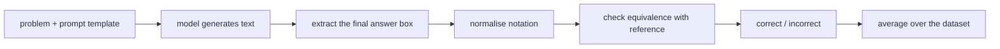

## Where this fits

A "reasoning model" is a language model that, before it commits to a final answer, writes out a long chain of intermediate steps (a **chain of thought**). Everything in this course is about getting more correct answers out of such a model: by spending more compute when answering ([[rsn.02]], [[rsn.03]]), by training it with reinforcement learning ([[rsn.04]], [[rsn.05]]) or by teaching a small model to imitate a big one ([[rsn.05]]).

All of that needs one boring but crucial ingredient: a way to say, automatically and reliably, **whether an answer is right**. If your checker is wrong 10% of the time you cannot tell a real improvement from noise, and if you plug a flawed checker into reinforcement learning the model will learn to fool it. This lesson builds that checker, then the statistics needed to read its output. It builds on how a decoder-only model writes text token by token ([[llm.02]]) and on sampling ([[llm.02]]).

## The idea in plain words

Imagine two students given the same maths problem. One must answer instantly; the other may use as much scratch paper as they like. The second student is slower and uses far more paper, yet usually gets more problems right, because each line of scratch work is a small, easy step and the next step can lean on the previous one.

A language model has no hidden scratch paper: the only place it can "think" is the text it writes. Every extra word it writes is one more pass through the whole network, so **a longer chain of thought is literally more computation spent on the question**. That is the first idea of the course: *reasoning = turning compute into text.*

The second idea is about marking the exam. Scratch paper is messy, so you cannot grade it directly. You agree on a convention ("circle your final answer"), you find the circle, you tidy up the notation (`0.5` or `1/2`?), and then you compare with the answer key. Each of those steps can go wrong, and each is a place where a grader can be unfair to the student. Finally, because a student might get lucky or unlucky, you do not judge from one attempt: you let them try several times and report how likely it is that at least one attempt is right (that is **pass@k**), together with how much your score could have wobbled by chance alone.

## Chain of thought is compute

An LLM produces text with a loop: feed the tokens so far, read the scores for the next token, pick one, append it, repeat until a special end-of-sequence token or a length limit. Greedy decoding picks the highest score each time (the book's `generate_text_basic_stream` is exactly this loop). A **KV cache** stores intermediate attention values so each new token does not recompute the whole prefix ([[sys.01]]); it only changes speed, not the text.

The cost of an answer is therefore roughly proportional to its **number of generated tokens**. The book measures this on MATH-500 (500 competition-maths problems with short reference answers) with a 0.6-billion-parameter Qwen3 model, greedy decoding, on one GPU:

| model | MATH-500 accuracy | average answer length | wall-clock for 500 problems |
|---|---|---|---|
| base model, answer directly | 15.2% (15.6% in another run) | 78.85 tokens | about 10 min |
| reasoning variant | 48.2% | 1369.79 tokens | about 182 min |

The reasoning variant writes $1369.79/78.85\approx17.4$ times as many tokens and takes about 18 times as long, for roughly three times the accuracy. Simply asking the base model to "explain step by step" (chain-of-thought prompting, chapter 4) lifts it from 15.2% to 40.6%, which shows that a good part of the gain is the written reasoning itself and not new knowledge. (The 15.2% versus 15.6% for the same base model comes from two different runs in the book; that gap is a first hint of the noise discussed below.)

## The evaluation pipeline

The book's chapter 3 breaks the job into steps; this lesson's exercise implements the middle ones with no model at all, because they are pure text processing:



### 1. Extraction

Models are told (in the prompt) to finish with `\boxed{ANSWER}`. To find it you cannot use a naive regular expression, because the answer may contain braces: `\boxed{\frac{14}{3}}`. The robust way is to find the **last** `\boxed`, skip spaces, expect `{`, then walk forward counting a nesting depth (+1 for `{`, -1 for `}`) until it returns to zero. The content in between is the answer. If the braces never balance (a truncated output), return nothing.

If there is no box, you choose a **fallback**: take the last number in the text, or the whole text, or nothing. The choice matters. For *measuring* a model, a forgiving fallback avoids punishing a correct answer for a formatting slip. For a *training reward* ([[rsn.04]]) the book deliberately demands the box, so the model learns to produce the required format.

### 2. Normalisation

Different strings denote the same thing: `\dfrac{14}{3}`, `\frac{14}{3}`, `14/3`, `14/3.`, `(14)/(3)`. Normalisation rewrites a string into a canonical form: strip LaTeX decoration (`\left`, `\right`, `\(`...), unwrap `\text{...}`, turn `\frac{a}{b}` into `(a)/(b)`, `\sqrt{x}` into `sqrt(x)`, `^` into `**`, drop thousands separators, drop a trailing period, lower-case. These are heuristics. Each rule fixes some false negatives and can in principle create a false positive, so every rule you add should come with a test.

### 3. Equivalence

After normalising, compare the *values*, not the strings. The book parses both sides with SymPy and tests whether their difference simplifies to zero. In the exercise (NumPy-and-standard-library only) you do the same job with Python fractions, which gives an instructive policy question: is `0.3333333333` equal to `1/3`? With **exact** arithmetic it is not (the difference is $3.3\times10^{-11}$, not zero), and the book's own test table marks it as a mismatch. With a tolerance it would be accepted. Neither is "right"; the point is to decide on purpose. The exercise uses: exact comparison when both sides are exact rational numbers, and a tight relative tolerance (1e-9) when an irrational number such as $\sqrt2$ appears, because floating point cannot represent it exactly.

Tuples need care: `(14/3, 2/3)` is compared part by part, in order, and `(2,1)` is **not** `(1,2)`.

### 4. From grading to a reward

A **verifiable reward** is simply the grader's output used as a number: $r=1$ if the extracted answer is equivalent to the reference, else $0$. Deterministic, cheap, impossible to charm. This is the signal that replaces a learned "preference" model in reinforcement learning with verifiable rewards ([[rsn.04]]; compare RLHF in [[llm.05]]). It also means *all the grader's bugs become the model's incentives*.

## Reporting: pass@k and error bars

### Accuracy is a noisy estimate

If a model truly solves a fraction $\pi$ of problems and you test $N$ problems, the measured accuracy $\hat\pi=c/N$ has standard error $\sqrt{\hat\pi(1-\hat\pi)/N}$. For 241 correct out of 500 (48.2%) that is $0.0223$, i.e. about $\pm4.4$ points at 95%. The base model's 15.2% versus 15.6% is a 0.4-point difference, far smaller than the noise, and the book's ten-problem demonstration table (9 correct out of 10) has a standard error of $0.095$: the 95% Wilson interval for 9/10 runs from 0.60 to 0.98. A ten-problem run can show a bug but can never show an improvement.

The **Wilson score interval** is preferable to "estimate plus or minus 1.96 standard errors" at extreme rates, where the latter can leave $[0,1]$; with $p=c/N$ and $z=1.96$:

$$
\text{centre}=\frac{p+\frac{z^2}{2N}}{1+\frac{z^2}{N}},\qquad
\text{half-width}=\frac{z\sqrt{\frac{p(1-p)}{N}+\frac{z^2}{4N^2}}}{1+\frac{z^2}{N}}.
$$

### pass@k

Sampling (not greedy decoding) lets a model produce a different answer each time. **pass@k** asks: if I draw $k$ answers for a problem, what is the chance at least one is correct? It is the natural score when a verifier exists (you can keep any correct sample), and it measures the potential that methods like voting ([[rsn.02]]) and RL ([[rsn.04]]) try to cash in. (The estimator below is the standard one introduced for code-generation benchmarks; the book's chapters evaluate with a single greedy answer and do not implement pass@k, so this part comes from general knowledge and is verified by the exercise.)

If each sample is independently correct with probability $\pi$, then $\text{pass@}k=1-(1-\pi)^k$. You do not know $\pi$. You have $n\ge k$ samples of which $c$ are correct. The tempting plug-in estimate is $1-(1-c/n)^k$.

**It is biased.** The function $x\mapsto(1-x)^k$ is convex, so by Jensen's inequality $\mathbb{E}[(1-\hat\pi)^k]\ge(1-\pi)^k$ and the plug-in estimate is too small on average.

**The unbiased estimator.** Pick $k$ of your $n$ samples at random, without replacement. The chance that none of the $k$ is correct is the number of all-wrong subsets over the number of subsets:

$$
\Pr[\text{all wrong}]=\frac{\binom{n-c}{k}}{\binom{n}{k}}
\qquad\Longrightarrow\qquad
\widehat{\text{pass@}k}=1-\frac{\binom{n-c}{k}}{\binom{n}{k}}.
$$

Why unbiased: averaged over the random draw of the $n$ samples, each size-$k$ subset is $k$ independent samples, all wrong with probability $(1-\pi)^k$. The estimator is the average of that indicator over all subsets, so its mean is exactly $(1-\pi)^k$, and one minus it is exactly pass@k.

**A stable form.** Binomials of large numbers overflow. Write the ratio as a product:

$$
\frac{\binom{n-c}{k}}{\binom{n}{k}}=\frac{(n-c)!\,(n-k)!}{(n-c-k)!\,n!}=\prod_{i=n-c+1}^{n}\frac{i-k}{i}=\prod_{i=n-c+1}^{n}\Bigl(1-\frac{k}{i}\Bigr).
$$

The middle step cancels factorials; for the last, $(n-k)!/(n-c-k)!$ is the product of the integers from $n-c-k+1$ to $n-k$, and $n!/(n-c)!$ the product from $n-c+1$ to $n$, so dividing term by term (shift the first range by $k$) gives the factors $(i-k)/i$. If $n-c<k$ at least one correct sample is always in the subset, and the estimate is $1$.

## Worked example

Every number below is reproduced by the two exercises.

**Extraction and grading.** The text `...Final Answer:\n\[\boxed{\dfrac{14}{3}}\]` yields the candidate `\dfrac{14}{3}`, which normalises to `(14)/(3)`; as a Fraction that is $14/3$, equal to the reference `14/3`. For four sample outputs to a problem whose answer is 83, `\boxed{83}`, `The correct answer is \boxed{83}`, `The final answer is 83` and `We get \boxed{38}`, a box-only extractor gives rewards $[1,1,0,0]$: the third is right but unboxed, so it earns nothing, which is exactly the format pressure wanted in training.

**pass@k.** A problem sampled $n=10$ times with $c=3$ correct:

| $k$ | unbiased pass@k | plug-in $1-0.7^k$ |
|---|---|---|
| 1 | 0.3000 | 0.3000 |
| 2 | 0.5333 | 0.5100 |
| 5 | 0.9167 | 0.8319 |
| 10 | 1.0000 | 0.9718 |

(At $k=10$ with $c=3$ some sample is surely correct, so the unbiased value is 1, while the plug-in says 0.97.) For the *expected* estimate when the true $\pi=0.3$ and $k=5$: the unbiased estimator averages to exactly $1-0.7^5=0.8319$, but the plug-in averages to $0.7597$, a systematic 7-point underestimate.

## Implementation

```python
from math import comb

def pass_at_k(n, c, k):
    if n - c < k:
        return 1.0
    prod = 1.0
    for i in range(n - c + 1, n + 1):
        prod *= 1.0 - k / i
    return 1.0 - prod

def grade_answer(pred, gt):
    p, g = split_into_parts(normalize(pred)), split_into_parts(normalize(gt))
    return bool(p) and len(p) == len(g) and all(values_equal(a, b) for a, b in zip(p, g))
```

The production version of the verifier (book chapter 3) uses SymPy for symbolic simplification, which also handles things like `2x` versus `x*2` and can compare algebraic expressions; this lesson's version only handles numbers. Libraries for code and maths benchmarks (for example the evaluation harnesses used with such models) ship their own pass@k helpers. The exercise `verifier` implements extraction, normalisation and equality; `passk` implements the estimators and the interval.

## Evaluation pitfalls

- **Prompt template.** The book notes that small changes to the instruction wrapper (for example "Question" versus "Problem", or no template at all) move MATH-500 accuracy a lot on a ten-problem run: the base model from 20% to 40% or 70%, the reasoning model from 90% down to 60% or 50% on one device. Ten problems are noisy, but the direction is a warning: report the template, keep it fixed when comparing models.
- **Length limit.** If `max_new_tokens` is smaller than the model's chain of thought, the output is cut before the box. Reasoning models are the ones that need big budgets.
- **Device and numerics.** The book's ten-problem table gives 90%, 80%, 90%, 70% for the reasoning model on CPU, MPS, CUDA and XPU: tiny numeric differences change a sampled or even greedy path.
- **Contamination.** The book remarks that it is unclear whether MATH-500 problems were in a model's training data and that any public web text may have been. A high score on a public benchmark is not proof of generalisation.
- **Grader errors.** False negatives (a right answer rejected because of notation) lower scores; false positives (wrong answers accepted) inflate them. Keep a table of tricky pairs as unit tests, as the book does with its sixteen checks.
- **Fallback choice.** A forgiving extractor measures *knowledge*; a strict one measures *knowledge plus format obedience*. State which.

## Common misconceptions

- "More tokens always means more accuracy." No: the extra tokens must contain useful steps. A rambling or looping chain costs compute without helping, and a hard length cut loses the answer entirely.
- "Accuracy of 48.2% versus 47.4% shows model A is better." With 500 problems the standard error is about 2 points; the gap is noise.
- "pass@k with plug-in is close enough." It is biased low and the bias is largest exactly for moderate $k$ and small $n$.
- "The verifier is neutral." Every normalisation rule and fallback is a policy that models (and RL) will adapt to.

## Key takeaways

- A chain of thought is inference compute: cost scales with generated tokens.
- The evaluation chain is extract, normalise, check equivalence, average; each link is testable code.
- Use exact arithmetic where answers are exact and decide tolerances explicitly otherwise.
- A binary verifier output is a verifiable reward; its quirks become incentives.
- Report accuracy with an interval; use the unbiased pass@k estimator $1-\binom{n-c}{k}/\binom{n}{k}$.

## Explain it yourself

1. Why does a model that writes a long chain of thought cost more to run than one that answers directly, and what in the book's table shows it?
2. Your two models score 31.0% and 33.4% on 500 problems. What would you compute before claiming one is better, and what answer would you expect?

## Further reading

- Book chapter 3 and its exercise solutions (grader design), chapter 2 (generation loop).
- The next lesson [[rsn.02]] uses the extractor to vote across samples; [[rsn.04]] uses the verifier as the reward.
- Wilson score interval: any statistics text on binomial confidence intervals.

## Mastery criteria

- I can write an extractor that handles nested braces and a fallback, and say when each fallback is appropriate.
- I can explain why exact comparison and tolerance comparison give different verdicts on `0.3333333333` versus `1/3`.
- I can derive the unbiased pass@k estimator and show the plug-in is biased low.
- I can compute a Wilson interval and decide whether a difference between two accuracies is meaningful.
