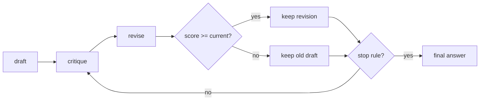

## Où cela s'inscrit

[[rsn.02]] a dépensé du calcul supplémentaire *en parallèle* : tirer de nombreux échantillons indépendants et les agréger. Cette leçon le dépense *en séquence* : prendre un brouillon et l'améliorer, comme on relit une dissertation. Les ingrédients sont un moyen de **noter** une réponse (sans connaître la vraie réponse), un moyen de **critiquer** et de **réviser**, et les règles qui empêchent la boucle de gaspiller du calcul ou d'abîmer un bon brouillon. Les outils de notation reviennent à l'entraînement : la somme des log-probabilités des tokens est exactement la quantité que les méthodes de gradient de politique dérivent ([[rsn.04]]).

Tu as besoin du vérificateur de réponses de [[rsn.01]] et de l'idée d'un modèle de langage comme produit de probabilités du token suivant ([[llm.02]]).

## L'idée en mots simples

Tu écris un brouillon, tu le mets de côté, puis tu le relis au stylo rouge : « l'étape 3 divise par le mauvais nombre », « tu n'as jamais vérifié le cas $x=0$ ». Puis tu écris une version corrigée. Tu peux recommencer. C'est l'**auto-raffinement** : le même modèle joue l'auteur et le relecteur.

Deux questions décident si cela marche. *Le relecteur est-il meilleur que l'auteur ?* Vérifier un calcul est souvent plus facile que de le trouver, donc un relecteur peut parfois repérer ce que l'auteur a manqué. Mais si l'auteur et le relecteur sont le même esprit avec les mêmes angles morts, le relecteur peut très bien approuver une mauvaise réponse, ou « corriger » une bonne en une mauvaise. Et : *comment décide-t-on que le brouillon révisé est réellement meilleur ?* Il faut un score, et le score ne doit pas être trompé par les mêmes angles morts.

## Noter une réponse

### Score à base de règles

Le `heuristic_score` du livre récompense la forme, pas la vérité : un bonus si la réponse se termine par une réponse encadrée (2.0), un plus petit si au moins un nombre peut être trouvé (1.0), un bonus plus grand pour un texte plus court (un terme de brièveté $1.5\,e^{-\text{len}/500}$, longueur en caractères). Pour la réponse de 9 caractères `\boxed{5}` le score est $2+1.5e^{-9/500}=3.4732$ ; pour `the answer is 5` (15 caractères, sans boîte) il est $1+1.5e^{-15/500}=2.4557$. C'est un départageur bon marché et un filtre de bon sens, rien de plus.

### Probabilités des tokens et règle de la chaîne

Un modèle de langage de poids $W$ attribue à une séquence de tokens $x_1,\dots,x_T$ la probabilité

$$
P(x_1,\dots,x_T\mid W)=\prod_{t=1}^{T}P(x_t\mid x_{1:t-1},W).
$$

Chaque facteur est une sortie de softmax à la position précédant le token. Deux problèmes apparaissent aussitôt.

1. **Débordement par le bas (underflow).** Chaque facteur est inférieur à 1, souvent bien inférieur. Une réponse de 400 tokens dont chaque token avait la probabilité $0.01$ a une probabilité jointe de $10^{-800}$, qu'un flottant 64 bits ne peut pas représenter : elle devient exactement `0.0`.
2. **Signification.** Une probabilité jointe minuscule ne signifie pas une mauvaise réponse ; tout texte long a une probabilité minuscule.

### Log-probabilités

Prends les logarithmes. Les produits deviennent des sommes :

$$
\log P(x_{1:T}\mid W)=\sum_{t=1}^{T}\log P(x_t\mid x_{1:t-1},W).
$$

Le même exemple de 400 tokens a $\log P=400\ln0.01=-1842.07$, parfaitement représentable. Calculer la log-probabilité directement à partir des logits $z$ est aussi plus stable que de prendre le log d'un softmax : $\log p_i=z_i-\log\sum_j e^{z_j}$ (soustraire d'abord le maximum, l'« astuce log-sum-exp »). En code, c'est `log_softmax`.

Pour un LLM, la ligne $t$ de la sortie (de forme $(L-1)\times V$ pour $L$ tokens d'entrée) note le token $t+1$, donc pour un prompt de longueur $m$ suivi d'une réponse, les tokens de la réponse sont notés par les lignes $m-1,\dots,L-2$. **Seule la réponse est notée ; le prompt est donné, pas prédit.**

### Somme ou moyenne ?

La somme $\sum_t\log p_t$ favorise les réponses courtes : chaque token supplémentaire ajoute un nombre négatif. Deux candidats : trois tokens à $-0.5$ chacun ont pour somme $-1.5$, moyenne $-0.5$ ; trente tokens à $-0.3$ chacun ont pour somme $-9$, moyenne $-0.3$. La somme choisit le court, la moyenne (confiance par token) choisit le long. Pour **noter** des réponses de longueurs différentes, le livre utilise la log-probabilité **moyenne** (sa normalisation par la longueur rend les candidats comparables). Pour **entraîner** avec des récompenses au niveau de la séquence ([[rsn.04]]), il utilise la **somme**, car chaque déroulement reçoit un seul avantage pour toute la séquence et le gradient doit être celui de la probabilité de la séquence entière ; moyenner changerait silencieusement l'échelle du signal d'apprentissage selon la longueur. L'opposé de la log-probabilité moyenne est l'entropie croisée par token, et $e^{-\text{mean}}$ est la perplexité ([[llm.02]]).

Une log-probabilité moyenne élevée signifie que le modèle trouve son propre texte *peu surprenant*. C'est de la **confiance, pas de la justesse** : une erreur fluide et cohérente peut obtenir un score très élevé.

## Critiquer et réviser

Un tour, avec des prompts comme ceux du livre :

1. **Brouillon** $y_0$ à partir de la question $q$ (échantillonné à température modérée).
2. **Critique** $c_k=\text{LLM}(\text{"you are a meticulous reviewer; find logical errors, missing steps, arithmetic mistakes; propose a short fix plan"},\,q,\,y_k)$, limitée à une courte longueur (le livre la plafonne à 256 tokens).
3. **Révision** $y'_{k}=\text{LLM}(\text{"revise using the critique; end with a boxed result"},\,q,\,y_k,\,c_k)$.
4. **Note** $s(y'_k)$ et **accepte** si elle n'est pas pire que $s(y_k)$ (la règle du livre : `revised_score >= current_score`).



**Coût.** Chaque tour comprend deux générations, et les tours dépendent les uns des autres, donc le raffinement d'un seul problème ne peut pas être exécuté en parallèle, et l'annexe du livre note qu'il ne profite pas du batching comme l'échantillonnage (on pourrait regrouper des *problèmes différents*, mais ce n'est pas fourni). Comparé à $n$ échantillons parallèles au même coût en tokens, le raffinement est plus lent en temps réel.

## Le contrôleur

Le modèle n'est que la moitié de la boucle ; l'autre moitié est la politique. Quatre règles d'arrêt, toutes dans l'exercice :

| règle | s'arrête quand | protège contre |
|---|---|---|
| `max_iters` | un nombre fixe de tours est effectué | un coût non borné |
| `target` | le score du brouillon courant atteint un seuil | le polissage de quelque chose d'assez bon |
| `critique_ok` | le critique dit que le brouillon est bon (« LGTM ») | le gaspillage d'un appel de révision |
| `patience` | $P$ tours consécutifs n'ont pas *strictement* amélioré le score | l'oscillation et les plateaux |

Et une règle d'acceptation : **garder l'ancien brouillon sauf si le nouveau obtient au moins le même score** (`not_worse`), ou strictement mieux (`strict`). La décision sur les égalités compte : `not_worse` laisse le texte dériver tant que le score reste plat ; `strict` se fige au premier brouillon à moins que le score ne bouge.

## Exemple détaillé

Scénarios scriptés de l'exercice (le « modèle » est un script préparé, donc les nombres sont exacts) :

- **Le raffinement aide.** Score du brouillon $1.0$ ; la critique « corrige l'arithmétique » produit une révision de score $2.0$ (acceptée) ; la critique suivante commence par « LGTM ». Trois appels (critique, révision, critique), raison d'arrêt `critique_ok`, score final $2.0$.
- **Le raffinement nuit, la garde fonctionne.** Brouillon $2.0$ ; les révisions obtiennent $1.5$ puis $1.2$. Les deux sont rejetées, l'original est conservé, et avec une patience de 2 la boucle s'arrête après quatre appels. Sans la garde d'acceptation, la réponse finale aurait été la pire.
- **Le score est trompé.** Le brouillon `answer 83` obtient $1.0$ ; la révision `answer 38` obtient $1.4$ parce que le modèle en est plus confiant. Le contrôleur l'accepte et la réponse est maintenant fausse. Aucune règle de la boucle ne peut détecter cela ; seule une vérification **externe** (un vérificateur disposant de la vraie réponse, comme à l'entraînement) le peut.

## Quand le raffinement aide et quand il nuit

Il aide :

- Quand le premier brouillon contient des étourderies (arithmétique, un signe oublié) qu'une seconde lecture repère.
- Quand le score ou le critique porte une information que l'auteur n'avait pas (un vérificateur, un test unitaire, un contrôle de format plus strict).
- Quand le modèle est bien meilleur pour vérifier que pour générer la réponse.

Il nuit :

- Quand le critique partage l'idée fausse de l'auteur, et qu'une révision « confiante » gagne sur la log-probabilité moyenne.
- Quand le modèle est *complaisant* (sycophantic) : il change une réponse correcte parce qu'on lui a dit de chercher des problèmes. Un prompt de critique qui exige des défauts en trouvera.
- Quand les révisions dérivent en style ou en longueur, ce que le score récompense ensuite (textes plus courts, plus de réponses encadrées), de sorte qu'on optimise le score plutôt que la justesse.
- Quand un petit modèle ne peut pas du tout se critiquer de façon fiable.

Que rapporte le livre ? L'aperçu de son chapitre 4 dit que les trois méthodes de mise à l'échelle à l'inférence qu'il présente (les deux premières sont traitées au chapitre 4, la troisième est le raffinement de cette leçon) plus que doublent la précision du modèle de base sur MATH-500. Mais le notebook du chapitre 5 n'imprime que des exemples isolés et aucune table de résultats, donc je ne cite pas ici de précision pour le raffinement. Mesure-la sur tes propres problèmes avec le vérificateur de [[rsn.01]], et avec des barres d'erreur.

## Implémentation

```python
import numpy as np

def log_softmax(z):
    z = z - z.max(axis=-1, keepdims=True)
    return z - np.log(np.exp(z).sum(axis=-1, keepdims=True))

def answer_token_logprobs(logits, token_ids, prompt_len):
    lp = log_softmax(logits)                       # (L-1, V)
    t = np.arange(prompt_len - 1, len(token_ids) - 1)
    return lp[t, np.asarray(token_ids)[t + 1]]     # (L - prompt_len,)

avg_logprob = lambda lp: float(np.mean(lp))
```

Une implémentation de production (le `avg_logprob_answer` du livre) fait exactement cela avec le `torch.log_softmax` de PyTorch et l'indexation sous `torch.inference_mode`. Quand tu auras besoin de gradients plus tard (RL), le même calcul s'exécute sans le décorateur sans gradient et avec une somme ([[rsn.04]]).

## Idées reçues

- « Une log-probabilité élevée veut dire correct. » Elle veut dire que le modèle n'est pas surpris par son propre texte.
- « Le raffinement ne peut qu'améliorer la réponse. » Une décision d'acceptation ou de rejet ne vaut que ce que vaut le score, et avec un mauvais score la boucle peut dégrader la réponse.
- « Un produit de probabilités convient pour les textes courts, donc je n'ai pas besoin de logs. » Même des longueurs modérées débordent par le bas ; et les logs sont aussi ce que l'entraînement dérive.
- « La somme et la moyenne des log-probabilités sont interchangeables. » Elles classent les candidats différemment dès que les longueurs diffèrent.

## Points clés

- Une réponse peut être notée par sa forme (règles), par la confiance du modèle (log-probabilité moyenne des tokens de la réponse) ou par un juge ou vérificateur externe ; chacun échoue différemment.
- Les log-probabilités transforment un produit en somme et évitent l'underflow ; calcule-les à partir des logits avec log-sum-exp.
- L'auto-raffinement est critique, puis révision, puis acceptation si pas pire, répétés ; il coûte deux appels séquentiels par tour.
- Le contrôleur (cible, critique OK, patience, itérations maximales) est aussi important que les prompts.
- La confiance n'est pas la justesse : seule une vérification externe peut attraper une révision confiante mais fausse.

## Explique-le toi-même

1. Pourquoi le livre note-t-il les réponses avec la log-probabilité *moyenne* mais entraîne-t-il avec la *somme* ?
2. Décris une situation où une boucle de raffinement avec acceptation si pas pire transforme une réponse correcte en réponse fausse, et dis ce que tu changerais.

## Pour aller plus loin

- Le chapitre 5 du livre en entier, et la Sec. 4.6 pour utiliser un évaluateur comme départageur de vote.
- [[rsn.04]] : remplacer l'auto-score peu fiable par une récompense vérifiable et apprendre à partir d'elle.

## Critères de maîtrise

- Je sais calculer la log-probabilité d'une réponse à partir de logits et dire quelles lignes et quels tokens sont concernés.
- Je sais expliquer pourquoi les produits débordent par le bas et pas les sommes de logs, et quand utiliser la somme plutôt que la moyenne.
- Je sais implémenter un contrôleur de raffinement avec des règles d'acceptation et d'arrêt et tracer son comportement sur un script.
- Je sais nommer deux façons dont une boucle de raffinement échoue même quand son score continue de monter.
