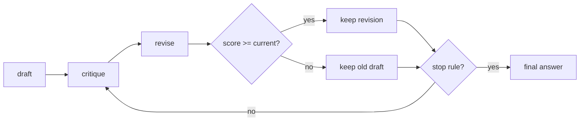

## Where this fits

[[rsn.02]] spent extra compute *in parallel*: draw many independent samples and aggregate. This lesson spends it *in sequence*: take one draft and improve it, the way you proofread an essay. The ingredients are a way to **score** an answer (without knowing the true answer), a way to **critique** and **revise**, and the rules that keep the loop from wasting compute or damaging a good draft. The scoring tools reappear in training: the sum of token log-probabilities is exactly the quantity that policy-gradient methods differentiate ([[rsn.04]]).

You need the answer checker from [[rsn.01]] and the idea of a language model as a product of next-token probabilities ([[llm.02]]).

## The idea in plain words

You write a draft, put it away, then read it with a red pen: "step 3 divides by the wrong number", "you never checked the case $x=0$". Then you write a corrected version. You may repeat. That is **self-refinement**: the same model plays author and editor.

Two questions decide whether it works. *Is the editor better than the author?* Checking a calculation is often easier than finding it, so an editor can sometimes catch what the author missed. But if author and editor are the same mind with the same blind spots, the editor may happily approve a wrong answer, or "fix" a right one into a wrong one. And: *how do you decide whether the revised draft is actually better?* You need a score, and the score must not be fooled by the same blind spots.

## Scoring a response

### Rule-based score

The book's `heuristic_score` rewards form, not truth: a bonus if the response ends with a boxed answer (2.0), a smaller one if at least a number can be found (1.0), a larger bonus the shorter the text (a brevity term $1.5\,e^{-\text{len}/500}$, length in characters). For the 9-character answer `\boxed{5}` the score is $2+1.5e^{-9/500}=3.4732$; for `the answer is 5` (15 characters, no box) it is $1+1.5e^{-15/500}=2.4557$. It is a cheap tie-breaker and a sanity filter, nothing more.

### Token probabilities and the chain rule

A language model with weights $W$ assigns to a token sequence $x_1,\dots,x_T$ the probability

$$
P(x_1,\dots,x_T\mid W)=\prod_{t=1}^{T}P(x_t\mid x_{1:t-1},W).
$$

Each factor is a softmax output at the position before the token. Two problems appear immediately.

1. **Underflow.** Each factor is below 1, often far below. A 400-token response whose tokens each had probability $0.01$ has joint probability $10^{-800}$, which a 64-bit float cannot represent: it becomes exactly `0.0`.
2. **Meaning.** A tiny joint probability does not mean a bad answer; any long text has a tiny probability.

### Log-probabilities

Take logs. Products become sums:

$$
\log P(x_{1:T}\mid W)=\sum_{t=1}^{T}\log P(x_t\mid x_{1:t-1},W).
$$

The same 400-token example has $\log P=400\ln0.01=-1842.07$, perfectly representable. Computing the log-probability directly from logits $z$ is also more stable than taking the log of a softmax: $\log p_i=z_i-\log\sum_j e^{z_j}$ (subtract the maximum first, the "log-sum-exp trick"). In code this is `log_softmax`.

For an LLM, row $t$ of the output (shape $(L-1)\times V$ for $L$ input tokens) scores token $t+1$, so for a prompt of length $m$ followed by an answer, the answer tokens are scored by rows $m-1,\dots,L-2$. **Only the answer is scored; the prompt is given, not predicted.**

### Sum or mean?

The sum $\sum_t\log p_t$ favours short answers: every extra token adds a negative number. Two candidates: three tokens at $-0.5$ each have sum $-1.5$, mean $-0.5$; thirty tokens at $-0.3$ each have sum $-9$, mean $-0.3$. The sum picks the short one, the mean (per-token confidence) picks the long one. For **scoring** answers of different length the book uses the **average** log-probability (its length normalisation makes candidates comparable). For **training** with sequence-level rewards ([[rsn.04]]) it uses the **sum**, because each rollout receives one advantage for the whole sequence and the gradient must be that of the full sequence probability; averaging would silently rescale the learning signal by length. The negative of the mean log-probability is the per-token cross-entropy, and $e^{-\text{mean}}$ is the perplexity ([[llm.02]]).

A high average log-probability means the model finds its own text *unsurprising*. It is **confidence, not correctness**: a fluent, consistent mistake can score very high.

## Critique and revise

One round, with prompts like the book's:

1. **Draft** $y_0$ from the question $q$ (sampled at moderate temperature).
2. **Critique** $c_k=\text{LLM}(\text{"you are a meticulous reviewer; find logical errors, missing steps, arithmetic mistakes; propose a short fix plan"},\,q,\,y_k)$, limited to a short length (the book caps it at 256 tokens).
3. **Revise** $y'_{k}=\text{LLM}(\text{"revise using the critique; end with a boxed result"},\,q,\,y_k,\,c_k)$.
4. **Score** $s(y'_k)$ and **accept** if it is not worse than $s(y_k)$ (the book's rule: `revised_score >= current_score`).



**Cost.** Each round is two generations, and the rounds depend on each other, so a single problem's refinement cannot be run in parallel, and the book's appendix notes it does not benefit from batching the way sampling does (one could batch *different problems*, but this is not provided). Compared with $n$ parallel samples at equal token cost, refinement is slower in wall-clock time.

## The controller

The model is only half the loop; the other half is policy. Four stopping rules, all in the exercise:

| rule | stops when | protects against |
|---|---|---|
| `max_iters` | a fixed number of rounds is done | unbounded cost |
| `target` | the score of the current draft reaches a threshold | polishing something already good enough |
| `critique_ok` | the critic says the draft is fine ("LGTM") | wasting a revise call |
| `patience` | $P$ consecutive rounds did not *strictly* improve the score | oscillation and plateaus |

And one acceptance rule: **keep the old draft unless the new one scores at least as well** (`not_worse`), or strictly better (`strict`). The tie decision matters: `not_worse` lets the text drift while the score stays flat; `strict` freezes at the first draft unless the score moves.

## Worked example

Scripted scenarios from the exercise (the "model" is a canned script, so the numbers are exact):

- **Refinement helps.** Draft score $1.0$; the critique "fix the arithmetic" yields a revision scoring $2.0$ (accepted); the next critique starts with "LGTM". Three calls (critique, revise, critique), stop reason `critique_ok`, final score $2.0$.
- **Refinement hurts, the guard works.** Draft $2.0$; revisions score $1.5$, then $1.2$. Both are rejected, the original is kept, and with patience 2 the loop stops after four calls. Without the acceptance guard the final answer would have been the worst one.
- **The score is fooled.** Draft `answer 83` scores $1.0$; the revision `answer 38` scores $1.4$ because the model is more confident about it. The controller accepts it and the answer is now wrong. No loop rule can detect this; only an **external** check (a verifier with the true answer, as in training) can.

## When refinement helps and when it hurts

Helps:

- The first draft contains slips (arithmetic, a dropped sign) that a second reading catches.
- The score or critic carries information the author lacked (a verifier, a unit test, a stricter format check).
- The model is much better at checking than at generating the answer.

Hurts:

- The critic shares the author's misconception, and a "confident" revision wins on average log-probability.
- The model is *sycophantic*: it changes a correct answer because it was told to find problems. A critique prompt that demands issues will find some.
- Revisions drift in style or length, which the score then rewards (shorter texts, more boxed answers), so you optimise the score rather than correctness.
- A small model cannot reliably critique itself at all.

What does the book report? The overview in its chapter 4 says that all three inference-time scaling methods it introduces (the first two are covered in chapter 4, the third is the refinement of this lesson) more than double the base model's accuracy on MATH-500. But chapter 5's notebook prints only single worked examples and no results table, so I do not quote a refinement accuracy here. Measure it on your own problems with the verifier from [[rsn.01]], and with error bars.

## Implementation

```python
import numpy as np

def log_softmax(z):
    z = z - z.max(axis=-1, keepdims=True)
    return z - np.log(np.exp(z).sum(axis=-1, keepdims=True))

def answer_token_logprobs(logits, token_ids, prompt_len):
    lp = log_softmax(logits)                       # (L-1, V)
    t = np.arange(prompt_len - 1, len(token_ids) - 1)
    return lp[t, np.asarray(token_ids)[t + 1]]     # (L - prompt_len,)

avg_logprob = lambda lp: float(np.mean(lp))
```

A production implementation (the book's `avg_logprob_answer`) does exactly this with PyTorch's `torch.log_softmax` and indexing under `torch.inference_mode`. When you later need gradients (RL) the same computation runs without the no-gradient decorator and with a sum ([[rsn.04]]).

## Common misconceptions

- "High log-probability means correct." It means the model is unsurprised by its own text.
- "Refinement can only improve the answer." A rejected-or-accepted decision is only as good as the score, and with a bad score the loop can degrade the answer.
- "A product of probabilities is fine for short texts, so I do not need logs." Even moderate lengths underflow; and logs are also what training differentiates.
- "Sum and mean log-probability are interchangeable." They rank candidates differently whenever lengths differ.

## Key takeaways

- A response can be scored by form (rules), by the model's own confidence (average log-probability of the answer tokens) or by an external judge or verifier; each fails differently.
- Log-probabilities turn a product into a sum and avoid underflow; compute them from logits with log-sum-exp.
- Self-refinement is critique then revise then accept-if-not-worse, repeated; it costs two sequential calls per round.
- The controller (target, critic OK, patience, max iterations) is as important as the prompts.
- Confidence is not correctness: only external verification can catch a confidently wrong revision.

## Explain it yourself

1. Why does the book score answers with the *average* log-probability but train with the *sum*?
2. Describe a situation where an accept-if-not-worse refinement loop turns a correct answer into a wrong one, and say what you would change.

## Further reading

- Book chapter 5 in full, and Sec. 4.6 for using a scorer as a voting tie-breaker.
- [[rsn.04]]: replacing the unreliable self-score by a verifiable reward and learning from it.

## Mastery criteria

- I can compute an answer's log-probability from logits and say which rows and tokens are involved.
- I can explain why products underflow and sums of logs do not, and when sum versus mean is appropriate.
- I can implement a refinement controller with acceptance and stopping rules and trace its behaviour on a script.
- I can name two ways a refinement loop fails even when its score keeps rising.
