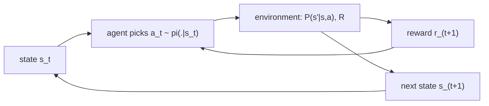

## Où cela s'inscrit

L'apprentissage supervisé (régression linéaire et logistique, k-means) reçoit une étiquette pour chaque exemple. De nombreux problèmes réels n'offrent rien de tel : un système de recommandation montre un article et apprend seulement si *cet* article a été cliqué ; un bot de jeu apprend à la fin de 80 coups s'il a gagné ; un modèle de langage est noté sur une réponse entière. Tu agis, le monde répond par un nombre (une **récompense**), et tu dois découvrir quel comportement est bon à partir de ces seuls nombres. C'est l'**apprentissage par renforcement** (RL).

Cette leçon construit le vocabulaire en deux étapes. D'abord le **bandit manchot** (*multi-armed bandit*), où il n'y a ni état ni délai : juste la pure tension entre essayer de nouvelles choses et répéter ce qui marche. Ensuite le **processus de décision markovien** (MDP), l'objet formel sur lequel porte l'optimisation de toutes les leçons suivantes de ce cours (itération de valeur, Q-learning, gradients de politique, PPO, RLHF). Tout ici est en NumPy et s'exécute dans ton navigateur.

## L'idée en mots simples

Imagine une salle de casino avec cinq machines à sous dont tu ne connais pas les gains. Tu as 1000 pièces. Si tu ne joues que la machine qui a le mieux payé lors de tes premiers essais, tu risques de rester coincé avec une machine médiocre pour toujours, parce que tu n'as jamais donné aux autres une vraie chance. Si tu dépenses toutes tes pièces à essayer chaque machine de façon égale, tu apprends la vérité mais tu gaspilles des pièces sur des machines que tu sais déjà mauvaises. C'est le **dilemme exploration-exploitation** : *exploiter* ce que tu crois être le meilleur, *explorer* pour améliorer tes croyances.

Deux remèdes simples. **Epsilon-greedy** : la plupart du temps, joue ta meilleure machine actuelle, mais de temps en temps (disons une fois sur dix) tire un levier au hasard. **L'optimisme face à l'incertitude (UCB)** : donne à chaque machine un bonus proportionnel à *ce que tu ignores* d'elle, puis joue la machine qui a la plus haute « moyenne plus bonus ». Une machine essayée deux fois reçoit un grand bonus ; une machine essayée 500 fois n'en reçoit presque aucun, donc le bonus diminue exactement à mesure que la certitude grandit.

Enrichissons maintenant le monde. Dans un labyrinthe, choisir un couloir change l'endroit où tu seras ensuite, et la récompense (la sortie) peut venir de nombreuses étapes plus tard. Tu dois alors te souvenir de *où tu es* (l'**état**), de ce que tu peux faire (les **actions**), de ce qui se passe ensuite (les **transitions**), de ce que tu collectes en chemin (les **récompenses**), et de combien tu valorises le futur par rapport au présent (le **facteur d'actualisation**). La promesse « markovienne » est que l'endroit où tu es suffit : l'historique n'importe pas au-delà. Un bandit n'est qu'un MDP à un seul état.

## Cadre : le bandit

Un bandit à $k$ bras a $k$ actions (bras). Tirer le bras $a$ donne une récompense aléatoire de moyenne inconnue $q_*(a)=\mathbb{E}[r\mid a]$. Nous gardons une estimation $Q_t(a)$ et un compteur $N_t(a)$ de tirages. Le meilleur bras est $a^*=\arg\max_a q_*(a)$.

La qualité d'une stratégie sur $T$ tirages se mesure par le **regret** : la récompense perdue par rapport à celle qu'on aurait eue en jouant toujours le meilleur bras,

$$
\text{Regret}(T)=T\,q_*(a^*)-\sum_{t=1}^{T}\mathbb{E}[r_t].
$$

### Moyenne empirique incrémentale (une dérivation qui vaut la peine d'être faite une fois)

Stocker chaque récompense juste pour les moyenner gaspille de la mémoire. Après $n$ tirages d'un bras avec les récompenses $r_1,\dots,r_n$, la moyenne est $Q_n=\frac1n\sum_{i=1}^n r_i$. Séparons le dernier terme :

$$
Q_n=\frac1n\Big(r_n+\sum_{i=1}^{n-1}r_i\Big)=\frac1n\big(r_n+(n-1)Q_{n-1}\big)=Q_{n-1}+\frac1n\big(r_n-Q_{n-1}\big).
$$

Lis-le ainsi : **nouvelle estimation = ancienne estimation + pas × (cible − ancienne estimation)**, avec un pas de $1/n$. Cette forme (une erreur fois un pas) reviendra dans l'apprentissage TD, la descente de gradient et le Q-learning. Un pas constant $\alpha$ au lieu de $1/n$ oublie les anciennes données et suit un monde qui change.

### Les deux stratégies

**Epsilon-greedy.** Avec une probabilité $\varepsilon$, choisir un bras uniformément au hasard, sinon $\arg\max_a Q(a)$. Simple, mais l'exploration est aveugle : elle continue de tirer des bras clairement mauvais avec une probabilité $\varepsilon/k$ pour toujours, donc son regret croît linéairement en $T$.

**UCB (borne supérieure de confiance).** Jouer

$$
a_t=\arg\max_a\Big[\,Q_t(a)+c\sqrt{\frac{\ln t}{N_t(a)}}\,\Big].
$$

Pourquoi ce bonus ? Par l'inégalité de Hoeffding, pour des récompenses dans $[0,1]$, la moyenne empirique de $N$ tirages vérifie $P\big(q_*-Q\ge u\big)\le e^{-2Nu^2}$. Fixer le membre de droite à une petite probabilité $\delta$ et résoudre en $u$ donne $u=\sqrt{\ln(1/\delta)/(2N)}$. Choisir un $\delta$ qui décroît comme une puissance de $t$ transforme $\ln(1/\delta)$ en un multiple de $\ln t$, ce qui donne la forme ci-dessus, le multiple étant absorbé dans la constante $c$. Le crochet est donc une *borne supérieure* plausible de la vraie moyenne, et nous agissons comme si le meilleur cas était vrai : les bras peu tirés (grand bonus) sont essayés ; les bras dont la borne supérieure tombe sous la meilleure moyenne sont abandonnés pour de bon. Avec un $c$ adapté, le regret ne croît que comme $\ln T$. (Nous nous appuyons sur le résultat standard ; la preuve complète du regret dépasse cette leçon.) Tout bras avec $N=0$ est tiré en premier.

## Du bandit au MDP

Un **processus de décision markovien** est un n-uplet $(\mathcal S,\mathcal A,P,R,\gamma)$ :

- $\mathcal S$ : l'ensemble des **états** (tout ce qui est nécessaire pour décider : une case d'une grille, un plateau, une fenêtre de contexte).
- $\mathcal A$ : les **actions**.
- $P(s'\mid s,a)$ : les probabilités de **transition**. Si tu es en $s$ et fais $a$, la chance d'atterrir en $s'$.
- $R(s,a,s')$ : la **récompense** reçue lors de cette transition (un nombre réel).
- $\gamma\in[0,1)$ : le **facteur d'actualisation**.

**Propriété de Markov :** $P(s_{t+1}\mid s_t,a_t)=P(s_{t+1}\mid s_0,a_0,\dots,s_t,a_t)$. Si l'historique compte encore, l'état est incomplet ; corrige l'état, pas la méthode.

Une **politique** $\pi(a\mid s)$ est la règle de l'agent pour choisir des actions (une distribution de probabilité par état). Exécuter une politique produit une **trajectoire** $s_0,a_0,r_1,s_1,a_1,r_2,\dots$. Le **retour** à partir de l'instant $t$ est la somme actualisée des récompenses futures :

$$
G_t=r_{t+1}+\gamma r_{t+2}+\gamma^2 r_{t+3}+\dots=\sum_{k=0}^{\infty}\gamma^k r_{t+k+1}.
$$

Pourquoi actualiser ? (i) Cela garde finies les sommes infinies, puisque $|G_t|\le r_{\max}/(1-\gamma)$. (ii) Cela encode l'impatience ou l'incertitude sur le futur lointain. Règle empirique : l'horizon effectif est d'environ $1/(1-\gamma)$ étapes ($\gamma=0.9$ vaut environ 10 étapes, $0.99$ environ 100). Les retours satisfont une récursion d'une ligne que la leçon suivante exploite :

$$
G_t=r_{t+1}+\gamma\,G_{t+1}.
$$

La **valeur d'état** $V^\pi(s)=\mathbb{E}_\pi[G_t\mid s_t=s]$ et la **valeur d'action** $Q^\pi(s,a)=\mathbb{E}_\pi[G_t\mid s_t=s,a_t=a]$ sont les quantités qu'estiment presque tous les algorithmes de RL. Le but du RL est une politique $\pi^*$ dont la valeur est au moins aussi élevée que celle de toute autre politique dans chaque état.



## Exemple résolu

Tous les nombres ci-dessous sont reproduits par le code de l'exercice.

**Retour.** Récompenses $(1,0,2)$ avec $\gamma=0.9$ : $G=1+0.9\cdot0+0.81\cdot2=2.62$. Par la récursion, $G_2=2$, $G_1=0+0.9\cdot2=1.8$, $G_0=1+0.9\cdot1.8=2.62$.

**Choix UCB.** Deux bras, $Q=(0.5,0.4)$, tirages $N=(10,2)$, étape totale $t=12$, $c=2$. Scores : le bras 0 donne $0.5+2\sqrt{\ln12/10}=1.497$ ; le bras 1 donne $0.4+2\sqrt{\ln12/2}=2.629$. UCB choisit le bras 1, bien que sa moyenne soit plus basse : il n'a été essayé que deux fois, il mérite donc un nouveau coup d'œil.

**Course de bandits.** Cinq bras gaussiens de moyennes $(0.1,0.5,0.3,0.9,0.2)$, bruit unitaire, 1000 tirages, moyennés sur 20 graines (chiffres de première main obtenus en exécutant le code) : l'algorithme purement glouton (estimations initiales à 0) gagne en moyenne environ 0.39 par tirage et ne trouve presque jamais le meilleur bras (le bras 3), car il se fixe sur le premier bras qui donne une récompense positive. Epsilon-greedy avec $\varepsilon=0.1$ gagne environ 0.80 et joue le meilleur bras environ 82 % du temps. Avec $\varepsilon=0.5$, il ne gagne qu'environ 0.64 (trop d'exploration). UCB avec $c=2$ gagne environ 0.78 et joue le meilleur bras environ 81 % du temps.

**Un minuscule MDP.** Une chaîne de 5 états, l'état 4 étant terminal. L'action « droite » avance d'un pas vers la droite avec une probabilité de 0.8 et reste sur place sinon ; atteindre l'état 4 donne la récompense 1, tout le reste 0. Aller toujours à droite depuis l'état 0 demande quatre succès ; la récompense arrive à l'étape $T$ avec le poids $\gamma^{T-1}$, donc $V(0)=\mathbb{E}[\gamma^{T-1}]=\frac1\gamma\big(\tfrac{0.8\gamma}{1-0.2\gamma}\big)^4\approx0.6605$ pour $\gamma=0.9$. La moyenne de 4000 retours simulés donne 0.661, dans l'erreur d'échantillonnage. Cet accord entre forme close et simulation est la façon dont nous testerons chaque algorithme de ce cours.

## Implémentation

```python
import numpy as np

def update_mean(Q, N, a, r):
    N = N.copy(); Q = Q.copy()
    N[a] += 1
    Q[a] += (r - Q[a]) / N[a]            # incremental mean
    return Q, N

def epsilon_greedy_action(Q, eps, rng):
    if rng.random() < eps:
        return int(rng.integers(len(Q)))
    return int(np.argmax(Q))

def ucb_action(Q, N, t, c):
    if np.any(N == 0):
        return int(np.argmin(N))         # try every arm once
    return int(np.argmax(Q + c * np.sqrt(np.log(t) / N)))

def discounted_return(rewards, gamma):
    g = 0.0
    for r in reversed(rewards):          # G_t = r + gamma * G_{t+1}
        g = r + gamma * g
    return g
```

Formes : `Q` et `N` ont la forme `(k,)` ; une étape d'environnement renvoie une récompense scalaire. En production, les services de bandits (classement publicitaire, tests A/B avec échantillonnage de Thompson ou UCB) utilisent les mêmes estimations plus des caractéristiques de contexte (bandits contextuels) ; les bibliothèques de RL comme Gymnasium définissent l'interface `reset()` / `step(action)` pour les environnements MDP.

## Idées reçues

- « L'exploration est un effort gaspillé. » Sans elle, tu ne peux pas savoir si ton choix actuel est bon ; les 0.39 de l'algorithme glouton plus haut en sont la preuve.
- « Epsilon-greedy avec un grand epsilon est sûr. » Le coût de l'exploration est payé à chaque étape, pour toujours ; fais décroître $\varepsilon$ ou utilise UCB quand tu le peux.
- « La propriété de Markov signifie que le monde n'a pas de mémoire. » Elle signifie que l'*état* résume tout ce qui est pertinent. Une partie d'échecs est markovienne dans la position du plateau, pas dans le seul dernier coup.
- « Récompense et retour sont la même chose. » Une récompense est le signal d'une étape ; le retour est la somme (actualisée) que tu veux maximiser. Un coup peut avoir une récompense de 0 et un retour énorme.
- « Un bandit est un domaine différent. » C'est un MDP à un seul état, donc tout ce que tu apprends sur l'estimation de valeurs s'y applique.
- « L'action optimale maximise la récompense immédiate. » Dans un MDP, la bonne action maximise le *retour* ; c'est toute la raison d'être des équations de Bellman (leçon suivante).

## Points clés à retenir

- Le RL apprend à partir d'un retour évaluatif (un nombre) plutôt qu'instructif (une étiquette), il doit donc explorer.
- La moyenne incrémentale $Q\leftarrow Q+\tfrac1n(r-Q)$ est le modèle de presque toutes les mises à jour ultérieures.
- Epsilon-greedy explore à l'aveugle ; UCB explore là où l'incertitude est la plus grande et a un regret logarithmique.
- Un MDP est $(\mathcal S,\mathcal A,P,R,\gamma)$ ; une politique associe des états à des actions ; le retour est la somme actualisée des récompenses ; la valeur est le retour espéré.
- $G_t=r_{t+1}+\gamma G_{t+1}$ est la récursion qui sous-tend la programmation dynamique et l'apprentissage TD.

## Explique-le toi-même

1. Explique à un ami qui n'a jamais vu de RL pourquoi une stratégie qui répète toujours l'option qui paraît la meilleure peut être pire qu'une stratégie qui fait parfois quelque chose d'aléatoire.
2. Prends une routine quotidienne (trajet, cuisine) et nomme ses états, actions, récompenses et un facteur d'actualisation raisonnable. Quelle partie n'est *pas* markovienne, et comment corrigerais-tu l'état ?

## Pour aller plus loin

- Sutton et Barto, *Reinforcement Learning: An Introduction*, chapitres 2 et 3 (bandits, MDP finis). Non utilisé comme source pour cette leçon.
- Auer, Cesa-Bianchi, Fischer (2002), analyse en temps fini d'UCB (non lu pour cette leçon ; cité pour le résultat sur le regret).

## Critères de maîtrise

Tu sais (1) dériver la mise à jour de la moyenne incrémentale ; (2) implémenter epsilon-greedy et UCB et expliquer pourquoi le bonus d'UCB diminue ; (3) écrire le n-uplet du MDP et le retour, et calculer à la main un retour actualisé ; (4) vérifier une estimation de valeur en comparant une forme close à une simulation.
