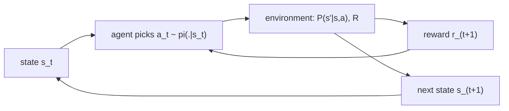

## Where this fits

Supervised learning (linear and logistic regression, k-means) gets a label for every example. Many real problems give nothing of the sort: a recommender shows one item and learns only whether *that* item was clicked; a game bot learns at the end of 80 moves whether it won; a language model is scored on a whole answer. You act, the world answers with a number (a **reward**), and you must discover which behaviour is good from those numbers alone. That is **reinforcement learning** (RL).

This lesson builds the vocabulary in two steps. First the **multi-armed bandit**, where there is no state and no delay: just the pure tension between trying new things and repeating what works. Then the **Markov decision process** (MDP), the formal object that every later lesson in this course (value iteration, Q-learning, policy gradients, PPO, RLHF) optimises over. Everything here is NumPy and runs in your browser.

## The idea in plain words

Imagine a casino hall with five slot machines whose payouts you do not know. You have 1000 coins. If you play only the machine that paid best in your first few tries, you may be stuck with a mediocre one forever, because you never gave the others a fair chance. If you spend all your coins sampling every machine equally, you learn the truth but waste coins on machines you already know are bad. This is the **exploration-exploitation dilemma**: *exploit* what you believe is best, *explore* to improve your beliefs.

Two simple remedies. **Epsilon-greedy**: most of the time play your current best machine, but every now and then (say one time in ten) pull a random lever. **Optimism under uncertainty (UCB)**: give every machine a bonus proportional to how *little* you know about it, then play the machine with the highest "average plus bonus". A machine you have tried twice gets a large bonus; one you have tried 500 times gets almost none, so the bonus shrinks exactly as certainty grows.

Now make the world richer. In a maze, choosing a corridor changes where you are next, and the payoff (the exit) may come many steps later. You now need to remember *where you are* (the **state**), what you can do (the **actions**), what happens next (the **transitions**), what you collect on the way (the **rewards**), and how much you value the future compared to now (the **discount**). The "Markov" promise is that where you are is enough: the history does not matter beyond it. A bandit is just an MDP with one state.

## Setup: the bandit

A $k$-armed bandit has $k$ actions (arms). Pulling arm $a$ gives a random reward with unknown mean $q_*(a)=\mathbb{E}[r\mid a]$. We keep an estimate $Q_t(a)$ and a count $N_t(a)$ of pulls. The best arm is $a^*=\arg\max_a q_*(a)$.

The quality of a strategy over $T$ pulls is measured by **regret**: how much reward you lost compared with always playing the best arm,

$$
\text{Regret}(T)=T\,q_*(a^*)-\sum_{t=1}^{T}\mathbb{E}[r_t].
$$

### Incremental sample mean (a derivation worth doing once)

Storing every reward just to average them wastes memory. After $n$ pulls of an arm with rewards $r_1,\dots,r_n$, the mean is $Q_n=\frac1n\sum_{i=1}^n r_i$. Split off the last term:

$$
Q_n=\frac1n\Big(r_n+\sum_{i=1}^{n-1}r_i\Big)=\frac1n\big(r_n+(n-1)Q_{n-1}\big)=Q_{n-1}+\frac1n\big(r_n-Q_{n-1}\big).
$$

Read it as: **new estimate = old estimate + step size × (target − old estimate)**, with step size $1/n$. This shape (an error times a step size) will reappear in TD learning, gradient descent and Q-learning. A constant step size $\alpha$ instead of $1/n$ forgets old data and tracks a world that changes.

### The two strategies

**Epsilon-greedy.** With probability $\varepsilon$ choose an arm uniformly at random, otherwise $\arg\max_a Q(a)$. Simple, but the exploration is blind: it keeps pulling clearly bad arms with probability $\varepsilon/k$ forever, so its regret grows linearly in $T$.

**UCB (upper confidence bound).** Play

$$
a_t=\arg\max_a\Big[\,Q_t(a)+c\sqrt{\frac{\ln t}{N_t(a)}}\,\Big].
$$

Why this bonus? By Hoeffding's inequality, for rewards in $[0,1]$ the sample mean of $N$ pulls satisfies $P\big(q_*-Q\ge u\big)\le e^{-2Nu^2}$. Setting the right-hand side to a small probability $\delta$ and solving for $u$ gives $u=\sqrt{\ln(1/\delta)/(2N)}$. Choosing $\delta$ that shrinks like a power of $t$ turns $\ln(1/\delta)$ into a multiple of $\ln t$, which gives the form above, with the multiple absorbed in the constant $c$. So the bracket is a plausible *upper bound* on the true mean, and we act as if the best case were true: arms with few pulls (large bonus) are tried; arms whose upper bound falls below the best average are abandoned for good. With a suitable $c$ the regret grows only like $\ln T$. (We rely on the standard result; the full regret proof is beyond this lesson.) Any arm with $N=0$ is pulled first.

## From bandit to MDP

A **Markov decision process** is a tuple $(\mathcal S,\mathcal A,P,R,\gamma)$:

- $\mathcal S$: the set of **states** (everything needed to decide: a cell in a grid, a board, a context window).
- $\mathcal A$: the **actions**.
- $P(s'\mid s,a)$: the **transition** probabilities. If you are in $s$ and do $a$, the chance of landing in $s'$.
- $R(s,a,s')$: the **reward** received on that transition (a real number).
- $\gamma\in[0,1)$: the **discount factor**.

**Markov property:** $P(s_{t+1}\mid s_t,a_t)=P(s_{t+1}\mid s_0,a_0,\dots,s_t,a_t)$. If the history still matters, the state is incomplete; fix the state, not the method.

A **policy** $\pi(a\mid s)$ is the agent's rule for choosing actions (a probability distribution per state). Running a policy produces a **trajectory** $s_0,a_0,r_1,s_1,a_1,r_2,\dots$. The **return** from time $t$ is the discounted sum of future rewards:

$$
G_t=r_{t+1}+\gamma r_{t+2}+\gamma^2 r_{t+3}+\dots=\sum_{k=0}^{\infty}\gamma^k r_{t+k+1}.
$$

Why discount? (i) It keeps infinite sums finite, since $|G_t|\le r_{\max}/(1-\gamma)$. (ii) It encodes impatience or uncertainty about the far future. A rule of thumb: the effective horizon is about $1/(1-\gamma)$ steps ($\gamma=0.9$ is about 10 steps, $0.99$ about 100). Returns satisfy a one-line recursion that the next lesson exploits:

$$
G_t=r_{t+1}+\gamma\,G_{t+1}.
$$

The **state value** $V^\pi(s)=\mathbb{E}_\pi[G_t\mid s_t=s]$ and the **action value** $Q^\pi(s,a)=\mathbb{E}_\pi[G_t\mid s_t=s,a_t=a]$ are the quantities that nearly every RL algorithm estimates. The goal of RL is a policy $\pi^*$ whose value is at least as high as any other policy in every state.



## Worked example

All numbers below are reproduced by the exercise code.

**Return.** Rewards $(1,0,2)$ with $\gamma=0.9$: $G=1+0.9\cdot0+0.81\cdot2=2.62$. By the recursion, $G_2=2$, $G_1=0+0.9\cdot2=1.8$, $G_0=1+0.9\cdot1.8=2.62$.

**UCB choice.** Two arms, $Q=(0.5,0.4)$, pulls $N=(10,2)$, total step $t=12$, $c=2$. Scores: arm 0 gives $0.5+2\sqrt{\ln12/10}=1.497$; arm 1 gives $0.4+2\sqrt{\ln12/2}=2.629$. UCB chooses arm 1, even though its average is lower: it has been tried only twice, so it deserves another look.

**Bandit race.** Five Gaussian arms with means $(0.1,0.5,0.3,0.9,0.2)$, unit noise, 1000 pulls, averaged over 20 seeds (first-hand numbers from running the code): pure greedy (initial estimates 0) earns an average reward of about 0.39 per pull and almost never finds the best arm (arm 3), because it locks onto the first arm that gives a positive reward. Epsilon-greedy with $\varepsilon=0.1$ earns about 0.80 and plays the best arm about 82% of the time. With $\varepsilon=0.5$ it earns only about 0.64 (too much exploration). UCB with $c=2$ earns about 0.78 and plays the best arm about 81% of the time.

**A tiny MDP.** A chain of 5 states, state 4 terminal. Action "right" moves one step right with probability 0.8 and otherwise stays put; reaching state 4 gives reward 1, everything else 0. Always going right from state 0 needs four successes; the reward arrives at step $T$ with weight $\gamma^{T-1}$, so $V(0)=\mathbb{E}[\gamma^{T-1}]=\frac1\gamma\big(\tfrac{0.8\gamma}{1-0.2\gamma}\big)^4\approx0.6605$ for $\gamma=0.9$. Averaging 4000 simulated returns gives 0.661, within sampling error. That agreement of a closed form and a simulation is how we will test every algorithm in this course.

## Implementation

```python
import numpy as np

def update_mean(Q, N, a, r):
    N = N.copy(); Q = Q.copy()
    N[a] += 1
    Q[a] += (r - Q[a]) / N[a]            # incremental mean
    return Q, N

def epsilon_greedy_action(Q, eps, rng):
    if rng.random() < eps:
        return int(rng.integers(len(Q)))
    return int(np.argmax(Q))

def ucb_action(Q, N, t, c):
    if np.any(N == 0):
        return int(np.argmin(N))         # try every arm once
    return int(np.argmax(Q + c * np.sqrt(np.log(t) / N)))

def discounted_return(rewards, gamma):
    g = 0.0
    for r in reversed(rewards):          # G_t = r + gamma * G_{t+1}
        g = r + gamma * g
    return g
```

Shapes: `Q` and `N` have shape `(k,)`; an environment step returns a scalar reward. In production, bandit services (ad ranking, A/B testing with Thompson sampling or UCB) use the same estimates plus context features (contextual bandits); RL libraries such as Gymnasium define the `reset()` / `step(action)` interface for MDP environments.

## Common misconceptions

- "Exploration is wasted effort." Without it you cannot know whether your current choice is any good; greedy's 0.39 above is the evidence.
- "Epsilon-greedy with a large epsilon is safe." The exploration cost is paid every step forever; decay $\varepsilon$ or use UCB when you can.
- "The Markov property means the world has no memory." It means the *state* summarises everything relevant. A game of chess is Markov in the board position, not in the last move alone.
- "Reward and return are the same." A reward is one step's signal; the return is the (discounted) sum you want to maximise. A move can have reward 0 and enormous return.
- "A bandit is a different field." It is an MDP with a single state, so everything you learn about estimating values carries over.
- "The optimal action maximises the immediate reward." In an MDP the right action maximises the *return*; this is the entire reason the Bellman equations exist (next lesson).

## Key takeaways

- RL learns from evaluative (a number) rather than instructive (a label) feedback, so it must explore.
- The incremental mean $Q\leftarrow Q+\tfrac1n(r-Q)$ is the template for almost all later updates.
- Epsilon-greedy explores blindly; UCB explores where uncertainty is highest and has logarithmic regret.
- An MDP is $(\mathcal S,\mathcal A,P,R,\gamma)$; a policy maps states to actions; the return is the discounted sum of rewards; value is expected return.
- $G_t=r_{t+1}+\gamma G_{t+1}$ is the recursion behind dynamic programming and TD learning.

## Explain it yourself

1. Explain, to a friend who has never seen RL, why a strategy that always repeats the best-looking option can be worse than one that sometimes does something random.
2. Take a daily routine (commuting, cooking) and name its states, actions, rewards and a sensible discount factor. Which part is *not* Markov, and how would you fix the state?

## Further reading

- Sutton and Barto, *Reinforcement Learning: An Introduction*, chapters 2 and 3 (bandits, finite MDPs). Not used as a source for this lesson.
- Auer, Cesa-Bianchi, Fischer (2002), finite-time analysis of UCB (not read for this lesson; cited for the regret result).

## Mastery criteria

You can (1) derive the incremental mean update; (2) implement epsilon-greedy and UCB and explain why UCB's bonus shrinks; (3) write down the MDP tuple and the return, and compute a discounted return by hand; (4) check a value estimate by comparing a closed form with a simulation.
