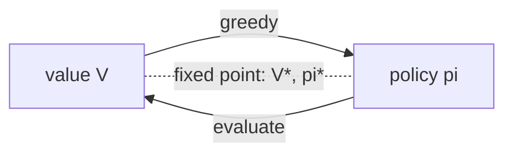

## Où cela s'inscrit

[[rl.01]] a défini un MDP et la valeur d'une politique comme un retour espéré, mais n'a donné aucun moyen de la *calculer* autrement qu'en simulant. Quand tu connais le modèle (les probabilités de transition et les récompenses), tu n'as pas besoin de simuler : la valeur d'un état peut s'écrire en fonction des valeurs de ses voisins, et cette récursion peut être transformée en algorithme. C'est la **programmation dynamique** (DP), inventée par Bellman dans les années 1950.

La DP compte même si la plupart des problèmes réels n'ont pas de modèle connu, pour trois raisons : elle définit exactement ce que signifie « la politique optimale » ; c'est l'oracle de débogage de toute méthode par échantillonnage qui suit (si ton Q-learning est en désaccord avec la DP sur une petite grille, tu as un bogue) ; et chaque algorithme ultérieur ([[rl.03]] apprentissage TD, [[rl.04]] DQN) est une version approchée et échantillonnée de la même mise à jour de Bellman (*backup*).

## L'idée en mots simples

Supposons que tu veuilles savoir à quel point il est bon de se tenir sur une case d'un jeu de plateau. Sa valeur est « ce que j'obtiens tout de suite en la quittant, plus la qualité de la case sur laquelle j'atterris ». Mais la case sur laquelle j'atterris a la même propriété, donc sa valeur est encore « gain immédiat plus valeur de la case suivante ». Les valeurs sont **auto-cohérentes** : la valeur de chaque état est expliquée par celles de ses voisins. C'est l'équation de Bellman.

Calculer les valeurs devient alors un jeu de corrections répétées. Pars d'une estimation grossière (disons tout à zéro). Balaie les cases en remplaçant chaque estimation par « gain immédiat plus les estimations actuelles de mes voisins ». L'information sur la sortie voyage d'une case par balayage jusqu'à ce que les estimations cessent de changer. C'est l'**évaluation de politique**. Une fois que tu sais à quel point chaque case est bonne sous ta stratégie actuelle, tu peux *améliorer* la stratégie en choisissant, sur chaque case, le coup qui mène à la position suivante la plus prometteuse, puis réévaluer. Alterne les deux et tu atteins une stratégie qui ne peut plus être améliorée : l'**itération de politique**. Ou fusionne les deux en un seul balayage qui suppose toujours le meilleur coup : l'**itération de valeur**.

## Dérivation : l'équation d'espérance de Bellman

Fixons une politique $\pi$. Partons de la définition et utilisons la récursion du retour $G_t=r_{t+1}+\gamma G_{t+1}$ de [[rl.01]] :

$$
V^\pi(s)=\mathbb{E}_\pi[G_t\mid s_t=s]=\mathbb{E}_\pi[r_{t+1}+\gamma G_{t+1}\mid s_t=s].
$$

Conditionnons sur la première action $a\sim\pi(\cdot\mid s)$ et l'état suivant $s'\sim P(\cdot\mid s,a)$ (loi de l'espérance totale) :

$$
V^\pi(s)=\sum_a\pi(a\mid s)\sum_{s'}P(s'\mid s,a)\Big[R(s,a,s')+\gamma\,\mathbb{E}_\pi[G_{t+1}\mid s_{t+1}=s']\Big].
$$

La propriété de Markov dit que, sachant $s_{t+1}=s'$, le futur ne dépend pas de la façon dont nous y sommes arrivés, donc l'espérance interne est exactement $V^\pi(s')$ :

$$
\boxed{V^\pi(s)=\sum_a\pi(a\mid s)\sum_{s'}P(s'\mid s,a)\big[R(s,a,s')+\gamma V^\pi(s')\big]}
$$

Définissons la valeur d'action $Q^\pi(s,a)=\sum_{s'}P(s'\mid s,a)[R(s,a,s')+\gamma V^\pi(s')]$. Alors $V^\pi(s)=\sum_a\pi(a\mid s)Q^\pi(s,a)$.

**Forme matricielle.** Soit $r_\pi(s)=\sum_a\pi(a|s)\sum_{s'}P(s'|s,a)R(s,a,s')$ (un vecteur de longueur $|\mathcal S|$) et $P_\pi[s,s']=\sum_a\pi(a|s)P(s'|s,a)$ (une matrice $|\mathcal S|\times|\mathcal S|$ stochastique en lignes). L'équation s'écrit $V=r_\pi+\gamma P_\pi V$, donc pour $\gamma<1$

$$
V^\pi=(I-\gamma P_\pi)^{-1}r_\pi .
$$

Une résolution directe coûte $O(|\mathcal S|^3)$ ; les balayages itératifs ci-dessous coûtent chacun $O(|\mathcal S|^2|\mathcal A|)$ et passent mieux à l'échelle quand $P$ est creuse.

### Pourquoi les balayages convergent

Définissons l'**opérateur d'espérance de Bellman** $(T^\pi V)(s)=r_\pi(s)+\gamma(P_\pi V)(s)$. Pour deux vecteurs de valeurs $V,W$,

$$
\|T^\pi V-T^\pi W\|_\infty=\gamma\|P_\pi(V-W)\|_\infty\le\gamma\|V-W\|_\infty,
$$

car chaque ligne de $P_\pi$ est une distribution de probabilité, donc $P_\pi$ ne peut pas augmenter la grandeur de la plus grande composante. $T^\pi$ est une **$\gamma$-contraction** : l'appliquer réduit les distances d'un facteur $\gamma$, donc par le théorème du point fixe de Banach, des applications répétées convergent vers l'unique point fixe $V^\pi$ depuis n'importe quel départ. (Pour les tâches épisodiques avec $\gamma=1$, la convergence tient encore quand toute politique atteint un état terminal ; nous l'utilisons dans l'exemple résolu.)

## Optimalité de Bellman

La **valeur optimale** $V^*(s)=\max_\pi V^\pi(s)$ et $Q^*(s,a)=\max_\pi Q^\pi(s,a)$. Fait standard (principe d'optimalité) : dans chaque état, une politique optimale prend l'action de meilleur $Q^*$. Remplacer la moyenne sur les actions dans l'équation d'espérance par un max donne l'**équation d'optimalité de Bellman** :

$$
\boxed{V^*(s)=\max_a\sum_{s'}P(s'\mid s,a)\big[R(s,a,s')+\gamma V^*(s')\big]}
$$

Elle est non linéaire à cause du max, donc il n'y a pas d'inverse matriciel, mais l'opérateur $(T^*V)(s)=\max_a Q_V(s,a)$ est aussi une $\gamma$-contraction : $|\max_a x_a-\max_a y_a|\le\max_a|x_a-y_a|$, donc $\|T^*V-T^*W\|_\infty\le\gamma\|V-W\|_\infty$. Ainsi l'itération de valeur converge vers $V^*$.

## Les algorithmes

**Évaluation de politique** (prédiction) : itérer $V\leftarrow T^\pi V$ jusqu'à $\max_s|V_{\text{new}}(s)-V(s)|<\text{tol}$.

**Amélioration de politique :** rendre la politique gloutonne par rapport à la valeur courante, $\pi'(s)=\arg\max_a Q^\pi(s,a)$. Le *théorème d'amélioration de politique* dit que $V^{\pi'}\ge V^\pi$ dans chaque état : suivre $\pi'$ pendant une étape puis $\pi$ est au moins aussi bon que suivre $\pi$, puisque $\max_a Q^\pi(s,a)\ge\sum_a\pi(a|s)Q^\pi(s,a)=V^\pi(s)$ ; appliquer cet argument de façon répétée le long de la trajectoire donne le résultat.

**Itération de politique :** évaluer, améliorer, répéter jusqu'à ce que la politique cesse de changer. Avec un nombre fini de politiques déterministes, chaque étape améliore faiblement et aucune politique ne se répète, donc elle se termine, et la politique est optimale parce qu'elle satisfait alors l'équation d'optimalité de Bellman.

**Itération de valeur :** $V\leftarrow T^*V$, c'est-à-dire un balayage avec le max à l'intérieur, qui s'arrête quand les changements passent sous la tolérance ; la politique gloutonne pour le $V$ final est renvoyée. Chaque balayage est moins coûteux que la boucle interne de l'itération de politique, mais davantage de balayages peuvent être nécessaires. Les deux sont des cas particuliers de **l'itération de politique généralisée** : tout schéma dans lequel la valeur et la politique se poussent mutuellement vers la cohérence.



## Exemple résolu

Le gridworld 4x4 classique : états 0..15 ligne par ligne, les états 0 (en haut à gauche) et 15 (en bas à droite) sont terminaux, chaque déplacement coûte $-1$, se cogner à un mur laisse sur place, $\gamma=1$. Les nombres ci-dessous proviennent de l'exécution du code de l'exercice.

**Politique aléatoire** (les quatre mouvements avec une probabilité 1/4). Le balayage 1 donne à chaque état non terminal la valeur $-1$. Au balayage 2, l'état 1 (à côté de l'état terminal 0) devient $-1+\tfrac14\big(V_1+V_5+V_0+V_2\big)=-1+\tfrac14(-1-1+0-1)=-1.75$. Après convergence (426 balayages à la tolérance $10^{-10}$), les valeurs sont

$$
\begin{pmatrix}0&-14&-20&-22\\-14&-18&-20&-20\\-20&-20&-18&-14\\-22&-20&-14&0\end{pmatrix}
$$

ce qui signifie qu'un agent errant au hasard met en moyenne 14 pas pour terminer depuis la case voisine de la sortie.

**Valeurs optimales** par itération de valeur (4 balayages) et itération de politique (3 étapes d'amélioration) concordent exactement : $V^*(s)=-(\text{shortest number of steps to a terminal state})$, par exemple $V^*=\begin{pmatrix}0&-1&-2&-3\\-1&-2&-3&-2\\-2&-3&-2&-1\\-3&-2&-1&0\end{pmatrix}$. Avec $\gamma=0.9$, la même disposition donne $V^*(2)=-1-0.9=-1.9$ et $V^*(3)=-2.71$, puisque $-(1+0.9+0.81)$.

**Vérification de la forme matricielle.** Pour la politique aléatoire à $\gamma=0.9$, les valeurs itérées et $(I-\gamma P_\pi)^{-1}r_\pi$ concordent à $5\times10^{-10}$ près (c'est la tolérance de la règle d'arrêt).

## Implémentation

```python
import numpy as np

def q_from_v(P, R, V, gamma):             # P, R: (S, A, S); V: (S,)  ->  (S, A)
    return (P * R).sum(axis=2) + gamma * (P @ V)

def policy_evaluation(P, R, pi, gamma, tol=1e-10):   # pi: (S, A)
    V = np.zeros(P.shape[0])
    while True:
        V_new = (pi * q_from_v(P, R, V, gamma)).sum(axis=1)
        delta = np.abs(V_new - V).max(); V = V_new
        if delta < tol: return V

def value_iteration(P, R, gamma, tol=1e-10):
    V = np.zeros(P.shape[0])
    while True:
        V_new = q_from_v(P, R, V, gamma).max(axis=1)
        delta = np.abs(V_new - V).max(); V = V_new
        if delta < tol: return V
```

## Formes (shapes)

| Objet | Forme |
|---|---|
| tenseur de transition `P[s, a, s']` | $(S, A, S)$ |
| tenseur de récompense `R[s, a, s']` | $(S, A, S)$ |
| valeur `V` | $(S,)$ |
| valeur d'action `Q = q_from_v(...)` | $(S, A)$ |
| politique stochastique `pi` | $(S, A)$, les lignes somment à 1 |

`P @ V` contracte le dernier axe et donne $(S,A)$ : la valeur espérée de l'état suivant pour chaque paire état-action.

## Idées reçues

- « La DP est un algorithme d'apprentissage. » C'est de la planification : elle a besoin du modèle complet $P,R$ et ne fait aucun échantillonnage. Les méthodes de RL qui apprennent de l'expérience approchent les mêmes mises à jour.
- « L'itération de valeur a besoin d'une politique. » Non ; la politique est lue à la fin en agissant de façon gloutonne.
- « L'itération de politique exige une évaluation exacte. » Arrêter l'évaluation plus tôt (itération de politique modifiée) converge quand même. L'extrême, un balayage, est l'itération de valeur.
- « La politique optimale est unique. » La *valeur* optimale est unique ; plusieurs politiques peuvent être à égalité (l'argmax glouton du gridworld départage arbitrairement).
- « Un facteur d'actualisation de 1 est toujours acceptable. » Dans les tâches continues, il peut faire diverger les retours et l'opérateur cesse d'être une contraction ; le gridworld fonctionne parce que chaque épisode se termine.

## Points clés à retenir

- $V^\pi(s)=\sum_a\pi(a|s)\sum_{s'}P(s'|s,a)[R+\gamma V^\pi(s')]$ découle de $G_t=r_{t+1}+\gamma G_{t+1}$ et de la propriété de Markov.
- Remplacer la moyenne sur la politique par un max donne l'équation d'optimalité pour $V^*$.
- Les deux opérateurs de Bellman sont des $\gamma$-contractions, donc les balayages convergent vers un unique point fixe.
- L'itération de politique alterne évaluation et amélioration gloutonne ; l'itération de valeur les fusionne. Les deux renvoient les mêmes valeurs optimales.
- Vérifie toute méthode de RL échantillonnée contre la DP sur un petit MDP connu.

## Explique-le toi-même

1. Explique l'équation de Bellman à quelqu'un avec l'expression « récompense immédiate plus valeur actualisée de l'endroit où j'atterris », et dis précisément où la propriété de Markov est nécessaire.
2. Pourquoi ne peut-on pas utiliser l'itération de valeur simple sur un jeu de $10^{40}$ états, et que perdent et gagnent en échange les méthodes par échantillonnage ?

## Pour aller plus loin

- Sutton et Barto, chapitre 4 (Programmation dynamique), pour les preuves complètes et l'exemple de la « location de voitures de Jack ». Non lu pour cette leçon.

## Critères de maîtrise

Tu sais (1) dériver l'équation d'espérance de Bellman à partir de la récursion du retour ; (2) l'écrire sous forme matricielle et la résoudre directement ; (3) expliquer pourquoi les mises à jour sont des contractions ; (4) implémenter l'évaluation de politique, l'itération de politique et l'itération de valeur et vérifier qu'elles concordent sur un gridworld.
