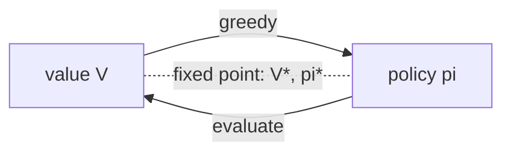

## Where this fits

[[rl.01]] defined an MDP and the value of a policy as an expected return, but gave no way to *compute* it except by simulating. When you know the model (the transition probabilities and rewards), you do not need to simulate: the value of a state can be written in terms of the values of its neighbours, and that recursion can be turned into an algorithm. This is **dynamic programming** (DP), invented by Bellman in the 1950s.

DP matters even though most real problems have no known model, for three reasons: it defines what "the optimal policy" means exactly; it is the debugging oracle for every sampling-based method that follows (if your Q-learning disagrees with DP on a small grid, you have a bug); and every later algorithm ([[rl.03]] TD learning, [[rl.04]] DQN) is an approximate, sampled version of the same Bellman backup.

## The idea in plain words

Suppose you want to know how good it is to stand on a square of a board game. Its value is "what I get right now for stepping off it, plus how good the square I land on is". But the square I land on has the same property, so its value is again "immediate gain plus the value of the next square". Values are **self-consistent**: every state's value is explained by its neighbours' values. That is the Bellman equation.

Computing values then becomes a game of repeated corrections. Start with a rough guess (say all zeros). Sweep through the squares, replacing each guess by "immediate gain plus my neighbours' current guesses". Information about the exit travels one square per sweep until the guesses stop changing. That is **policy evaluation**. Once you know how good each square is under your current strategy, you can *improve* the strategy by choosing, at each square, the move that leads to the best-looking next position, then re-evaluate. Alternate the two and you reach a strategy that cannot be improved: **policy iteration**. Or blend both into a single sweep that always assumes the best move: **value iteration**.

## Derivation: the Bellman expectation equation

Fix a policy $\pi$. Start from the definition and use the return recursion $G_t=r_{t+1}+\gamma G_{t+1}$ from [[rl.01]]:

$$
V^\pi(s)=\mathbb{E}_\pi[G_t\mid s_t=s]=\mathbb{E}_\pi[r_{t+1}+\gamma G_{t+1}\mid s_t=s].
$$

Condition on the first action $a\sim\pi(\cdot\mid s)$ and next state $s'\sim P(\cdot\mid s,a)$ (law of total expectation):

$$
V^\pi(s)=\sum_a\pi(a\mid s)\sum_{s'}P(s'\mid s,a)\Big[R(s,a,s')+\gamma\,\mathbb{E}_\pi[G_{t+1}\mid s_{t+1}=s']\Big].
$$

The Markov property says that, given $s_{t+1}=s'$, the future does not depend on how we got there, so the inner expectation is exactly $V^\pi(s')$:

$$
\boxed{V^\pi(s)=\sum_a\pi(a\mid s)\sum_{s'}P(s'\mid s,a)\big[R(s,a,s')+\gamma V^\pi(s')\big]}
$$

Define the action value $Q^\pi(s,a)=\sum_{s'}P(s'\mid s,a)[R(s,a,s')+\gamma V^\pi(s')]$. Then $V^\pi(s)=\sum_a\pi(a\mid s)Q^\pi(s,a)$.

**Matrix form.** Let $r_\pi(s)=\sum_a\pi(a|s)\sum_{s'}P(s'|s,a)R(s,a,s')$ (a vector of length $|\mathcal S|$) and $P_\pi[s,s']=\sum_a\pi(a|s)P(s'|s,a)$ (an $|\mathcal S|\times|\mathcal S|$ row-stochastic matrix). The equation reads $V=r_\pi+\gamma P_\pi V$, so for $\gamma<1$

$$
V^\pi=(I-\gamma P_\pi)^{-1}r_\pi .
$$

A direct solve costs $O(|\mathcal S|^3)$; the iterative sweeps below cost $O(|\mathcal S|^2|\mathcal A|)$ each and scale better when $P$ is sparse.

### Why the sweeps converge

Define the **Bellman expectation operator** $(T^\pi V)(s)=r_\pi(s)+\gamma(P_\pi V)(s)$. For two value vectors $V,W$,

$$
\|T^\pi V-T^\pi W\|_\infty=\gamma\|P_\pi(V-W)\|_\infty\le\gamma\|V-W\|_\infty,
$$

because each row of $P_\pi$ is a probability distribution, so $P_\pi$ cannot increase the largest entry's magnitude. $T^\pi$ is a **$\gamma$-contraction**: applying it shrinks distances by a factor $\gamma$, so by the Banach fixed-point theorem repeated application converges to the unique fixed point $V^\pi$ from any start. (For episodic tasks with $\gamma=1$, convergence still holds when every policy reaches a terminal state; we use that in the worked example.)

## Bellman optimality

The **optimal value** $V^*(s)=\max_\pi V^\pi(s)$ and $Q^*(s,a)=\max_\pi Q^\pi(s,a)$. Standard fact (the principle of optimality): in each state an optimal policy takes the action with the best $Q^*$. Replacing the average over actions in the expectation equation by a max gives the **Bellman optimality equation**:

$$
\boxed{V^*(s)=\max_a\sum_{s'}P(s'\mid s,a)\big[R(s,a,s')+\gamma V^*(s')\big]}
$$

It is non-linear because of the max, so there is no matrix inverse, but the operator $(T^*V)(s)=\max_a Q_V(s,a)$ is also a $\gamma$-contraction: $|\max_a x_a-\max_a y_a|\le\max_a|x_a-y_a|$, so $\|T^*V-T^*W\|_\infty\le\gamma\|V-W\|_\infty$. Hence value iteration converges to $V^*$.

## The algorithms

**Policy evaluation** (prediction): iterate $V\leftarrow T^\pi V$ until $\max_s|V_{\text{new}}(s)-V(s)|<\text{tol}$.

**Policy improvement:** make the policy greedy with respect to the current value, $\pi'(s)=\arg\max_a Q^\pi(s,a)$. The *policy improvement theorem* says $V^{\pi'}\ge V^\pi$ in every state: following $\pi'$ for one step and then $\pi$ is at least as good as following $\pi$, since $\max_a Q^\pi(s,a)\ge\sum_a\pi(a|s)Q^\pi(s,a)=V^\pi(s)$; applying this argument repeatedly along the trajectory gives the claim.

**Policy iteration:** evaluate, improve, repeat until the policy stops changing. With finitely many deterministic policies, each step weakly improves and no policy repeats, so it terminates, and the policy is optimal because it then satisfies the Bellman optimality equation.

**Value iteration:** $V\leftarrow T^*V$, i.e. one sweep with the max inside, stopping when changes fall below tolerance; the greedy policy for the final $V$ is returned. Each sweep is cheaper than policy iteration's inner loop, but more sweeps may be needed. Both are special cases of **generalised policy iteration**: any scheme in which the value and the policy keep pushing each other toward consistency.



## Worked example

The classic 4x4 gridworld: states 0..15 row by row, states 0 (top-left) and 15 (bottom-right) are terminal, every move costs $-1$, bumping into a wall leaves you in place, $\gamma=1$. The numbers below come from running the exercise code.

**Random policy** (all four moves with probability 1/4). Sweep 1 gives every non-terminal state the value $-1$. In sweep 2, state 1 (next to the terminal state 0) becomes $-1+\tfrac14\big(V_1+V_5+V_0+V_2\big)=-1+\tfrac14(-1-1+0-1)=-1.75$. After convergence (426 sweeps at tolerance $10^{-10}$) the values are

$$
\begin{pmatrix}0&-14&-20&-22\\-14&-18&-20&-20\\-20&-20&-18&-14\\-22&-20&-14&0\end{pmatrix}
$$

meaning a randomly wandering agent takes on average 14 steps to finish from the cell next to the exit.

**Optimal values** from value iteration (4 sweeps) and policy iteration (3 improve steps) agree exactly: $V^*(s)=-(\text{shortest number of steps to a terminal state})$, e.g. $V^*=\begin{pmatrix}0&-1&-2&-3\\-1&-2&-3&-2\\-2&-3&-2&-1\\-3&-2&-1&0\end{pmatrix}$. With $\gamma=0.9$ the same layout gives $V^*(2)=-1-0.9=-1.9$ and $V^*(3)=-2.71$, since $-(1+0.9+0.81)$.

**Check of the matrix form.** For the random policy at $\gamma=0.9$, the iterated values and $(I-\gamma P_\pi)^{-1}r_\pi$ agree to $5\times10^{-10}$ (that is the tolerance of the stopping rule).

## Implementation

```python
import numpy as np

def q_from_v(P, R, V, gamma):             # P, R: (S, A, S); V: (S,)  ->  (S, A)
    return (P * R).sum(axis=2) + gamma * (P @ V)

def policy_evaluation(P, R, pi, gamma, tol=1e-10):   # pi: (S, A)
    V = np.zeros(P.shape[0])
    while True:
        V_new = (pi * q_from_v(P, R, V, gamma)).sum(axis=1)
        delta = np.abs(V_new - V).max(); V = V_new
        if delta < tol: return V

def value_iteration(P, R, gamma, tol=1e-10):
    V = np.zeros(P.shape[0])
    while True:
        V_new = q_from_v(P, R, V, gamma).max(axis=1)
        delta = np.abs(V_new - V).max(); V = V_new
        if delta < tol: return V
```

## Shapes

| Object | Shape |
|---|---|
| transition tensor `P[s, a, s']` | $(S, A, S)$ |
| reward tensor `R[s, a, s']` | $(S, A, S)$ |
| value `V` | $(S,)$ |
| action value `Q = q_from_v(...)` | $(S, A)$ |
| stochastic policy `pi` | $(S, A)$, rows sum to 1 |

`P @ V` contracts the last axis and gives $(S,A)$: the expected next-state value for each state-action pair.

## Common misconceptions

- "DP is a learning algorithm." It is planning: it needs the full model $P,R$ and does no sampling. RL methods that learn from experience approximate the same backups.
- "Value iteration needs a policy." It does not; the policy is read off at the end by acting greedily.
- "Policy iteration needs the evaluation to be exact." Stopping evaluation early (modified policy iteration) still converges. The extreme, one sweep, is value iteration.
- "The optimal policy is unique." The optimal *value* is unique; several policies can tie (the greedy argmax in the gridworld breaks ties arbitrarily).
- "A discount of 1 is always fine." In continuing tasks it can make returns diverge and the operator stops being a contraction; the gridworld works because every episode ends.

## Key takeaways

- $V^\pi(s)=\sum_a\pi(a|s)\sum_{s'}P(s'|s,a)[R+\gamma V^\pi(s')]$ follows from $G_t=r_{t+1}+\gamma G_{t+1}$ plus the Markov property.
- Replacing the policy average by a max gives the optimality equation for $V^*$.
- Both Bellman operators are $\gamma$-contractions, so sweeping converges to a unique fixed point.
- Policy iteration alternates evaluation and greedy improvement; value iteration merges them. Both return the same optimal values.
- Verify any sampled RL method against DP on a small known MDP.

## Explain it yourself

1. Explain the Bellman equation to someone using the phrase "immediate reward plus discounted value of where I land", and say precisely where the Markov property is needed.
2. Why can't you use plain value iteration on a game with $10^{40}$ states, and what do sampling-based methods give up and gain in exchange?

## Further reading

- Sutton and Barto, chapter 4 (Dynamic Programming), for the full proofs and the "jack's car rental" example. Not read for this lesson.

## Mastery criteria

You can (1) derive the Bellman expectation equation from the return recursion; (2) write it in matrix form and solve it directly; (3) explain why the backups are contractions; (4) implement policy evaluation, policy iteration and value iteration and verify they agree on a gridworld.
