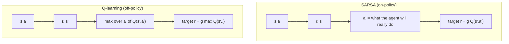

## Où cela s'inscrit

[[rl.02]] a résolu des MDP exactement, mais avait besoin des probabilités de transition. Un robot, un jeu, un système de recommandation ou un modèle de langage ne te donne aucune table de ce genre ; il te laisse seulement *essayer des choses et voir ce qui se passe*. Cette leçon apprend à partir de ce flux d'expérience, avec deux idées que tous les algorithmes ultérieurs mélangent :

- **Monte Carlo (MC) :** attendre la fin d'un épisode, calculer le retour réel, et moyenner.
- **Apprentissage par différence temporelle (TD) :** après chaque pas, pousser l'estimation vers « récompense plus mon estimation actuelle de l'état suivant ». Il fait du *bootstrap*, c'est-à-dire qu'il apprend une estimation à partir d'une estimation.

Ces idées mènent à **SARSA** et au **Q-learning**, les ancêtres tabulaires de DQN ([[rl.04]]), et le résidu TD revient comme avantage dans les méthodes acteur-critique ([[rl.05]], [[rl.06]]).

## L'idée en mots simples

Tu apprends combien de temps dure ton trajet depuis différents points de départ. La façon Monte Carlo : faire le trajet, noter le temps total depuis chaque point où tu es passé, et mettre à jour ton estimation pour chaque point avec ce total. Tu as toujours raison en moyenne, mais un embouteillage à la fin gâche l'estimation de tous les points précédents (forte variance), et tu dois attendre d'arriver pour apprendre quoi que ce soit.

La façon TD : en atteignant le repère suivant, compare « le temps que je viens de passer plus ce que je pense que le reste prend à partir d'ici » avec « ce que je pensais que le reste prendrait depuis le repère précédent » et corrige l'estimation précédente d'une fraction de l'écart. Tu apprends en chemin, avec moins de bruit, mais ta mise à jour s'appuie sur une estimation qui peut elle-même être fausse (un biais qui s'estompe à mesure que les estimations s'améliorent).

Pour le contrôle (choisir des actions), il y a une deuxième question. Quand tu mets à jour « à quel point ce coup était bon », supposes-tu que tu joueras *prudemment* à partir de là (**Q-learning**, en supposant le coup glouton ensuite) ou comme tu joues *réellement*, avec tes petites erreurs aléatoires occasionnelles (**SARSA**) ? Près du bord d'une falaise, les réponses diffèrent : l'optimiste longe le bord, le réaliste garde une distance de sécurité.

## Prédiction Monte Carlo

Pour une politique $\pi$, $V^\pi(s)=\mathbb{E}[G_t\mid s_t=s]$, donc *moyenne les retours observés après avoir visité $s$*. Le MC **première visite** n'utilise que la première visite de $s$ dans chaque épisode ; le MC **toutes visites** les utilise toutes. Les deux convergent vers $V^\pi$ quand les visites augmentent. En utilisant la moyenne incrémentale de [[rl.01]], avec $n$ le nombre de retours jusqu'ici :

$$
V(s)\leftarrow V(s)+\tfrac1n\big(G_t-V(s)\big),
$$

et avec un pas constant $\alpha$, l'estimateur continue de suivre une politique qui change :

$$
V(s_t)\leftarrow V(s_t)+\alpha\big(G_t-V(s_t)\big).
$$

Limites : il lui faut des épisodes qui *se terminent*, il ne met à jour qu'à la fin, et les états que la politique ne visite jamais ne sont jamais appris (d'où les dispositifs d'exploration : départs exploratoires, politiques epsilon-greedy).

## Dérivation : la mise à jour TD(0)

L'équation de Bellman ([[rl.02]]) dit $V^\pi(s)=\mathbb{E}\big[r_{t+1}+\gamma V^\pi(s_{t+1})\mid s_t=s\big]$. Nous ne pouvons pas calculer cette espérance sans modèle, mais une seule transition $(s_t,r_{t+1},s_{t+1})$ est un *échantillon* de la quantité qu'elle contient. Traitons l'échantillon $r_{t+1}+\gamma V(s_{t+1})$ comme cible et déplaçons l'estimation vers elle, comme dans la moyenne incrémentale :

$$
\boxed{V(s_t)\leftarrow V(s_t)+\alpha\,\delta_t,\qquad \delta_t=r_{t+1}+\gamma V(s_{t+1})-V(s_t)}
$$

$\delta_t$ est l'**erreur TD**. À la vraie $V^\pi$, sa moyenne conditionnelle est nulle d'après l'équation de Bellman, donc les mises à jour s'arrêtent en moyenne. Comparons avec le MC, dont l'erreur est $G_t-V(s_t)$. Elles sont reliées exactement : puisque $G_t=r_{t+1}+\gamma G_{t+1}$,

$$
G_t-V(s_t)=\delta_t+\gamma\big(G_{t+1}-V(s_{t+1})\big)\;\Longrightarrow\;G_t-V(s_t)=\sum_{k\ge0}\gamma^k\delta_{t+k}\quad(V\text{ held fixed}).
$$

L'erreur MC est la somme actualisée des erreurs TD futures. Cette identité revient dans [[rl.06]] quand nous les mélangeons (GAE). La convergence de TD(0) exige en théorie des pas avec $\sum\alpha=\infty$, $\sum\alpha^2<\infty$ (Robbins-Monro) ; en pratique, on utilise un petit $\alpha$ constant.

### Biais et variance

- **Cible MC** $G_t$ : un échantillon *non biaisé* de $V^\pi(s_t)$, mais une somme de nombreuses récompenses et transitions aléatoires, donc **forte variance**.
- **Cible TD** $r_{t+1}+\gamma V(s_{t+1})$ : un seul pas d'aléa, donc **faible variance**, mais elle utilise l'estimation courante $V(s_{t+1})$, fausse au début : **biaisée**. À mesure que les estimations s'améliorent, le biais diminue.

C'est le compromis biais-variance habituel de l'estimation. Le TD peut aussi apprendre au milieu d'un épisode, dans les tâches continues, et exploite la structure markovienne. Le MC ne dépend ni de la propriété de Markov ni du bootstrap, ce qui le rend plus robuste quand l'état n'est que partiellement observé.

## Contrôle : SARSA et Q-learning

On utilise des valeurs d'action $Q(s,a)$ et une politique de comportement epsilon-greedy. **SARSA** (nommé d'après le n-uplet $s,a,r,s',a'$) :

$$
Q(s,a)\leftarrow Q(s,a)+\alpha\big[r+\gamma\,Q(s',a')-Q(s,a)\big],
$$

où $a'$ est l'action que l'agent prend réellement ensuite. Il estime la valeur de la *politique epsilon-greedy qu'il suit* : **sur la politique** (*on-policy*). **Q-learning** :

$$
Q(s,a)\leftarrow Q(s,a)+\alpha\big[r+\gamma\,\max_{a'}Q(s',a')-Q(s,a)\big]
$$

fait du bootstrap à partir de l'action gloutonne, quelle que soit la suite choisie par l'agent. Il estime $Q^*$ tout en se comportant de façon epsilon-greedy : **hors politique** (*off-policy*) (la politique de *comportement* qui génère les données diffère de la politique *cible* apprise). À une transition terminale, le terme de bootstrap est supprimé.

**Marche au bord de la falaise (cliff walking).** Une grille avec une falaise le long de la rangée du bas : marcher dessus donne $-100$ et une réinitialisation ; sinon chaque pas coûte $-1$. Le chemin le plus court longe le bord de la falaise. Le Q-learning apprend exactement ce chemin, parce que sa cible suppose un comportement glouton ensuite. Mais la politique de comportement explore encore avec une probabilité $\varepsilon$ et tombe parfois de la falaise, donc sa récompense *en ligne* est mauvaise. SARSA sait qu'il agira parfois au hasard, donc les états voisins de la falaise reçoivent une valeur plus basse, et il apprend un chemin plus long qui garde une rangée de marge : pire hors ligne, meilleur en ligne. Les deux atteignent le même chemin quand $\varepsilon\to0$.



## Exemple résolu

Tous les nombres sont reproduits par les deux exercices de cette leçon.

**Un pas TD.** Supposons $V(\text{next})=0.8$, $\gamma=0.9$, $r=0$, $V(s)=0$, $\alpha=0.5$. Alors $\delta=0+0.9\cdot0.8-0=0.72$ et $V(s)\leftarrow0+0.5\cdot0.72=0.36$.

**SARSA vs Q-learning, un pas.** $Q(s',\cdot)=(0,2,1,-1)$ ; l'agent prendra en réalité $a'=3$ (valeur $-1$) ; $r=-1$, $\gamma=0.9$, $\alpha=0.5$, $Q(s,a)=0$. Cible SARSA : $-1+0.9\cdot(-1)=-1.9$, nouveau $Q=-0.95$. Cible Q-learning : $-1+0.9\cdot2=0.8$, nouveau $Q=0.4$. Mêmes données, croyances très différentes : le Q-learning fait confiance au meilleur cas.

**Marche aléatoire (cinq états, départ au milieu, récompense 1 à l'extrémité droite).** Les vraies valeurs sont $(1,2,3,4,5)/6$. Avec un $\alpha=0.05$ constant, 100 épisodes, moyennés sur 20 graines, l'erreur RMS est de **0.031 pour TD(0)** contre **0.125 pour MC**. Pour l'état du milieu sous les vraies valeurs, la cible TD est une récompense de $0$ plus $V$ d'un voisin, soit $1/3$ ou $2/3$ avec une probabilité égale : variance $(1/6)^2\approx0.028$ ; le retour MC vaut 0 ou 1 : variance $0.25$, neuf fois plus grande. (Une seule graine : après 100 épisodes, TD donne $(0.13,0.30,0.46,0.58,0.77)$, MC donne $(0.10,0.21,0.41,0.57,0.77)$.)

**Cliff walking** (grille 4x8, $\varepsilon=0.1$, $\alpha=0.5$, $\gamma=1$, 300 épisodes, 3 graines). Le chemin glouton du Q-learning fait 10 cases (le plus court, le long du bord) pour toutes les graines ; celui de SARSA en fait 12-14. Le retour en ligne moyen sur les 100 derniers épisodes est d'environ $-17.6$ pour SARSA et $-29.7$ pour le Q-learning.

## Implémentation

```python
import numpy as np

def td0_update(V, s, r, s_next, alpha, gamma):       # s_next is None at termination
    target = r if s_next is None else r + gamma * V[s_next]
    return V[s] + alpha * (target - V[s])

def sarsa_update(Q, s, a, r, s2, a2, done, alpha, gamma):
    target = r if done else r + gamma * Q[s2, a2]
    Q[s, a] += alpha * (target - Q[s, a])

def q_learning_update(Q, s, a, r, s2, done, alpha, gamma):
    target = r if done else r + gamma * Q[s2].max()
    Q[s, a] += alpha * (target - Q[s, a])
```

Formes : `V` a la forme $(S,)$, `Q` a la forme $(S,A)$. Les vraies bibliothèques de RL (Stable-Baselines3, CleanRL) gardent les mêmes mises à jour mais remplacent la table par un réseau ([[rl.04]]).

## Idées reçues

- « Le Q-learning est simplement meilleur parce qu'il trouve la politique optimale. » Il apprend $Q^*$, mais pendant l'exploration il peut suivre un chemin dangereux ; SARSA optimise la politique que tu exécutes réellement.
- « Hors politique signifie que les données sont aléatoires. » Cela signifie que les données viennent d'une autre politique que celle évaluée ou améliorée ; le Q-learning exige que la politique de comportement continue de visiter chaque paire état-action.
- « Le TD est biaisé, donc le MC est toujours préférable. » Avec des données limitées, la variance du MC domine souvent l'erreur (0.125 contre 0.031 plus haut).
- « Le bootstrap rend le TD instable à lui seul. » Il est stable dans le cas tabulaire ; les ennuis commencent quand on combine bootstrap, approximation de fonction et données hors politique (la « triade mortelle », [[rl.04]]).
- « Le MC première visite et toutes visites donnent des réponses différentes pour toujours. » Les deux convergent vers la même valeur ; ils diffèrent en comportement sur échantillon fini.

## Points clés à retenir

- Le MC moyenne des retours complets : non biaisé, forte variance, exige que les épisodes se terminent.
- Le TD(0) fait du bootstrap : $V(s)\leftarrow V(s)+\alpha[r+\gamma V(s')-V(s)]$ ; variance plus faible, un certain biais, en ligne.
- L'erreur MC est la somme actualisée des erreurs TD futures.
- SARSA est sur la politique (la cible utilise l'action réellement prise) ; le Q-learning est hors politique (la cible utilise le max).
- Le cliff walking montre la conséquence pratique : le Q-learning apprend le chemin optimal risqué, SARSA le chemin sûr pendant l'exploration.

## Explique-le toi-même

1. Un ami dit « l'apprentissage TD met à jour une estimation avec une autre estimation, donc il ne peut pas marcher ». Explique pourquoi il marche, avec l'équation de Bellman.
2. Quand préférerais-tu une méthode sur la politique comme SARSA au Q-learning dans un système réel (pense à un robot qui ne doit pas tomber pendant l'entraînement) ?

## Pour aller plus loin

- Sutton et Barto, chapitres 5 (Monte Carlo) et 6 (apprentissage TD), y compris les exemples de cliff walking et de marche aléatoire. Non lus pour cette leçon.

## Critères de maîtrise

Tu sais (1) implémenter la prédiction MC et TD(0) et expliquer la différence de biais/variance ; (2) dériver TD(0) à partir de l'équation de Bellman ; (3) énoncer les cibles de SARSA et du Q-learning et dire laquelle est sur la politique ; (4) prédire, et démontrer par simulation, les différents chemins qu'ils apprennent au bord d'une falaise.
