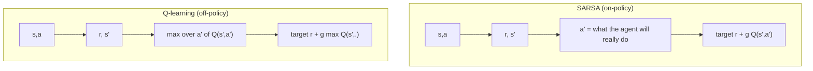

## Where this fits

[[rl.02]] solved MDPs exactly, but it needed the transition probabilities. A robot, a game, a recommender or a language model gives you no such table; it only lets you *try things and see what happens*. This lesson learns from that stream of experience, with two ideas that every later algorithm mixes:

- **Monte Carlo (MC):** wait until an episode ends, compute the actual return, and average.
- **Temporal-difference (TD) learning:** after each single step, nudge the estimate toward "reward plus my current estimate of the next state". It *bootstraps*, i.e. learns a guess from a guess.

These lead to **SARSA** and **Q-learning**, the tabular ancestors of DQN ([[rl.04]]), and the TD residual returns as the advantage in actor-critic methods ([[rl.05]], [[rl.06]]).

## The idea in plain words

You are learning how long your commute takes from different starting points. The Monte Carlo way: make the trip, note the total time from each point you passed, and update your estimate for each point using that total. You are always correct on average, but one traffic jam at the end spoils the estimate of every earlier point (high variance), and you must wait until you arrive to learn anything.

The TD way: when you reach the next landmark, compare "time I just spent plus what I think the rest takes from here" with "what I thought the remainder would be from the previous landmark" and fix the previous estimate by a fraction of the difference. You learn en route, with less noise, but your update leans on a guess that may itself be wrong (bias that fades as the guesses improve).

For control (choosing actions) there is a second question. When you update "how good was that move", do you assume you will play *carefully* from then on (**Q-learning**, assuming the greedy move later) or the way you *actually* play with your occasional random slip-ups (**SARSA**)? Near a cliff edge the answers differ: the optimist hugs the edge, the realist keeps a safe distance.

## Monte Carlo prediction

For a policy $\pi$, $V^\pi(s)=\mathbb{E}[G_t\mid s_t=s]$, so *average the returns observed after visiting $s$*. **First-visit** MC uses only the first visit of $s$ in each episode; **every-visit** uses all. Both converge to $V^\pi$ as visits grow. Using the incremental mean from [[rl.01]], with $n$ the number of returns so far:

$$
V(s)\leftarrow V(s)+\tfrac1n\big(G_t-V(s)\big),
$$

and with a constant step size $\alpha$ the estimator keeps tracking a changing policy:

$$
V(s_t)\leftarrow V(s_t)+\alpha\big(G_t-V(s_t)\big).
$$

Limits: it needs episodes that *end*, it updates only at the end, and states the policy never visits are never learned (hence the exploration devices: exploring starts, epsilon-greedy policies).

## Derivation: the TD(0) update

The Bellman equation ([[rl.02]]) says $V^\pi(s)=\mathbb{E}\big[r_{t+1}+\gamma V^\pi(s_{t+1})\mid s_t=s\big]$. We cannot compute that expectation without a model, but a single transition $(s_t,r_{t+1},s_{t+1})$ is one *sample* of the quantity inside it. Treat the sample $r_{t+1}+\gamma V(s_{t+1})$ as the target and move the estimate toward it, as in the incremental mean:

$$
\boxed{V(s_t)\leftarrow V(s_t)+\alpha\,\delta_t,\qquad \delta_t=r_{t+1}+\gamma V(s_{t+1})-V(s_t)}
$$

$\delta_t$ is the **TD error**. At the true $V^\pi$ its conditional mean is zero by the Bellman equation, so the updates stop on average. Compare with MC, whose error is $G_t-V(s_t)$. They are related exactly: since $G_t=r_{t+1}+\gamma G_{t+1}$,

$$
G_t-V(s_t)=\delta_t+\gamma\big(G_{t+1}-V(s_{t+1})\big)\;\Longrightarrow\;G_t-V(s_t)=\sum_{k\ge0}\gamma^k\delta_{t+k}\quad(V\text{ held fixed}).
$$

The MC error is the discounted sum of future TD errors. This identity returns in [[rl.06]] when we blend them (GAE). Convergence of TD(0) needs step sizes with $\sum\alpha=\infty$, $\sum\alpha^2<\infty$ (Robbins-Monro) in theory; a small constant $\alpha$ is used in practice.

### Bias and variance

- **MC target** $G_t$: an *unbiased* sample of $V^\pi(s_t)$, but a sum of many random rewards and transitions, so **high variance**.
- **TD target** $r_{t+1}+\gamma V(s_{t+1})$: only one step of randomness, so **low variance**, but it uses the current estimate $V(s_{t+1})$, which is wrong early on: **biased**. As estimates improve the bias shrinks.

This is the usual bias-variance trade-off of estimation. TD can also learn in the middle of an episode, in continuing tasks, and exploits the Markov structure. MC does not rely on the Markov property or on bootstrapping, which makes it more robust when the state is only partly observed.

## Control: SARSA and Q-learning

Use action values $Q(s,a)$ and an epsilon-greedy behaviour policy. **SARSA** (named for the tuple $s,a,r,s',a'$):

$$
Q(s,a)\leftarrow Q(s,a)+\alpha\big[r+\gamma\,Q(s',a')-Q(s,a)\big],
$$

where $a'$ is the action the agent really takes next. It estimates the value of the *epsilon-greedy policy it is following*: **on-policy**. **Q-learning**:

$$
Q(s,a)\leftarrow Q(s,a)+\alpha\big[r+\gamma\,\max_{a'}Q(s',a')-Q(s,a)\big]
$$

bootstraps from the greedy action regardless of what the agent does next. It estimates $Q^*$ while behaving epsilon-greedily: **off-policy** (the *behaviour* policy that generates data differs from the *target* policy being learned). At a terminal transition the bootstrap term is dropped.

**Cliff walking.** A grid with a cliff along the bottom row: stepping on it gives $-100$ and a reset; otherwise each step costs $-1$. The shortest path runs right along the cliff edge. Q-learning learns exactly this path, because its target assumes greedy behaviour afterwards. But the behaviour policy still explores with probability $\varepsilon$ and sometimes slips off the cliff, so its *online* reward is poor. SARSA knows it will sometimes act randomly, so states next to the cliff get a lower value, and it learns a longer path that keeps a row of margin: worse offline, better online. Both reach the same path as $\varepsilon\to0$.



## Worked example

All numbers are reproduced by the two exercises of this lesson.

**One TD step.** Suppose $V(\text{next})=0.8$, $\gamma=0.9$, $r=0$, $V(s)=0$, $\alpha=0.5$. Then $\delta=0+0.9\cdot0.8-0=0.72$ and $V(s)\leftarrow0+0.5\cdot0.72=0.36$.

**SARSA vs Q-learning, one step.** $Q(s',\cdot)=(0,2,1,-1)$; the agent will actually take $a'=3$ (value $-1$); $r=-1$, $\gamma=0.9$, $\alpha=0.5$, $Q(s,a)=0$. SARSA target: $-1+0.9\cdot(-1)=-1.9$, new $Q=-0.95$. Q-learning target: $-1+0.9\cdot2=0.8$, new $Q=0.4$. Same data, very different beliefs: Q-learning trusts the best case.

**Random walk (five states, start in the middle, reward 1 at the right end).** True values are $(1,2,3,4,5)/6$. With constant $\alpha=0.05$, 100 episodes, averaged over 20 seeds, the RMS error is **0.031 for TD(0)** versus **0.125 for MC**. For the middle state under the true values, the TD target is $0$-reward plus $V$ of a neighbour, i.e. $1/3$ or $2/3$ with equal probability: variance $(1/6)^2\approx0.028$; the MC return is 0 or 1: variance $0.25$, nine times larger. (A single seed: after 100 episodes TD gives $(0.13,0.30,0.46,0.58,0.77)$, MC gives $(0.10,0.21,0.41,0.57,0.77)$.)

**Cliff walking** (4x8 grid, $\varepsilon=0.1$, $\alpha=0.5$, $\gamma=1$, 300 episodes, 3 seeds). Q-learning's greedy path has 10 cells (the shortest, along the edge) in all seeds; SARSA's has 12-14 cells. The average online return over the last 100 episodes is about $-17.6$ for SARSA and $-29.7$ for Q-learning.

## Implementation

```python
import numpy as np

def td0_update(V, s, r, s_next, alpha, gamma):       # s_next is None at termination
    target = r if s_next is None else r + gamma * V[s_next]
    return V[s] + alpha * (target - V[s])

def sarsa_update(Q, s, a, r, s2, a2, done, alpha, gamma):
    target = r if done else r + gamma * Q[s2, a2]
    Q[s, a] += alpha * (target - Q[s, a])

def q_learning_update(Q, s, a, r, s2, done, alpha, gamma):
    target = r if done else r + gamma * Q[s2].max()
    Q[s, a] += alpha * (target - Q[s, a])
```

Shapes: `V` has shape $(S,)$, `Q` has shape $(S,A)$. Real RL libraries (Stable-Baselines3, CleanRL) keep the same updates but replace the table by a network ([[rl.04]]).

## Common misconceptions

- "Q-learning is just better because it finds the optimal policy." It learns $Q^*$, but while exploring it may follow a dangerous path; SARSA optimises the policy you actually run.
- "Off-policy means the data is random." It means the data comes from a different policy than the one being evaluated or improved; Q-learning needs the behaviour policy to keep visiting every state-action pair.
- "TD is biased, so MC is always preferable." With limited data, the variance of MC often dominates the error (0.125 vs 0.031 above).
- "Bootstrapping makes TD unstable by itself." It is stable in the tabular case; trouble starts when bootstrapping, function approximation and off-policy data are combined (the "deadly triad", [[rl.04]]).
- "First-visit and every-visit MC give different answers forever." Both converge to the same value; they differ in finite-sample behaviour.

## Key takeaways

- MC averages full returns: unbiased, high variance, needs episodes to finish.
- TD(0) bootstraps: $V(s)\leftarrow V(s)+\alpha[r+\gamma V(s')-V(s)]$; lower variance, some bias, online.
- The MC error is the discounted sum of future TD errors.
- SARSA is on-policy (target uses the action actually taken); Q-learning is off-policy (target uses the max).
- Cliff walking shows the practical consequence: Q-learning learns the risky optimal path, SARSA the safe one while exploring.

## Explain it yourself

1. A friend says "TD learning updates a guess using another guess, so it cannot work." Explain why it does, using the Bellman equation.
2. When would you prefer an on-policy method such as SARSA to Q-learning in a real system (think of a robot that must not fall during training)?

## Further reading

- Sutton and Barto, chapters 5 (Monte Carlo) and 6 (TD learning), including the cliff-walking and random-walk examples. Not read for this lesson.

## Mastery criteria

You can (1) implement MC and TD(0) prediction and explain the bias/variance difference; (2) derive TD(0) from the Bellman equation; (3) state the SARSA and Q-learning targets and say which is on-policy; (4) predict, and demonstrate by simulation, the different paths they learn on a cliff.
