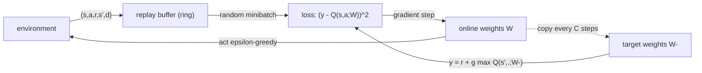

## Où cela s'inscrit

Le Q-learning tabulaire ([[rl.03]]) stocke un nombre par paire état-action. C'est sans espoir quand les états sont des images (une trame Atari a environ 100 000 nombres), des positions de plateau ou des vecteurs de capteurs : tu ne visiteras jamais deux fois le même état, donc une table ne peut pas généraliser. Le remède est **l'approximation de fonction** : représenter $Q(s,a)$ par une fonction paramétrique $Q(s,a;\theta)$, comme un réseau de neurones, de sorte que des états similaires reçoivent des valeurs similaires et qu'une mise à jour améliore de nombreux états.

C'est ce qu'a fait le DQN qui jouait à Atari, mais combiner Q-learning et approximation de fonction est instable à moins d'ajouter deux idées d'ingénierie : un **tampon de rejeu d'expérience** (*experience replay*) et un **réseau cible** (*target network*). Cette leçon dérive la perte DQN, explique les deux idées, et implémente tout avec l'approximateur de fonction le plus simple qui rende la mécanique visible : une fonction Q *linéaire*, de sorte que chaque gradient peut être écrit à la main et vérifié numériquement. Remplacer l'application linéaire par un réseau PyTorch ne change que la façon dont $\nabla_\theta Q$ est calculé.

## L'idée en mots simples

Imagine apprendre une carte de « à quel point chaque endroit est bon » en te promenant. Avec une table, tu griffonnes une note séparée par endroit. Avec l'approximation de fonction, tu gardes plutôt une *formule* avec quelques boutons, par exemple « la qualité croît avec ta position vers la droite ». Chaque observation tourne un peu les boutons, donc tu apprends sur des endroits que tu n'as jamais visités, mais un réglage qui corrige un endroit peut en abîmer un autre.

Deux choses tournent mal quand tu entraînes cela naïvement à partir de l'expérience en direct. D'abord, les pas consécutifs sont presque identiques (les images 1000 et 1001 d'une partie), donc tu t'entraînes sur un flux fortement corrélé, comme étudier un manuel en lisant dix mille fois une page avant de passer à la suivante. Le remède est un **tampon de rejeu** : stocker les expériences passées dans un grand sac et s'entraîner sur des poignées aléatoires, mélangeant ancien et nouveau, et réutilisant chaque expérience plusieurs fois. Ensuite, la cible d'apprentissage contient elle-même ton estimation actuelle ; si tu bouges les boutons, la cible bouge aussi, comme courir après une carotte attachée à ta propre tête. Le remède est un **réseau cible** : garder une copie gelée des boutons pour calculer les cibles, et ne rafraîchir la copie que de temps en temps, de sorte que pendant un moment la régression ait un but fixe.

## Cadre formel

Soit $\phi(s)\in\mathbb{R}^d$ un vecteur de caractéristiques de l'état $s$, et soit $A$ actions. Une fonction Q linéaire garde un vecteur de poids par action :

$$
Q(s,a;W)=W[a]\cdot\phi(s),\qquad W\in\mathbb{R}^{A\times d},
$$

donc pour un batch de $B$ états empilés dans $\Phi\in\mathbb{R}^{B\times d}$, toutes les valeurs d'action sont $Q=\Phi W^\top\in\mathbb{R}^{B\times A}$. Un réseau de neurones remplacerait le membre de droite par un réseau de paramètres $\theta$ ; des caractéristiques one-hot redonnent le cas tabulaire.

## Dérivation : la perte DQN

La mise à jour du Q-learning ([[rl.03]]) déplace $Q(s,a)$ vers la cible $r+\gamma\max_{a'}Q(s',a')$. Dans un cadre paramétrique, c'est un problème de régression : rendre $Q(s,a;\theta)$ proche de la cible en erreur quadratique. Sur des transitions $(s,a,r,s',d)$ tirées du tampon de rejeu $\mathcal D$ (avec $d=1$ si $s'$ est terminal) :

$$
\boxed{L(\theta)=\mathbb{E}_{(s,a,r,s',d)\sim\mathcal D}\Big[\tfrac12\big(y-Q(s,a;\theta)\big)^2\Big],\qquad y=r+\gamma(1-d)\max_{a'}Q(s',a';\theta^-)}
$$

où $\theta^-$ sont les paramètres du **réseau cible**, un instantané de $\theta$ copié périodiquement. Le facteur $\tfrac12$ n'est là que pour des gradients propres (l'article original écrête l'erreur, ce qui équivaut à une perte de Huber).

**Gradient.** Traitons la cible $y$ comme une constante : c'est un *semi-gradient*, puisque la cible dépend en secret des paramètres via le bootstrap, et nous ignorons délibérément cette dépendance (avec $\theta^-$ gelé, la dépendance a vraiment disparu pour un temps). Avec $\delta=y-Q(s,a;\theta)$,

$$
\nabla_\theta L=-\mathbb{E}\big[\delta\,\nabla_\theta Q(s,a;\theta)\big].
$$

Pour le modèle linéaire, $\nabla_{W[a']}Q(s,a;W)=\phi(s)\,\mathbf 1[a'=a]$, donc avec un minibatch de taille $B$

$$
\frac{\partial L}{\partial W[a']}=-\frac1B\sum_{i:\,a_i=a'}\delta_i\,\phi(s_i)\in\mathbb{R}^d,
$$

seules les lignes des actions réellement prises reçoivent du gradient. La mise à jour est $W\leftarrow W-\eta\nabla_WL$. La descente de gradient sur cette perte est exactement « la mise à jour du Q-learning avec un taux d'apprentissage » quand les caractéristiques sont one-hot.

### Pourquoi les deux astuces

- **Tampon de rejeu.** Échantillonner uniformément dans un tampon circulaire des $N$ dernières transitions décorrèle le minibatch (l'hypothèse i.i.d. de la SGD), réutilise les expériences rares et récompensantes et moyenne sur de nombreuses politiques de comportement passées. Cela n'est légitime que parce que le Q-learning est hors politique : les anciennes transitions restent des échantillons valides de la dynamique.
- **Réseau cible.** Si $y$ utilisait $\theta$ lui-même, chaque mise à jour déplacerait les cibles de *tous* les états (parce que la fonction généralise), ce qui peut osciller ou diverger. Geler $\theta^-$ pendant $C$ pas transforme l'apprentissage en une suite de problèmes supervisés ordinaires. Deux façons de mettre à jour : copie **dure** $\theta^-\leftarrow\theta$ tous les $C$ pas, ou **douce** (Polyak) $\theta^-\leftarrow(1-\tau)\theta^-+\tau\theta$ à chaque pas avec un petit $\tau$.

Q-learning + approximation de fonction + bootstrap + données hors politique s'appelle la **triade mortelle** ; DQN ne supprime pas le danger, il le rend gérable. Raffinements connus (non implémentés ici) : Double DQN (choisir $a'$ avec $\theta$, l'évaluer avec $\theta^-$, ce qui réduit la surestimation causée par le max), rejeu priorisé, têtes « dueling », et écrêtage des récompenses pour garder des échelles de gradient comparables entre tâches.



## Exemple résolu

Tous les nombres sont reproduits par le code de l'exercice.

Deux actions, deux caractéristiques, un minibatch de deux transitions, $\gamma=0.9$ :

- Poids en ligne $W=\begin{pmatrix}1&0\\0&1\end{pmatrix}$, poids cibles $W^-=\begin{pmatrix}0.5&0.5\\1&0\end{pmatrix}$.
- Transition 1 : $\phi(s)=(1,0)$, $a=0$, $r=1$, $\phi(s')=(0,1)$, non terminale. Les valeurs du réseau cible en $s'$ sont $(0.5,0)$, donc $y_1=1+0.9\cdot0.5=1.45$. Le $Q(s,0)=1$ en ligne, donc $\delta_1=0.45$.
- Transition 2 : $\phi(s)=(0,1)$, $a=1$, $r=0$, terminale. $y_2=0$, le $Q(s,1)=1$ en ligne, $\delta_2=-1$.

Perte $=\frac12\cdot\frac12(0.45^2+1^2)=0.300625$. Gradient : la ligne 0 reçoit $-\frac12\cdot0.45\cdot(1,0)=(-0.225,0)$ ; la ligne 1 reçoit $-\frac12\cdot(-1)\cdot(0,1)=(0,0.5)$. L'exercice vérifie le gradient analytique contre des différences finies centrées sur des données aléatoires (en gardant $W^-$ fixe).

**Une chaîne.** Six états, l'action 1 va à droite, l'action 0 à gauche, récompense 1 en atteignant le dernier état, $\gamma=0.9$. La valeur optimale de « droite » dans l'état $s$ est $0.9^{\,4-s}$ ($0.656,\,0.729,\,0.81,\,0.9,\,1$). DQN avec des caractéristiques one-hot (1500 pas d'environnement, tampon de 500, minibatch de 32, taux d'apprentissage 0.1, copie cible tous les 20 pas, $\varepsilon=0.5$) apprend $Q(\cdot,\text{right})\approx(0.66,0.73,0.81,0.90,1.00)$ pour toutes les graines essayées, et choisit « droite » partout. Avec seulement trois caractéristiques $(1,x,x^2)$, $x=s/5$, soit six poids au total, il apprend encore la bonne politique et des valeurs à environ 0.01 de l'optimum, parce que les exponentielles sont bien approchées par un polynôme quadratique sur cet intervalle.

## Implémentation

```python
import numpy as np

def q_values(W, Phi):                      # W: (A, d), Phi: (B, d) -> (B, A)
    return Phi @ W.T

def dqn_loss_grad(W, W_target, batch, gamma):
    S, A, R, S2, D = batch                 # (B,d) (B,) (B,) (B,d) (B,)
    B = len(R)
    y = R + gamma * (1 - D) * q_values(W_target, S2).max(axis=1)   # constant target
    delta = y - q_values(W, S)[np.arange(B), A]
    grad = np.zeros_like(W)
    for i in range(B):
        grad[A[i]] -= delta[i] * S[i] / B
    return 0.5 * np.mean(delta ** 2), grad

def soft_update(W_target, W, tau):
    return (1 - tau) * W_target + tau * W
```

Le tampon de rejeu est un anneau de tableaux préalloués avec un pointeur d'insertion modulo la capacité. En PyTorch, le même code se lit `y = r + gamma*(1-d)*target_net(s2).max(1).values.detach()`, `loss = F.smooth_l1_loss(q_net(s).gather(1, a), y)`, puis `loss.backward()` ; le `.detach()` est la forme en code de « traiter la cible comme une constante ». Des bibliothèques comme Stable-Baselines3 fournissent cela avec tous les raffinements.

## Formes (shapes)

| Objet | Forme |
|---|---|
| poids `W`, `W_target`, gradient | $(A,d)$ |
| caractéristiques d'un batch `S`, `S2` | $(B,d)$ |
| `A`, `R`, `D` | $(B,)$ |
| `q_values(W, S)` | $(B,A)$ |
| cible `y` | $(B,)$ |

## Idées reçues

- « Le réseau cible n'est qu'une astuce de performance. » Sans lui (ou avec un intervalle de synchronisation très court), la cible mouvante est une vraie source de divergence.
- « Le rejeu rend DQN sur la politique. » C'est l'inverse : les données de rejeu viennent de politiques plus anciennes, ce qui est permis parce que le Q-learning est hors politique. C'est pourquoi SARSA ne se combine pas naturellement avec de grands tampons de rejeu.
- « La perte est une perte de régression standard. » L'étiquette $y$ dépend du modèle ; les gradients ne passent que par $Q(s,a;\theta)$, pas par $y$, et la valeur de la perte ne décroît pas de façon monotone pendant l'apprentissage parce que les cibles elles-mêmes s'améliorent.
- « Un plus gros réseau règle l'instabilité. » L'instabilité vient de la triade ; la capacité ne la supprime pas.
- « Le max dans la cible est inoffensif. » Il surestime les valeurs en présence de bruit (un maximum d'estimations bruitées est biaisé vers le haut), ce que Double DQN réduit.

## Points clés à retenir

- DQN est du Q-learning avec $Q(s,a;\theta)$ entraîné en minimisant $\tfrac12(y-Q)^2$ sur des minibatches, $y=r+\gamma(1-d)\max_{a'}Q(s',a';\theta^-)$.
- Le gradient ignore la dépendance de $y$ aux paramètres (semi-gradient) ; pour un Q linéaire, c'est $-\delta\,\phi(s)$ sur la ligne de l'action prise.
- Le rejeu décorrèle et réutilise les données ; le réseau cible stabilise la cible de régression.
- Avec des caractéristiques one-hot, DQN est du Q-learning tabulaire ; avec quelques caractéristiques bien choisies, il généralise entre états.
- Teste toujours le gradient contre des différences finies et teste l'apprenant sur un petit problème à réponse connue.

## Explique-le toi-même

1. Pourquoi le réseau cible rend-il l'entraînement plus stable, et quel est le coût d'un très grand intervalle de synchronisation ?
2. Pourquoi le tampon de rejeu est-il compatible avec le Q-learning mais gênant pour SARSA ?

## Pour aller plus loin

- Mnih et al. (2013, 2015) pour le DQN Atari original, et van Hasselt et al. (2016) pour Double DQN ; aucun n'a été ouvert pour cette leçon. Leurs idées sont résumées ici via la leçon du dépôt.

## Critères de maîtrise

Tu sais (1) écrire la perte DQN et dire quels termes sont tenus constants dans le gradient ; (2) dériver le gradient pour une fonction Q linéaire et le vérifier numériquement ; (3) implémenter un tampon de rejeu circulaire et des mises à jour de cible dures/douces ; (4) expliquer la triade mortelle et ce que corrigent respectivement le rejeu et les réseaux cibles.
