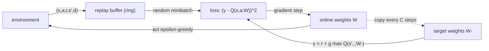

## Where this fits

Tabular Q-learning ([[rl.03]]) stores one number per state-action pair. That is hopeless when states are images (an Atari frame has about 100,000 numbers), board positions or sensor vectors: you will never visit the same state twice, so a table cannot generalise. The cure is **function approximation**: represent $Q(s,a)$ by a parametric function $Q(s,a;\theta)$, such as a neural network, so that similar states get similar values and one update improves many states.

This is what the Atari-playing DQN did, but combining Q-learning with function approximation is unstable unless you add two engineering ideas: an **experience replay buffer** and a **target network**. This lesson derives the DQN loss, explains the two ideas, and implements everything with the simplest function approximator that makes the mechanics visible: a *linear* Q-function, so every gradient can be written by hand and checked numerically. Swapping the linear map for a PyTorch network changes only how $\nabla_\theta Q$ is computed.

## The idea in plain words

Imagine learning a map of "how good is each spot" by walking around. With a table you scribble a separate note per spot. With function approximation you instead keep a *formula* with a few dials, for example "goodness grows with how far right you are". Each observation twists the dials a bit, so you learn about spots you have never visited, but a twist that fixes one spot may damage another.

Two things go wrong when you train this naively from live experience. First, consecutive steps are nearly identical (frame 1000 and 1001 of a game), so you train on a strongly correlated stream, like studying a textbook by reading one page ten thousand times before the next. The cure is a **replay buffer**: store past experiences in a big bag and train on random handfuls, mixing old and new, and reusing each experience many times. Second, the learning target itself contains your own current estimate; if you move the dials, the target moves too, like chasing a carrot attached to your own head. The cure is a **target network**: keep a frozen copy of the dials to compute targets, and refresh the copy only now and then, so for a while the regression has a fixed goal.

## Formal setup

Let $\phi(s)\in\mathbb{R}^d$ be a feature vector for state $s$, and let there be $A$ actions. A linear Q-function keeps one weight vector per action:

$$
Q(s,a;W)=W[a]\cdot\phi(s),\qquad W\in\mathbb{R}^{A\times d},
$$

so for a batch of $B$ states stacked in $\Phi\in\mathbb{R}^{B\times d}$ all action values are $Q=\Phi W^\top\in\mathbb{R}^{B\times A}$. A neural network would replace the right-hand side by a network with parameters $\theta$; one-hot features recover the tabular case.

## Derivation: the DQN loss

Q-learning's update ([[rl.03]]) moves $Q(s,a)$ toward the target $r+\gamma\max_{a'}Q(s',a')$. In a parametric setting that is a regression problem: make $Q(s,a;\theta)$ close to the target in squared error. Over transitions $(s,a,r,s',d)$ drawn from the replay buffer $\mathcal D$ (with $d=1$ if $s'$ is terminal):

$$
\boxed{L(\theta)=\mathbb{E}_{(s,a,r,s',d)\sim\mathcal D}\Big[\tfrac12\big(y-Q(s,a;\theta)\big)^2\Big],\qquad y=r+\gamma(1-d)\max_{a'}Q(s',a';\theta^-)}
$$

where $\theta^-$ are the **target network** parameters, a periodically copied snapshot of $\theta$. The factor $\tfrac12$ is only for tidy gradients (the original paper clips the error, equivalent to a Huber loss).

**Gradient.** Treat the target $y$ as a constant: this is a *semi-gradient*, since the target secretly depends on the parameters through the bootstrap, and we deliberately ignore that dependence (with $\theta^-$ frozen, the dependence is genuinely gone for a while). With $\delta=y-Q(s,a;\theta)$,

$$
\nabla_\theta L=-\mathbb{E}\big[\delta\,\nabla_\theta Q(s,a;\theta)\big].
$$

For the linear model, $\nabla_{W[a']}Q(s,a;W)=\phi(s)\,\mathbf 1[a'=a]$, so with a minibatch of size $B$

$$
\frac{\partial L}{\partial W[a']}=-\frac1B\sum_{i:\,a_i=a'}\delta_i\,\phi(s_i)\in\mathbb{R}^d,
$$

only the rows of the actions actually taken receive gradient. The update is $W\leftarrow W-\eta\nabla_WL$. Gradient descent on this loss is exactly "Q-learning update with a learning rate" when the features are one-hot.

### Why the two tricks

- **Replay buffer.** Sampling uniformly from a ring buffer of the last $N$ transitions decorrelates the minibatch (the i.i.d. assumption of SGD), re-uses rare rewarding experiences and averages over many past behaviour policies. This is only legitimate because Q-learning is off-policy: old transitions are still valid samples of the dynamics.
- **Target network.** If $y$ used $\theta$ itself, every update would shift the targets of *all* states (because the function generalises), which can oscillate or diverge. Freezing $\theta^-$ for $C$ steps turns learning into a sequence of ordinary supervised problems. Two ways to update: **hard** copy $\theta^-\leftarrow\theta$ every $C$ steps, or **soft** (Polyak) $\theta^-\leftarrow(1-\tau)\theta^-+\tau\theta$ every step with small $\tau$.

Q-learning + function approximation + bootstrapping + off-policy data is called the **deadly triad**; DQN does not remove the danger, it makes it manageable. Known refinements (not implemented here): Double DQN (choose $a'$ with $\theta$, evaluate it with $\theta^-$, reducing the overestimation caused by the max), prioritised replay, dueling heads, and reward clipping to keep gradient scales comparable across tasks.



## Worked example

All numbers are reproduced by the exercise code.

Two actions, two features, a minibatch of two transitions, $\gamma=0.9$:

- Online weights $W=\begin{pmatrix}1&0\\0&1\end{pmatrix}$, target weights $W^-=\begin{pmatrix}0.5&0.5\\1&0\end{pmatrix}$.
- Transition 1: $\phi(s)=(1,0)$, $a=0$, $r=1$, $\phi(s')=(0,1)$, not terminal. Target network values at $s'$ are $(0.5,0)$, so $y_1=1+0.9\cdot0.5=1.45$. Online $Q(s,0)=1$, so $\delta_1=0.45$.
- Transition 2: $\phi(s)=(0,1)$, $a=1$, $r=0$, terminal. $y_2=0$, online $Q(s,1)=1$, $\delta_2=-1$.

Loss $=\frac12\cdot\frac12(0.45^2+1^2)=0.300625$. Gradient: row 0 gets $-\frac12\cdot0.45\cdot(1,0)=(-0.225,0)$; row 1 gets $-\frac12\cdot(-1)\cdot(0,1)=(0,0.5)$. The exercise verifies the analytic gradient against central finite differences on random data (holding $W^-$ fixed).

**A chain.** Six states, action 1 moves right, action 0 left, reward 1 for reaching the last state, $\gamma=0.9$. The optimal value of "right" in state $s$ is $0.9^{\,4-s}$ ($0.656,\,0.729,\,0.81,\,0.9,\,1$). DQN with one-hot features (1500 environment steps, buffer 500, minibatch 32, learning rate 0.1, target copy every 20 steps, $\varepsilon=0.5$) learns $Q(\cdot,\text{right})\approx(0.66,0.73,0.81,0.90,1.00)$ for all seeds tried, and picks "right" everywhere. With only three features $(1,x,x^2)$, $x=s/5$, so six weights in total, it still learns the right policy and values within about 0.01 of optimal, because exponentials are well approximated by a quadratic on this range.

## Implementation

```python
import numpy as np

def q_values(W, Phi):                      # W: (A, d), Phi: (B, d) -> (B, A)
    return Phi @ W.T

def dqn_loss_grad(W, W_target, batch, gamma):
    S, A, R, S2, D = batch                 # (B,d) (B,) (B,) (B,d) (B,)
    B = len(R)
    y = R + gamma * (1 - D) * q_values(W_target, S2).max(axis=1)   # constant target
    delta = y - q_values(W, S)[np.arange(B), A]
    grad = np.zeros_like(W)
    for i in range(B):
        grad[A[i]] -= delta[i] * S[i] / B
    return 0.5 * np.mean(delta ** 2), grad

def soft_update(W_target, W, tau):
    return (1 - tau) * W_target + tau * W
```

The replay buffer is a ring of preallocated arrays with an insertion pointer modulo the capacity. In PyTorch the same code reads `y = r + gamma*(1-d)*target_net(s2).max(1).values.detach()`, `loss = F.smooth_l1_loss(q_net(s).gather(1, a), y)`, then `loss.backward()`; the `.detach()` is the code form of "treat the target as a constant". Libraries such as Stable-Baselines3 provide this with all refinements.

## Shapes

| Object | Shape |
|---|---|
| weights `W`, `W_target`, gradient | $(A,d)$ |
| features of a batch `S`, `S2` | $(B,d)$ |
| `A`, `R`, `D` | $(B,)$ |
| `q_values(W, S)` | $(B,A)$ |
| target `y` | $(B,)$ |

## Common misconceptions

- "The target network is only a performance trick." Without it (or with a very short sync interval) the moving target is a genuine source of divergence.
- "Replay makes DQN on-policy." The opposite: replay data comes from older policies, which is allowed because Q-learning is off-policy. This is why SARSA does not combine naturally with large replay buffers.
- "The loss is a standard regression loss." The label $y$ depends on the model; gradients flow only through $Q(s,a;\theta)$, not through $y$, and the loss value does not decrease monotonically as learning proceeds because the targets themselves improve.
- "A bigger network fixes instability." Instability comes from the triad; capacity does not remove it.
- "The max in the target is harmless." It overestimates values under noise (a maximum of noisy estimates is biased upward), which Double DQN reduces.

## Key takeaways

- DQN is Q-learning with $Q(s,a;\theta)$ trained by minimising $\tfrac12(y-Q)^2$ on minibatches, $y=r+\gamma(1-d)\max_{a'}Q(s',a';\theta^-)$.
- The gradient ignores the dependence of $y$ on the parameters (semi-gradient); for linear Q it is $-\delta\,\phi(s)$ on the row of the action taken.
- Replay decorrelates and reuses data; the target network stabilises the regression target.
- With one-hot features DQN is tabular Q-learning; with a few well-chosen features it generalises across states.
- Always test the gradient against finite differences and test the learner on a tiny problem with a known answer.

## Explain it yourself

1. Why does the target network make training more stable, and what is the cost of a very large sync interval?
2. Why is the replay buffer compatible with Q-learning but awkward for SARSA?

## Further reading

- Mnih et al. (2013, 2015) for the original Atari DQN, and van Hasselt et al. (2016) for Double DQN; neither was opened for this lesson. Their ideas are summarised here via the repository lesson.

## Mastery criteria

You can (1) write the DQN loss and say which terms are held constant in the gradient; (2) derive the gradient for a linear Q-function and verify it numerically; (3) implement a ring replay buffer and hard/soft target updates; (4) explain the deadly triad and what replay and target networks each fix.
