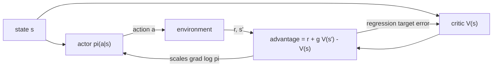

## Où cela s'inscrit

Les méthodes fondées sur la valeur ([[rl.03]], [[rl.04]]) apprennent la qualité des actions puis agissent en prenant un argmax. C'est gênant quand les actions sont continues (quel est l'argmax sur un couple de torsion à 10 dimensions ?), quand la meilleure politique est véritablement aléatoire (pierre-papier-ciseaux), et quand on veut des changements de comportement lisses et progressifs. Les méthodes de **gradient de politique** apprennent la politique elle-même : une fonction $\pi_\theta(a\mid s)$ dont nous ajustons les paramètres $\theta$ par montée de gradient sur le retour espéré. Le fine-tuning de modèles de langage par RL ([[rl.06]]) est exactement cela, où la politique est le modèle de langage et une action est un token.

Le coût est la variance : l'estimation du gradient est bruitée. Cette leçon dérive l'estimateur, montre comment une *référence* (baseline) puis un *critique* appris domptent le bruit, et se termine par la structure acteur-critique sur laquelle PPO s'appuie dans [[rl.06]].

## L'idée en mots simples

Imagine un entraîneur qui te regarde jouer à un jeu de nombreuses fois. Après chaque partie, l'entraîneur ne te dit pas le bon coup ; il dit seulement à quel point la partie s'est bien passée. La règle de retour la plus simple : « ce que tu as fait dans les parties qui se sont bien passées, fais-en un peu plus ; ce que tu as fait dans les parties qui se sont mal passées, fais-en un peu moins ». C'est **REINFORCE** : augmenter la probabilité des actions que tu as prises proportionnellement à la qualité du résultat.

Le défaut : si chaque partie rapporte entre 100 et 110, alors *chaque* action de *chaque* partie est « bonne » et se trouve renforcée, et le vrai signal (110 contre 100) se noie dans le bruit. Remède : comparer chaque résultat à un résultat typique. « Mieux que d'habitude » pousse vers le haut, « moins bien que d'habitude » pousse vers le bas. Le score typique est la **référence** (*baseline*). Mieux encore, faire dépendre la référence de la situation, avec un second apprenant, le **critique**, qui prédit comment les choses se passent d'habitude à partir d'ici ; l'**acteur** est la politique qu'on entraîne. L'écart entre le résultat réel et la prédiction du critique est l'**avantage**.

## Cadre formel

Une politique paramétrée, par exemple un softmax sur des préférences d'action $\theta_{s,a}$ (tabulaire) ou sur les logits d'un réseau. Un épisode (trajectoire) $\tau=(s_0,a_0,r_1,s_1,\dots)$ a pour probabilité

$$
p_\theta(\tau)=p(s_0)\prod_{t}\pi_\theta(a_t\mid s_t)\,P(s_{t+1}\mid s_t,a_t).
$$

L'objectif est le retour espéré, $J(\theta)=\mathbb{E}_{\tau\sim p_\theta}[G(\tau)]=\sum_\tau p_\theta(\tau)G(\tau)$, où $G(\tau)$ est le retour (actualisé) de la trajectoire.

## Dérivation : le théorème du gradient de politique

Dérivons la somme. Le retour $G(\tau)$ ne dépend pas de $\theta$ (étant donnée la trajectoire), seules les probabilités en dépendent :

$$
\nabla_\theta J=\sum_\tau\nabla_\theta p_\theta(\tau)\,G(\tau).
$$

Nous ne pouvons pas estimer par échantillonnage une somme de *gradients de probabilités*, mais nous pouvons estimer une somme pondérée par des probabilités. **L'astuce de la log-dérivée** convertit l'une en l'autre grâce à $\nabla p=p\,\nabla\log p$ :

$$
\nabla_\theta J=\sum_\tau p_\theta(\tau)\,\nabla_\theta\log p_\theta(\tau)\,G(\tau)=\mathbb{E}_{\tau\sim p_\theta}\big[\nabla_\theta\log p_\theta(\tau)\,G(\tau)\big].
$$

Développons maintenant le log du produit. Les termes d'état initial et de transition ne contiennent pas $\theta$, donc leur gradient s'annule :

$$
\nabla_\theta\log p_\theta(\tau)=\sum_t\nabla_\theta\log\pi_\theta(a_t\mid s_t).
$$

D'où le **théorème du gradient de politique** (la dynamique de l'environnement n'est pas nécessaire !) :

$$
\boxed{\nabla_\theta J=\mathbb{E}_{\tau\sim\pi_\theta}\Big[\sum_{t}\nabla_\theta\log\pi_\theta(a_t\mid s_t)\,G(\tau)\Big]}
$$

Il peut être estimé à partir d'épisodes échantillonnés, sans modèle.

**Récompense restante (reward-to-go).** Une action au temps $t$ ne peut pas influencer les récompenses reçues avant $t$. En séparant $G(\tau)$ en récompenses passées et futures, la partie passée multiplie $\nabla\log\pi(a_t|s_t)$ par quelque chose d'indépendant de $a_t$, et a une espérance nulle (montré ensuite). La supprimer donne une version de variance plus faible, de même espérance :

$$
\nabla_\theta J=\mathbb{E}\Big[\sum_t\nabla_\theta\log\pi_\theta(a_t\mid s_t)\,G_t\Big],\qquad G_t=\sum_{k\ge t}\gamma^{k-t}r_{k+1}.
$$

**Pourquoi une référence est gratuite.** Pour toute fonction $b(s_t)$ qui ne dépend pas de l'action,

$$
\mathbb{E}_{a\sim\pi}\big[b(s)\nabla_\theta\log\pi_\theta(a\mid s)\big]=b(s)\sum_a\nabla_\theta\pi_\theta(a\mid s)=b(s)\,\nabla_\theta\sum_a\pi_\theta(a\mid s)=b(s)\nabla_\theta 1=0 .
$$

Soustraire $b(s_t)$ de $G_t$ change donc la variance mais pas le gradient espéré. Le meilleur choix simple est la fonction de valeur, $b(s)=V^\pi(s)$, ce qui fait du multiplicateur l'**avantage**

$$
A^\pi(s,a)=Q^\pi(s,a)-V^\pi(s)\;\approx\;G_t-V(s_t),
$$

« de combien cette action était meilleure que l'action moyenne de la politique dans cet état ». La mise à jour est $\theta\leftarrow\theta+\eta\,A_t\nabla_\theta\log\pi_\theta(a_t|s_t)$.

**Gradient du softmax.** Pour $\pi_\theta=\operatorname{softmax}(\theta)$, $\partial\log\pi(a)/\partial\theta_k=\mathbf 1[k=a]-\pi_k$, c'est-à-dire $\nabla_\theta\log\pi(a)=e_a-\pi$ (un one-hot moins le vecteur de probabilités). Intuition : cela pousse vers le haut le logit choisi et pousse les autres vers le bas proportionnellement à leur probabilité.

## Acteur-critique et A2C

L'**acteur-critique** apprend deux fonctions : l'acteur $\pi_\theta$ et le critique $V_\phi(s)$, entraîné à prédire les retours. Choix pour l'estimation de l'avantage $\hat A_t$ :

- *Avantage Monte Carlo* $G_t-V_\phi(s_t)$ : non biaisé, variance plus élevée (REINFORCE avec une référence apprise).
- *Avantage TD (résidu TD)* $\delta_t=r_{t+1}+\gamma V_\phi(s_{t+1})-V_\phi(s_t)$ : variance plus faible, biaisé par les erreurs du critique ([[rl.03]]).
- Les avantages à *n pas* interpolent. Une moyenne pondérée sur tous les $n$ est **l'estimation généralisée de l'avantage** (GAE), introduite dans [[rl.06]].

**A2C** (acteur-critique à avantage) collecte de courts déploiements à partir de plusieurs copies de l'environnement en parallèle (de façon synchrone), calcule les avantages pour tout le batch, et fait un pas sur la perte de l'acteur $-\hat A_t\log\pi_\theta(a_t|s_t)$ (avec $\hat A_t$ traité comme une constante) et un sur la perte du critique $(V_\phi(s_t)-\text{target})^2$, en ajoutant d'ordinaire un bonus d'entropie $+c_e H(\pi_\theta)$ pour continuer d'explorer. A3C est l'original asynchrone. Comme les données viennent de la politique courante, A2C ne peut utiliser chaque batch que pour un seul pas de gradient ; corriger cela est le but de PPO ([[rl.06]]).



## Exemple résolu

Tous les nombres proviennent des exercices.

**Un bandit à trois bras avec une politique softmax.** $\theta=(0.2,-0.1,0.5)$, récompenses $r=(10,12,11)$. La récompense pondérée par la politique est $J=10.916$. Le gradient exact $\partial J/\partial\theta_k=\pi_k(r_k-J)$ vaut $(-0.296,\,0.260,\,0.037)$ ; les différences finies centrées concordent à $10^{-6}$ près. L'espérance $\sum_a\pi_a\,r_a\nabla\log\pi_a$ donne le même vecteur (le théorème), de même que $\sum_a\pi_a(r_a-5)\nabla\log\pi_a$ ou avec $b=J$ (une référence ne change rien en espérance).

**Variance.** La variance totale d'un échantillon de $(R-b)\nabla\log\pi(a)$ vaut $78.16$ sans référence et seulement $0.282$ avec $b=J$, une réduction d'un facteur 277, parce que sans elle chaque échantillon est dominé par le décalage commun d'environ 11. Avec 20 000 actions échantillonnées, l'estimation sans référence est à environ 0.3 de la vérité, alors qu'avec la référence elle est à 0.02.

**Une chaîne.** Cinq états, mouvements droite/gauche, récompense 1 à l'extrémité droite, $\gamma=0.95$, acteur softmax tabulaire, taux d'apprentissage 0.5 (acteur) et 0.2 (critique), 400 épisodes. REINFORCE avec une référence apprise et A2C à un pas atteignent tous deux une politique qui va à droite avec une probabilité supérieure à 0.9 dans chaque état (environ 0.94-0.99), et le critique finit près de $0.95^{3-s}=(0.857,0.90,0.95,1.0)$. Une mise à jour A2C au dernier pas : $V=0$, $r=1$, terminal donne $\delta=1$, critique $0\to0.2$, logits de l'acteur $\theta_s\leftarrow0.5\cdot1\cdot(-0.5,\,0.5)$ (pour l'action 1), soit $(-0.25,0.25)$.

## Implémentation

```python
import numpy as np

def softmax(z):
    e = np.exp(z - np.max(z)); return e / e.sum()

def grad_log_pi(th_s, a):                 # (A,) : one-hot(a) - pi
    g = -softmax(th_s); g[a] += 1.0; return g

def a2c_update(theta, V, s, a, r, s2, done, gamma, lr_pi, lr_v):
    delta = r + (0.0 if done else gamma * V[s2]) - V[s]     # advantage
    V[s] += lr_v * delta                                    # critic step
    theta[s] += lr_pi * delta * grad_log_pi(theta[s], a)    # actor step
    return delta
```

En PyTorch, la perte de l'acteur est `-(adv.detach() * dist.log_prob(a)).mean()`, l'autograd calculant $\nabla\log\pi$ ; le `detach` fait de l'avantage une constante pour l'acteur. Les bibliothèques (Stable-Baselines3, CleanRL) ajoutent des bonus d'entropie, la normalisation des avantages et l'écrêtage du gradient.

## Formes (shapes)

| Objet | Forme |
|---|---|
| logits tabulaires `theta` | $(S,A)$ |
| `grad_log_pi(theta[s], a)` | $(A,)$ |
| critique `V` | $(S,)$ |
| batch de log-probabilités / avantages (version profonde) | $(B,)$ chacun |

## Idées reçues

- « Le gradient de politique a besoin du modèle de l'environnement. » Le théorème supprime les probabilités de transition, c'est pourquoi il est sans modèle.
- « Une référence biaise le gradient. » Seulement si elle dépend de l'action ; toute référence ne dépendant que de l'état est non biaisée.
- « La valeur du critique est la cible de l'acteur. » Le critique fournit une *référence/un avantage* ; l'acteur suit toujours $\nabla\log\pi$.
- « Les avantages TD sont non biaisés. » Ils héritent des erreurs du critique ; c'est le prix d'une variance plus faible (même compromis biais-variance que dans [[rl.03]]).
- « Les gradients de politique sont efficaces en échantillons. » Les versions de base sont sur la politique et bruitées ; elles demandent typiquement bien plus d'échantillons que les méthodes de valeur avec rejeu.

## Points clés à retenir

- $\nabla_\theta J=\mathbb{E}[\sum_t\nabla\log\pi_\theta(a_t|s_t)\,G_t]$ via l'astuce de la log-dérivée ; aucun modèle nécessaire.
- Soustraire une référence dépendant de l'état laisse inchangé le gradient espéré et peut réduire fortement la variance (277x dans l'exemple du bandit).
- Avec la fonction de valeur comme référence, le multiplicateur est l'avantage $A(s,a)$.
- L'acteur-critique utilise un critique appris et un avantage par résidu TD ; A2C le fait de façon synchrone avec des environnements parallèles.
- Vérifie le code du gradient contre des différences finies et la forme close sur un petit exemple.

## Explique-le toi-même

1. Pourquoi l'astuce de la log-dérivée permet-elle d'estimer le gradient d'une espérance à partir d'échantillons, et pourquoi le modèle de transition de l'environnement disparaît-il du résultat ?
2. Un ami ajoute 1000 à chaque récompense et l'entraînement devient beaucoup plus bruité. Explique pourquoi, et ce que tu changerais.

## Pour aller plus loin

- Williams (1992), l'article REINFORCE, et Sutton et Barto chapitre 13 (méthodes de gradient de politique). Aucun n'a été ouvert pour cette leçon.

## Critères de maîtrise

Tu sais (1) dériver le théorème du gradient de politique avec l'astuce de la log-dérivée ; (2) prouver qu'une référence d'état est non biaisée ; (3) écrire le $\nabla\log\pi$ du softmax et vérifier le gradient par différences finies ; (4) implémenter REINFORCE avec référence et un acteur-critique à un pas et expliquer ce que chacun sacrifie.
