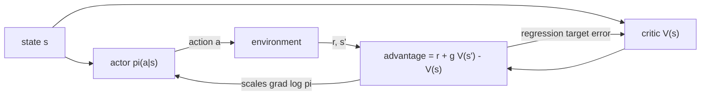

## Where this fits

Value-based methods ([[rl.03]], [[rl.04]]) learn how good actions are and then act by taking an argmax. That is awkward when actions are continuous (what is the argmax over a 10-dimensional torque?), when the best policy is genuinely random (rock-paper-scissors), and when you want smooth, gradual changes in behaviour. **Policy gradient** methods learn the policy itself: a function $\pi_\theta(a\mid s)$ whose parameters $\theta$ we adjust by gradient ascent on expected return. Language-model fine-tuning with RL ([[rl.06]]) is exactly this, where the policy is the language model and an action is a token.

The cost is variance: the gradient estimate is noisy. This lesson derives the estimator, shows how a *baseline* and then a learned *critic* tame the noise, and ends with the actor-critic structure that PPO builds on in [[rl.06]].

## The idea in plain words

Picture a coach who watches you play a game many times. After each game the coach does not tell you the right move; they only say how well the game went. The simplest feedback rule: "whatever you did in games that went well, do a bit more of; whatever you did in games that went badly, do a bit less of". That is **REINFORCE**: raise the probability of the actions you took in proportion to how good the outcome was.

The flaw: if every game scores between 100 and 110, then *every* action in *every* game is "good" and gets reinforced, and the real signal (110 vs 100) drowns in the noise. Fix: compare each outcome to a typical one. "Better than usual" pushes up, "worse than usual" pushes down. The typical score is the **baseline**. Better still, make the baseline depend on the situation, with a second learner, the **critic**, that predicts how well things usually go from here; the **actor** is the policy being coached. The gap between the actual outcome and the critic's prediction is the **advantage**.

## Formal setup

A parametrised policy, for example a softmax over action preferences $\theta_{s,a}$ (tabular) or a network's logits. An episode (trajectory) $\tau=(s_0,a_0,r_1,s_1,\dots)$ has probability

$$
p_\theta(\tau)=p(s_0)\prod_{t}\pi_\theta(a_t\mid s_t)\,P(s_{t+1}\mid s_t,a_t).
$$

The objective is the expected return, $J(\theta)=\mathbb{E}_{\tau\sim p_\theta}[G(\tau)]=\sum_\tau p_\theta(\tau)G(\tau)$, where $G(\tau)$ is the (discounted) return of the trajectory.

## Derivation: the policy gradient theorem

Differentiate the sum. The return $G(\tau)$ does not depend on $\theta$ (given the trajectory), only the probabilities do:

$$
\nabla_\theta J=\sum_\tau\nabla_\theta p_\theta(\tau)\,G(\tau).
$$

We cannot estimate a sum of *gradients of probabilities* by sampling, but we can estimate a sum weighted by probabilities. The **log-derivative trick** converts one into the other using $\nabla p=p\,\nabla\log p$:

$$
\nabla_\theta J=\sum_\tau p_\theta(\tau)\,\nabla_\theta\log p_\theta(\tau)\,G(\tau)=\mathbb{E}_{\tau\sim p_\theta}\big[\nabla_\theta\log p_\theta(\tau)\,G(\tau)\big].
$$

Now expand the log of the product. The initial-state and transition terms do not contain $\theta$, so their gradient vanishes:

$$
\nabla_\theta\log p_\theta(\tau)=\sum_t\nabla_\theta\log\pi_\theta(a_t\mid s_t).
$$

Hence, the **policy gradient theorem** (the environment's dynamics are not needed!):

$$
\boxed{\nabla_\theta J=\mathbb{E}_{\tau\sim\pi_\theta}\Big[\sum_{t}\nabla_\theta\log\pi_\theta(a_t\mid s_t)\,G(\tau)\Big]}
$$

It can be estimated from sampled episodes, with no model.

**Reward-to-go.** An action at time $t$ cannot influence rewards received before $t$. Splitting $G(\tau)$ into past and future rewards, the past part multiplies $\nabla\log\pi(a_t|s_t)$ with something independent of $a_t$, and has expectation zero (shown next). Dropping it gives a lower-variance version with the same expectation:

$$
\nabla_\theta J=\mathbb{E}\Big[\sum_t\nabla_\theta\log\pi_\theta(a_t\mid s_t)\,G_t\Big],\qquad G_t=\sum_{k\ge t}\gamma^{k-t}r_{k+1}.
$$

**Why a baseline is free.** For any function $b(s_t)$ that does not depend on the action,

$$
\mathbb{E}_{a\sim\pi}\big[b(s)\nabla_\theta\log\pi_\theta(a\mid s)\big]=b(s)\sum_a\nabla_\theta\pi_\theta(a\mid s)=b(s)\,\nabla_\theta\sum_a\pi_\theta(a\mid s)=b(s)\nabla_\theta 1=0 .
$$

So subtracting $b(s_t)$ from $G_t$ changes the variance but not the expected gradient. The best simple choice is the value function, $b(s)=V^\pi(s)$, which makes the multiplier the **advantage**

$$
A^\pi(s,a)=Q^\pi(s,a)-V^\pi(s)\;\approx\;G_t-V(s_t),
$$

"how much better was this action than the policy's average action in this state". The update is $\theta\leftarrow\theta+\eta\,A_t\nabla_\theta\log\pi_\theta(a_t|s_t)$.

**Softmax gradient.** For $\pi_\theta=\operatorname{softmax}(\theta)$, $\partial\log\pi(a)/\partial\theta_k=\mathbf 1[k=a]-\pi_k$, i.e. $\nabla_\theta\log\pi(a)=e_a-\pi$ (a one-hot minus the probability vector). Intuition: pushes up the chosen logit and pushes the others down in proportion to their probability.

## Actor-critic and A2C

**Actor-critic** learns two functions: the actor $\pi_\theta$ and the critic $V_\phi(s)$, trained to predict returns. Choices for the advantage estimate $\hat A_t$:

- *Monte Carlo advantage* $G_t-V_\phi(s_t)$: unbiased, higher variance (REINFORCE with a learned baseline).
- *TD advantage (TD residual)* $\delta_t=r_{t+1}+\gamma V_\phi(s_{t+1})-V_\phi(s_t)$: lower variance, biased by the critic's errors ([[rl.03]]).
- *n-step* advantages interpolate. A weighted average over all $n$ is **generalised advantage estimation**, introduced in [[rl.06]].

**A2C** (advantage actor-critic) collects short rollouts from several environment copies in parallel (synchronously), computes advantages for the whole batch, and takes one step on the actor loss $-\hat A_t\log\pi_\theta(a_t|s_t)$ (with $\hat A_t$ treated as a constant) and one on the critic loss $(V_\phi(s_t)-\text{target})^2$, usually adding an entropy bonus $+c_e H(\pi_\theta)$ to keep exploring. A3C is the asynchronous original. Because the data comes from the current policy, A2C can use each batch for one gradient step only; fixing that is the point of PPO ([[rl.06]]).



## Worked example

All numbers come from the exercises.

**A three-armed bandit with a softmax policy.** $\theta=(0.2,-0.1,0.5)$, rewards $r=(10,12,11)$. The policy-weighted reward is $J=10.916$. The exact gradient $\partial J/\partial\theta_k=\pi_k(r_k-J)$ is $(-0.296,\,0.260,\,0.037)$; central finite differences agree to $10^{-6}$. The expectation $\sum_a\pi_a\,r_a\nabla\log\pi_a$ gives the same vector (the theorem), and so does $\sum_a\pi_a(r_a-5)\nabla\log\pi_a$ or with $b=J$ (a baseline changes nothing in expectation).

**Variance.** The total variance of one sample of $(R-b)\nabla\log\pi(a)$ is $78.16$ without a baseline and only $0.282$ with $b=J$, a 277-fold reduction, because without it every sample is dominated by the common offset of about 11. With 20,000 sampled actions the baseline-free estimate is within about 0.3 of the truth, while with the baseline it is within 0.02.

**A chain.** Five states, right/left moves, reward 1 at the right end, $\gamma=0.95$, tabular softmax actor, learning rates 0.5 (actor) and 0.2 (critic), 400 episodes. REINFORCE with a learned baseline and one-step A2C both reach a policy that moves right with probability above 0.9 in every state (about 0.94-0.99), and the critic ends near $0.95^{3-s}=(0.857,0.90,0.95,1.0)$. One A2C update at the last step: $V=0$, $r=1$, terminal gives $\delta=1$, critic $0\to0.2$, actor logits $\theta_s\leftarrow0.5\cdot1\cdot(-0.5,\,0.5)$ (for action 1), i.e. $(-0.25,0.25)$.

## Implementation

```python
import numpy as np

def softmax(z):
    e = np.exp(z - np.max(z)); return e / e.sum()

def grad_log_pi(th_s, a):                 # (A,) : one-hot(a) - pi
    g = -softmax(th_s); g[a] += 1.0; return g

def a2c_update(theta, V, s, a, r, s2, done, gamma, lr_pi, lr_v):
    delta = r + (0.0 if done else gamma * V[s2]) - V[s]     # advantage
    V[s] += lr_v * delta                                    # critic step
    theta[s] += lr_pi * delta * grad_log_pi(theta[s], a)    # actor step
    return delta
```

In PyTorch the actor loss is `-(adv.detach() * dist.log_prob(a)).mean()`, with autograd computing $\nabla\log\pi$; the `detach` makes the advantage a constant for the actor. Libraries (Stable-Baselines3, CleanRL) add entropy bonuses, advantage normalisation and gradient clipping.

## Shapes

| Object | Shape |
|---|---|
| tabular logits `theta` | $(S,A)$ |
| `grad_log_pi(theta[s], a)` | $(A,)$ |
| critic `V` | $(S,)$ |
| batch of log-probs / advantages (deep version) | $(B,)$ each |

## Common misconceptions

- "Policy gradient needs the environment model." The theorem removes the transition probabilities, which is why it is model-free.
- "A baseline biases the gradient." Only if it depends on the action; any state-only baseline is unbiased.
- "The critic's value is the target for the actor." The critic supplies a *baseline/advantage*; the actor still follows $\nabla\log\pi$.
- "TD advantages are unbiased." They inherit the critic's errors; that is the price for lower variance (same bias-variance trade-off as in [[rl.03]]).
- "Policy gradients are sample-efficient." Vanilla versions are on-policy and noisy; they typically need many more samples than replay-based value methods.

## Key takeaways

- $\nabla_\theta J=\mathbb{E}[\sum_t\nabla\log\pi_\theta(a_t|s_t)\,G_t]$ via the log-derivative trick; no model is needed.
- Subtracting a state-dependent baseline leaves the expected gradient unchanged and can slash variance (277x in the bandit example).
- With the value function as baseline the multiplier is the advantage $A(s,a)$.
- Actor-critic uses a learned critic and a TD-residual advantage; A2C does this synchronously with parallel environments.
- Verify gradient code against finite differences and the closed form on a tiny example.

## Explain it yourself

1. Why does the log-derivative trick let you estimate a gradient of an expectation from samples, and why does the environment's transition model disappear from the result?
2. A friend adds 1000 to every reward and training gets much noisier. Explain why, and what you would change.

## Further reading

- Williams (1992), the REINFORCE paper, and Sutton and Barto chapter 13 (policy gradient methods). Neither was opened for this lesson.

## Mastery criteria

You can (1) derive the policy gradient theorem with the log-derivative trick; (2) prove that a state baseline is unbiased; (3) write the softmax $\nabla\log\pi$ and verify the gradient by finite differences; (4) implement REINFORCE with a baseline and one-step actor-critic and explain what each one trades off.
