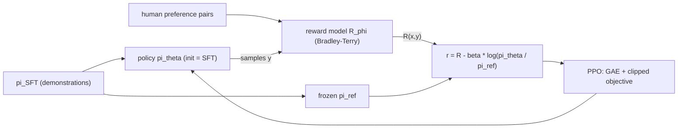

## Où cela s'inscrit

[[rl.05]] s'est terminée sur un problème : une méthode de gradient de politique jette ses données après une mise à jour, parce que les données ont été collectées par l'ancienne politique. Faire plusieurs pas sur le même batch est tentant mais dangereux. Un seul pas trop grand peut détruire une politique, et comme le batch suivant vient de la politique détruite, les dégâts s'aggravent et souvent ne se réparent pas. **L'optimisation de politique proximale (PPO)** obtient plusieurs pas sûrs par batch grâce à une petite modification de l'objectif. C'est l'algorithme de gradient de politique par défaut depuis 2017, de la robotique au fine-tuning de grands modèles de langage.

La seconde moitié de cette leçon est cet usage : **l'apprentissage par renforcement à partir de retours humains (RLHF)**. Un modèle de langage pré-entraîné sait écrire un texte fluide, mais personne ne peut écrire une formule pour « une réponse utile ». Les gens peuvent en revanche dire laquelle de deux réponses ils préfèrent. Le RLHF ajuste un **modèle de récompense** à de telles comparaisons, puis optimise le modèle de langage avec PPO contre lui. Le côté modèle de langage (tokens, SFT, le transformer) relève du cours LLM (voir la leçon `llm.05` de ce cours, écrite séparément) ; ici, nous nous concentrons sur la mécanique de l'apprentissage par renforcement.

## L'idée en mots simples

Imagine que tu ajustes une recette d'après les retours de dégustateurs. Tu apprends dans quelle direction le goût s'améliore, mais si tu changes le sel, les épices et le temps de cuisson tous à la fois et fortement, ton estimation de « quelle direction est meilleure » (fondée sur l'ancienne recette) ne s'applique plus, et le plat peut être gâché. Un cuisinier raisonnable fait de **petits changements** et goûte à nouveau. Une **région de confiance** formalise cela : ne fais confiance à ton estimation d'amélioration que dans un voisinage de la recette actuelle.

PPO impose le voisinage à bas coût : il mesure de combien la nouvelle politique rend chaque action observée plus (ou moins) probable, et **cesse de récompenser tout changement supplémentaire** dès que la probabilité d'une action a bougé de plus de, disons, 20 pour cent dans la direction que le retour favorisait. Au-delà de ce point, il n'y a rien à gagner à pousser plus loin, donc le gradient est simplement nul.

Pour le RLHF, ajoute une laisse. Le modèle a le droit de courir après le score du modèle de récompense, mais il paie une pénalité s'il s'éloigne trop du modèle original (de référence), car le modèle de récompense n'est fiable que sur des textes ressemblant à ceux sur lesquels il a été entraîné. Sans la laisse, la politique découvre des sorties étranges qui trompent le modèle de récompense (« piratage de la récompense », *reward hacking*).

## Dérivation : du gradient de politique à l'objectif écrêté

**Échantillonnage préférentiel.** Les données sont collectées avec l'ancienne politique $\pi_{\theta_{\text{old}}}$, mais nous voulons évaluer une nouvelle politique $\pi_\theta$. Pour toute fonction $f$, $\mathbb{E}_{a\sim\pi_\theta}[f(a)]=\mathbb{E}_{a\sim\pi_{\text{old}}}\big[\tfrac{\pi_\theta(a|s)}{\pi_{\text{old}}(a|s)}f(a)\big]$. Définissons le **rapport de probabilités**

$$
\rho_t(\theta)=\frac{\pi_\theta(a_t\mid s_t)}{\pi_{\theta_{\text{old}}}(a_t\mid s_t)},\qquad \rho_t(\theta_{\text{old}})=1 .
$$

L'objectif de substitution (*surrogate*) $L^{\text{PG}}(\theta)=\mathbb{E}_t[\rho_t(\theta)\hat A_t]$ a, en $\theta=\theta_{\text{old}}$, exactement le gradient de politique de [[rl.05]] : $\nabla\rho_t=\rho_t\nabla\log\pi_\theta$ vaut $\nabla\log\pi_\theta$ quand $\rho_t=1$. Loin de $\theta_{\text{old}}$, le surrogate n'est qu'une approximation locale, ce qui est précisément la raison pour laquelle nous devons rester proches.

**Idée de la région de confiance.** TRPO maximise le surrogate sous la contrainte $\mathrm{KL}(\pi_{\text{old}}\|\pi_\theta)\le\delta$, ce qui exige une résolution du second ordre. PPO remplace la contrainte par un écrêtage. Le **surrogate écrêté** est

$$
\boxed{L^{\text{CLIP}}(\theta)=\mathbb{E}_t\Big[\min\big(\rho_t\hat A_t,\;\operatorname{clip}(\rho_t,\,1-\varepsilon,\,1+\varepsilon)\,\hat A_t\big)\Big]}
$$

avec typiquement $\varepsilon=0.2$. Une analyse par cas montre ce que fait le $\min$ :

- $\hat A_t>0$ (une bonne action) : l'objectif est $\min(\rho,\,1+\varepsilon)\hat A$. Il croît avec $\rho$ jusqu'à $\rho=1+\varepsilon$ puis est plat : **aucune incitation à augmenter la probabilité de plus de $\varepsilon$**. Si $\rho<1-\varepsilon$ (l'action est devenue moins probable), le terme non écrêté est le plus petit, donc le gradient reste actif et peut réparer l'erreur.
- $\hat A_t<0$ (une mauvaise action) : l'objectif est $\max(\rho,\,1-\varepsilon)\hat A$, plat dès que $\rho<1-\varepsilon$ : **aucune incitation à réduire la probabilité de plus de $\varepsilon$** ; si $\rho>1+\varepsilon$, le gradient reste actif pour la ramener vers le bas.

Le $\min$ pessimiste fait de $L^{\text{CLIP}}$ une borne inférieure du surrogate non écrêté, de sorte que l'optimiseur ne peut pas exploiter l'approximation en s'éloignant. Gradient pour un échantillon : $\rho_t\hat A_t\nabla\log\pi_\theta(a_t|s_t)$ si l'échantillon n'est pas écrêté, 0 s'il est écrêté. (L'écrêtage borne l'incitation de chaque échantillon, pas le changement réel de la politique : des paramètres partagés entre échantillons peuvent encore pousser un rapport au-delà de $1\pm\varepsilon$, comme le montre l'exemple résolu.)

**La perte complète** ajoute une perte de fonction de valeur et un bonus d'entropie : $L=L^{\text{CLIP}}-c_v(V_\phi(s_t)-V_t^{\text{target}})^2+c_eH(\pi_\theta)$, souvent avec $c_v=0.5$, $c_e=0.01$. **Boucle d'entraînement :** collecter $N\times T$ transitions avec la politique courante ; calculer les avantages et les *geler*, et stocker $\log\pi_{\text{old}}$ ; exécuter $K$ époques (p. ex. 10) de pas de gradient par minibatch sur $L$ ; jeter les données ; recommencer.

## Dérivation : estimation généralisée de l'avantage

D'après [[rl.05]] et [[rl.03]] : l'avantage à un pas est le résidu TD $\delta_t=r_t+\gamma V(s_{t+1})-V(s_t)$ (faible variance, biaisé) ; l'avantage à $n$ pas somme $n$ récompenses actualisées puis fait du bootstrap ; l'avantage Monte Carlo $G_t-V(s_t)$ est non biaisé mais bruité. Dans [[rl.03]], nous avons montré que $G_t-V(s_t)=\sum_{k\ge0}\gamma^k\delta_{t+k}$. **GAE** garde la même somme mais atténue les termes plus tardifs, plus bruités, par $\lambda\in[0,1]$ :

$$
\hat A_t^{\text{GAE}(\gamma,\lambda)}=\sum_{l=0}^{\infty}(\gamma\lambda)^l\,\delta_{t+l}
\quad\Longleftrightarrow\quad
\hat A_t=\delta_t+\gamma\lambda\,\hat A_{t+1}.
$$

La récursion permet de calculer tous les avantages en une seule passe arrière. $\lambda=0$ donne $\delta_t$ (TD, faible variance, plus de biais) ; $\lambda=1$ donne l'avantage Monte Carlo (non biaisé, forte variance) ; $\lambda\approx0.95$ est un compromis courant. À la fin d'un épisode ($d_t=1$), le bootstrap et la trace sont coupés : $\delta_t=r_t-V(s_t)$ et $\hat A_t=\delta_t$. Les cibles de valeur pour le critique sont $\hat A_t+V(s_t)$.

## Modélisation de la récompense et RLHF

**Étape 1, fine-tuning supervisé (SFT) :** fine-tuner le modèle pré-entraîné sur des démonstrations humaines pour obtenir $\pi_{\text{SFT}}$.

**Étape 2, modèle de récompense.** Collecter, pour des prompts $x$, des paires de réponses $(y^+,y^-)$ où $y^+$ est préférée. Modéliser la probabilité que $y^+$ gagne par le modèle de **Bradley-Terry**, une fonction logistique de la différence de récompense : $P(y^+\succ y^-)=\sigma\big(R_\phi(x,y^+)-R_\phi(x,y^-)\big)$. Le maximum de vraisemblance donne la perte

$$
\mathcal L(\phi)=-\mathbb{E}\big[\log\sigma\big(R_\phi(x,y^+)-R_\phi(x,y^-)\big)\big].
$$

C'est une régression logistique ordinaire sur la *différence* des scores (pour un $R_w(x)=w\cdot x$ linéaire, le gradient est $-\mathbb{E}[(1-\sigma(m))(x^+-x^-)]$ avec la marge $m$). Seules les différences comptent, donc l'échelle de la récompense est arbitraire. En pratique, $R_\phi$ est le transformer SFT avec une tête scalaire.

**Étape 3, PPO avec pénalité KL.** Initialiser la politique à partir de $\pi_{\text{SFT}}$ et garder une copie gelée $\pi_{\text{ref}}$. La récompense utilisée par PPO pour une réponse échantillonnée est

$$
r_{\text{total}}(x,y)=R_\phi(x,y)-\beta\big[\log\pi_\theta(y|x)-\log\pi_{\text{ref}}(y|x)\big],
$$

où le crochet est une estimation à un échantillon de $\mathrm{KL}(\pi_\theta\|\pi_{\text{ref}})$ (la divergence KL de la théorie de l'information), et $\beta$ vaut typiquement 0.01-0.05. L'« état » est le prompt plus les tokens déjà produits, une « action » est le token suivant, et le score du modèle de récompense arrive à la fin de la réponse (la pénalité KL peut être répartie sur les tokens). Le critique donne des références par token, GAE donne les avantages, et l'objectif écrêté met à jour la politique. Le terme KL est la plus importante des protections contre le piratage de la récompense ; il agit comme un régularisateur doux plutôt que comme une région de confiance dure.



**Vers où cela va.** DPO (optimisation directe des préférences) dérive une perte en forme close qui supprime le modèle de récompense séparé et la boucle PPO ; GRPO remplace le critique par une référence relative au groupe et utilise des récompenses vérifiables (le code s'exécute-t-il, la réponse mathématique est-elle juste), désormais courant pour les modèles de raisonnement ; les modèles de récompense de processus notent les étapes intermédiaires du raisonnement. Au-delà d'un agent unique, les leçons ultérieures de la phase source couvrent le RL multi-agents (non-stationnarité quand d'autres apprenants changent), le transfert simulation-réalité (randomisation de domaine pour franchir l'écart avec la réalité) et le RL pour les jeux (auto-jeu, recherche de type AlphaZero). Je n'ai lu que les ouvertures de ces trois-là, considère donc ce paragraphe comme une carte, pas un traitement.

## Exemple résolu

Tous les nombres proviennent des deux exercices.

**GAE.** Récompenses $(1,0,1)$, valeurs $(0.5,0.4,0.6)$, valeur de bootstrap $0.3$, $\gamma=0.9$.
- Résidus TD : $\delta_0=1+0.9\cdot0.4-0.5=0.86$ ; $\delta_1=0+0.9\cdot0.6-0.4=0.14$ ; $\delta_2=1+0.9\cdot0.3-0.6=0.67$.
- $\lambda=0$ : avantages $(0.86,0.14,0.67)$.
- $\lambda=1$ : $(1.5287,0.743,0.67)$, ce qui égale retour moins valeur : $G_0=1+0+0.81\cdot1+0.729\cdot0.3=2.0287$, moins $0.5$.
- $\lambda=0.95$ : $(1.4695,0.7129,0.67)$, entre les deux, comme attendu.

**L'écrêtage en action.** Trois actions avec une politique initiale uniforme, un batch de six actions échantillonnées $(0,0,1,2,2,1)$ avec les avantages $(1,1,-1,0.5,-0.5,-1)$ et $\varepsilon=0.2$. On exécute 200 pas de gradient avec un taux d'apprentissage de 0.5 sur ce même batch :
- *Sans* écrêtage : la politique s'effondre vers $\pi\approx(0.995,0.002,0.004)$ et le rapport de l'action 0 atteint environ 3.
- *Avec* écrêtage : $\pi\approx(0.45,0.23,0.32)$, rapport de l'action 0 d'environ 1.36. Il dépasse un peu $1.2$ parce que les gradients des *autres* échantillons déplacent les logits partagés, mais il reste dans une région saine, l'objectif s'est quand même amélioré, et la politique ne s'est pas effondrée.

**Modèle de récompense.** Des préférences synthétiques générées à partir d'une récompense linéaire cachée $w=(2,-1,0.5,0)$ avec des étiquettes bruitées (logistiques) sur 300 paires : la descente de gradient sur la perte de Bradley-Terry à partir de poids nuls atteint une perte d'environ 0.30 (la valeur de départ est $\log2=0.693$) et retrouve $w\approx(2.2,-1.5,0.7,0.1)$ (même direction, cosinus d'environ 0.99), avec une précision par paires d'environ 0.87. Elle ne peut pas atteindre 100 % parce que les étiquettes elles-mêmes sont bruitées.

**Récompense façonnée par la KL.** $R=1.0$, $\log\pi_\theta=-0.5$, $\log\pi_{\text{ref}}=-2.0$, $\beta=0.1$ : $r_{\text{total}}=1.0-0.1\cdot1.5=0.85$. Une réponse piratée avec $R=1.2$ mais $\log\pi_\theta-\log\pi_{\text{ref}}=4.9$ et $\beta=0.5$ obtient $1.2-2.45=-1.25$, pire qu'une réponse inchangée de récompense 1.0.

## Implémentation

```python
import numpy as np

def gae(rewards, values, last_value, gamma, lam, dones=None):
    T = len(rewards); vals = np.append(values, last_value)
    adv = np.zeros(T); running = 0.0
    for t in reversed(range(T)):
        nd = 1.0 if dones is None else 1.0 - dones[t]
        delta = rewards[t] + gamma * vals[t + 1] * nd - vals[t]
        running = delta + gamma * lam * nd * running
        adv[t] = running
    return adv                                  # shape (T,)

def clipped_surrogate(ratio, adv, eps):         # ratio, adv: (N,)
    return np.minimum(ratio * adv, np.clip(ratio, 1 - eps, 1 + eps) * adv).mean()

def bt_loss(w, Xp, Xn):                         # Xp, Xn: (N, d)
    return np.mean(np.logaddexp(0.0, -((Xp - Xn) @ w)))

def rlhf_reward(r, logp_policy, logp_ref, beta):
    return r - beta * (logp_policy - logp_ref)
```

En production : PPO vit dans Stable-Baselines3 et CleanRL pour le contrôle classique et, pour les modèles de langage, dans des bibliothèques comme TRL, qui gèrent aussi le modèle de référence, le contrôle de la KL, la notation par le modèle de récompense et le regroupement en batchs de séquences de tokens. Formes dans un cadre LM : les log-probabilités et les avantages sont $(B,T)$ (batch par longueur de réponse), le modèle de récompense renvoie $(B,)$.

## Formes (shapes)

| Objet | Forme |
|---|---|
| récompenses, valeurs, avantages dans un déploiement | $(T,)$ (les valeurs ont une entrée de bootstrap en plus) |
| rapport $\rho$, avantage dans un minibatch | $(N,)$ |
| paires de caractéristiques de préférence | $(N,d)$ chacune ; marge $(N,)$ |
| log-probabilités LM, avantages (RLHF profond) | $(B,T)$ |

## Idées reçues

- « PPO garantit que la politique reste dans $1\pm\varepsilon$. » L'écrêtage supprime l'incitation par échantillon, mais les paramètres partagés et de nombreuses époques peuvent encore pousser des rapports hors de l'intervalle ; les implémentations surveillent la KL et peuvent s'arrêter plus tôt.
- « L'écrêtage s'applique de la même façon aux bonnes et aux mauvaises directions. » Il est unilatéral par conception : les mouvements qui empirent les choses ne sont pas écrêtés, donc les erreurs peuvent être corrigées.
- « GAE est un algorithme différent de l'acteur-critique. » C'est une façon de calculer l'avantage ; $\lambda$ échange du biais contre de la variance.
- « Le modèle de récompense mesure la qualité. » Il prédit quelle réponse un annotateur préférerait, sur un texte semblable à ses données d'entraînement ; optimisé trop fort, il est exploité (d'où la laisse KL).
- « La pénalité KL est un simple vernis optionnel. » C'est la principale défense contre le piratage de la récompense et elle garde la politique proche d'un langage fluide.
- « Le RLHF a toujours besoin de PPO. » Les méthodes de type DPO et GRPO suppriment des parties du pipeline, mais l'idée de modélisation des préférences/récompenses subsiste.

## Points clés à retenir

- Le surrogate $\rho_t\hat A_t$ n'est valable que près de la politique qui a collecté les données ; l'objectif écrêté de PPO supprime l'incitation à faire sortir un rapport de probabilités de $1\pm\varepsilon$ dans la direction que favorise l'avantage.
- GAE : $\hat A_t=\sum_l(\gamma\lambda)^l\delta_{t+l}$, calculé par une récursion arrière ; $\lambda$ interpole entre TD ($0$) et Monte Carlo ($1$).
- Un modèle de récompense de Bradley-Terry est une régression logistique sur les différences de scores entre réponses préférées et rejetées.
- RLHF = SFT, puis modèle de récompense, puis PPO sur $R-\beta\log(\pi_\theta/\pi_{\text{ref}})$.
- Teste toujours les composants un par un : GAE contre des résidus TD calculés à la main, le gradient écrêté contre des différences finies, le modèle de récompense contre une récompense cachée connue.

## Explique-le toi-même

1. Pourquoi une estimation de gradient de politique calculée à partir de données anciennes devient-elle peu fiable une fois que la politique a bougé, et comment l'écrêtage limite-t-il les dégâts ?
2. Décris avec tes propres mots ce qui irait mal dans le RLHF si $\beta=0$.

## Pour aller plus loin

- Schulman et al. (2017) pour PPO et Schulman et al. (2016) pour GAE ; Christiano et al. (2017) et Ouyang et al. (2022) pour le RLHF. Aucun de ces articles n'a été ouvert pour cette leçon ; la leçon suit les leçons de la phase 9 du dépôt listées plus haut.
- La leçon du cours LLM sur le RLHF et l'alignement (`llm.05`) pour le côté modèle de langage du pipeline.

## Critères de maîtrise

Tu sais (1) dériver le surrogate à rapport d'importance et expliquer les deux cas de l'objectif écrêté ; (2) implémenter GAE et vérifier les limites $\lambda=0$ et $\lambda=1$ ; (3) ajuster un modèle de récompense de Bradley-Terry et vérifier son gradient ; (4) écrire la récompense façonnée par la KL et expliquer ce qu'apporte chacune des trois étapes du RLHF.
