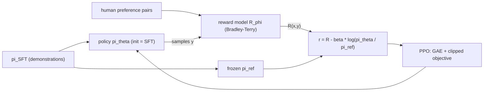

## Where this fits

[[rl.05]] ended with a problem: a policy-gradient method throws away its data after one update, because the data was collected by the old policy. Taking several steps on the same batch is tempting but dangerous. A single oversized step can wreck a policy, and since the next batch comes from the wrecked policy, the damage compounds and often does not recover. **Proximal policy optimisation (PPO)** gets several safe steps per batch with one small modification of the objective. It has been the default policy-gradient algorithm since 2017, from robotics to the fine-tuning of large language models.

The second half of this lesson is that use: **reinforcement learning from human feedback (RLHF)**. A pretrained language model can write fluent text, but nobody can write a formula for "a helpful answer". People can, however, say which of two answers they prefer. RLHF fits a **reward model** to such comparisons and then optimises the language model with PPO against it. The language-model side (tokens, SFT, the transformer) belongs to the LLM course (see the lesson `llm.05` in that course, written separately); here we focus on the reinforcement-learning mechanics.

## The idea in plain words

Imagine adjusting a recipe from tasters' feedback. You learn which direction improves the taste, but if you change salt, spice and cooking time all at once by a big amount, your estimate of "which direction is better" (based on the old recipe) no longer applies, and the dish may be ruined. A sensible cook makes **small changes** and re-tastes. A **trust region** formalises this: only trust your improvement estimate within a neighbourhood of the current recipe.

PPO enforces the neighbourhood cheaply: it measures how much more (or less) likely the new policy makes each action it observed, and **stops rewarding further change** once an action's probability has moved by more than, say, 20 percent in the direction that the feedback favoured. Beyond that point, there is nothing to gain from pushing further, so the gradient is simply zero.

For RLHF add a leash. The model is allowed to chase the reward model's score, but it pays a penalty for drifting far from the original (reference) model, since the reward model is only reliable on text like the text it was trained on. Without the leash the policy discovers strange outputs that fool the reward model ("reward hacking").

## Derivation: from the policy gradient to the clipped objective

**Importance sampling.** Data is gathered with the old policy $\pi_{\theta_{\text{old}}}$, but we want to evaluate a new policy $\pi_\theta$. For any function $f$, $\mathbb{E}_{a\sim\pi_\theta}[f(a)]=\mathbb{E}_{a\sim\pi_{\text{old}}}\big[\tfrac{\pi_\theta(a|s)}{\pi_{\text{old}}(a|s)}f(a)\big]$. Define the **probability ratio**

$$
\rho_t(\theta)=\frac{\pi_\theta(a_t\mid s_t)}{\pi_{\theta_{\text{old}}}(a_t\mid s_t)},\qquad \rho_t(\theta_{\text{old}})=1 .
$$

The surrogate objective $L^{\text{PG}}(\theta)=\mathbb{E}_t[\rho_t(\theta)\hat A_t]$ has, at $\theta=\theta_{\text{old}}$, exactly the policy gradient of [[rl.05]]: $\nabla\rho_t=\rho_t\nabla\log\pi_\theta$ equals $\nabla\log\pi_\theta$ when $\rho_t=1$. Away from $\theta_{\text{old}}$ the surrogate is only a local approximation, which is precisely why we need to stay close.

**Trust-region idea.** TRPO maximises the surrogate subject to $\mathrm{KL}(\pi_{\text{old}}\|\pi_\theta)\le\delta$, which needs a second-order solve. PPO replaces the constraint by clipping. The **clipped surrogate** is

$$
\boxed{L^{\text{CLIP}}(\theta)=\mathbb{E}_t\Big[\min\big(\rho_t\hat A_t,\;\operatorname{clip}(\rho_t,\,1-\varepsilon,\,1+\varepsilon)\,\hat A_t\big)\Big]}
$$

with typically $\varepsilon=0.2$. Case analysis shows what the $\min$ does:

- $\hat A_t>0$ (a good action): the objective is $\min(\rho,\,1+\varepsilon)\hat A$. It increases with $\rho$ until $\rho=1+\varepsilon$ and is flat afterwards: **no incentive to raise the probability by more than $\varepsilon$**. If $\rho<1-\varepsilon$ (the action got worse), the unclipped term is the smaller one, so the gradient stays active and can repair the mistake.
- $\hat A_t<0$ (a bad action): the objective is $\max(\rho,\,1-\varepsilon)\hat A$, flat once $\rho<1-\varepsilon$: **no incentive to cut the probability by more than $\varepsilon$**; if $\rho>1+\varepsilon$ the gradient stays active to push it back down.

The pessimistic $\min$ makes $L^{\text{CLIP}}$ a lower bound of the unclipped surrogate, so the optimiser cannot exploit the approximation by moving far. Gradient for one sample: $\rho_t\hat A_t\nabla\log\pi_\theta(a_t|s_t)$ if the sample is unclipped, 0 if clipped. (Clipping bounds each sample's incentive, not the actual policy change: parameters shared between samples can still push a ratio beyond $1\pm\varepsilon$, as the worked example shows.)

**The full loss** adds a value-function loss and an entropy bonus: $L=L^{\text{CLIP}}-c_v(V_\phi(s_t)-V_t^{\text{target}})^2+c_eH(\pi_\theta)$, often $c_v=0.5$, $c_e=0.01$. **Training loop:** collect $N\times T$ transitions with the current policy; compute advantages and *freeze* them, and store $\log\pi_{\text{old}}$; run $K$ epochs (e.g. 10) of minibatch gradient steps on $L$; discard the data; repeat.

## Derivation: generalised advantage estimation

From [[rl.05]] and [[rl.03]]: the one-step advantage is the TD residual $\delta_t=r_t+\gamma V(s_{t+1})-V(s_t)$ (low variance, biased); the $n$-step advantage sums $n$ discounted rewards then bootstraps; the Monte Carlo advantage $G_t-V(s_t)$ is unbiased but noisy. In [[rl.03]] we showed $G_t-V(s_t)=\sum_{k\ge0}\gamma^k\delta_{t+k}$. **GAE** keeps the same sum but decays the later, noisier terms by $\lambda\in[0,1]$:

$$
\hat A_t^{\text{GAE}(\gamma,\lambda)}=\sum_{l=0}^{\infty}(\gamma\lambda)^l\,\delta_{t+l}
\quad\Longleftrightarrow\quad
\hat A_t=\delta_t+\gamma\lambda\,\hat A_{t+1}.
$$

The recursion lets us compute all advantages in one backward pass. $\lambda=0$ gives $\delta_t$ (TD, low variance, more bias); $\lambda=1$ gives the Monte Carlo advantage (unbiased, high variance); $\lambda\approx0.95$ is a common compromise. At an episode end ($d_t=1$) the bootstrap and the trace are cut: $\delta_t=r_t-V(s_t)$ and $\hat A_t=\delta_t$. Value targets for the critic are $\hat A_t+V(s_t)$.

## Reward modelling and RLHF

**Stage 1, supervised fine-tuning (SFT):** fine-tune the pretrained model on human demonstrations to get $\pi_{\text{SFT}}$.

**Stage 2, reward model.** Collect, for prompts $x$, pairs of responses $(y^+,y^-)$ with $y^+$ preferred. Model the probability that $y^+$ wins by the **Bradley-Terry** model, a logistic function of the reward difference: $P(y^+\succ y^-)=\sigma\big(R_\phi(x,y^+)-R_\phi(x,y^-)\big)$. Maximum likelihood gives the loss

$$
\mathcal L(\phi)=-\mathbb{E}\big[\log\sigma\big(R_\phi(x,y^+)-R_\phi(x,y^-)\big)\big].
$$

This is ordinary logistic regression on the *difference* of scores (for a linear $R_w(x)=w\cdot x$ the gradient is $-\mathbb{E}[(1-\sigma(m))(x^+-x^-)]$ with margin $m$). Only differences matter, so the reward scale is arbitrary. In practice $R_\phi$ is the SFT transformer with a scalar head.

**Stage 3, PPO with a KL penalty.** Initialise the policy from $\pi_{\text{SFT}}$ and keep a frozen copy $\pi_{\text{ref}}$. The reward used by PPO for a sampled response is

$$
r_{\text{total}}(x,y)=R_\phi(x,y)-\beta\big[\log\pi_\theta(y|x)-\log\pi_{\text{ref}}(y|x)\big],
$$

where the bracket is a single-sample estimate of $\mathrm{KL}(\pi_\theta\|\pi_{\text{ref}})$ (the KL divergence from information theory), and $\beta$ is typically 0.01-0.05. The "state" is the prompt plus tokens so far, an "action" is the next token, and the reward-model score arrives at the end of the response (the KL penalty can be spread over tokens). The critic gives per-token baselines, GAE gives advantages, and the clipped objective updates the policy. The KL term is the single most important safeguard against reward hacking; it acts as a soft regulariser rather than a hard trust region.



**Where this is heading.** DPO (direct preference optimisation) derives a closed-form loss that removes the separate reward model and the PPO loop; GRPO replaces the critic with a group-relative baseline and uses verifiable rewards (does the code run, is the math answer right), now common for reasoning models; process reward models score intermediate reasoning steps. Beyond single agents, the later lessons of the source phase cover multi-agent RL (non-stationarity when other learners change), sim-to-real transfer (domain randomisation to cross the reality gap) and RL for games (self-play, AlphaZero-style search). I read only the openings of those three, so treat this paragraph as a map, not a treatment.

## Worked example

All numbers come from the two exercises.

**GAE.** Rewards $(1,0,1)$, values $(0.5,0.4,0.6)$, bootstrap value $0.3$, $\gamma=0.9$.
- TD residuals: $\delta_0=1+0.9\cdot0.4-0.5=0.86$; $\delta_1=0+0.9\cdot0.6-0.4=0.14$; $\delta_2=1+0.9\cdot0.3-0.6=0.67$.
- $\lambda=0$: advantages $(0.86,0.14,0.67)$.
- $\lambda=1$: $(1.5287,0.743,0.67)$, which equals return minus value: $G_0=1+0+0.81\cdot1+0.729\cdot0.3=2.0287$, minus $0.5$.
- $\lambda=0.95$: $(1.4695,0.7129,0.67)$, in between, as expected.

**Clipping in action.** Three actions with uniform initial policy, a batch of six sampled actions $(0,0,1,2,2,1)$ with advantages $(1,1,-1,0.5,-0.5,-1)$ and $\varepsilon=0.2$. Run 200 gradient steps with learning rate 0.5 on this same batch:
- *Without* clipping: the policy collapses to $\pi\approx(0.995,0.002,0.004)$ and the ratio of action 0 reaches about 3.
- *With* clipping: $\pi\approx(0.45,0.23,0.32)$, ratio of action 0 about 1.36. It overshoots $1.2$ a little because the gradients of the *other* samples move the shared logits, but it stays in a sane region, the objective still improved, and the policy has not collapsed.

**Reward model.** Synthetic preferences generated from a hidden linear reward $w=(2,-1,0.5,0)$ with noisy (logistic) labels on 300 pairs: gradient descent on the Bradley-Terry loss from zero weights reaches loss about 0.30 (the starting value is $\log2=0.693$) and recovers $w\approx(2.2,-1.5,0.7,0.1)$ (same direction, cosine about 0.99), with pairwise accuracy about 0.87. It cannot reach 100% because the labels themselves are noisy.

**KL-shaped reward.** $R=1.0$, $\log\pi_\theta=-0.5$, $\log\pi_{\text{ref}}=-2.0$, $\beta=0.1$: $r_{\text{total}}=1.0-0.1\cdot1.5=0.85$. A hacked response with $R=1.2$ but $\log\pi_\theta-\log\pi_{\text{ref}}=4.9$ and $\beta=0.5$ gets $1.2-2.45=-1.25$, worse than an unchanged response with reward 1.0.

## Implementation

```python
import numpy as np

def gae(rewards, values, last_value, gamma, lam, dones=None):
    T = len(rewards); vals = np.append(values, last_value)
    adv = np.zeros(T); running = 0.0
    for t in reversed(range(T)):
        nd = 1.0 if dones is None else 1.0 - dones[t]
        delta = rewards[t] + gamma * vals[t + 1] * nd - vals[t]
        running = delta + gamma * lam * nd * running
        adv[t] = running
    return adv                                  # shape (T,)

def clipped_surrogate(ratio, adv, eps):         # ratio, adv: (N,)
    return np.minimum(ratio * adv, np.clip(ratio, 1 - eps, 1 + eps) * adv).mean()

def bt_loss(w, Xp, Xn):                         # Xp, Xn: (N, d)
    return np.mean(np.logaddexp(0.0, -((Xp - Xn) @ w)))

def rlhf_reward(r, logp_policy, logp_ref, beta):
    return r - beta * (logp_policy - logp_ref)
```

In production: PPO lives in Stable-Baselines3 and CleanRL for classic control and, for language models, in libraries such as TRL, which also handle the reference model, KL control, reward-model scoring and batching of token sequences. Shapes in an LM setting: log-probs and advantages are $(B,T)$ (batch by response length), the reward model returns $(B,)$.

## Shapes

| Object | Shape |
|---|---|
| rewards, values, advantages in one rollout | $(T,)$ (values have one extra bootstrap entry) |
| ratio $\rho$, advantage in a minibatch | $(N,)$ |
| preference feature pairs | $(N,d)$ each; margin $(N,)$ |
| LM log-probs, advantages (deep RLHF) | $(B,T)$ |

## Common misconceptions

- "PPO guarantees the policy stays within $1\pm\varepsilon$." Clipping removes the incentive per sample, but shared parameters and many epochs can still push ratios outside the interval; implementations monitor the KL and may stop early.
- "The clip applies equally to good and bad directions." It is one-sided by design: moves that make things worse are not clipped, so mistakes can be corrected.
- "GAE is a different algorithm from actor-critic." It is a way to compute the advantage; $\lambda$ trades bias for variance.
- "The reward model measures quality." It predicts which response a labeller would prefer, on text similar to its training data; optimised hard, it gets exploited (hence the KL leash).
- "The KL penalty is optional polish." It is the main defence against reward hacking and keeps the policy close to fluent language.
- "RLHF always needs PPO." DPO and GRPO-style methods drop parts of the pipeline, but the preference/reward modelling idea survives.

## Key takeaways

- The surrogate $\rho_t\hat A_t$ is valid only near the data-collecting policy; PPO's clipped objective removes the incentive to move a probability ratio beyond $1\pm\varepsilon$ in the direction the advantage favours.
- GAE: $\hat A_t=\sum_l(\gamma\lambda)^l\delta_{t+l}$, computed by a backward recursion; $\lambda$ interpolates TD ($0$) and Monte Carlo ($1$).
- A Bradley-Terry reward model is logistic regression on score differences between preferred and rejected responses.
- RLHF = SFT, then reward model, then PPO on $R-\beta\log(\pi_\theta/\pi_{\text{ref}})$.
- Always unit test the pieces: GAE against hand TD residuals, the clipped gradient against finite differences, the reward model against a known hidden reward.

## Explain it yourself

1. Why does a policy-gradient estimate computed from old data become unreliable after the policy has moved, and how does clipping limit the damage?
2. Describe in your own words what would go wrong in RLHF if $\beta=0$.

## Further reading

- Schulman et al. (2017) for PPO and Schulman et al. (2016) for GAE; Christiano et al. (2017) and Ouyang et al. (2022) for RLHF. None of these papers was opened for this lesson; the lesson follows the repository phase-9 lessons listed above.
- The LLM course lesson on RLHF and alignment (`llm.05`) for the language-model side of the pipeline.

## Mastery criteria

You can (1) derive the importance-ratio surrogate and explain the two cases of the clipped objective; (2) implement GAE and verify the $\lambda=0$ and $\lambda=1$ limits; (3) fit a Bradley-Terry reward model and check its gradient; (4) write the KL-shaped reward and explain what each of the three RLHF stages contributes.
